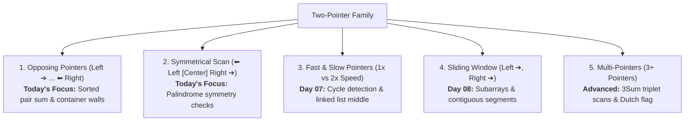

# Day 06: Two Pointers: Opposing & Symmetrical Scans

<nav aria-label="Lecture navigation">

[Previous: Hash Table Patterns: Frequency, Complements & Duplicates](day-05-hash-patterns-frequency-counting-and-duplicates.md) | [Roadmap](../javascript-dsa-roadmap.md) | [Next: Two Pointers: Fast & Slow](day-07-two-pointers-fast-slow-and-partitioning.md)

</nav>

## Prerequisites

- [Day 01: Big O Complexity & Problem Solving](day-01-big-o-complexity-and-problem-solving.md) — Asymptotic bounds ($O(n), O(n^2)$) and the $10^7$ operations rule.
- [Day 02: JavaScript Arrays, Strings & Primitive Memory](day-02-arrays-strings-and-primitive-memory.md) — Contiguous memory, zero-based indexing, and pointer manipulation.

---

## 1. What is the Two-Pointer Technique?

The **Two-Pointer technique** is an algorithmic strategy where two index variables ("pointers") traverse a collection at the same time. Instead of testing all pairs with nested loops ($O(n^2)$), the two pointers converge or scan intelligently based on specific rules to find the answer in a single linear pass ($O(n)$) using zero extra heap memory ($O(1)$).

### The Two-Pointer Family Tree

Before zooming into today's focus, recognize where opposing pointers fit within the 5 core two-pointer patterns:

> **1. Opposing Two Pointers**: Two pointers start at opposite ends (`left = 0`, `right = n - 1`) and move inward toward each other. Used for sorted pairs and boundary containers. *(Today's Primary Focus)*

> **2. Symmetrical Scan**: Two pointers start at the center and expand outward (or start at the ends and converge) to check bilateral symmetry. Used for palindromes. *(Today's Primary Focus)*

> **3. Slow and Fast Pointers**: Also known as Floyd's Tortoise and Hare algorithm. Two pointers move at different speeds (1x vs 2x) to detect cycles or find midpoints. *(Covered in Day 07)*

> **4. Same-Side / Sliding Window**: Both pointers move in the same direction to expand and contract a contiguous window. *(Covered in Days 08 & 09)*

> **5. Multi-Pointer Techniques**: Extensions using 3 or more pointers for k-Sum combinations (3Sum, 4Sum) or 3-way array partitioning. *(Covered in Day 06 & 07)*



### The Opposing Pointers Analogy

Imagine two librarians searching for two numbered books that sum to 100 on a shelf sorted from book #1 to book #99:
- Librarian A stands at the far left (the smallest book: #2).
- Librarian B stands at the far right (the largest book: #99).
- They sum their book numbers: $2 + 99 = 101$.
- 101 is larger than 100. How can they make the sum smaller?
- Because the shelf is sorted, Librarian A cannot help by moving right (that only makes the sum bigger).
- Therefore, Librarian B steps one spot to the left to book #97 ($right--$).
- They check again: $2 + 97 = 99$. Too small! Librarian A steps one spot to the right ($left++$).

```text
Opposing Pointers Convergence:
Index:     0    1    2    3    4    5
Array:  [  2,   7,  11,  15,  19,  28  ], Target = 26
           ▲                            ▲
         left                         right
         (2)                          (28)   Sum = 30 (Too big! right--)

Index:     0    1    2    3    4    5
Array:  [  2,   7,  11,  15,  19,  28  ]
           ▲                   ▲
         left                right
         (2)                 (19)            Sum = 21 (Too small! left++)

Index:     0    1    2    3    4    5
Array:  [  2,   7,  11,  15,  19,  28  ]
                ▲              ▲
              left           right
              (7)            (19)            Sum = 26 (MATCH FOUND!)
```

Neither librarian had to inspect every book. At each step, they threw away an entire row or column of useless pairs without looking at them!

---

## 2. How Opposing Pointers Works

Opposing two-pointer algorithms rely on a monotonic property: moving a pointer in one direction strictly increases or decreases the evaluated metric.

```text
+--------------------------------------------------------------------+
|                      POINTER MOVEMENT RULES                        |
+--------------------------------------------------------------------+
|  Condition                       | Action                          |
+----------------------------------+---------------------------------+
|  Current Sum < Target            | left++  (need larger value)     |
|  Current Sum > Target            | right-- (need smaller value)    |
|  Current Sum === Target          | Found pair! Return [left, right]|
|  left >= right                   | Pointers crossed: No match      |
+--------------------------------------------------------------------+
```

### The Invariant Principle

The loop runs under a strict mathematical contract:
$$\text{Candidate pair } (i, j) \text{ must satisfy } left \le i < j \le right$$

1. If `arr[left] + arr[right] > target`, then `arr[right]` added to *any* element between `left` and `right` will also exceed `target` because `arr[left]` is already the smallest candidate remaining. Therefore, `arr[right]` can never be part of a valid pair. We safely discard it by decrementing `right--`.
2. If `arr[left] + arr[right] < target`, then `arr[left]` added to *any* element between `left` and `right` will also be smaller than `target`. Therefore, `arr[left]` can never be part of a valid pair. We safely discard it by incrementing `left++`.

This mathematical guarantee eliminates $n - 1$ checks on every single pointer movement, reducing total work from $\frac{n(n-1)}{2}$ steps to at most $n$ steps.

### Language-Agnostic Pseudocode

```text
ALGORITHM OpposingTwoPointers(sortedArray, target):
  left  <- 0
  right <- length(sortedArray) - 1

  WHILE left < right DO:
    currentSum <- sortedArray[left] + sortedArray[right]
    IF currentSum == target THEN
      RETURN (left, right)
    ELSE IF currentSum < target THEN
      left <- left + 1
    ELSE
      right <- right - 1
  END WHILE

  RETURN NOT_FOUND
```

---

## 3. Pattern Recognition of Opposing Two Pointers

Spot this pattern in technical screens 
- **Sorted array input:** The problem says "Given a sorted array..." or "Given an array in non-decreasing order...".
- **Pair or triplet search:** Asking for two or three elements that meet a target sum, difference, or condition.
- **Symmetry and palindromes:** Verifying if a string or sequence reads identically forwards and backwards.
- **In-place boundary adjustments:** Containers holding water, trapped rainwater, or bounding boxes.
- **Strict memory limits:** The interviewer demands $O(1)$ auxiliary space, ruling out Hash Maps and Hash Sets.

### Keywords to Look For
- *"Sorted in non-decreasing order"*
- *"Find two numbers such that their sum equals target"*
- *"Valid palindrome / reads the same backward"*
- *"Container with most water / maximum area"*
- *"Find all unique triplets that sum to zero"*


### When NOT to Use Opposing Two Pointers
- **Unsorted array where original indices must be returned:** If sorting costs O(n log n) and destroys the original index order, use an O(n) Hash Map instead.
- **Contiguous subarray sum:** When looking for a contiguous subarray of consecutive elements, moving both ends inward can skip valid contiguous segments. Use Sliding Window or Prefix Sum instead.

---

## 4. Problem 1: Two Sum II

Given an array of integers `numbers` that is already sorted in non-decreasing order, find two numbers such that they add up to a specific `target` number. Return the indices of the two numbers added by one as an integer array `[index1, index2]` of length 2.

- **Example 1:** `numbers = [2, 7, 11, 15]`, `target = 9` $\to$ `[1, 2]`
- **Example 2:** `numbers = [2, 3, 4]`, `target = 6` $\to$ `[1, 3]`
- **Example 3:** `numbers = [-1, 0]`, `target = -1` $\to$ `[1, 2]`
- **Constraints:** $2 \le numbers.length \le 3 \times 10^4$, $-1000 \le numbers[i] \le 1000$, `numbers` is sorted in non-decreasing order. Exactly one valid solution exists.

---

### Step 1: Physical Simulation

Lay numbered tiles in a sorted row on a desk:
`[ 2 | 7 | 11 | 15 ]`, and note `Target = 9`.

1. Place your left finger on `2` (index 0) and your right finger on `15` (index 3).
2. Calculate the sum: $2 + 15 = 17$.
3. 17 is much higher than 9. Because all numbers to the left of 15 are smaller, and 2 is already the smallest possible partner, pairing 15 with *anything* else will only yield sums $\ge 17$. Tile 15 is impossible. Move your right finger left to `11`.
4. Calculate the sum: $2 + 11 = 13$. Still too high! Move your right finger left to `7`.
5. Calculate the sum: $2 + 7 = 9$. Target reached!
6. Convert 0-based indices `[0, 1]` to 1-based indices: `[1, 2]`.

---

### Step 2: Brute Force Approach

Test every combination of pairs using nested loops:

```javascript
// Node.js code
function twoSumIIBruteForce(numbers, target) {
  for (let i = 0; i < numbers.length; i++) {
    for (let j = i + 1; j < numbers.length; j++) {
      if (numbers[i] + numbers[j] === target) {
        return [i + 1, j + 1];
      }
    }
  }
  return [];
}
```

#### Complexity Analysis:
- **Time Complexity:** $O(n^2)$. Checks $\frac{n(n-1)}{2}$ pairs.
- **Space Complexity:** $O(1)$ auxiliary space.
- **Scale Failure:** At $n = 30,000$, operations reach $\approx 4.5 \times 10^8$. In Node.js, this takes ~1.5 seconds, failing interview benchmarks.

---

#### Why not use the brute force?
- It ignores the single most valuable piece of information: **the array is already sorted**.
- When `numbers[0] + numbers[3] = 17 > 9`, brute force still tests `numbers[1] + numbers[3] = 18` and `numbers[2] + numbers[3] = 26`!
- **The Wasted Work:** Calculating pairs that are mathematically guaranteed to be too large.

---

### Step 4: The Pattern Discovery

Because the array is sorted, we can prune thousands of invalid pairs at each comparison:
- If `currentSum > target`, decrement `right`.
- If `currentSum < target`, increment `left`.
- Each step moves one pointer closer. The pointers never backtrack.
- Maximum steps required: $n - 1$.
- Runtime drops from **$O(n^2)$ to $O(n)$** without using any extra memory ($O(1)$ space).

---

### Step 5: Solution using Opposing Two Pointers

```javascript
// ✅ CORRECT: Optimal O(n) time, O(1) space opposing two pointers
function twoSumII(numbers, target) {
  if (!Array.isArray(numbers) || numbers.length < 2) return [];

  let left = 0;
  let right = numbers.length - 1;

  while (left < right) {
    const currentSum = numbers[left] + numbers[right];

    if (currentSum === target) {
      return [left + 1, right + 1]; // Convert to 1-indexed output
    } else if (currentSum < target) {
      left++; // Need a larger value to reach target
    } else {
      right--; // Need a smaller value to reach target
    }
  }

  return []; // No valid pair found
}

// ❌ ANTI-PATTERN: Using a Hash Map on already-sorted input
function twoSumIIHashMapAntiPattern(numbers, target) {
  // WASTEFUL: Allocates O(n) heap memory for Map when O(1) two pointers is available!
  const map = new Map();
  for (let i = 0; i < numbers.length; i++) {
    const complement = target - numbers[i];
    if (map.has(complement)) {
      return [map.get(complement) + 1, i + 1];
    }
    map.set(numbers[i], i);
  }
  return [];
}

// Example runs
console.log(twoSumII([2, 7, 11, 15], 9)); // [1, 2]
console.log(twoSumII([2, 3, 4], 6));       // [1, 3]
console.log(twoSumII([-1, 0], -1));        // [1, 2]
console.log(twoSumII([1, 2, 3, 9], 100));  // []
```

#### Complexity Analysis:
- **Time Complexity:** $O(n)$. In each iteration of the `while` loop, either `left` advances rightward or `right` retreats leftward. The pointers start $n - 1$ steps apart and meet after at most $n$ iterations.
- **Space Complexity:** $O(1)$ auxiliary space. Only two integer index pointers (`left` and `right`) and a sum accumulator are maintained in stack memory.

---

## 5. Problem 2: Container With Most Water

You are given an integer array height of length n. There are n vertical lines drawn such that the two endpoints of the i-th line are (i, 0) and (i, height[i]).
Find two lines that together with the x-axis form a container, such that the container contains the most water. Return the maximum amount of water a container can store.

Notice that you may not slant the container.

- **Example 1:** `height = [1, 8, 6, 2, 5, 4, 8, 3, 7]` $\to$ `49`  
  *(Lines at index 1 (height 8) and index 8 (height 7) hold: $\min(8, 7) \times (8 - 1) = 7 \times 7 = 49$)*
- **Example 2:** `height = [1, 1]` $\to$ `1`
- **Constraints:** $n == height.length$, $2 \le n \le 10^5$, $0 \le height[i] \le 10^4$.

---

### Step 1: Physical Simulation

Imagine vertical wooden planks stuck in sand:
`[ 1, 8, 6, 2, 5, 4, 8, 3, 7 ]`

1. Start by testing the widest possible container: plank at index 0 (height 1) and plank at index 8 (height 7).
2. Width = $8 - 0 = 8$.
3. What is the maximum water height? Water spills out over the shorter plank! $\min(1, 7) = 1$.
4. Area = $8 \times 1 = 8$.
5. How can we find a larger area?
   - Any other container will have a **smaller width** ($< 8$).
   - To get more water despite a smaller width, we **must find a taller constraining height**.
   - The current height is strictly limited by the plank of height 1. Keeping the plank of height 1 while moving the plank of height 7 inward can *only* produce smaller widths with the same or worse height limit ($\le 1$).
   - Therefore, the plank of height 1 has no further potential. Move past it! Advance `left++`.

---

### Step 2: Brute Force Approach

Evaluate the water container area formed by all pairs of lines:

```javascript
// Node.js code
function maxAreaBruteForce(height) {
  let maxWater = 0;
  for (let i = 0; i < height.length; i++) {
    for (let j = i + 1; j < height.length; j++) {
      const currentHeight = Math.min(height[i], height[j]);
      const currentWidth = j - i;
      const area = currentHeight * currentWidth;
      if (area > maxWater) {
        maxWater = area;
      }
    }
  }
  return maxWater;
}
```

#### Complexity Analysis:
- **Time Complexity:** O(n^2). Checks all (n(n-1)/2) line combinations.
- **Space Complexity:** O(1).
- **Scale Failure:** At n = 100,000, operations reach $\approx 5 \times 10^9$. Node.js halts with Time Limit Exceeded.

---

### Step 3: Why not use the brute force?

- The area equation is: $\text{Area} = (right - left) \times \min(height[left], height[right])$.
- As pointers converge inward, $(right - left)$ **always decreases**.
- The only way a smaller width can yield a larger area is if $\min(height[left], height[right])$ **increases**.
- If $height[left] < height[right]$, moving `right` inward reduces width while the height cannot exceed $height[left]$. Every single container formed with this `left` will be smaller than the current container!
- **The Wasted Work:** Testing narrower containers while keeping the shorter bottleneck wall.

---

### Step 4: The Pattern Discovery

- Start with the widest container: `left = 0`, `right = height.length - 1`.
- At every step:
  1. Record the current area.
  2. Identify the shorter wall: $\min(height[left], height[right])$.
  3. **Discard the shorter wall!** Move that pointer inward.
  4. If heights are equal, moving either pointer (or both) is mathematically safe.
- We inspect each wall at most once.
- Work reduces from **$O(n^2)$ to $O(n)$**!

---

### Step 5: Solution using opposing two pointers

```javascript
// ✅ CORRECT: Optimal O(n) time, O(1) space opposing two pointers
function maxArea(height) {
  if (!Array.isArray(height) || height.length < 2) return 0;

  let left = 0;
  let right = height.length - 1;
  let maxWater = 0;

  while (left < right) {
    const width = right - left;
    const leftHeight = height[left];
    const rightHeight = height[right];
    
    // Water height is constrained by the shorter wall
    const containerHeight = leftHeight < rightHeight ? leftHeight : rightHeight;
    const currentArea = width * containerHeight;

    if (currentArea > maxWater) {
      maxWater = currentArea;
    }

    // Always eliminate the shorter boundary
    if (leftHeight < rightHeight) {
      left++;
    } else {
      right--;
    }
  }

  return maxWater;
}

// ❌ ANTI-PATTERN : Moving the taller pointer
function buggyMaxAreaMovingTaller(height) {
  let left = 0;
  let right = height.length - 1;
  let maxWater = 0;

  while (left < right) {
    const width = right - left;
    const area = width * Math.min(height[left], height[right]);
    maxWater = Math.max(maxWater, area);

    // BUG: Moving the taller wall inward shrinks width without enabling height gain!
    if (height[left] > height[right]) {
      left++;
    } else {
      right--;
    }
  }

  return maxWater;
}

// Example runs
console.log(maxArea([1, 8, 6, 2, 5, 4, 8, 3, 7])); // 49
console.log(maxArea([1, 1]));                         // 1
console.log(maxArea([4, 3, 2, 1, 4]));                // 16
console.log(maxArea([1, 2, 1]));                      // 2
```

#### Complexity Derivation:
- **Time Complexity:** $O(n)$. Each step compares heights and strictly moves one pointer closer to the other. Exactly $n - 1$ steps are executed before `left === right`.
- **Space Complexity:** $O(1)$ auxiliary space. Only scalar numbers are allocated in memory.

---

## 6. Hands-On Exercise: Clean Palindrome Validation
An e-commerce backend validates vanity URLs and coupon codes. A junior developer wrote a palindrome validation function that uses `toLowerCase()`, regex cleaning, `split('')`, `reverse()`, and `join('')`. Under load testing with 200,000 requests per minute, the service suffered severe GC pressure and high memory consumption. You must rewrite it to operate in $O(n)$ time with $O(1)$ space using opposing two pointers.

### Buggy Code
```javascript
// Node.js code
function isPalindromeBuggy(s) {
  // ❌ PERFORMANCE BOTTLENECK:
  // 1. toLowerCase() allocates a new string in heap memory.
  // 2. replace() regex allocates another new string.
  // 3. split('') allocates an array of n string pointers.
  // 4. reverse() modifies the array.
  // 5. join('') allocates yet another new string.
  const cleaned = s.toLowerCase().replace(/[^a-z0-9]/g, "");
  return cleaned === cleaned.split("").reverse().join("");
}
```

### Acceptance Criteria
1. Must check palindrome symmetry using opposing two pointers (`left` and `right`).
2. Must ignore non-alphanumeric characters without allocating a cleaned string.
3. Must be case-insensitive.
4. Must operate in **$O(1)$ auxiliary space**.
5. Must execute in under 1 millisecond for strings of length $10^5$.
6. Must pass differential stress-testing against the baseline comparator.

### Verified Solution

```javascript
// ✅ CORRECT: Optimal O(n) time, O(1) space opposing two pointers
function isPalindrome(s) {
  if (typeof s !== "string") return false;

  let left = 0;
  let right = s.length - 1;

  while (left < right) {
    // Skip non-alphanumeric characters on the left
    while (left < right && !isAlphaNumeric(s.charCodeAt(left))) {
      left++;
    }

    // Skip non-alphanumeric characters on the right
    while (left < right && !isAlphaNumeric(s.charCodeAt(right))) {
      right--;
    }

    // Compare characters in a case-insensitive manner
    const leftChar = toLowerCharCode(s.charCodeAt(left));
    const rightChar = toLowerCharCode(s.charCodeAt(right));

    if (leftChar !== rightChar) {
      return false; // Mismatch detected!
    }

    left++;
    right--;
  }

  return true; // Symmetric palindrome confirmed
}

// Helper: Check if character code is 0-9, A-Z, or a-z
function isAlphaNumeric(code) {
  return (
    (code >= 48 && code <= 57) ||  // 0-9
    (code >= 65 && code <= 90) ||  // A-Z
    (code >= 97 && code <= 122)    // a-z
  );
}

// Helper: Convert uppercase ASCII code (A-Z) to lowercase (a-z)
function toLowerCharCode(code) {
  if (code >= 65 && code <= 90) {
    return code + 32;
  }
  return code;
}

// Example runs
console.log(isPalindrome("A man, a plan, a canal: Panama")); // true
console.log(isPalindrome("race a car"));                     // false
console.log(isPalindrome(" "));                              // true
console.log(isPalindrome("0P"));                             // false

// Performance check: 100,000 characters
const largeStr = "a".repeat(50000) + "b" + "a".repeat(50000);
const start = Date.now();
const res = isPalindrome(largeStr);
const duration = Date.now() - start;
console.log(`Checked 100,000 chars in ${duration}ms! Result: ${res}`);

// Differential Stress-Testing Harness (Differential Fuzzing)
function runStressTest(testCount = 500) {
  const characters = "abcdefghijklmnopqrstuvwxyzABCDEFGHIJKLMNOPQRSTUVWXYZ0123456789!@#$%^&*()-_=+[]{}|;:,.<>? ";
  for (let t = 0; t < testCount; t++) {
    const len = Math.floor(Math.random() * 40) + 1;
    let randStr = "";
    for (let c = 0; c < len; c++) {
      randStr += characters[Math.floor(Math.random() * characters.length)];
    }

    const expected = isPalindromeBuggy(randStr);
    const actual = isPalindrome(randStr);

    if (expected !== actual) {
      console.error(`❌ Stress test mismatch on string: "${randStr}"! Expected ${expected}, got ${actual}`);
      return false;
    }
  }
  console.log(`✅ Passed all ${testCount} randomized differential stress tests with zero failures!`);
  return true;
}
runStressTest(500);
```

---

## 7. Tricky Points

### 1. Loop Boundary: `left < right` vs `left <= right`
- In pair search problems (Two Sum II, Container With Most Water), use **`left < right`**. An element cannot be paired with itself at index `left === right`.
- In palindromes with odd lengths (e.g., `"aba"`), the middle element `'b'` at `left === right` does not need to be compared against itself. Using `left < right` stops cleanly.

### 2. Skipping Duplicates in 3Sum
When expanding opposing two pointers to 3-element problems ($3Sum$):
```javascript
// MUST skip duplicate values on both ends after finding a match
while (left < right && nums[left] === nums[left + 1]) left++;
while (left < right && nums[right] === nums[right - 1]) right--;
left++;
right--;
```
Failing to advance pointers past identical numbers produces duplicate triplets in the output.

### 3. Equal Heights in Container With Most Water
If `height[left] === height[right]`, which pointer should move?
- It does not matter! Moving either `left++` or `right--` (or both) is mathematically sound because any future container bounded by either of these two identical walls will have a strictly smaller width and cannot exceed this height.

### 4. Integer Boundary and Safe Numbers in JavaScript
JavaScript stores standard numbers as IEEE 754 64-bit floats. Safe integer arithmetic extends up to `Number.MAX_SAFE_INTEGER` ($2^{53} - 1 \approx 9 \times 10^{15}$). Unlike C++ or Java where adding two large 32-bit signed integers can overflow past $2^{31} - 1$, JavaScript numbers remain exact for typical array element values unless working with `BigInt` or 32-bit bitwise operators (`|`, `&`, `^`).

---


## 8. Cheat Sheet

| Problem Characteristics | Target Complexity | Preferred Technique |
| :--- | :---: | :--- |
| **Array is sorted, find pair summing to $k$** | Time: $O(n)$, Space: $O(1)$ | Opposing Two Pointers (`left++`, `right--`) |
| **Array is unsorted, original indices required** | Time: $O(n)$, Space: $O(n)$ | Hash Map (Day 01) |
| **Symmetry check / Palindrome verification** | Time: $O(n)$, Space: $O(1)$ | Opposing Two Pointers with in-place ASCII filter |
| **Find max area bounded by vertical lines** | Time: $O(n)$, Space: $O(1)$ | Opposing Two Pointers (move shorter wall) |
| **Find unique triplets summing to zero** | Time: $O(n^2)$, Space: $O(1)$ | Sort array ($O(n \log n)$) + outer loop + Opposing Two Pointers |

### Common Pitfalls List
- **The Unsorted Trap:** Applying opposing pointers to an unsorted array without sorting first. The direction rule (`sum < target => left++`) only works when values are in sorted order!
- **The Heap Churn Trap:** Using `.split('').reverse().join('')` for string palindrome checks instead of in-place character code pointers.
- **The Self-Pairing Bug:** Using `left <= right` in Two Sum, allowing an item at index $i$ to add to itself.
- **Duplicate Output in Triplets:** Forgetting to advance past identical elements after recording a valid combination.

### Reusable Opposing Two-Pointer Skeleton

```javascript
function opposingPointersTemplate(sortedArr, target) {
  let left = 0;
  let right = sortedArr.length - 1;

  while (left < right) {
    const metric = sortedArr[left] + sortedArr[right];

    if (metric === target) {
      return [left, right]; // Match found
    } else if (metric < target) {
      left++; // Increase metric
    } else {
      right--; // Decrease metric
    }
  }

  return null; // Target unreachable
}
```

---

## 9. Summary

- **Opposing Two Pointers** maintains two index pointers starting at index `0` and index `n - 1`, moving inward toward each other.
- **Monotonic Pruning:** Every pointer movement permanently eliminates an entire row or column of candidate pairs based on sorted order or height constraints.
- **Complexity Advantage:** Replaces quadratic nested loops ($O(n^2)$) with a single linear pass ($O(n)$) while keeping auxiliary space strictly constant ($O(1)$).
- **V8 Engine Benefits:** Uses primitive integer Smis in CPU registers. Produces zero heap allocations, high L1 cache locality, and zero garbage collector pauses.
- **Event Loop Safety:** Keeps synchronous processing times well under 2ms, preventing event loop blocking in Node.js production servers.
- **System Architecture Alignment:** Powers core systems primitives such as database Sort-Merge Joins and LSM-Tree SSTable compaction sweeps.

---

## 10. Interview Q&A

> *"The Opposing Two-Pointer pattern eliminates quadratic search bottlenecks on sorted or symmetric data structures. By initializing pointers at index 0 and index n - 1 and converging inward based on comparison invariants, we discard an entire subset of invalid states at each step. This achieves an optimal O(n) runtime with strictly O(1) auxiliary space. In Node.js backend systems, this avoids heap allocation, ensures high CPU cache locality, and keeps synchronous event loop lag under one millisecond."*

---

### 1. Why does moving the shorter wall in "Container With Most Water" guarantee we never miss the global maximum?
**Answer:**
The container area is defined by $\text{Width} \times \min(height[left], height[right])$. As pointers move inward, the width $(right - left)$ strictly decreases by at least 1 on every step. If we were to move the taller wall inward, the new width is smaller, while the new height is still bounded by the shorter wall. Therefore, moving the taller wall can *only* produce an area that is strictly smaller than or equal to the current area. The only mathematical possibility of discovering a larger area is to find a wall taller than our current bottleneck, which requires discarding the shorter wall.

---

### 2. When should you choose Two Pointers over a Hash Map for pair-sum problems?
**Answer:**
Choose Two Pointers when:
1. The input array is **already sorted** or can be sorted without violating problem constraints.
2. Space complexity is constrained to **$O(1)$ auxiliary memory** (e.g., embedded devices or high-concurrency Node.js microservices).
Choose a Hash Map when:
1. The input is unsorted and you must preserve original indices in $O(n)$ time.
2. Sorting the array ($O(n \log n)$) would exceed time limits.

---

### 3. What will the following code output, and what is its performance flaw?
```javascript
function checkSymmetry(str) {
  let left = 0;
  let right = str.length - 1;
  while (left < right) {
    if (str[left].toLowerCase() !== str[right].toLowerCase()) {
      return false;
    }
    left++;
    right--;
  }
  return true;
}
console.log(checkSymmetry("Deified"));
```
**Answer:**
It prints `true`.
The performance flaw is calling `.toLowerCase()` on individual characters inside the loop on every iteration. In V8, calling `.toLowerCase()` on single characters creates temporary string objects in the young generation heap, creating garbage collection churn. A senior engineer compares ASCII integer character codes directly: `if (code >= 65 && code <= 90) code += 32;`, which executes entirely in CPU registers with zero heap allocations.

---

### 4. How does an in-place two-pointer algorithm protect Node.js microservices under high load?
**Answer:**
High-concurrency Node.js services often degrade due to **Garbage Collection (GC) pauses**. Methods like `.slice()`, `.split()`, `.map()`, or creating intermediate `new Map()` structures allocate memory on the V8 heap. Under 50,000 requests per second, the V8 Scavenger and Mark-Sweep GC engines freeze the JavaScript execution thread to reclaim memory. An in-place two-pointer algorithm operates strictly on primitive index numbers (Smis) allocated in CPU registers and stack frames, producing **zero heap allocations and zero GC pauses**.

---

## 11. Practice Problems

### 1. Valid Palindrome - Easy
A phrase is a palindrome if, after converting all uppercase letters into lowercase letters and removing all non-alphanumeric characters, it reads the same forward and backward. Implement in $O(n)$ time and $O(1)$ space.
- **Sample Input 1:** `s = "A man, a plan, a canal: Panama"` $\to$ **Expected Output:** `true`
- **Sample Input 2:** `s = "race a car"` $\to$ **Expected Output:** `false`
- **Sample Input 3:** `s = " "` $\to$ **Expected Output:** `true`

#### Socratic Hint Ladder:
- **Hint 1:** Do not allocate a new string using regex or `.split()`. Treat the string as a read-only character sequence.
- **Hint 2:** Use two index pointers `left = 0` and `right = s.length - 1`. If `s[left]` is not alphanumeric, skip it with `left++`. If `s[right]` is not alphanumeric, skip it with `right--`.

---

### 2. 3Sum - Medium
Given an integer array `nums`, return all the triplets `[nums[i], nums[j], nums[k]]` such that `i != j`, `i != k`, and `j != k`, and `nums[i] + nums[j] + nums[k] === 0`. Notice that the solution set must not contain duplicate triplets.
- **Sample Input 1:** `nums = [-1, 0, 1, 2, -1, -4]` $\to$ **Expected Output:** `[ [-1, -1, 2], [-1, 0, 1] ]`
- **Sample Input 2:** `nums = [0, 1, 1]` $\to$ **Expected Output:** `[]`
- **Sample Input 3:** `nums = [0, 0, 0]` $\to$ **Expected Output:** `[ [0, 0, 0] ]`

#### Socratic Hint Ladder:
- **Hint 1 (Sort & Fix):** Sort the array in $O(n \log n)$ time. Fix one element `nums[i]` using an outer loop. Now you need to find two remaining elements such that `nums[left] + nums[right] === -nums[i]`.
- **Hint 2 (Two-Pointer Invariant):** For each `i`, run an opposing two-pointer scan with `left = i + 1` and `right = nums.length - 1`.
- **Hint 3 (Duplicate Elimination):** To avoid duplicate triplets without using a Set, skip duplicates on the outer loop (`if (i > 0 && nums[i] === nums[i - 1]) continue;`), and after finding a valid triplet, advance past identical elements: `while (left < right && nums[left] === nums[left + 1]) left++; while (left < right && nums[right] === nums[right - 1]) right--; left++; right--;`.

---

### 3. Trapping Rain Water - Hard
Given `n` non-negative integers representing an elevation map where the width of each bar is 1, compute how much water it can trap after raining using an opposing two-pointer approach in $O(n)$ time and $O(1)$ space.
- **Sample Input 1:** `height = [0, 1, 0, 2, 1, 0, 1, 3, 2, 1, 2, 1]` $\to$ **Expected Output:** `6`
- **Sample Input 2:** `height = [4, 2, 0, 3, 2, 5]` $\to$ **Expected Output:** `9`
- **Sample Input 3:** `height = [3, 0, 2, 0, 4]` $\to$ **Expected Output:** `7`

#### Socratic Hint Ladder:
- **Hint 1 (Physical Bottleneck):** At any given bar `i`, the water volume standing above `i` is strictly determined by: $\min(\text{maxLeftWall}, \text{maxRightWall}) - height[i]$.
- **Hint 2 (Monotonic Pruning):** Start with `left = 0` and `right = height.length - 1`. Maintain two trackers: `leftMax` and `rightMax`. If `height[left] < height[right]`, the left boundary is the constraining bottleneck. Any taller wall to the right does not change the fact that water is bounded by `leftMax`.
- **Hint 3 (State Transition):** If `height[left] < height[right]`: if `height[left] >= leftMax`, update `leftMax = height[left]`; else, accumulate `water += leftMax - height[left]`; then `left++`. Symmetrically apply this rule to `right--` when `height[right] <= height[left]`.

---

<nav aria-label="Lecture navigation">

[Previous: Hash Table Patterns: Frequency, Complements & Duplicates](day-05-hash-patterns-frequency-counting-and-duplicates.md) | [Roadmap](../javascript-dsa-roadmap.md) | [Next: Two Pointers: Fast & Slow](day-07-two-pointers-fast-slow-and-partitioning.md)

</nav>
