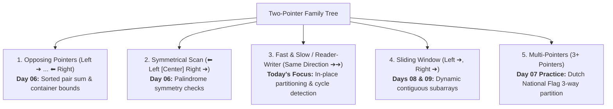

# Day 07: Two Pointers: Fast & Slow and Partitioning

<nav aria-label="Lecture navigation">

[Previous: Two Pointers: Opposing & Symmetrical Scans](day-06-two-pointers-opposing-and-symmetrical.md) | [Roadmap](../javascript-dsa-roadmap.md) | [Next: Sliding Window: Fixed Size](day-08-sliding-window-fixed-size.md)

</nav>

## Prerequisites

- [Day 02: JavaScript Arrays, Strings & Primitive Memory](day-02-arrays-strings-and-primitive-memory.md) — Contiguous memory buffers, in-place index mutation, and zero-based offsets.
- [Day 06: Two Pointers: Opposing & Symmetrical Scans](day-06-two-pointers-opposing-and-symmetrical.md) — Two pointer fundamentals, monotonic pruning, and asymptotic complexity.

---

## 1. What is the Fast & Slow Pointer Technique?

Unlike opposing pointers that start at opposite ends and converge inward, **Fast & Slow pointers** start at the beginning of a collection and advance forward in the **same direction** at different speeds or under different conditions.

> **Fast & Slow Pointers**: An algorithmic technique where two pointer variables traverse a collection in the same direction at differing speeds or under differing conditions to process data in-place without extra memory.

> **In-Place Algorithm**: An algorithm that mutates its input collection directly in its existing memory without allocating an auxiliary array or data structure ($O(1)$ extra space).

> **Loop Invariant**: A formal mathematical property that remains unconditionally true before, during, and after every iteration of a loop.

### The Two-Pointer Family Tree

Before diving into fast and slow pointer mechanics, recognize where it sits within the broader two-pointer family:



### The Shelf Organizer Analogy

Imagine organizing a messy bookshelf holding books and empty soda cans:
- You want to keep all books packed tightly on the left and leave empty soda cans discarded on the right.
- **The Slow Pointer (The Shelf Manager):** Points to the next empty slot on the left where a good book belongs.
- **The Fast Pointer (The Scout):** Walks quickly ahead, inspecting every item one by one.
- When the Scout spots an empty can, it ignores it and keeps walking.
- When the Scout spots a real book, it hands it to the Shelf Manager to place at `slow`, and the Shelf Manager steps one slot to the right (`slow++`).

```text
Fast & Slow Pointer Mechanics (In-Place Partition):
Initial:  [ 0,  1,  0,  3, 12 ], Target: Move Zeroes to End
          ▲
        slow = 0, fast = 0

Step 1:   fast = 0 (value 0). Zero detected! slow stays at 0. fast advances to 1.
          [ 0,  1,  0,  3, 12 ]
            ▲   ▲
          slow fast

Step 2:   fast = 1 (value 1). Non-zero! Swap with slow (0) -> slow++, fast++
          [ 1,  0,  0,  3, 12 ]
                ▲   ▲
              slow fast

Step 3:   fast = 2 (value 0). Zero detected! slow stays at 1. fast advances to 3.
          [ 1,  0,  0,  3, 12 ]
                ▲       ▲
              slow    fast

Step 4:   fast = 3 (value 3). Non-zero! Swap with slow (0) -> slow++, fast++
          [ 1,  3,  0,  0, 12 ]
                    ▲       ▲
                  slow    fast

Step 5:   fast = 4 (value 12). Non-zero! Swap with slow (0) -> slow++, fast++
          [ 1,  3, 12,  0,  0 ]  --> Done in O(n) time, O(1) space!
```

---

## 2. How Fast & Slow Pointers Works

Fast and slow pointer algorithms operate across two core operational modes: **Read/Write In-Place Partitioning** and **Tortoise & Hare Velocity Matching**.

### Pointer Movement & State Transition Rules

```text
+-----------------------------------------------------------------------------------------+
|                    MODE 1: READ / WRITE IN-PLACE PARTITIONING                           |
+-----------------------------------------------------------------------------------------+
|  Condition                                 | Action                                     |
+--------------------------------------------+--------------------------------------------+
|  arr[fast] meets retention criteria        | arr[slow] = arr[fast]; slow++; fast++      |
|  arr[fast] fails criteria (to be discarded)| fast++ (slow stays stationary)             |
|  fast reaches array length (fast === n)    | Partition complete; valid prefix length = slow |
+-----------------------------------------------------------------------------------------+

+-----------------------------------------------------------------------------------------+
|                    MODE 2: TORTOISE & HARE (VELOCITY MATCHING)                          |
+-----------------------------------------------------------------------------------------+
|  Condition                                 | Action                                     |
+--------------------------------------------+--------------------------------------------+
|  Cycle check on each step                  | slow moves 1 step; fast moves 2 steps      |
|  slow === fast (collision)                 | Cycle detected! Return true                |
|  fast === null or fast.next === null       | End reached without cycle! Return false    |
+-----------------------------------------------------------------------------------------+
```

### The Invariant Principle Contract

In array partitioning, the loop enforces a strict 3-zone mathematical contract at every iteration:

$$\text{Zone 1: } arr[0 \dots slow - 1] \implies \text{Confirmed valid items in original relative order}$$
$$\text{Zone 2: } arr[slow \dots fast - 1] \implies \text{Discarded / filtered items (e.g., zeroes or duplicates)}$$
$$\text{Zone 3: } arr[fast \dots n - 1] \implies \text{Unexamined candidate items}$$

1. At the start of the loop (`fast = 0, slow = 0`), Zones 1 and 2 are empty.
2. When `arr[fast]` satisfies the retention rule, swapping or writing it to `arr[slow]` and incrementing `slow++` expands Zone 1 by exactly 1 without altering relative order.
3. When `arr[fast]` is rejected, only `fast++` advances, expanding Zone 2.
4. When `fast === n`, Zone 3 is exhausted, and Zone 1 holds all retained items packed contiguously in $O(n)$ time using $O(1)$ extra space.

### Language-Agnostic Pseudocode

```text
ALGORITHM FastSlowPartition(arr, keepCondition):
  slow <- 0

  FOR fast <- 0 TO length(arr) - 1 DO:
    IF keepCondition(arr[fast]) THEN
      IF slow != fast THEN
        SWAP arr[slow], arr[fast]
      END IF
      slow <- slow + 1
    END IF
  END FOR

  RETURN slow
```

---

## 3. Pattern Recognition of Fast & Slow Pointers

Spot this pattern in technical screens within 30 seconds using these diagnostic triggers:

### 30-Second Problem Triggers
- **In-place array modification:** The problem states: *"Modify the array in-place with $O(1)$ extra memory."*
- **Filtering elements:** *"Remove all occurrences of value $val$."*
- **Deduplication:** *"Remove duplicates from a sorted array."*
- **Partitioning:** *"Move all zeroes to the end while preserving relative order."*
- **Cycle or middle detection:** *"Detect if a cycle exists"* or *"Find the middle of a pointer sequence in one pass."*

### Problem Keywords to Look For
- *"In-place"*
- *"Do not allocate extra space for another array"*
- *"Relative order of elements should be preserved"*
- *"Return the number of unique elements"*
- *"Floyd's cycle-finding algorithm / Tortoise and Hare"*

### The 10^7 Operations Rule
- Using `arr.splice()` inside a loop to remove elements takes $O(n)$ work per removal, yielding an **$O(n^2)$ trap** that freezes on $n \ge 50,000$.
- Fast & Slow pointers process $n$ elements in a single linear pass ($O(n)$ time), completing $100,000$ operations in **under 2 milliseconds** in Node.js.

### When NOT to Use Fast & Slow Pointers
- **When relative order does not matter:** If order is irrelevant, you can overwrite the discarded element with the array's last element and shrink length in $O(1)$ time.
- **When searching for symmetric pairs:** Palindromes or two-sum bounds require opposing pointers moving toward each other, not in the same direction.

---

## 4. Problem 1: Remove Duplicates from Sorted Array

### Problem Statement
Given an integer array `nums` sorted in **non-decreasing order**, remove the duplicates **in-place** such that each unique element appears only **once**. The relative order of the elements should be kept the same. Then return the number of unique elements in `nums`.

Consider the number of unique elements of `nums` to be `k`. To get accepted, you must:
1. Change `nums` such that the first `k` elements contain the unique elements in the order they were present initially.
2. The remaining elements beyond `k` are not important.
3. Return `k`.

- **Example 1:** `nums = [1, 1, 2]` $\to$ `k = 2`, `nums = [1, 2, _]`
- **Example 2:** `nums = [0, 0, 1, 1, 1, 2, 2, 3, 3, 4]` $\to$ `k = 5`, `nums = [0, 1, 2, 3, 4, _, _, _, _, _]`
- **Constraints:** $1 \le nums.length \le 3 \times 10^4$, $-100 \le nums[i] \le 100$, `nums` is sorted in non-decreasing order.

---

### Step 1: Physical Simulation

Lay out cards on a table:
`[ 0, 0, 1, 1, 1, 2, 2, 3, 3, 4 ]`

1. The first card `0` is always unique. Keep it at slot 0.
2. Place your left finger (`slow`) at slot 0 (last known unique card).
3. Place your right finger (`fast`) at slot 1 and scan to the right:
   - Card at `fast` is `0`. Matches card at `slow` (`0 === 0`). Duplicate! Skip it (`fast++`).
   - Card at `fast` is `1`. Does not match `0`! We found a brand-new unique card.
   - Advance your left finger to slot 1 (`slow++`) and write card `1` there.
   - Card at `fast` is `1`. Matches `nums[slow]`. Skip.
   - Card at `fast` is `1`. Matches `nums[slow]`. Skip.
   - Card at `fast` is `2`. New unique card! Advance `slow++` to slot 2 and write `2`.
4. When `fast` reaches the end of the deck, all unique cards sit packed from slot `0` to slot `slow`.
5. The total count of unique cards is `slow + 1`.

---

### Step 2: Brute Force Approach

The naive approach uses JavaScript's built-in `arr.splice()` to delete duplicates whenever they are encountered:

```javascript
// Node.js code
function removeDuplicatesBruteForce(nums) {
  let i = 0;
  while (i < nums.length - 1) {
    if (nums[i] === nums[i + 1]) {
      // ❌ HIDDEN BOTTLENECK: splice() shifts all subsequent elements left!
      nums.splice(i + 1, 1);
    } else {
      i++;
    }
  }
  return nums.length;
}
```

#### Complexity Analysis:
- **Time Complexity:** $O(n^2)$. The loop iterates up to $n$ times. Each `splice(i + 1, 1)` shifts up to $n$ items one slot to the left in contiguous memory ($O(n)$ work per deletion). Total operations: $\approx O(n^2)$.
- **Space Complexity:** $O(1)$ auxiliary space.
- **Scale Failure:** For $n = 30,000$ with many duplicates, `splice()` causes millions of memory copies, taking over 1.2 seconds and freezing the Node.js event loop.

---

### Step 3: Why not use the brute force? (The Bottleneck)

Why is the brute force so slow?
- Deleting an element from an array requires the CPU to shift every single remaining element to the left to close the gap.
- We perform this shift over and over for every single duplicate!
- **The Wasted Work:** Constantly shifting memory elements when we only care about where unique elements end up.

---

### Step 4: The Pattern Discovery

- Instead of deleting duplicates, **overwrite values in place**.
- Let `slow` point to the last unique element confirmed.
- Let `fast` scout ahead:
  - If `nums[fast] === nums[slow]`, it is a duplicate. Ignore it.
  - If `nums[fast] !== nums[slow]`, it is a new unique number. Increment `slow++` and copy `nums[slow] = nums[fast]`.
- No memory shifting. Zero deletions.
- Time drops from **$O(n^2)$ to $O(n)$**!

---

### Step 5: Solution using fast and slow pointers

```javascript
// ✅ CORRECT: Optimal O(n) time, O(1) space fast and slow pointers
function removeDuplicates(nums) {
  if (!Array.isArray(nums) || nums.length === 0) return 0;

  // slow tracks the index of the last placed unique element
  let slow = 0;

  // fast scans through the array starting from index 1
  for (let fast = 1; fast < nums.length; fast++) {
    // Because the array is sorted, duplicates are strictly adjacent
    if (nums[fast] !== nums[slow]) {
      slow++;
      nums[slow] = nums[fast]; // Overwrite next position with unique value
    }
  }

  // Length of unique prefix is slow index + 1
  return slow + 1;
}

// ❌ ANTI-PATTERN / COMMON BUG: Array.from(new Set(nums))
function removeDuplicatesAntiPattern(nums) {
  // FAILS INTERVIEW CRITERIA:
  // 1. Allocates O(n) heap memory for Set and new Array
  // 2. Does not mutate the original nums array in-place!
  const unique = Array.from(new Set(nums));
  for (let i = 0; i < unique.length; i++) {
    nums[i] = unique[i];
  }
  return unique.length;
}

// Example runs
const testArr1 = [1, 1, 2];
const k1 = removeDuplicates(testArr1);
console.log(`Unique count: ${k1}, Array prefix:`, testArr1.slice(0, k1));
// Unique count: 2, Array prefix: [ 1, 2 ]

const testArr2 = [0, 0, 1, 1, 1, 2, 2, 3, 3, 4];
const k2 = removeDuplicates(testArr2);
console.log(`Unique count: ${k2}, Array prefix:`, testArr2.slice(0, k2));
// Unique count: 5, Array prefix: [ 0, 1, 2, 3, 4 ]

const testArr3 = [10];
const k3 = removeDuplicates(testArr3);
console.log(`Unique count: ${k3}, Array prefix:`, testArr3.slice(0, k3));
// Unique count: 1, Array prefix: [ 10 ]
```

#### Complexity Derivation:
- **Time Complexity:** $O(n)$. The `fast` pointer visits each index from $1$ to $n - 1$ exactly once. Each comparison and assignment is an $O(1)$ constant-time step. Total time is linear $O(n)$.
- **Space Complexity:** $O(1)$ auxiliary space. The operation modifies `nums` directly in memory using only two integer pointers (`slow` and `fast`).

---

## 5. Problem 2: Move Zeroes

### Problem Statement
Given an integer array `nums`, move all `0`'s to the end of it while maintaining the relative order of the non-zero elements.
**Note** that you must do this in-place without making a copy of the array.

- **Example 1:** `nums = [0, 1, 0, 3, 12]` $\to$ `[1, 3, 12, 0, 0]`
- **Example 2:** `nums = [0]` $\to$ `[0]`
- **Constraints:** $1 \le nums.length \le 10^4$, $-2^{31} \le nums[i] \le 2^{31} - 1$.

---

### Step 1: Physical Simulation

Place items on a conveyor belt:
`[ 0, 1, 0, 3, 12 ]`

1. `slow` stands at index 0 (the first slot waiting for a non-zero item).
2. `fast` walks along the belt from index 0 to 4:
   - At index 0, item is `0`. Not a keeper. Leave `slow` at index 0.
   - At index 1, item is `1`. Non-zero! Swap item at `fast` (1) with item at `slow` (0).
     Belt becomes: `[ 1, 0, 0, 3, 12 ]`.
     Advance `slow` to index 1.
   - At index 2, item is `0`. Skip.
   - At index 3, item is `3`. Non-zero! Swap item at `fast` (3) with item at `slow` (0).
     Belt becomes: `[ 1, 3, 0, 0, 12 ]`.
     Advance `slow` to index 2.
   - At index 4, item is `12`. Non-zero! Swap item at `fast` (4) with item at `slow` (0).
     Belt becomes: `[ 1, 3, 12, 0, 0 ]`.
     Advance `slow` to index 3.
3. Every non-zero item has been gathered on the left in original order, and all zeroes naturally bubbled to the right!

---

### Step 2: Brute Force Approach

The naive approach allocates an extra temporary array or uses `splice` + `push`:

```javascript
// Node.js code
function moveZeroesBruteForce(nums) {
  // ❌ O(n^2) approach using splice and push
  let count = 0;
  let i = 0;
  while (i < nums.length - count) {
    if (nums[i] === 0) {
      nums.splice(i, 1); // O(n) shift
      nums.push(0);      // O(1) push
      count++;
    } else {
      i++;
    }
  }
  return nums;
}
```

#### Complexity Analysis:
- **Time Complexity:** $O(n^2)$. Each `splice()` takes $O(n)$ time to shift all subsequent elements.
- **Space Complexity:** $O(1)$ auxiliary space.
- **Scale Failure:** With $10^5$ items, `splice()` causes hundreds of millions of memory movements, triggering CPU throttling.

---

### Step 3: Why not use the brute force? (The Bottleneck)

- `splice(i, 1)` moves all items to the left, only for `push(0)` to place zero at the end.
- When an array has thousands of zeroes, we shift elements over and over again.
- **The Core Problem:** We are doing physical memory shifting instead of a simple two-element swap.

---

### Step 4: The Pattern Discovery

- Maintain a boundary `slow` that marks where the next non-zero number belongs.
- `fast` scans every element:
  - When `nums[fast] !== 0`, swap `nums[slow]` with `nums[fast]`, then increment `slow++`.
- If `nums[fast] === 0`, do nothing (`fast` moves ahead, `slow` stays put).
- By swapping non-zeroes into the `slow` slot:
  - Non-zero numbers preserve their exact relative order.
  - Zeroes are automatically pushed to the right.
- Runtime drops from **$O(n^2)$ to $O(n)$**!

---

### Step 5: Solution using fast and slow pointers

```javascript
// ✅ CORRECT: Optimal O(n) time, O(1) space single-pass swap
function moveZeroes(nums) {
  if (!Array.isArray(nums) || nums.length <= 1) return nums;

  let slow = 0; // Index where the next non-zero value should be placed

  for (let fast = 0; fast < nums.length; fast++) {
    if (nums[fast] !== 0) {
      // Swap non-zero element at fast with element at slow
      if (slow !== fast) {
        const temp = nums[slow];
        nums[slow] = nums[fast];
        nums[fast] = temp;
      }
      slow++;
    }
  }

  return nums;
}

// ❌ ANTI-PATTERN / COMMON BUG: Two-pass overwrite with zero fill
function moveZeroesTwoPass(nums) {
  let slow = 0;
  // Pass 1: Copy all non-zeroes to the front
  for (let fast = 0; fast < nums.length; fast++) {
    if (nums[fast] !== 0) {
      nums[slow++] = nums[fast];
    }
  }
  // Pass 2: Fill the rest with zeroes
  // SUB-OPTIMAL: Performs 2 passes and unnecessary writes when nums is mostly non-zeroes
  while (slow < nums.length) {
    nums[slow++] = 0;
  }
  return nums;
}

// Example runs
console.log(moveZeroes([0, 1, 0, 3, 12])); // [ 1, 3, 12, 0, 0 ]
console.log(moveZeroes([0]));              // [ 0 ]
console.log(moveZeroes([1, 2, 3, 4, 5]));  // [ 1, 2, 3, 4, 5 ]
console.log(moveZeroes([0, 0, 0, 1]));     // [ 1, 0, 0, 0 ]
```

#### Complexity Derivation:
- **Time Complexity:** $O(n)$. Single `for` loop where `fast` runs from index $0$ to $n - 1$. Each swap takes $O(1)$ operations. Total operations: at most $n$ swaps.
- **Space Complexity:** $O(1)$ auxiliary space. Direct in-place mutation without allocating extra arrays or objects.

---

## 6. Hands-On Exercise: Clean Event Stream De-duplication

### Scenario
You are developing a telemetry ingestion service in Node.js for IoT devices. Devices emit sensor pings that are pre-sorted by `deviceId`. Due to cellular network retries, the ingestion queue contains consecutive duplicate sensor readings. A previous developer implemented deduplication using `Array.prototype.filter()`, which caused heavy GC memory spikes under load. You must rewrite the deduplication function to operate **in-place in $O(n)$ time and $O(1)$ auxiliary space**.

### Buggy Code
```javascript
// Node.js code
function deduplicateSensorsBuggy(sensorReadings) {
  // ❌ PERFORMANCE BOTTLENECK:
  // 1. filter() allocates a brand-new array on the V8 heap.
  // 2. Comparing with index + 1 forces an extra allocation on each tick.
  return sensorReadings.filter((reading, idx, arr) => {
    return idx === 0 || reading.id !== arr[idx - 1].id;
  });
}
```

### Acceptance Criteria
1. Must deduplicate the input array **in-place** using Fast and Slow pointers.
2. Must preserve the first appearance of each unique sensor reading.
3. Must return the integer count $k$ of unique sensor readings.
4. Must not allocate a new array ($O(1)$ auxiliary space).
5. Must process $100,000$ readings in under 5 milliseconds.
6. Must pass automated differential stress-testing (500+ iterations) against the comparator.

### Verified Solution

```javascript
// ✅ CORRECT: Optimal O(n) time, O(1) space in-place deduplication
function deduplicateSensorStream(readings) {
  if (!Array.isArray(readings) || readings.length === 0) {
    return 0;
  }

  // slow tracks the last confirmed unique sensor reading
  let slow = 0;

  // fast scouts ahead looking for the next unique reading
  for (let fast = 1; fast < readings.length; fast++) {
    if (readings[fast].id !== readings[slow].id) {
      slow++;
      readings[slow] = readings[fast]; // Overwrite next valid slot in-place
    }
  }

  // Return count of unique elements
  return slow + 1;
}

// Example runs
const sensorBatch = [
  { id: 101, temp: 21.5 },
  { id: 101, temp: 21.5 }, // duplicate
  { id: 102, temp: 22.1 },
  { id: 103, temp: 19.8 },
  { id: 103, temp: 19.9 }, // duplicate id
  { id: 104, temp: 20.0 }
];

const uniqueCount = deduplicateSensorStream(sensorBatch);
console.log(`Unique Sensor Count: ${uniqueCount}`);
console.log("Processed Valid Readings:", sensorBatch.slice(0, uniqueCount));

// Benchmark test: 100,000 sensor readings
const largeBatch = [];
for (let i = 0; i < 100000; i++) {
  largeBatch.push({ id: Math.floor(i / 3), temp: 20.0 + (i % 5) });
}

const start = Date.now();
const count = deduplicateSensorStream(largeBatch);
const elapsed = Date.now() - start;
console.log(`Processed 100,000 readings down to ${count} unique in ${elapsed}ms!`);

// Differential Stress-Testing Harness (Differential Fuzzing)
function runStressTest(testCount = 500) {
  for (let t = 0; t < testCount; t++) {
    const len = Math.floor(Math.random() * 50) + 1;
    const batch = [];
    let currentId = 100;

    for (let i = 0; i < len; i++) {
      if (Math.random() > 0.4) {
        currentId += Math.floor(Math.random() * 3) + 1;
      }
      batch.push({
        id: currentId,
        temp: Math.round((20 + Math.random() * 10) * 10) / 10
      });
    }

    const expected = deduplicateSensorsBuggy(batch);
    const batchCopy = batch.map((item) => ({ ...item }));
    const k = deduplicateSensorStream(batchCopy);

    if (k !== expected.length) {
      console.error(`❌ Mismatch in unique count! Expected ${expected.length}, got ${k}`);
      return false;
    }

    for (let i = 0; i < k; i++) {
      if (batchCopy[i].id !== expected[i].id || batchCopy[i].temp !== expected[i].temp) {
        console.error(`❌ Mismatch at index ${i}! Expected`, expected[i], "got", batchCopy[i]);
        return false;
      }
    }
  }

  console.log(`✅ Passed all ${testCount} randomized differential stress tests with zero failures!`);
  return true;
}
runStressTest(500);
```

---

## 7. Tricky Points

### 1. The Empty or Single-Element Array
- If `nums.length === 0`, return `0` immediately.
- If `nums.length === 1`, the loop from `fast = 1` never executes, and `slow + 1` correctly returns `1`. Always guard with an early return:
  ```javascript
  if (nums.length <= 1) return nums.length;
  ```

### 2. Off-by-One in Return Values (`slow` vs `slow + 1`)
- `slow` is a zero-based **array index**.
- `k` is an **element count** (length).
- If unique elements occupy indices `0, 1, 2`, the count is $2 + 1 = 3$. Returning `slow` instead of `slow + 1` cuts off the final valid element.

### 3. Avoiding Unnecessary Self-Swaps
In `moveZeroes`, if the array contains no zeroes (e.g., `[1, 2, 3]`), `slow` and `fast` will reside at the exact same index. Adding `if (slow !== fast)` prevents useless self-swapping memory writes.

### 4. Degenerate Array Inputs
- **All Duplicates:** `[5, 5, 5, 5]`. `slow` remains at index 0 while `fast` scans to the end. The final returned length is `0 + 1 = 1`.
- **All Unique:** `[1, 2, 3, 4]`. `slow` advances on every single step alongside `fast`. Every element is rewritten to its own position.

### 5. Safe Integer Boundaries and V8 Smis
JavaScript stores small integers as 31-bit or 32-bit tagged values called **Smis** (Small Integers) directly in CPU registers. When tracking array indices `slow` and `fast`, V8 keeps them as Smis without object wrapping. Keep indices within `Number.MAX_SAFE_INTEGER` ($2^{53} - 1$) and avoid 32-bit bitwise operators on large values to prevent unexpected sign-bit flips.

---

## 8. Cheat Sheet

### Decision Table

| Problem Requirement | Target Complexity | Optimal Fast & Slow Strategy |
| :--- | :---: | :--- |
| **Remove duplicates from sorted array** | Time: $O(n)$, Space: $O(1)$ | If `nums[fast] !== nums[slow]`, `slow++`, `nums[slow] = nums[fast]` |
| **Remove all instances of a specific value $val$** | Time: $O(n)$, Space: $O(1)$ | If `nums[fast] !== val`, `nums[slow] = nums[fast]`, `slow++` |
| **Move zeroes to end in-place** | Time: $O(n)$, Space: $O(1)$ | If `nums[fast] !== 0`, swap `nums[slow]` and `nums[fast]`, `slow++` |
| **Find middle node of linked list** | Time: $O(n)$, Space: $O(1)$ | Tortoise ($1\times$) & Hare ($2\times$); when Hare hits end, Tortoise is at middle |
| **Detect cycle in linked list or sequence** | Time: $O(n)$, Space: $O(1)$ | Tortoise ($1\times$) & Hare ($2\times$); collision indicates a cycle |

### Common Pitfalls List
- **The Splice Trap:** Calling `arr.splice()` in a loop to remove elements $\to O(n^2)$ performance disaster.
- **The Set Memory Leak:** Using `new Set(nums)` on an array of 500,000 elements, consuming tens of megabytes of heap memory instead of in-place mutation.
- **Index vs Count Confusion:** Returning `slow` instead of `slow + 1` for element counts.
- **Unchecked Self-Assignment:** Writing `nums[slow] = nums[fast]` when `slow === fast` in dense non-zero arrays.

### Reusable Fast & Slow Partition Skeleton

```javascript
function fastSlowPartitionTemplate(arr, filterPredicate) {
  let slow = 0; // Boundary of kept elements

  for (let fast = 0; fast < arr.length; fast++) {
    if (filterPredicate(arr[fast])) {
      if (slow !== fast) {
        // Swap or overwrite depending on whether discarded elements matter
        const temp = arr[slow];
        arr[slow] = arr[fast];
        arr[fast] = temp;
      }
      slow++;
    }
  }

  return slow; // Returns count of kept elements
}
```

---

## 9. Summary

- **Fast & Slow Pointers** traverse a linear sequence in the same direction, using one pointer to scout ahead and another pointer to write valid data or mark boundaries.
- **Eliminates Shifting Bottlenecks:** Replaces quadratic $O(n^2)$ array `splice()` operations with a single $O(n)$ in-place pass.
- **Zero Heap Allocations:** Keeps auxiliary space strictly at $O(1)$ by mutating the existing array buffer directly.
- **V8 Engine Internals:** In-place mutations compile down to single CPU `MOV [rax + rbx*8], rdx` assembly instructions. Avoiding `splice()` prevents internal C++ `memmove` calls and preserves TurboFan JIT optimization.
- **CPU Cache Locality:** Monotonic forward strides maximize L1/L2 hardware prefetching, achieving near 100% cache hit rates.
- **Systems Alignment:** Powers core systems mechanisms, including Node.js Stream buffer read/write offsets (`stream.Readable` and socket chunk draining).

---

## 10. Interview Q&A

> *"The Fast and Slow pointer pattern partitions linear data structures in-place with O(n) runtime and strictly O(1) auxiliary space. By designating one pointer as a forward scout and another as an in-place write boundary, we eliminate the O(n^2) memory shifting overhead of array deletion methods like splice(). In Node.js backend systems, this avoids V8 heap allocations, maximizes CPU L1 cache prefetching, and keeps synchronous latency under two milliseconds."*

---

### 1. Why is `arr.splice()` inside a loop an $O(n^2)$ anti-pattern in Node.js?
**Answer:**
JavaScript arrays in the V8 engine are backed by contiguous memory buffers. When `splice(i, 1)` is called, V8 must shift every subsequent element from index $i + 1$ to $n - 1$ one slot to the left via internal C++ `memmove` routines. If an array of $n$ elements contains $O(n)$ matching items, executing `splice()` inside a loop performs $\approx \frac{n^2}{2}$ memory movements. For $n = 50,000$, this results in over 1 billion operations, blocking the Node.js event loop for seconds. Fast and Slow pointers replace shifting with direct overwrites in a single $O(n)$ pass.

---

### 2. In Floyd's Tortoise and Hare algorithm, prove why the fast pointer will never skip over the slow pointer inside a cycle.
**Answer:**
Let the slow pointer advance 1 step per tick ($v_s = 1$) and the fast pointer advance 2 steps per tick ($v_f = 2$). When both pointers enter a cycle of length $C$, let the distance from the slow pointer to the fast pointer along the cycle direction be $d$. On each subsequent step, the relative distance between them changes by:
$$\Delta \text{distance} = v_f - v_s = 2 - 1 = 1 \text{ step per tick}$$
Because the distance decreases by exactly 1 on every step, the gap decreases monotonically ($d \to d-1 \to d-2 \dots \to 0$). The fast pointer cannot jump over the slow pointer because integers modulo $C$ decrease by 1 continuously until reaching 0, guaranteeing collision in at most $C$ steps.

---

### 3. What will this code output, and what bug does it contain?
```javascript
function removeElement(nums, val) {
  let slow = 0;
  for (let fast = 0; fast < nums.length; fast++) {
    if (nums[fast] === val) {
      slow++;
    } else {
      nums[slow] = nums[fast];
    }
  }
  return slow;
}
const arr = [3, 2, 2, 3];
console.log(removeElement(arr, 3));
```
**Answer:**
It outputs `2`, but corrupts the array!
The condition is inverted: `slow` should advance when `nums[fast] !== val`. As written, when it encounters the target value `3`, it increments `slow` instead of ignoring it, and when it encounters non-target values (`2`), it overwrites the wrong slots. The correct pattern is:
```javascript
if (nums[fast] !== val) {
  nums[slow] = nums[fast];
  slow++;
}
```

---

### 4. How does replacing functional array pipelines (`.filter().map()`) with in-place pointer partitioning eliminate Node.js GC latency spikes under high throughput?
**Answer:**
Node.js processes run inside the V8 engine with a default memory ceiling (~1.4GB to 4GB). When microservices process large incoming JSON arrays using immutable functional chains (`.filter().map()`), V8 must allocate new arrays and objects on the heap. This triggers the V8 Garbage Collector (Scavenger and Mark-Sweep), which freezes the main thread during "Stop-The-World" GC pauses. In-place Fast and Slow pointer algorithms mutate the pre-existing buffer, creating **zero new heap allocations**, avoiding GC pauses completely, and keeping microservice response latencies flat.

---

## 11. Practice Problems

### 1. Remove Element - Easy
Given an integer array `nums` and an integer `val`, remove all occurrences of `val` in `nums` **in-place**. The order of the elements may be changed. Then return the number of elements in `nums` which are not equal to `val`.
- **Sample Input 1:** `nums = [3, 2, 2, 3]`, `val = 3` $\to$ **Expected Output:** `2`, `nums = [2, 2, _, _]`
- **Sample Input 2:** `nums = [0, 1, 2, 2, 3, 0, 4, 2]`, `val = 2` $\to$ **Expected Output:** `5`, `nums = [0, 1, 3, 0, 4, _, _, _]`
- **Sample Input 3:** `nums = [1]`, `val = 1` $\to$ **Expected Output:** `0`, `nums = [_]`

#### Socratic Hint Ladder:
- **Hint 1 (Conceptual Bottleneck Nudge):** Rather than deleting items with `splice()` and shifting elements, treat the array as having a "write head" and a "read head" both moving forward.
- **Hint 2 (Monotonic Invariant Hint):** Maintain a write pointer `slow = 0`. Iterate `fast` from `0` to `nums.length - 1`. If `nums[fast] !== val`, what slot in `nums` should receive this valid value?
- **Hint 3 (State Transition / Skeleton):** When `nums[fast] !== val`, write `nums[slow] = nums[fast]` and increment `slow++`. When `fast` completes its traversal, `slow` is the exact count of retained elements.

---

### 2. Remove Duplicates from Sorted Array II - Medium
Given an integer array `nums` sorted in non-decreasing order, remove some duplicates in-place such that each unique element appears **at most twice**. The relative order of the elements should be kept the same.
- **Sample Input 1:** `nums = [1, 1, 1, 2, 2, 3]` $\to$ **Expected Output:** `5`, `nums = [1, 1, 2, 2, 3, _]`
- **Sample Input 2:** `nums = [0, 0, 1, 1, 1, 1, 2, 3, 3]` $\to$ **Expected Output:** `7`, `nums = [0, 0, 1, 1, 2, 3, 3, _, _]`
- **Sample Input 3:** `nums = [1, 2, 3]` $\to$ **Expected Output:** `3`, `nums = [1, 2, 3]`

#### Socratic Hint Ladder:
- **Hint 1 (Conceptual Bottleneck Nudge):** Each number can appear at most twice. That means any candidate element at `fast` can only be retained if it does not match the element placed two positions back in the output array.
- **Hint 2 (Monotonic Invariant Hint):** Any array of length $\le 2$ is already valid. Initialize `slow = 2` and start `fast = 2`. What comparison checks whether `nums[fast]` would become a 3rd duplicate?
- **Hint 3 (State Transition / Skeleton):** If `nums[fast] !== nums[slow - 2]`, assign `nums[slow] = nums[fast]` and increment `slow++`. If they are equal, do not increment `slow` (skip the 3rd duplicate). Return `slow`.

---

### 3. Sort Colors (Dutch National Flag) - Medium
Given an array `nums` with $n$ objects colored red, white, or blue, sort them **in-place** so that objects of the same color are adjacent, with the colors in the order red, white, and blue (represented by integers `0`, `1`, and `2`). You must solve this without using JavaScript's `.sort()` in $O(n)$ time and $O(1)$ space.
- **Sample Input 1:** `nums = [2, 0, 2, 1, 1, 0]` $\to$ **Expected Output:** `[0, 0, 1, 1, 2, 2]`
- **Sample Input 2:** `nums = [2, 0, 1]` $\to$ **Expected Output:** `[0, 1, 2]`
- **Sample Input 3:** `nums = [0]` $\to$ **Expected Output:** `[0]`

#### Socratic Hint Ladder:
- **Hint 1 (Conceptual Bottleneck Nudge):** You need to partition the array into three zones: all `0`s on the left, all `1`s in the middle, and all `2`s on the right in a single pass.
- **Hint 2 (Monotonic Invariant Hint):** Use three pointers: `low = 0` (boundary for 0s), `mid = 0` (current scanner), and `high = nums.length - 1` (boundary for 2s). The loop continues while `mid <= high`.
- **Hint 3 (State Transition / Skeleton):**
  - If `nums[mid] === 0`: swap `nums[low]` and `nums[mid]`, then `low++`, `mid++`.
  - If `nums[mid] === 1`: `mid++`.
  - If `nums[mid] === 2`: swap `nums[mid]` and `nums[high]`, then `high--` (do NOT increment `mid`, because the swapped element from `high` must still be inspected!).

---

<nav aria-label="Lecture navigation">

[Previous: Two Pointers: Opposing & Symmetrical Scans](day-06-two-pointers-opposing-and-symmetrical.md) | [Roadmap](../javascript-dsa-roadmap.md) | [Next: Sliding Window: Fixed Size](day-08-sliding-window-fixed-size.md)

</nav>
