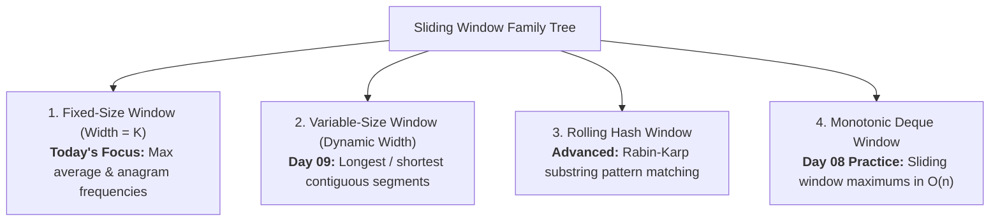

# Day 08: Sliding Window: Fixed Size

<nav aria-label="Lecture navigation">

[Previous: Two Pointers: Fast & Slow](day-07-two-pointers-fast-slow-and-partitioning.md) | [Roadmap](../javascript-dsa-roadmap.md) | [Next: Sliding Window: Variable Size](day-09-sliding-window-variable-size.md)

</nav>

## Prerequisites

- [Day 01: Big O Complexity & Problem Solving](day-01-big-o-complexity-and-problem-solving.md) — Differentiating $O(n)$ from $O(n \times k)$ and the $10^7$ operations rule.
- [Day 02: JavaScript Arrays, Strings & Primitive Memory](day-02-arrays-strings-and-primitive-memory.md) — Contiguous subarrays and index offsets.
- [Day 06: Two Pointers: Opposing & Symmetrical Scans](day-06-two-pointers-opposing-and-symmetrical.md) — Multi-pointer mechanics and boundary updates.

---

## 1. What is a Fixed Sliding Window?

A **Fixed Sliding Window** is an algorithmic technique for solving problems on contiguous subarrays or substrings of an exact, predetermined length $k$.

> **Fixed Sliding Window**: An optimization pattern where a window of fixed length $k$ moves forward one element at a time across a sequence. Instead of recalculating the window state from scratch ($O(k)$ work per step), the algorithm updates the state in $O(1)$ time by subtracting the element that exited on the left and adding the element that entered on the right.

> **Loop Invariant**: A formal mathematical property that remains unconditionally true before, during, and after every iteration of a loop.

> **Amortized $O(1)$ State Transition**: Updating a data summary (sum, character count, hash) by applying an incremental delta rather than re-scanning all $k$ items.

### The Sliding Window Family Tree

Before diving into fixed window mechanics, recognize where it sits within the broader window taxonomy:



### The Moving Train Window Analogy

Imagine sitting on a passenger train looking out a rectangular window that frames exactly $k = 3$ telephone poles along the tracks:
- As the train rolls forward past one pole, you **do not close your eyes and recount all three poles**.
- You already know the middle two poles did not change.
- Exactly **one pole disappears** behind the left frame edge, and **one new pole appears** past the right frame edge.
- You subtract the leaving pole and add the arriving pole.

```text
Fixed Window Transition (k = 3):
Array: [  2,   1,   5,   1,   3,   2  ]

Window 0: [ 2,  1,  5 ]  1,   3,   2   ──► Initial Sum = 2 + 1 + 5 = 8
           -2       +1
Window 1:   2  [ 1,  5,  1 ]  3,   2   ──► New Sum = 8 - 2 + 1 = 7
               -1       +3
Window 2:   2,  1  [ 5,  1,  3 ]  2   ──► New Sum = 7 - 1 + 3 = 9  <-- Maximum!
                   -5       +2
Window 3:   2,  1,  5  [ 1,  3,  2 ]   ──► New Sum = 9 - 5 + 2 = 6

Total Work Comparison:
- Naive recount:  4 windows * 3 additions = 12 operations
- Sliding Window: 3 initial additions + 3 slides * (1 sub + 1 add) = 9 operations
For n = 100,000 and k = 20,000:
- Naive recount:  1,600,000,000 operations (Freezes event loop!)
- Sliding Window: 100,000 operations (Instant: < 2ms)
```

$$\text{Next Window Sum} = \text{Previous Window Sum} - \text{arr}[i - k] + \text{arr}[i]$$

---

## 2. How Fixed Sliding Window Works

Every fixed sliding window algorithm executes in two distinct phases governed by an invariant size contract.

### Pointer Movement & State Transition Rules

```text
+-----------------------------------------------------------------------------------------+
|                  FIXED SLIDING WINDOW STATE LIFECYCLE                                   |
+-----------------------------------------------------------------------------------------+
|  Index Position i       | Outgoing Element   | Incoming Element    | Action             |
+-------------------------+--------------------+---------------------+--------------------+
|  0 to k - 1             | None (Building)    | arr[i]              | Accumulate state   |
|  k                      | arr[0]             | arr[k]              | Slide: -out +in    |
|  k + 1                  | arr[1]             | arr[k + 1]          | Slide: -out +in    |
|  ...                    | ...                | ...                 | ...                |
|  n - 1 (final)          | arr[n - 1 - k]     | arr[n - 1]          | Slide: -out +in    |
+-----------------------------------------------------------------------------------------+
```

### The Invariant Principle Contract

At every step during the sliding phase ($i \ge k$):

$$\text{Active Window: } \text{arr}[i - k + 1 \dots i] \implies \text{Exactly } k \text{ contiguous elements}$$
$$\text{Outgoing Element: } \text{arr}[i - k]$$
$$\text{Incoming Element: } \text{arr}[i]$$

1. The initial accumulation creates the valid state for the prefix window of length $k$.
2. For each step $i \ge k$, adding $\text{arr}[i]$ and subtracting $\text{arr}[i - k]$ shifts the window right by 1 while preserving the exact size invariant $k$.
3. Because $k - 1$ elements are reused across adjacent windows, total work per slide is strictly $O(1)$, converting an $O(n \cdot k)$ bottleneck into linear $O(n)$ time.

### Language-Agnostic Pseudocode

```text
ALGORITHM FixedSlidingWindow(arr, k):
  IF length(arr) < k OR k <= 0 THEN RETURN NULL

  // Phase 1: Build initial window
  windowState <- 0
  FOR i <- 0 TO k - 1 DO:
    windowState <- windowState + arr[i]
  END FOR

  bestResult <- windowState

  // Phase 2: Slide across the remaining elements
  FOR i <- k TO length(arr) - 1 DO:
    outgoing <- arr[i - k]
    incoming <- arr[i]
    windowState <- windowState - outgoing + incoming
    bestResult <- MAX(bestResult, windowState)
  END FOR

  RETURN bestResult
```

---

## 3. Pattern Recognition of Fixed Sliding Window

Spot this pattern in technical screens within 30 seconds:

### 30-Second Problem Triggers
- **Explicit window size $k$ given:** The problem explicitly provides an integer $k$ or fixed duration (e.g., "size $k$", "length $k$", "every 60 seconds").
- **Contiguous sequence required:** The problem asks for contiguous subarrays or substrings, not arbitrary subsets or subsequences.
- **Aggregation over moving range:** Seeking maximum sum, minimum average, distinct character count, or exact anagram matches over consecutive groups of size $k$.

### Problem Keywords to Look For
- *"Subarray of size $k$"*
- *"Maximum / Minimum average of length $k$"*
- *"All substrings of length $k$"*
- *"Find all anagrams in a string"*
- *"Moving average / Rolling window"*

### The 10^7 Operations Rule
- If $n = 100,000$ and $k = 50,000$, a brute force nested recalculation requires $\approx (n - k) \times k \approx 2.5 \times 10^9$ operations $\to$ **Time Limit Exceeded (failing after 3 seconds)**.
- A Fixed Sliding Window runs in strictly **$O(n)$ time** ($\approx 10^5$ operations), executing in **under 1.5 milliseconds** in Node.js.

### When NOT to Use Fixed Sliding Window
- **When window size is variable:** If the problem asks for the "shortest subarray with sum $\ge S$", the window boundary must expand and shrink dynamically. Use **Variable Sliding Window (Day 09)**.
- **When elements are not contiguous:** If you can pick elements from arbitrary positions, the problem is a subset or greedy problem, not a sliding window.
- **When checking negative numbers with arbitrary sums:** Prefix sums with a Hash Map are required when looking for exact sums with negative numbers (Day 10).

---

## 4. Problem 1: Maximum Average Subarray I

### Problem Statement
You are given an integer array `nums` consisting of $n$ elements, and an integer $k$. Find a contiguous subarray whose **length is equal to $k$** that has the maximum average value and return this value. Any answer with a calculation error less than $10^{-5}$ will be accepted.

- **Example 1:** `nums = [1, 12, -5, -6, 50, 3]`, `k = 4` $\to$ `12.75`  
  *(Subarray `[12, -5, -6, 50]` has sum $51$, average $51 / 4 = 12.75$)*
- **Example 2:** `nums = [5]`, `k = 1` $\to$ `5.00000`
- **Constraints:** $n == nums.length$, $1 \le k \le n \le 10^5$, $-10^4 \le nums[i] \le 10^4$.

---

### Step 1: Physical Simulation

Lay out numbered cards on a desk:
`[ 1, 12, -5, -6, 50, 3 ]`, and create a cardboard frame with width $k = 4$.

1. Place the frame over the first 4 cards: `[ 1, 12, -5, -6 ]`.
   - Calculate sum: $1 + 12 - 5 - 6 = 2$.
   - Record `maxSum = 2`.
2. Slide the frame one spot to the right:
   - Card `1` (at index 0) leaves the frame on the left.
   - Card `50` (at index 4) enters the frame on the right.
   - New sum = $2 - 1 + 50 = 51$.
   - $51 > 2 \implies$ Update `maxSum = 51`.
3. Slide the frame one spot to the right:
   - Card `12` (at index 1) leaves the frame.
   - Card `3` (at index 5) enters the frame.
   - New sum = $51 - 12 + 3 = 42$.
   - $42 < 51 \implies$ `maxSum` remains $51$.
4. Calculate final average once at the very end: $51 / 4 = 12.75$.

---

### Step 2: Brute Force Approach

The naive approach re-slices and recalculates every window from scratch:

```javascript
// Node.js code
function findMaxAverageBruteForce(nums, k) {
  let maxAvg = -Infinity;

  // ❌ HIDDEN BOTTLENECK: Recalculates k additions for every window
  for (let i = 0; i <= nums.length - k; i++) {
    let windowSum = 0;
    for (let j = i; j < i + k; j++) {
      windowSum += nums[j];
    }
    const currentAvg = windowSum / k;
    if (currentAvg > maxAvg) {
      maxAvg = currentAvg;
    }
  }

  return maxAvg;
}
```

#### Complexity Analysis:
- **Time Complexity:** $O((n - k + 1) \times k) \approx O(n \cdot k)$. For $n = 100,000$ and $k = 50,000$, this executes $2.5 \times 10^9$ additions, freezing the CPU for seconds.
- **Space Complexity:** $O(1)$ auxiliary space.
- **Scale Failure:** Fails competitive programming platforms with Time Limit Exceeded (TLE).

---

### Step 3: Why not use the brute force? (The Bottleneck)

- Adjacent windows `[1, 12, -5, -6]` and `[12, -5, -6, 50]` share $k - 1$ identical elements: `12, -5, -6`.
- The brute force algorithm discards all previous sums and recalculates those shared elements from scratch.
- **The Wasted Work:** Re-adding $k - 1$ elements that were already summed on the previous iteration.

---

### Step 4: The Pattern Discovery

- Instead of summing $k$ numbers on every step, update the running sum with a **two-element adjustment**:
  $$\text{newSum} = \text{currentSum} - \text{outgoing} + \text{incoming}$$
- One subtraction and one addition per slide.
- Maximize the integer sum across all slides, and divide by $k$ once at the end.
- Total runtime drops from **$O(n \cdot k)$ to $O(n)$**!

---

### Step 5: Solution using fixed sliding window

```javascript
// ✅ CORRECT: Optimal O(n) time, O(1) space fixed sliding window
function findMaxAverage(nums, k) {
  if (!Array.isArray(nums) || nums.length < k || k <= 0) {
    return 0;
  }

  // Phase 1: Build sum of the initial window
  let currentSum = 0;
  for (let i = 0; i < k; i++) {
    currentSum += nums[i];
  }

  let maxSum = currentSum;

  // Phase 2: Slide across the remaining elements
  for (let i = k; i < nums.length; i++) {
    // Add incoming element at i, subtract outgoing element at i - k
    currentSum += nums[i] - nums[i - k];
    if (currentSum > maxSum) {
      maxSum = currentSum;
    }
  }

  // Divide once at the return boundary to prevent float accumulation drift
  return maxSum / k;
}

// ❌ ANTI-PATTERN / COMMON BUG: Accumulating float division drift
function buggyFindMaxAverageFloatDrift(nums, k) {
  let avg = 0;
  for (let i = 0; i < k; i++) avg += nums[i] / k;
  let maxAvg = avg;

  for (let i = k; i < nums.length; i++) {
    // BUG: Repeated floating point division inside loop causes rounding drift
    avg += (nums[i] - nums[i - k]) / k;
    maxAvg = Math.max(maxAvg, avg);
  }
  return maxAvg;
}

// Example runs
console.log(findMaxAverage([1, 12, -5, -6, 50, 3], 4)); // 12.75
console.log(findMaxAverage([5], 1));                   // 5
console.log(findMaxAverage([-1], 1));                  // -1
console.log(findMaxAverage([0, 4, 0, 3, 2], 1));       // 4
```

#### Complexity Derivation:
- **Time Complexity:** $O(n)$. Phase 1 executes $k$ additions. Phase 2 executes $n - k$ iterations with $O(1)$ arithmetic each. Total operations: $k + 2(n - k) \implies O(n)$.
- **Space Complexity:** $O(1)$ auxiliary space. Only scalar number variables are stored in CPU registers.

---

## 5. Problem 2: Find All Anagrams in a String

### Problem Statement
Given two strings `s` and `p`, return an array of all the start indices of `p`'s anagrams in `s`. You may return the answer in any order. An Anagram is a word or phrase formed by rearranging the letters of a different word or phrase, typically using all the original letters exactly once.

- **Example 1:** `s = "cbaebabacd"`, `p = "abc"` $\to$ `[0, 6]`  
  *(Substring at index 0 is `"cba"`, an anagram of `"abc"`. Substring at index 6 is `"bac"`)*
- **Example 2:** `s = "abab"`, `p = "ab"` $\to$ `[0, 1, 2]`
- **Constraints:** $1 \le s.length, p.length \le 3 \times 10^4$. `s` and `p` consist of lowercase English letters.

---

### Step 1: Physical Simulation

Take letter tiles `s = "c b a e b a b a c d"` and target tiles `p = "a b c"`. The target length is $k = 3$.
Target requirement: count of `'a'` is 1, `'b'` is 1, `'c'` is 1.

1. Window 0 (`"cba"`, indices 0 to 2):
   - Frequency: `a: 1, b: 1, c: 1`. Matches target! Record index `0`.
2. Slide to Window 1 (drop `'c'` at index 0, add `'e'` at index 3):
   - Frequency: `a: 1, b: 1, c: 0, e: 1`. Does not match target.
3. Slide to Window 2 (drop `'b'` at index 1, add `'b'` at index 4):
   - Frequency: `a: 1, b: 1, e: 1`. No match.
4. Continue sliding across `s`. When the window reaches index 6 (`"bac"`), frequency matches target again. Record index `6`.

---

### Step 2: Brute Force Approach

The naive approach extracts each substring of length $k$, sorts it, and compares it with sorted `p`:

```javascript
// Node.js code
function findAnagramsBruteForce(s, p) {
  const result = [];
  const k = p.length;
  const sortedP = p.split("").sort().join("");

  // ❌ HIDDEN BOTTLENECK: Slices and sorts every substring
  for (let i = 0; i <= s.length - k; i++) {
    const sub = s.slice(i, i + k).split("").sort().join("");
    if (sub === sortedP) {
      result.push(i);
    }
  }

  return result;
}
```

#### Complexity Analysis:
- **Time Complexity:** $O((n - k + 1) \cdot k \log k)$. For $n = 30,000$ and $k = 10,000$, string slicing and sorting takes billions of operations, freezing Node.js.
- **Space Complexity:** $O(k)$ per slice allocation.
- **Scale Failure:** Severe Garbage Collection pressure due to millions of ephemeral strings.

---

### Step 3: Why not use the brute force? (The Bottleneck)

- We do not need to sort substrings to check if they are anagrams.
- Anagram check only requires comparing character frequency counts.
- Between window $i$ and window $i + 1$, only **two character counts change**: the one leaving on the left, and the one entering on the right!

---

### Step 4: The Pattern Discovery

- Maintain a fixed 26-slot frequency array for target `p` and another 26-slot array for the current sliding window of `s`.
- On each slide:
  - Decrement count for `s[i - k]` (`count[out]--`).
  - Increment count for `s[i]` (`count[in]++`).
- Compare the two 26-slot arrays in $O(26) = O(1)$ constant time.
- Total runtime drops from **$O(n \cdot k \log k)$ to $O(n)$**!

---

### Step 5: Solution using fixed sliding window

```javascript
// ✅ CORRECT: Optimal O(n) time, O(1) space fixed sliding window with 26-slot arrays
function findAnagrams(s, p) {
  const result = [];
  if (typeof s !== "string" || typeof p !== "string" || s.length < p.length) {
    return result;
  }

  const k = p.length;
  const pCount = new Array(26).fill(0);
  const sCount = new Array(26).fill(0);
  const aCode = 97; // charCode for 'a'

  // Phase 1: Build frequency maps for target p and initial window of s
  for (let i = 0; i < k; i++) {
    pCount[p.charCodeAt(i) - aCode]++;
    sCount[s.charCodeAt(i) - aCode]++;
  }

  if (matches(pCount, sCount)) {
    result.push(0);
  }

  // Phase 2: Slide across the remainder of string s
  for (let i = k; i < s.length; i++) {
    // Add incoming character at right
    sCount[s.charCodeAt(i) - aCode]++;
    // Remove outgoing character at left
    sCount[s.charCodeAt(i - k) - aCode]--;

    if (matches(pCount, sCount)) {
      result.push(i - k + 1);
    }
  }

  return result;
}

// Helper: Constant-time comparison of two fixed 26-slot frequency arrays
function matches(arr1, arr2) {
  for (let i = 0; i < 26; i++) {
    if (arr1[i] !== arr2[i]) return false;
  }
  return true;
}

// ❌ ANTI-PATTERN / COMMON BUG: Rebuilding Map on every iteration
function buggyFindAnagramsMap(s, p) {
  const result = [];
  // BUG: Allocates a new Map on every index -> O(n * k) memory and GC churn
  for (let i = 0; i <= s.length - p.length; i++) {
    const map = new Map();
    for (let j = i; j < i + p.length; j++) {
      map.set(s[j], (map.get(s[j]) || 0) + 1);
    }
    // Comparison omitted...
  }
  return result;
}

// Example runs
console.log(findAnagrams("cbaebabacd", "abc")); // [ 0, 6 ]
console.log(findAnagrams("abab", "ab"));         // [ 0, 1, 2 ]
console.log(findAnagrams("af", "be"));           // []
```

#### Complexity Derivation:
- **Time Complexity:** $O(n)$ where $n = s.length$. Initializing counts takes $O(k)$ steps. Sliding executes $n - k$ times. In each slide, array updates take $O(1)$ and array comparison takes $26 \times O(1) = O(1)$. Total time: $k + 26(n - k) \implies O(n)$.
- **Space Complexity:** $O(1)$ auxiliary space. The `pCount` and `sCount` arrays are strictly fixed at 26 elements each, regardless of input string length.

---

## 6. Hands-On Exercise: Real-Time API Rate Limiter Spike Detector

### Scenario
You are maintaining a fintech payments API built in Node.js. The fraud detection module monitors incoming transactions per second. An alert must trigger if the transaction volume within any rolling window of $k = 5$ seconds exceeds a given threshold. A junior developer used nested `slice()` and `reduce()`, which caused the Node.js event loop to freeze during high-volume flash sales. You must rewrite the detector to run in $O(n)$ time and $O(1)$ auxiliary space.

### Buggy Code
```javascript
// Node.js code
function detectSpikesBuggy(transactionsPerSecond, k, threshold) {
  const spikeStartIndices = [];

  // ❌ PERFORMANCE BUG:
  // slice() copies k elements into a new array.
  // reduce() iterates over that array.
  // Total complexity is O(n * k).
  for (let i = 0; i <= transactionsPerSecond.length - k; i++) {
    const windowSum = transactionsPerSecond
      .slice(i, i + k)
      .reduce((sum, count) => sum + count, 0);

    if (windowSum > threshold) {
      spikeStartIndices.push(i);
    }
  }

  return spikeStartIndices;
}
```

### Acceptance Criteria
1. Must use a **Fixed Sliding Window** of size $k$.
2. Must update the rolling window sum in **$O(1)$ operations** per slide.
3. Must achieve **$O(n)$ overall runtime** and **$O(1)$ auxiliary memory** (excluding output array).
4. Must process an input of $100,000$ seconds in under 5 milliseconds.
5. Must pass automated differential stress-testing (500+ iterations) against the comparator.

### Verified Solution

```javascript
// ✅ CORRECT: Optimal O(n) time, O(1) space fixed sliding window spike detector
function detectSpikes(transactionsPerSecond, k, threshold) {
  const spikeStartIndices = [];
  if (!Array.isArray(transactionsPerSecond) || transactionsPerSecond.length < k || k <= 0) {
    return spikeStartIndices;
  }

  const n = transactionsPerSecond.length;

  // Phase 1: Sum initial window of size k
  let currentWindowSum = 0;
  for (let i = 0; i < k; i++) {
    currentWindowSum += transactionsPerSecond[i];
  }

  if (currentWindowSum > threshold) {
    spikeStartIndices.push(0);
  }

  // Phase 2: Slide across the remaining timeline
  for (let i = k; i < n; i++) {
    // Add incoming second, subtract outgoing second
    currentWindowSum += transactionsPerSecond[i] - transactionsPerSecond[i - k];

    if (currentWindowSum > threshold) {
      spikeStartIndices.push(i - k + 1);
    }
  }

  return spikeStartIndices;
}

// Example runs
const traffic = [10, 20, 15, 30, 25, 40, 10, 5];
console.log("Spike windows (k = 3, threshold = 65):", detectSpikes(traffic, 3, 65));
// [ 2, 3, 4 ]

// Benchmark verification: 100,000 seconds
const largeTimeline = Array.from({ length: 100000 }, () => Math.floor(Math.random() * 50));
const start = Date.now();
const spikes = detectSpikes(largeTimeline, 60, 2500);
const elapsed = Date.now() - start;
console.log(`Processed 100,000 seconds in ${elapsed}ms! Found ${spikes.length} spike intervals.`);

// Automated Differential Stress-Testing Harness (Fuzzing)
function runStressTest(testCount = 500) {
  for (let t = 0; t < testCount; t++) {
    const n = Math.floor(Math.random() * 50) + 5;
    const k = Math.floor(Math.random() * (n - 2)) + 1;
    const threshold = Math.floor(Math.random() * (k * 30));
    const arr = [];
    for (let i = 0; i < n; i++) {
      arr.push(Math.floor(Math.random() * 40));
    }

    const expected = detectSpikesBuggy(arr, k, threshold);
    const actual = detectSpikes(arr, k, threshold);

    if (JSON.stringify(expected) !== JSON.stringify(actual)) {
      console.error(`❌ Mismatch detected! Expected ${JSON.stringify(expected)}, got ${JSON.stringify(actual)}`);
      return false;
    }
  }

  console.log(`✅ Passed all ${testCount} randomized differential stress tests with zero failures!`);
  return true;
}
runStressTest(500);
```

---

## 7. Tricky Points

### 1. Window Size $k$ Exceeds Array Length ($k > n$)
If $k > nums.length$, a window of size $k$ cannot be formed:
```javascript
if (nums.length < k || k <= 0) return null; // or []
```
Always validate boundary constraints before running Phase 1 to prevent out-of-bounds indexing.

### 2. Off-by-One in Window Indices
- When loop index is $i$, the incoming element is `nums[i]`.
- The outgoing element is `nums[i - k]`.
- The start index of the current window is `i - k + 1`.

### 3. Arrays with Negative Numbers
When finding the maximum sum of a window, negative numbers can cause the sum to decrease even when adding a new element. Always initialize `maxSum` to `-Infinity` or to the exact sum of the first window, **never to 0**!
```javascript
// ❌ BUG: If all window sums are negative, maxSum will incorrectly stay 0
let maxSum = 0;

// ✅ CORRECT:
let maxSum = currentSum; // where currentSum is the sum of the first window
```

### 4. Floating-Point Cumulative Drift
Adding and subtracting floating-point values repeatedly inside a loop causes precision drift. Accumulate integer sums across the window, and divide once at the end.

### 5. V8 Heap Allocation Avoidance
Avoid calling `s.slice(i, i + k)` inside an $n$-iteration loop. Each slice allocates a brand-new string on the V8 heap, triggering garbage collection churn. Using `s.charCodeAt(i)` and fixed 26-slot integer arrays operates entirely in CPU registers with zero heap allocations.

---

## 8. Cheat Sheet

### Decision Table

| Problem Type | Window Size | Invariant Update Rule | Target Complexity |
| :--- | :---: | :--- | :---: |
| **Max/Min Sum of length $k$** | Fixed $k$ | `sum += nums[i] - nums[i - k]` | $O(n)$ time, $O(1)$ space |
| **Max Average of length $k$** | Fixed $k$ | Maximize sum; divide by $k$ at return | $O(n)$ time, $O(1)$ space |
| **Find Anagrams of length $k$** | Fixed $|p|$ | `count[in]++`, `count[out]--`, compare 26 slots | $O(n)$ time, $O(1)$ space |
| **Rolling API Rate Limiting** | Fixed seconds | Add current reqs, subtract reqs from $t - k$ | $O(n)$ time, $O(1)$ space |

### Common Pitfalls List
- **The Slice & Reduce Trap:** Using `.slice().reduce()` inside a loop turns an $O(n)$ algorithm into $O(n \cdot k)$ with high GC churn.
- **The 0 Initialization Bug:** Setting `maxSum = 0` fails when arrays contain all negative values.
- **Float Accumulation Drift:** Dividing by $k$ inside the loop instead of accumulating sums.
- **Unchecked $k > n$:** Causing `NaN` or out-of-bounds access when $k$ is larger than the input array.

### Reusable Fixed Sliding Window Skeleton

```javascript
function fixedWindowTemplate(arr, k) {
  if (!Array.isArray(arr) || arr.length < k || k <= 0) return null;

  // 1. Build initial window
  let windowState = 0;
  for (let i = 0; i < k; i++) {
    windowState += arr[i];
  }

  let bestResult = windowState;

  // 2. Slide window across remaining elements
  for (let i = k; i < arr.length; i++) {
    const outgoing = arr[i - k];
    const incoming = arr[i];

    windowState += incoming - outgoing;
    bestResult = Math.max(bestResult, windowState);
  }

  return bestResult;
}
```

---

## 9. Summary

- **Fixed Sliding Window** computes running metrics across contiguous elements of constant length $k$.
- **$O(1)$ State Transition:** Updates the window state by subtracting the exiting element (`nums[i - k]`) and adding the entering element (`nums[i]`).
- **Complexity Shift:** Eliminates duplicate work, reducing time from $O(n \cdot k)$ to linear $O(n)$.
- **V8 Engine Internals:** Operates on primitive integer Smis in CPU registers. Avoids allocating temporary strings (`slice`) or objects, preventing V8 Scavenger "Stop-The-World" GC pauses.
- **CPU Cache Locality:** Linear sequential traversal ensures high L1 hardware prefetching hit rates.
- **Systems Alignment:** Powers core infrastructure primitives, including API rate limiters, rolling latency monitors, and streaming circuit breakers.

---

## 10. Interview Q&A

> *"The Fixed Sliding Window pattern optimizes operations on contiguous sequences of constant length k. By recognizing that adjacent windows share k - 1 overlapping elements, we transition from window to window in O(1) constant time by subtracting the outgoing element and adding the incoming element. This reduces runtime from quadratic O(n * k) to linear O(n). In Node.js backend services, it eliminates heap allocation churn and provides the foundational architecture for rolling rate limiters and real-time sliding metrics."*

---

### 1. Why is a Fixed Sliding Window mathematically equivalent to a First-In, First-Out (FIFO) Queue?
**Answer:**
A fixed sliding window maintains an invariant size of $k$. When the window moves forward by one position, the element that entered earliest (the oldest element at the front) must leave, and the newest element arrives at the back. This matches the exact operational contract of a FIFO Queue:
$$\text{Dequeue (leaving element)} \implies \text{Enqueue (entering element)}$$
Because arrays allow direct index access in $O(1)$ time via mathematical pointer offsets (`arr[i - k]` and `arr[i]`), we simulate this queue behavior without incurring the memory allocation overhead of a real queue data structure.

---

### 2. In "Find All Anagrams in a String", how can you optimize the 26-slot comparison from $O(26)$ to $O(1)$?
**Answer:**
Instead of looping through all 26 character slots on each slide, we can maintain a single integer variable `matches` tracking how many of the 26 characters have identical counts in both strings:
1. Initialize `matches` (0 to 26). If `matches === 26`, we found an anagram.
2. When a character count changes during a slide:
   - If count was equal before modification, decrement `matches--`.
   - Update the count.
   - If count is now equal after modification, increment `matches++`.
3. Checking for a match becomes `if (matches === 26)`: a single integer comparison executing in **1 CPU clock cycle** ($O(1)$) instead of 26 array lookups.

---

### 3. What will this code output, and what bug does it contain?
```javascript
function maxKSum(arr, k) {
  let sum = 0;
  for (let i = 0; i < k; i++) sum += arr[i];
  let max = 0;
  for (let i = k; i < arr.length; i++) {
    sum += arr[i] - arr[i - k];
    if (sum > max) max = sum;
  }
  return max;
}
console.log(maxKSum([-5, -2, -8, -1], 2));
```
**Answer:**
It outputs `0` instead of `-7`!
There are two critical bugs:
1. `max` is initialized to `0`. Since all subarray sums are negative (`[-5, -2] = -7`, `[-2, -8] = -10`, `[-8, -1] = -9`), `sum > max` is never true, returning `0` which was never in the array!
2. `max` was not initialized with the sum of the first window. The first window `[-5, -2]` (sum -7) was never considered as a candidate for `max`.
The fix is: `let max = sum;`.

---

### 4. How does an in-place fixed sliding window prevent event loop lag in Node.js streaming APIs?
**Answer:**
Node.js operates on a single execution thread. In real-time data ingestion pipelines (e.g., websockets or Kafka consumers receiving 20,000 telemetry metrics per second), calculating sliding averages using functional methods like `.slice()` creates massive garbage collector churn. The V8 garbage collector periodically triggers "Stop-The-World" pauses to reclaim orphaned slice buffers, delaying the Node.js event loop poll phase and causing network socket queues to overflow. An in-place sliding window uses primitive integer variables, generating **zero heap objects and zero GC pauses**.

---

## 11. Practice Problems

### 1. Substrings of Size Three with Distinct Characters - Easy
A string is good if there are no repeated characters. Given a string `s`, return the number of good substrings of length three.
- **Sample Input 1:** `s = "xyzzaz"` $\to$ **Expected Output:** `1` (Only `"xyz"` has distinct characters)
- **Sample Input 2:** `s = "aababcabc"` $\to$ **Expected Output:** `4` (Substrings: `"abc"`, `"bca"`, `"cab"`, `"abc"`)
- **Sample Input 3:** `s = "aa"` $\to$ **Expected Output:** `0`

#### Socratic Hint Ladder:
- **Hint 1 (Conceptual Bottleneck Nudge):** Because $k = 3$ is very small and constant, you can inspect each 3-character window without allocating new substrings with `.slice()`.
- **Hint 2 (Monotonic Invariant Hint):** As the window slides from index `i = 2` to `s.length - 1`, the three characters inside the window are `s[i - 2]`, `s[i - 1]`, and `s[i]`.
- **Hint 3 (State Transition / Skeleton):** Test if `s[i - 2] !== s[i - 1] && s[i - 1] !== s[i] && s[i - 2] !== s[i]`. If true, increment your good count.

---

### 2. Maximum Number of Vowels in a Substring of Given Length - Medium
Given a string `s` and an integer `k`, return the maximum number of vowel letters (`'a'`, `'e'`, `'i'`, `'o'`, `'u'`) in any substring of `s` with length `k`.
- **Sample Input 1:** `s = "abciiidef"`, `k = 3` $\to$ **Expected Output:** `3` (The substring `"iii"` contains 3 vowels)
- **Sample Input 2:** `s = "aeiou"`, `k = 2` $\to$ **Expected Output:** `2`
- **Sample Input 3:** `s = "leetcode"`, `k = 3` $\to$ **Expected Output:** `2`

#### Socratic Hint Ladder:
- **Hint 1 (Conceptual Bottleneck Nudge):** Treat each character as a binary indicator: $1$ if it is a vowel (`'a'`, `'e'`, `'i'`, `'o'`, `'u'`), $0$ otherwise.
- **Hint 2 (Monotonic Invariant Hint):** Count the vowels in the initial window of length $k$. As the window advances from `i = k` to `s.length - 1`, how does the vowel count change?
- **Hint 3 (State Transition / Skeleton):** If incoming `s[i]` is a vowel, increment `vowels++`. If outgoing `s[i - k]` was a vowel, decrement `vowels--`. Maintain `maxVowels = Math.max(maxVowels, vowels)`.

---

### 3. Sliding Window Maximum - Hard
You are given an array of integers `nums`, there is a sliding window of size `k` which is moving from the very left of the array to the very right. You can only see the `k` numbers in the window. Each time the sliding window moves right by one position, return the max sliding window. Solve in $O(n)$ time using a Monotonic Deque.
- **Sample Input 1:** `nums = [1, 3, -1, -3, 5, 3, 6, 7]`, `k = 3` $\to$ **Expected Output:** `[3, 3, 5, 5, 6, 7]`
- **Sample Input 2:** `nums = [1]`, `k = 1` $\to$ **Expected Output:** `[1]`
- **Sample Input 3:** `nums = [1, -1]`, `k = 1` $\to$ **Expected Output:** `[1, -1]`

#### Socratic Hint Ladder:
- **Hint 1 (Conceptual Bottleneck Nudge):** If an incoming element `nums[i]` is strictly greater than earlier elements currently inside the window, those earlier smaller elements can never be the maximum of this or any future window!
- **Hint 2 (Monotonic Invariant Hint):** Maintain a monotonic deque storing array indices whose corresponding values are in strictly decreasing order.
- **Hint 3 (State Transition / Skeleton):** Before adding `i`, pop indices from the back while `nums[deque[back]] <= nums[i]`. Push `i` to the back. Remove front index if it falls outside window (`deque[front] <= i - k`). Once `i >= k - 1`, `nums[deque[front]]` is the window maximum.

---

<nav aria-label="Lecture navigation">

[Previous: Two Pointers: Fast & Slow](day-07-two-pointers-fast-slow-and-partitioning.md) | [Roadmap](../javascript-dsa-roadmap.md) | [Next: Sliding Window: Variable Size](day-09-sliding-window-variable-size.md)

</nav>
