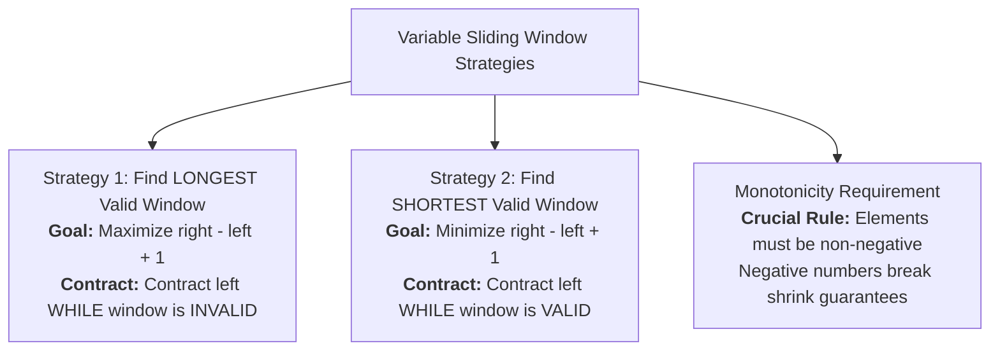

# Day 09: Sliding Window: Variable Size

<nav aria-label="Lecture navigation">

[Previous: Sliding Window: Fixed Size](day-08-sliding-window-fixed-size.md) | [Roadmap](../javascript-dsa-roadmap.md) | [Next: Prefix Sum & Subarray Totals](day-10-prefix-sum-and-subarray-totals.md)

</nav>

## Prerequisites

- [Day 04: Objects, Maps, Sets & Hash Tables](day-04-objects-maps-sets-and-hash-tables.md) — Constant-time membership queries with `Set` and `Map`.
- [Day 08: Sliding Window: Fixed Size](day-08-sliding-window-fixed-size.md) — Window state transitions and rolling updates.

---

## 1. What is a Variable Sliding Window?

A **Variable Sliding Window** is an algorithmic pattern where the left and right boundaries of a window expand and contract dynamically based on problem-specific constraints.

> **Variable Sliding Window**: A two-pointer technique where the `right` pointer eagerly expands the window to incorporate new data, and the `left` pointer contracts the window to restore an invariant or find a minimal boundary, processing $n$ elements in amortized $O(n)$ time.

> **Monotonicity**: A mathematical property where moving a pointer in one direction guarantees that an aggregated metric (such as a sum of non-negative numbers or character counts) strictly increases or decreases.

> **Amortized Analysis**: An algorithmic analysis technique proving that although individual iterations may take up to $O(n)$ steps, the average cost across all $n$ iterations is strictly $O(1)$.

### The Variable Window Strategy Tree

Before writing code, understand the two opposing structural strategies of variable sliding windows:



### The Caterpillar Analogy

Think of a caterpillar crawling across a branch:
1. **The Head (`right` pointer):** Extends forward, exploring new leaves and stretching the caterpillar's body.
2. **The Body (The Window):** Stretches longer and longer as the head moves forward.
3. **The Tail (`left` pointer):** When the body touches a thorn (violating a constraint like a duplicate character or exceeding an allowed count), the tail pulls forward, contracting the body until the caterpillar is valid again.

```text
The Expand and Contract Rhythm:
Input: "abcabcb"

Step 1: Expand right
[ a ] b c a b c b          --> Valid! Length = 1

Step 2: Expand right
[ a  b ] c a b c b         --> Valid! Length = 2

Step 3: Expand right
[ a  b  c ] a b c b        --> Valid! Length = 3

Step 4: Expand right -> 'a' is a duplicate!
[ a  b  c  a ] b c b       --> INVALID! Duplicate 'a' detected!

Step 5: Contract left until duplicate 'a' is eliminated
   a [ b  c  a ] b c b     --> Valid again! Length = 3
```

---

## 2. How Variable Sliding Window Works

Variable sliding window problems operate across two distinct mechanical templates depending on whether the goal is maximization or minimization.

### State Transition & Movement Rules

```text
+-----------------------------------------------------------------------------------------+
|                  THE TWO VARIABLE WINDOW OPERATIONAL STRATEGIES                         |
+-----------------------------------------------------------------------------------------+
|  Strategy 1: Find LONGEST Valid Window (e.g., Longest Substring Without Repeats)        |
|  - Advance `right` on every loop iteration to add new element.                          |
|  - WHILE window is INVALID: contract `left++` to restore validity.                      |
|  - Record answer AFTER while loop: `maxLength = Math.max(maxLength, right - left + 1)`  |
+-----------------------------------------------------------------------------------------+
|  Strategy 2: Find SHORTEST Valid Window (e.g., Minimum Size Subarray Sum)               |
|  - Advance `right` on every loop iteration to accumulate data.                          |
|  - WHILE window is VALID: record answer `minLen`, then contract `left++`.               |
|  - Record answer INSIDE while loop before shrinking.                                    |
+-----------------------------------------------------------------------------------------+
```

### The $2n$ Amortized Complexity Proof

Junior engineers often assume that a `while` loop nested inside a `for` loop produces an $O(n^2)$ quadratic runtime:

```javascript
for (let right = 0; right < n; right++) {
  while (windowIsInvalid) {
    left++;
  }
}
```

**Why this is strictly $O(n)$:**
1. The pointer `right` starts at $0$ and increments exactly $n$ times ($n$ operations).
2. The pointer `left` starts at $0$ and only moves **forward**. It never resets or moves backward.
3. Therefore, across the *entire lifetime* of the algorithm, `left` can increment at most $n$ times.
4. Total pointer operations: at most $n \text{ (right increments)} + n \text{ (left increments)} = 2n \text{ steps}$.
5. $O(2n) \implies \mathbf{O(n)}$ **linear time!**

### Language-Agnostic Pseudocode

```text
// Template 1: Longest Window
ALGORITHM LongestVariableWindow(arr):
  left <- 0
  maxLength <- 0
  windowState <- EmptyState()

  FOR right <- 0 TO length(arr) - 1 DO:
    Add arr[right] to windowState

    WHILE windowState is INVALID DO:
      Remove arr[left] from windowState
      left <- left + 1
    END WHILE

    maxLength <- MAX(maxLength, right - left + 1)
  END FOR

  RETURN maxLength

// Template 2: Shortest Window
ALGORITHM ShortestVariableWindow(arr, target):
  left <- 0
  minLength <- INFINITY
  windowState <- EmptyState()

  FOR right <- 0 TO length(arr) - 1 DO:
    Add arr[right] to windowState

    WHILE windowState is VALID DO:
      minLength <- MIN(minLength, right - left + 1)
      Remove arr[left] from windowState
      left <- left + 1
    END WHILE
  END FOR

  RETURN minLength == INFINITY ? 0 : minLength
```

---

## 3. Pattern Recognition of Variable Sliding Window

Spot this pattern in technical screens within 30 seconds:

### 30-Second Problem Triggers
- **Seeking "Longest" or "Shortest" contiguous segment:** The prompt uses superlatives over continuous ranges (e.g., "longest substring without...", "minimum length subarray with sum $\ge target$").
- **Constraint violation trigger:** Adding an element can invalidate the window (e.g., duplicate character, exceeding $K$ distinct types).
- **All elements are positive:** In sum-based problems, all array elements are positive ($\ge 0$), guaranteeing that adding elements strictly increases the sum and removing elements strictly decreases it.

### Problem Keywords to Look For
- *"Longest substring with at most K distinct characters"*
- *"Longest substring without repeating characters"*
- *"Minimum size subarray sum"*
- *"Smallest contiguous window containing all elements"*
- *"Maximum consecutive ones with at most K flips"*

### The 10^7 Operations Rule
- A brute force all-subarrays check tests $\frac{n(n+1)}{2}$ windows, requiring $O(n^2)$ or $O(n^3)$ operations. For $n = 50,000$, this takes $2.5 \times 10^9$ operations ($\approx 3$ seconds $\to$ Timeout).
- A Variable Sliding Window processes $n$ elements in at most $2n$ steps, executing in **under 2 milliseconds** in Node.js.

### When NOT to Use Variable Sliding Window
- **Arrays with negative numbers and exact sum targets:** If an array has negative numbers, adding an element does *not* guarantee the sum will increase! Contracting `left` does *not* guarantee the sum will decrease. Monotonicity is broken. You **must** use Prefix Sum + Hash Map (Day 10).
- **Subsequences (non-contiguous):** If you can pick arbitrary elements while skipping others, sliding window is invalid. Use Dynamic Programming or Greedy algorithms.

---

## 4. Problem 1: Longest Substring Without Repeating Characters

### Problem Statement
Given a string `s`, find the length of the **longest substring** without repeating characters.

- **Example 1:** `s = "abcabcbb"` $\to$ `3`  
  *(The answer is `"abc"`, with the length of 3)*
- **Example 2:** `s = "bbbbb"` $\to$ `1`  
  *(The answer is `"b"`, with the length of 1)*
- **Example 3:** `s = "pwwkew"` $\to$ `3`  
  *(The answer is `"wke"`, with the length of 3. Note that `"pwke"` is a subsequence, not a substring)*
- **Constraints:** $0 \le s.length \le 5 \times 10^4$. `s` consists of English letters, digits, symbols, and spaces.

---

### Step 1: Physical Simulation

Lay out letter blocks: `"a b c a b c b b"`
1. Start `left = 0`, `right = 0`:
   - Inspect `'a'`. Seen? No. Valid window `[a]`, length = 1.
2. Advance `right = 1`:
   - Inspect `'b'`. Seen? No. Valid window `[a, b]`, length = 2.
3. Advance `right = 2`:
   - Inspect `'c'`. Seen? No. Valid window `[a, b, c]`, length = 3.
4. Advance `right = 3`:
   - Inspect `'a'`. Seen? Yes! Last seen at index 0.
   - Pull `left` forward past index 0 to index 1 (`left = 1`).
   - Window is now `[b, c, a]`, length = 3.
5. Continue scanning to the end. The maximum length confirmed is 3.

---

### Step 2: Brute Force Approach

The naive approach generates every possible substring and checks for duplicate characters using a Set:

```javascript
// Node.js code
function lengthOfLongestSubstringBruteForce(s) {
  let maxLen = 0;

  // ❌ HIDDEN BOTTLENECK: Checks all O(n^2) substrings with an O(n) set check
  for (let i = 0; i < s.length; i++) {
    const seen = new Set();
    for (let j = i; j < s.length; j++) {
      if (seen.has(s[j])) {
        break; // Duplicate found, stop expanding
      }
      seen.add(s[j]);
      maxLen = Math.max(maxLen, j - i + 1);
    }
  }

  return maxLen;
}
```

#### Complexity Analysis:
- **Time Complexity:** $O(n^2)$ average, $O(n^3)$ if naive substring slices are created. For $n = 50,000$, $O(n^2) \approx 2.5 \times 10^9$ operations $\to$ TLE.
- **Space Complexity:** $O(\min(n, m))$ where $m$ is the character set size.
- **Scale Failure:** Severe CPU timeout on inputs larger than $10^4$ characters.

---

### Step 3: Why not use the brute force? (The Bottleneck)

- When a duplicate `'a'` is encountered at index 3 in `"abca"`, the brute force restarts scanning from index 1 (`"b"`), throwing away all knowledge that `"bc"` was already verified as duplicate-free!
- **The Wasted Work:** Restarting from scratch after every duplicate instead of sliding `left` past the duplicate.

---

### Step 4: The Pattern Discovery

- Maintain a Hash Map storing each character's **most recent index**: `char -> lastSeenIndex`.
- As `right` advances:
  - If `s[right]` was seen at index $idx \ge left$, jump `left = idx + 1` directly!
  - Record the character's new index in the Map.
  - Update `maxLength = Math.max(maxLength, right - left + 1)`.
- Each character is visited at most once by `right` and skipped by `left`.
- Runtime drops from **$O(n^2)$ to $O(n)$**!

---

### Step 5: Solution using variable sliding window

```javascript
// ✅ CORRECT: Optimal O(n) time, O(min(n, m)) space variable sliding window
function lengthOfLongestSubstring(s) {
  if (typeof s !== "string" || s.length === 0) return 0;

  // Map stores: character -> last seen index
  const lastSeen = new Map();
  let left = 0;
  let maxLen = 0;

  for (let right = 0; right < s.length; right++) {
    const char = s[right];

    // If character was seen and its index is within the current active window
    if (lastSeen.has(char) && lastSeen.get(char) >= left) {
      // Contract window by jumping left past the previous duplicate
      left = lastSeen.get(char) + 1;
    }

    // Record or update the latest index of this character
    lastSeen.set(char, right);

    // Record maximum window length (Strategy 1: Longest Window)
    const currentLen = right - left + 1;
    if (currentLen > maxLen) {
      maxLen = currentLen;
    }
  }

  return maxLen;
}

// ❌ ANTI-PATTERN / COMMON BUG: Using Array.includes() inside loop
function buggyLengthOfLongestSubstring(s) {
  let maxLen = 0;
  let currentWindow = [];

  // BUG: Array.includes() and Array.shift() are O(k) linear operations inside O(n) loop
  // Total complexity degrades to O(n * k) with heavy GC churn
  for (let i = 0; i < s.length; i++) {
    const char = s[i];
    while (currentWindow.includes(char)) {
      currentWindow.shift();
    }
    currentWindow.push(char);
    maxLen = Math.max(maxLen, currentWindow.length);
  }
  return maxLen;
}

// Example runs
console.log(lengthOfLongestSubstring("abcabcbb")); // 3
console.log(lengthOfLongestSubstring("bbbbb"));    // 1
console.log(lengthOfLongestSubstring("pwwkew"));   // 3
console.log(lengthOfLongestSubstring(""));         // 0
```

#### Complexity Derivation:
- **Time Complexity:** $O(n)$. The `right` pointer iterates from $0$ to $n - 1$ exactly once. Hash Map lookups and jumps take $O(1)$ constant time. Total operations: $O(n)$.
- **Space Complexity:** $O(\min(n, m))$ auxiliary space, where $m$ is the size of the character alphabet (e.g., 26 for lowercase letters, 128 for ASCII).

---

## 5. Problem 2: Minimum Size Subarray Sum

### Problem Statement
Given an array of positive integers `nums` and a positive integer `target`, return the **minimal length** of a contiguous subarray of which the sum is greater than or equal to `target`. If there is no such subarray, return `0` instead.

- **Example 1:** `target = 7`, `nums = [2, 3, 1, 2, 4, 3]` $\to$ `2`  
  *(The subarray `[4, 3]` has the minimal length under the problem constraint)*
- **Example 2:** `target = 4`, `nums = [1, 4, 4]` $\to$ `1`
- **Example 3:** `target = 11`, `nums = [1, 1, 1, 1, 1, 1, 1, 1]` $\to$ `0`
- **Constraints:** $1 \le target \le 10^9$, $1 \le nums.length \le 10^5$, $1 \le nums[i] \le 10^4$.

---

### Step 1: Physical Simulation

Lay out weights on a scale with target = 7: `[ 2, 3, 1, 2, 4, 3 ]`
1. Add 2: sum = 2 (too small).
2. Add 3: sum = 5 (too small).
3. Add 1: sum = 6 (too small).
4. Add 2: sum = 8. Target reached! Window is `[2, 3, 1, 2]`, length = 4.
   - Now, can we remove from the left?
   - Remove 2: sum = 6. Fell below target. Window became invalid.
5. Add 4: sum = 10. Target reached! Window is `[3, 1, 2, 4]`, length = 4.
   - Shrink from left: remove 3 $\to$ sum = 7. Still valid! Length = 3 (`[1, 2, 4]`).
   - Remove 1 $\to$ sum = 6. Fell below target.
6. Add 3: sum = 9. Target reached! Window is `[2, 4, 3]`, length = 3.
   - Shrink left: remove 2 $\to$ sum = 7. Valid! Length = 2 (`[4, 3]`).
   - Remove 4 $\to$ sum = 3. Fell below target.
7. End reached. Minimal length found is 2.

---

### Step 2: Brute Force Approach

The naive approach evaluates all subarrays starting at every index:

```javascript
// Node.js code
function minSubArrayLenBruteForce(target, nums) {
  let minLen = Infinity;

  // ❌ HIDDEN BOTTLENECK: Quadratic search over all pairs
  for (let i = 0; i < nums.length; i++) {
    let currentSum = 0;
    for (let j = i; j < nums.length; j++) {
      currentSum += nums[j];
      if (currentSum >= target) {
        minLen = Math.min(minLen, j - i + 1);
        break; // Smallest subarray starting at i found
      }
    }
  }

  return minLen === Infinity ? 0 : minLen;
}
```

#### Complexity Analysis:
- **Time Complexity:** $O(n^2)$. For $n = 100,000$, requires up to $10^{10}$ additions $\to$ TLE.
- **Space Complexity:** $O(1)$.

---

### Step 3: Why not use the brute force? (The Bottleneck)

- When a valid subarray is found, restarting the search from $i + 1$ recomputes sums from scratch.
- Because all numbers are strictly positive, the sum is **monotonic**:
  - Adding an element strictly increases the sum.
  - Removing an element strictly decreases the sum.
- **The Wasted Work:** Throwing away the accumulated sum instead of shrinking the left boundary.

---

### Step 4: The Pattern Discovery

- Use **Strategy 2 (Shortest Window)**:
  - Expand `right` and add `nums[right]` to `currentSum`.
  - While `currentSum >= target`:
    - Record `minLen = Math.min(minLen, right - left + 1)`.
    - Shrink the window by subtracting `nums[left]` and incrementing `left++`.
- Each element is added once by `right` and subtracted at most once by `left`.
- Runtime drops from **$O(n^2)$ to $O(n)$**!

---

### Step 5: Solution using variable sliding window

```javascript
// ✅ CORRECT: Optimal O(n) time, O(1) space variable sliding window
function minSubArrayLen(target, nums) {
  if (!Array.isArray(nums) || nums.length === 0 || target <= 0) {
    return 0;
  }

  let left = 0;
  let currentSum = 0;
  let minLen = Infinity;

  for (let right = 0; right < nums.length; right++) {
    currentSum += nums[right];

    // Strategy 2: While window is VALID, update minLen and contract left
    while (currentSum >= target) {
      const currentWindowLen = right - left + 1;
      if (currentWindowLen < minLen) {
        minLen = currentWindowLen;
      }

      currentSum -= nums[left];
      left++;
    }
  }

  return minLen === Infinity ? 0 : minLen;
}

// ❌ ANTI-PATTERN / COMMON BUG: Updating minLen outside the while loop
function buggyMinSubArrayLenOutsideWhile(target, nums) {
  let left = 0;
  let currentSum = 0;
  let minLen = Infinity;

  for (let right = 0; right < nums.length; right++) {
    currentSum += nums[right];
    while (currentSum >= target) {
      currentSum -= nums[left];
      left++;
    }
    // BUG: Updating minLen here checks an INVALID window after left++!
    if (currentSum + nums[left - 1] >= target) {
      minLen = Math.min(minLen, right - left + 2);
    }
  }
  return minLen === Infinity ? 0 : minLen;
}

// Example runs
console.log(minSubArrayLen(7, [2, 3, 1, 2, 4, 3])); // 2
console.log(minSubArrayLen(4, [1, 4, 4]));          // 1
console.log(minSubArrayLen(11, [1, 1, 1, 1, 1]));   // 0
```

#### Complexity Derivation:
- **Time Complexity:** $O(n)$. Although the `while` loop is nested inside the `for` loop, `left` increments at most $n$ times across the entire runtime. Total operations: at most $2n \implies O(n)$.
- **Space Complexity:** $O(1)$ auxiliary space. Only scalar pointers and sums are stored in memory.

---

## 6. Hands-On Exercise: Real-Time Stream Session Windowing

### Scenario
You are developing a WebSocket real-time event streaming service in Node.js. Client connections emit binary event flags (`1` = active successful ping, `0` = network dropout or error packet). To maintain session continuity metrics, you must determine the maximum length of a contiguous event session that tolerates at most $k$ network dropout errors (`0`s). A previous developer wrote a nested loop function that causes high CPU usage and event loop latency spikes during peak traffic. You must rewrite it to run in $O(n)$ time and $O(1)$ auxiliary space.

### Buggy Code
```javascript
// Node.js code
function longestSessionBuggy(events, k) {
  let maxLen = 0;
  // ❌ PERFORMANCE BUG:
  // Quadratic nested loops cause O(n^2) event loop blocking
  for (let i = 0; i < events.length; i++) {
    let zeros = 0;
    for (let j = i; j < events.length; j++) {
      if (events[j] === 0) {
        zeros++;
      }
      if (zeros <= k) {
        maxLen = Math.max(maxLen, j - i + 1);
      } else {
        break;
      }
    }
  }
  return maxLen;
}
```

### Acceptance Criteria
1. Must use a **Variable Sliding Window** expanding with `right` and contracting with `left`.
2. Must track the count of `0`s inside the active window.
3. Must achieve **$O(n)$ time** and strictly **$O(1)$ auxiliary space**.
4. Must process $100,000$ event pings in under 5 milliseconds.
5. Must pass automated differential stress-testing (500+ iterations) against the comparator.

### Verified Solution

```javascript
// ✅ CORRECT: Optimal O(n) time, O(1) space variable sliding window
function longestActiveSession(events, k) {
  if (!Array.isArray(events) || events.length === 0 || k < 0) {
    return 0;
  }

  let left = 0;
  let zeroCount = 0;
  let maxLen = 0;

  for (let right = 0; right < events.length; right++) {
    // If incoming event is an error dropout, increment counter
    if (events[right] === 0) {
      zeroCount++;
    }

    // Strategy 1 (Longest): While window is INVALID (more than k errors), contract left
    while (zeroCount > k) {
      if (events[left] === 0) {
        zeroCount--;
      }
      left++;
    }

    // Record maximum valid session length
    const currentLen = right - left + 1;
    if (currentLen > maxLen) {
      maxLen = currentLen;
    }
  }

  return maxLen;
}

// Example runs
const streamLogs = [1, 1, 1, 0, 0, 0, 1, 1, 1, 1, 0];
console.log("Max session with at most 2 errors:", longestActiveSession(streamLogs, 2)); // 6
console.log("Max session with 0 errors allowed:", longestActiveSession(streamLogs, 0)); // 4

// Benchmark verification: 100,000 event pings
const largeStream = Array.from({ length: 100000 }, () => (Math.random() > 0.2 ? 1 : 0));
const start = Date.now();
const result = longestActiveSession(largeStream, 50);
const elapsed = Date.now() - start;
console.log(`Processed 100,000 events in ${elapsed}ms! Max continuous session: ${result}`);

// Automated Differential Stress-Testing Harness (Fuzzing)
function runStressTest(testCount = 500) {
  for (let t = 0; t < testCount; t++) {
    const len = Math.floor(Math.random() * 60) + 1;
    const k = Math.floor(Math.random() * 5);
    const arr = [];
    for (let i = 0; i < len; i++) {
      arr.push(Math.random() > 0.3 ? 1 : 0);
    }

    const expected = longestSessionBuggy(arr, k);
    const actual = longestActiveSession(arr, k);

    if (expected !== actual) {
      console.error(`❌ Mismatch detected! Expected ${expected}, got ${actual}`);
      return false;
    }
  }

  console.log(`✅ Passed all ${testCount} randomized differential stress tests with zero failures!`);
  return true;
}
runStressTest(500);
```

---

## 7. Tricky Points

### 1. Update Placement: Longest vs Shortest
- **Finding the LONGEST window:** Update the result **outside/after** the `while` loop, once `left` has finished contracting to restore window validity.
- **Finding the SHORTEST window:** Update the result **inside** the `while` loop on every valid state, immediately before incrementing `left++`.

### 2. Monotonicity Breakdown with Negative Numbers
Variable sliding window strictly requires non-negative elements. If an array contains negative numbers, subtracting `nums[left]` can actually *increase* the sum, breaking the contract that shrinking `left` decreases the total. For negative numbers, use Prefix Sum + Hash Map (Day 10).

### 3. Window Length Calculation Formula
The number of elements between zero-based indices `left` and `right` inclusive is always:
$$\text{Window Length} = right - left + 1$$
Forgetting the $+ 1$ is the most frequent off-by-one bug in coding screens.

### 4. Unreachable Targets and Fallback Values
In shortest-window problems, initialize `minLen = Infinity`. If the total sum never reaches `target`, the answer must be `0`, not `Infinity`:
```javascript
return minLen === Infinity ? 0 : minLen;
```

### 5. V8 Map Lookups vs Fixed-Size Typed Arrays
When sliding over ASCII strings, using `new Uint32Array(128)` or `new Array(128).fill(0)` is faster than a JavaScript `Map`. Direct index access executes in a single CPU instruction, while `Map.get()` performs hash code hashing and bucket lookups.

---

## 8. Cheat Sheet

### Decision Table

| Problem Type | Target Goal | Condition to Shrink `left` | Where to Update Result | Target Complexity |
| :--- | :---: | :--- | :--- | :---: |
| **Longest Substring Without Repeats** | Maximize | While duplicate character exists | After `while` loop | $O(n)$ time, $O(m)$ space |
| **Max Consecutive Ones with K Flips** | Maximize | While `zeroCount > k` | After `while` loop | $O(n)$ time, $O(1)$ space |
| **Minimum Size Subarray Sum** | Minimize | While `currentSum >= target` | Inside `while` loop | $O(n)$ time, $O(1)$ space |
| **Minimum Window Substring** | Minimize | While all characters matched | Inside `while` loop | $O(n)$ time, $O(m)$ space |

### Common Pitfalls List
- **Updating Result at Wrong Location:** Updating `minLen` outside the while loop in shortest-window problems.
- **Using Array Methods Inside Window:** Calling `arr.includes()` or `arr.shift()` inside the loop, turning $O(n)$ into $O(n^2)$.
- **Negative Numbers Trap:** Attempting to use variable sliding window when array contains negative integers.
- **Forgetting the $+ 1$:** Writing `right - left` instead of `right - left + 1`.

### Reusable Variable Sliding Window Skeletons

```javascript
// Skeleton 1: Longest Window
function longestWindowTemplate(arr, constraintValidator) {
  let left = 0;
  let maxLen = 0;

  for (let right = 0; right < arr.length; right++) {
    // 1. Add arr[right] to window state
    // ...

    // 2. Shrink while invalid
    while (!constraintValidator()) {
      // Remove arr[left] from state
      left++;
    }

    // 3. Record longest valid window
    maxLen = Math.max(maxLen, right - left + 1);
  }

  return maxLen;
}

// Skeleton 2: Shortest Window
function shortestWindowTemplate(arr, isTargetSatisfied) {
  let left = 0;
  let minLen = Infinity;

  for (let right = 0; right < arr.length; right++) {
    // 1. Add arr[right] to window state
    // ...

    // 2. Shrink while valid
    while (isTargetSatisfied()) {
      minLen = Math.min(minLen, right - left + 1);
      // Remove arr[left] from state
      left++;
    }
  }

  return minLen === Infinity ? 0 : minLen;
}
```

---

## 9. Summary

- **Variable Sliding Window** dynamically adjusts window size to find the longest or shortest contiguous segment meeting a constraint.
- **Amortized $O(n)$ Guarantee:** Both `left` and `right` move forward monotonically. Neither pointer ever moves backward, bounding total operations to at most $2n$.
- **V8 Engine Internals:** Replacing `Array.includes()` and `Array.shift()` with a `Map` or typed array avoids $O(k)$ array shifts and eliminates V8 garbage collection churn.
- **Monotonicity Rule:** The algorithm strictly requires monotonic properties (e.g., non-negative numbers). Negative numbers break contraction invariants and require Prefix Sums.
- **Systems Alignment:** Underpins streaming network protocols (TCP sliding congestion window) and real-time event aggregation in Node.js backend microservices.

---

## 10. Interview Q&A

> *"The Variable Sliding Window pattern optimizes contiguous subarray and substring searches where window length is dynamic. By eagerly expanding a right pointer and contracting a left pointer to maintain or satisfy a constraint, we evaluate all valid candidates in amortized O(n) runtime. Because both pointers only advance forward, the algorithm completes in at most 2n steps with strictly O(1) or O(m) space. In Node.js backend systems, this avoids GC churn and ensures sub-millisecond execution for real-time telemetry processing."*

---

### 1. Prove why a `while` loop nested inside a `for` loop is strictly $O(n)$ in variable sliding windows.
**Answer:**
Let $n$ be the length of the input array. The outer `for` loop advances the `right` pointer from $0$ to $n - 1$, executing exactly $n$ times. The inner `while` loop advances the `left` pointer. Because `left` is only ever incremented (`left++`) and never reset to 0 or decremented, the total number of operations performed by the `while` loop across the entire life of the program cannot exceed $n$. Therefore, the total number of combined operations is at most $n \text{ (from right)} + n \text{ (from left)} = 2n$. In Big O asymptotic notation, $O(2n) \implies O(n)$ linear time.

---

### 2. Why does the Variable Sliding Window pattern fail when an array contains negative numbers?
**Answer:**
Variable sliding window relies on **monotonicity**: adding an element to the window must strictly expand the metric (e.g., sum increases), and removing an element from the left must strictly contract it (sum decreases). When negative numbers exist:
- Adding a negative number *decreases* the sum.
- Removing a negative number *increases* the sum.
Consequently, contracting `left` can no longer guarantee whether the sum will move closer to or further from the target. The greedy pruning property is broken, and valid candidate subarrays would be missed. Such problems must be solved using **Prefix Sum + Hash Map (Day 10)**.

---

### 3. What will this code output, and what bug does it contain?
```javascript
function minSubArray(target, nums) {
  let left = 0, sum = 0, minLen = Infinity;
  for (let right = 0; right < nums.length; right++) {
    sum += nums[right];
    if (sum >= target) {
      minLen = Math.min(minLen, right - left + 1);
      sum -= nums[left++];
    }
  }
  return minLen;
}
console.log(minSubArray(7, [2, 3, 1, 2, 4, 3]));
```
**Answer:**
It outputs `3` instead of the correct answer `2`!
The bug is using an `if` statement instead of a `while` loop. When `sum >= target`, the code only contracts `left` by a single position. However, after removing `nums[left]`, the remaining subarray might *still* be greater than or equal to `target` (e.g., `[2, 4, 3]` sum is 9, remove 2 gives `[4, 3]` sum 7, which is valid and has length 2). By using `if`, it fails to continue shrinking to find the true minimal length. Replacing `if` with `while` resolves the bug.

---

### 4. How does replacing `Map` with a typed array optimize V8 memory in high-throughput Node.js microservices?
**Answer:**
In Node.js services processing tens of thousands of requests per second, creating a `new Map()` on each request allocates hash table backing stores on the V8 heap. This contributes to young-generation heap fragmentation and triggers GC Scavenger pauses. When the character set is bounded (such as ASCII 0-127), allocating a flat buffer like `new Uint16Array(128)` allocates a single contiguous block of 256 bytes. Lookups and updates compile directly into single assembly `MOV` instructions without hashing, creating zero object allocations and zero garbage collection overhead.

---

## 11. Practice Problems

### 1. Max Consecutive Ones III - Medium
Given a binary array `nums` and an integer `k`, return the maximum number of consecutive `1`'s in the array if you can flip at most `k` `0`'s.
- **Sample Input 1:** `nums = [1, 1, 1, 0, 0, 0, 1, 1, 1, 1, 0]`, `k = 2` $\to$ **Expected Output:** `6`
- **Sample Input 2:** `nums = [0, 0, 1, 1, 0, 0, 1, 1, 1, 0, 1, 1, 0, 0, 0, 1, 1, 1, 1]`, `k = 3` $\to$ **Expected Output:** `10`
- **Sample Input 3:** `nums = [0, 0, 0, 0]`, `k = 0` $\to$ **Expected Output:** `0`

#### Socratic Hint Ladder:
- **Hint 1 (Conceptual Bottleneck Nudge):** Rephrase the problem: Find the longest contiguous subarray that contains at most `k` zeroes.
- **Hint 2 (Monotonic Invariant Hint):** Expand `right` and maintain a counter of zeroes seen in the window. When `zeroCount > k`, the window is invalid.
- **Hint 3 (State Transition / Skeleton):** While `zeroCount > k`: if `nums[left] === 0`, decrement `zeroCount--`, and increment `left++`. After the `while` loop, update `maxLen = Math.max(maxLen, right - left + 1)`.

---

### 2. Fruit Into Baskets - Medium
You are visiting a farm with trees in a row. You have 2 baskets, and each basket can only hold a single type of fruit. There is no limit on the amount of fruit each basket can hold. Starting from any tree, pick exactly one fruit from every tree while moving to the right until you reach a tree with a fruit type that cannot fit in your baskets. Return the maximum total number of fruits you can pick.
- **Sample Input 1:** `fruits = [1, 2, 1]` $\to$ **Expected Output:** `3`
- **Sample Input 2:** `fruits = [0, 1, 2, 2]` $\to$ **Expected Output:** `3` (Subarray `[1, 2, 2]`)
- **Sample Input 3:** `fruits = [1, 2, 3, 2, 2]` $\to$ **Expected Output:** `4` (Subarray `[2, 3, 2, 2]`)

#### Socratic Hint Ladder:
- **Hint 1 (Conceptual Bottleneck Nudge):** Rephrase the problem: Find the length of the longest contiguous subarray that contains at most 2 distinct integer values.
- **Hint 2 (Monotonic Invariant Hint):** Use a `Map` to track the frequency count of each fruit type currently in the window `[left ... right]`.
- **Hint 3 (State Transition / Skeleton):** Expand `right` and increment `map.set(fruit, count)`. If `map.size > 2`, contract `left` by decrementing its count and deleting from the map when count reaches 0 until `map.size <= 2`. Update `maxLen = Math.max(maxLen, right - left + 1)`.

---

### 3. Minimum Window Substring - Hard
Given two strings `s` and `t` of lengths `m` and `n` respectively, return the minimum window substring of `s` such that every character in `t` (including duplicates) is included in the window. If there is no such substring, return the empty string `""`. Solve in $O(m + n)$ time.
- **Sample Input 1:** `s = "ADOBECODEBANC"`, `t = "ABC"` $\to$ **Expected Output:** `"BANC"`
- **Sample Input 2:** `s = "a"`, `t = "a"` $\to$ **Expected Output:** `"a"`
- **Sample Input 3:** `s = "a"`, `t = "aa"` $\to$ **Expected Output:** `""`

#### Socratic Hint Ladder:
- **Hint 1 (Conceptual Bottleneck Nudge):** Build a target frequency map for `t`. Maintain a `formed` variable tracking how many unique characters in `t` have had their exact frequency requirements met in the current window.
- **Hint 2 (Monotonic Invariant Hint):** Expand `right`. When all character requirements are met (`formed === requiredUniqueCharacters`), the window is valid. Now contract `left` as much as possible while keeping the window valid to discover the minimum window.
- **Hint 3 (State Transition / Skeleton):** While `formed === required`: record window length and start index if smaller than `minLen`. Then remove `s[left]`: if its count drops below what is required in `t`, decrement `formed--`. Advance `left++`.

---

<nav aria-label="Lecture navigation">

[Previous: Sliding Window: Fixed Size](day-08-sliding-window-fixed-size.md) | [Roadmap](../javascript-dsa-roadmap.md) | [Next: Prefix Sum & Subarray Totals](day-10-prefix-sum-and-subarray-totals.md)

</nav>
