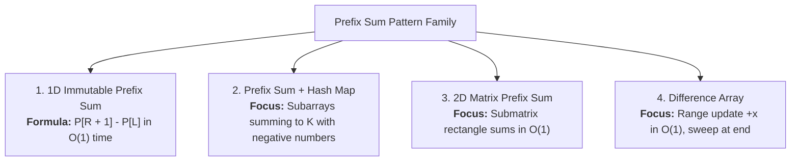

# Day 10: Prefix Sum & Subarray Totals

<nav aria-label="Lecture navigation">

[Previous: Sliding Window: Variable Size](day-09-sliding-window-variable-size.md) | [Roadmap](../javascript-dsa-roadmap.md) | [Next: Singly & Doubly Linked Lists](day-11-singly-and-doubly-linked-lists.md)

</nav>

## Prerequisites

- [Day 01: Big O Complexity & Problem Solving](day-01-big-o-complexity-and-problem-solving.md) — Trading precomputation space ($O(n)$) for instant query time ($O(1)$).
- [Day 04: Objects, Maps, Sets & Hash Tables](day-04-objects-maps-sets-and-hash-tables.md) — Hash Map frequency accumulation.
- [Day 09: Sliding Window: Variable Size](day-09-sliding-window-variable-size.md) — Monotonicity constraints and why sliding windows fail on negative numbers.

---

## 1. What is a Prefix Sum?

A **Prefix Sum** is an array of cumulative running totals where each element stores the sum of all preceding values up to that position.

> **Prefix Sum**: A precomputation technique where an array $P$ is constructed such that $P[i]$ equals the sum of all elements up to index $i - 1$, enabling any contiguous range sum from $L$ to $R$ to be answered in $O(1)$ time via subtraction: $P[R + 1] - P[L]$.

> **Prefix Complement**: The mathematical difference $\text{currentPrefix} - k$ searched in a Hash Map to identify earlier prefix positions that form a valid target subarray.

> **Difference Array**: The dual inverse of a prefix sum used to perform range updates in $O(1)$ time and reconstruct the final array via a prefix sweep.

### The Prefix Sum Family Tree

Before writing code, examine how prefix sums branch into range queries, hash complements, and higher dimensions:



### The Automobile Odometer Analogy

Imagine taking a road trip across four cities and recording the distances driven each day:
- Day 1: 50 miles
- Day 2: 70 miles
- Day 3: 40 miles
- Day 4: 100 miles

How does your car calculate the total distance driven between the start of Day 2 and the end of Day 3?
- It **does not** recount every mile marker driven.
- Your car has an **odometer** (a prefix sum) that constantly tracks total cumulative miles:
  - Day 0 (Start): 0 miles
  - After Day 1: 50 miles
  - After Day 2: 120 miles
  - After Day 3: 160 miles
  - After Day 4: 260 miles
- To find the miles driven on Days 2 and 3, subtract the odometer reading before Day 2 began from the odometer reading at the end of Day 3:
  $$160 - 50 = 110 \text{ miles} \quad (70 + 40 = 110!)$$

```text
Prefix Sum Transformation (1-indexed prefix array):
Original Array:        [  2,   1,   5,   3  ]  (length n = 4)
                       0    1    2    3

Prefix Array P:    [ 0,  2,   3,   8,  11  ]  (length n + 1 = 5)
Index P:             0   1    2    3   4

Query: Range Sum from index L = 1 to index R = 3 (values: 1 + 5 + 3 = 9)
Formula: P[R + 1] - P[L]
Calculation: P[4] - P[1] = 11 - 2 = 9  --> O(1) Instant Lookup!
```

---

## 2. How Prefix Sum Works

Prefix sum algorithms rely on the cumulative subtraction property to convert range summations into constant-time queries.

### The $(n + 1)$ Size Standard

Always allocate the prefix array with size **$n + 1$**:
$$\text{prefix} = \text{new Array}(n + 1).\text{fill}(0)$$

```text
+-----------------------------------------------------------------------------------------+
|                        WHY THE LEADING ZERO MATTERS                                     |
+-----------------------------------------------------------------------------------------+
|  prefix[0] = 0 represents the sum of zero elements.                                     |
|  prefix[1] = nums[0]                                                                    |
|  prefix[2] = nums[0] + nums[1]                                                          |
|  prefix[i] = sum of first i elements: nums[0 ... i - 1]                                 |
+-----------------------------------------------------------------------------------------+
```

### Eliminating Conditional Edge Cases

Without the leading zero at `prefix[0]`, querying a range that starts at the very beginning of the array ($L = 0$) requires a special `if/else` branch:
```javascript
// ❌ Clunky 0-indexed prefix array:
const sum = L === 0 ? prefix[R] : prefix[R] - prefix[L - 1];

// ✅ Clean (n + 1) prefix array:
const sum = prefix[R + 1] - prefix[L]; // Works universally for all L >= 0!
```

If $L = 0$ and $R = 2$, $\text{prefix}[3] - \text{prefix}[0] = \text{prefix}[3] - 0 = \text{prefix}[3]$. No branch instructions needed!

### The Prefix Complement Invariant

For problems finding subarrays summing to $k$:
$$\text{Sum}(i \dots j) = P[j] - P[i] = k \iff P[i] = P[j] - k$$
As we compute the running prefix sum $P[j]$, we query a Hash Map for how many times the complement $P[j] - k$ has appeared previously. Every previous appearance of $P[j] - k$ forms a valid contiguous subarray ending at $j$ that sums to $k$.

### Language-Agnostic Pseudocode

```text
// 1. Building a 1D Prefix Array
ALGORITHM BuildPrefixSum(nums):
  n <- length(nums)
  prefix <- Array of size (n + 1) initialized to 0

  FOR i <- 0 TO n - 1 DO:
    prefix[i + 1] <- prefix[i] + nums[i]
  END FOR

  RETURN prefix

// 2. Querying Range Sum L to R
ALGORITHM RangeSumQuery(prefix, L, R):
  RETURN prefix[R + 1] - prefix[L]
```

---

## 3. Pattern Recognition of Prefix Sum

Spot this pattern in technical screens within 30 seconds:

### 30-Second Problem Triggers
- **Multiple range sum queries:** The problem asks to calculate the sum of elements between indices $L$ and $R$ repeatedly across $q$ queries.
- **Subarrays summing to $k$ with negative numbers:** The problem asks for the count or length of subarrays summing to $k$, and the array contains negative numbers.
- **Equal parts / Equilibrium index:** Finding an index where the sum of numbers on the left equals the sum of numbers on the right.
- **Product of array except self:** Accumulating prefix products from the left and suffix products from the right.

### Problem Keywords to Look For
- *"Range sum query"*
- *"Subarray sum equals k"*
- *"Pivot index / Equilibrium index"*
- *"Continuous subarray sum"*
- *"Equal 0s and 1s"* (treat 0s as -1 and use prefix sum)

### The 10^7 Operations Rule
- For $q = 100,000$ queries on an array of length $n = 100,000$:
  - Naive loop per query: $O(q \cdot n) = 10^{10}$ operations $\to$ **15+ seconds (Time Limit Exceeded)**.
  - Prefix Sum: Precomputes in $O(n)$ time once, answers all $q$ queries in $O(1)$ each. Total operations: $n + q = 200,000 \approx 2 \times 10^5$ operations $\to$ **executed in 3 milliseconds** in Node.js!

### When NOT to Use Prefix Sum
- **Frequent in-place array updates:** If array elements are constantly updated between queries, a standard prefix sum requires an $O(n)$ rebuild per modification. Use a **Binary Indexed Tree (Fenwick Tree)** or **Segment Tree** instead for $O(\log n)$ updates and queries.
- **Simple sliding window without negative numbers:** If searching for the shortest/longest subarray with non-negative numbers, a variable sliding window (Day 09) achieves $O(n)$ time with strictly $O(1)$ space.

---

## 4. Problem 1: Range Sum Query - Immutable

### Problem Statement
Given an integer array `nums`, handle multiple queries of the following type:
Calculate the sum of the elements of `nums` between indices `left` and `right` inclusive where `left <= right`.

Implement the `NumArray` class:
- `NumArray(int[] nums)` Initializes the object with the integer array `nums`.
- `int sumRange(int left, int right)` Returns the sum of the elements of `nums` between indices `left` and `right` inclusive.

- **Example 1:**
  ```text
  Input:
  ["NumArray", "sumRange", "sumRange", "sumRange"]
  [[[-2, 0, 3, -5, 2, -1]], [0, 2], [2, 5], [0, 5]]
  Output: [null, 1, -1, -3]
  Explanation:
  sumRange(0, 2) -> (-2) + 0 + 3 = 1
  sumRange(2, 5) -> 3 + (-5) + 2 + (-1) = -1
  sumRange(0, 5) -> (-2) + 0 + 3 + (-5) + 2 + (-1) = -3
  ```
- **Constraints:** $1 \le nums.length \le 10^4$, $-10^5 \le nums[i] \le 10^5$, $0 \le left \le right < nums.length$, at most $10^4$ calls to `sumRange`.

---

### Step 1: Physical Simulation

Lay out numbers: `[ -2, 0, 3, -5, 2, -1 ]` (length 6)
Build cumulative odometer:
- Slot 0: `0`
- Slot 1: `0 + (-2) = -2`
- Slot 2: `-2 + 0 = -2`
- Slot 3: `-2 + 3 = 1`
- Slot 4: `1 + (-5) = -4`
- Slot 5: `-4 + 2 = -2`
- Slot 6: `-2 + (-1) = -3`

`prefix = [ 0, -2, -2, 1, -4, -2, -3 ]`
- Query `(0, 2)`: `prefix[3] - prefix[0] = 1 - 0 = 1`.
- Query `(2, 5)`: `prefix[6] - prefix[2] = -3 - (-2) = -1`.
- Query `(0, 5)`: `prefix[6] - prefix[0] = -3 - 0 = -3`.
Every range query is answered with a single subtraction!

---

### Step 2: Brute Force Approach

The naive approach iterates through `nums` from `left` to `right` on every `sumRange` call:

```javascript
// Node.js code
class NumArrayBruteForce {
  constructor(nums) {
    this.nums = nums;
  }

  // ❌ HIDDEN BOTTLENECK: O(n) scan on every single query
  sumRange(left, right) {
    let sum = 0;
    for (let i = left; i <= right; i++) {
      sum += this.nums[i];
    }
    return sum;
  }
}
```

#### Complexity Analysis:
- **Time Complexity:** Constructor takes $O(1)$. Each `sumRange` takes $O(n)$ time. For $q$ queries, total time is $O(q \cdot n)$. For $q = 10,000$ and $n = 10,000$, this executes $10^8$ operations, causing query lag.
- **Space Complexity:** $O(1)$ auxiliary space.

---

### Step 3: Why not use the brute force? (The Bottleneck)

- When multiple queries overlap (e.g., query `[0, 5]` and query `[2, 5]`), the brute force recalculates the exact same element sums repeatedly.
- **The Wasted Work:** Re-scanning contiguous memory segments over and over across separate queries.

---

### Step 4: The Pattern Discovery

- Trade $O(n)$ precomputation time and $O(n)$ space in the constructor to compute a prefix sum array of size $n + 1$.
- Any range sum $[left, right]$ is answered in **$O(1)$ constant time** using:
  $$\text{prefix}[right + 1] - \text{prefix}[left]$$
- Query time drops from **$O(n)$ to $O(1)$**!

---

### Step 5: Solution using prefix sum

```javascript
// ✅ CORRECT: Optimal O(n) precomputation, O(1) query time using (n + 1) prefix array
class NumArray {
  constructor(nums) {
    const n = Array.isArray(nums) ? nums.length : 0;
    // Allocate (n + 1) slots with prefix[0] = 0
    this.prefix = new Array(n + 1).fill(0);

    for (let i = 0; i < n; i++) {
      this.prefix[i + 1] = this.prefix[i] + nums[i];
    }
  }

  sumRange(left, right) {
    // Formula: prefix[R + 1] - prefix[L]
    return this.prefix[right + 1] - this.prefix[left];
  }
}

// ❌ ANTI-PATTERN / COMMON BUG: 0-indexed prefix array with ternary branches
class BuggyNumArrayZeroIndexed {
  constructor(nums) {
    this.prefix = [];
    let current = 0;
    for (let num of nums) {
      current += num;
      this.prefix.push(current);
    }
  }

  sumRange(left, right) {
    // BUG: Ternary branch instruction required on every query; prone to off-by-one errors
    return left === 0 ? this.prefix[right] : this.prefix[right] - this.prefix[left - 1];
  }
}

// Example runs
const numArray = new NumArray([-2, 0, 3, -5, 2, -1]);
console.log(numArray.sumRange(0, 2)); // 1
console.log(numArray.sumRange(2, 5)); // -1
console.log(numArray.sumRange(0, 5)); // -3
```

#### Complexity Derivation:
- **Time Complexity:**
  - `constructor`: $O(n)$ linear time to build the prefix array once.
  - `sumRange`: $O(1)$ constant time. Exactly one subtraction.
- **Space Complexity:** $O(n)$ auxiliary space to store the prefix array of size $n + 1$.

---

## 5. Problem 2: Subarray Sum Equals K

### Problem Statement
Given an array of integers `nums` and an integer `k`, return the total number of subarrays whose sum equals to `k`. A subarray is a contiguous non-empty sequence of elements within an array. **Note that elements may be negative, zero, or positive.**

- **Example 1:** `nums = [1, 1, 1]`, `k = 2` $\to$ `2`  
  *(Subarrays: `[1, 1]` at indices `0..1` and `[1, 1]` at indices `1..2`)*
- **Example 2:** `nums = [1, 2, 3]`, `k = 3` $\to$ `2`  
  *(Subarrays: `[1, 2]` and `[3]`)*
- **Example 3:** `nums = [1, -1, 0]`, `k = 0` $\to$ `3`  
  *(Subarrays: `[1, -1]`, `[0]`, `[1, -1, 0]`)*
- **Constraints:** $1 \le nums.length \le 2 \times 10^4$, $-1000 \le nums[i] \le 1000$, $-10^7 \le k \le 10^7$.

---

### Step 1: Physical Simulation

Let `nums = [ 1, -1, 1, 1, 1 ]` and `k = 2`.
Track the cumulative ledger balance as we move forward:
- Before start: balance = 0 (seen 1 time).
- Step 0 (value 1): balance = 1. Looking for balance $1 - 2 = -1$. Seen? No. Store balance `1: 1`.
- Step 1 (value -1): balance = 0. Looking for balance $0 - 2 = -2$. Seen? No. Store balance `0: 2`.
- Step 2 (value 1): balance = 1. Looking for balance $1 - 2 = -1$. Seen? No. Store balance `1: 2`.
- Step 3 (value 1): balance = 2. Looking for balance $2 - 2 = 0$. Seen? Yes! Balance 0 was seen 2 times previously! Add 2 to our count. Store balance `2: 1`.
- Step 4 (value 1): balance = 3. Looking for balance $3 - 2 = 1$. Seen? Yes! Balance 1 was seen 2 times previously! Add 2 to our count. Store balance `3: 1`.
Total count of valid subarrays: $2 + 2 = 4$.

---

### Step 2: Brute Force Approach

The naive approach evaluates all possible subarray pairs:

```javascript
// Node.js code
function subarraySumBruteForce(nums, k) {
  let count = 0;

  // ❌ HIDDEN BOTTLENECK: O(n^2) nested loop checking all pairs
  for (let start = 0; start < nums.length; start++) {
    let currentSum = 0;
    for (let end = start; end < nums.length; end++) {
      currentSum += nums[end];
      if (currentSum === k) {
        count++;
      }
    }
  }

  return count;
}
```

#### Complexity Analysis:
- **Time Complexity:** $O(n^2)$. For $n = 20,000$, takes $\approx 4 \times 10^8$ operations $\to$ TLE.
- **Space Complexity:** $O(1)$.

---

### Step 3: Why not use the brute force? (The Bottleneck)

- Why can't we use a Sliding Window here? Because `nums` contains **negative numbers**! A negative number decreases the sum, breaking the monotonic invariant where expanding `right` increases sum and contracting `left` decreases sum.
- In brute force, we repeatedly recalculate intermediate sums for all overlapping pairs.
- **The Wasted Work:** Recalculating range sums instead of using mathematical complements.

---

### Step 4: The Pattern Discovery

- Recall Two Sum: to find if $x + y = k$, we store $x$ in a Map and search for complement $k - y$.
- In prefix sums:
  $$\text{Subarray Sum}(i \dots j) = \text{prefixSum}[j] - \text{prefixSum}[i] = k$$
  $$\implies \text{prefixSum}[i] = \text{prefixSum}[j] - k$$
- As we iterate, maintain a running `prefixSum`.
- Check if `prefixSum - k` exists in our Hash Map:
  - If yes, add its recorded frequency to `count`.
- Record the current `prefixSum` into the Map.
- **Base Case:** Initialize `map.set(0, 1)` to account for subarrays starting at index 0.
- Runtime drops from **$O(n^2)$ to $O(n)$**!

---

### Step 5: Solution using prefix sum

```javascript
// ✅ CORRECT: Optimal O(n) time, O(n) space prefix sum + hash map
function subarraySum(nums, k) {
  if (!Array.isArray(nums) || nums.length === 0) return 0;

  // Map stores: prefixSum (number) -> frequencyCount (number)
  const prefixMap = new Map();

  // BASE CASE: A prefix sum of 0 has occurred 1 time (before the array starts)
  prefixMap.set(0, 1);

  let currentPrefixSum = 0;
  let totalCount = 0;

  for (let i = 0; i < nums.length; i++) {
    currentPrefixSum += nums[i];

    // Mathematical complement: prefix[i] = currentPrefixSum - k
    const complement = currentPrefixSum - k;

    if (prefixMap.has(complement)) {
      totalCount += prefixMap.get(complement);
    }

    // Record the current prefix sum frequency
    prefixMap.set(currentPrefixSum, (prefixMap.get(currentPrefixSum) || 0) + 1);
  }

  return totalCount;
}

// ❌ ANTI-PATTERN / COMMON BUG: Forgetting map.set(0, 1) base case
function buggySubarraySumMissingBaseCase(nums, k) {
  const prefixMap = new Map();
  // BUG: Missing prefixMap.set(0, 1)!
  // Any subarray starting at index 0 that sums to k will be missed!
  let currentPrefixSum = 0;
  let totalCount = 0;

  for (let i = 0; i < nums.length; i++) {
    currentPrefixSum += nums[i];
    if (prefixMap.has(currentPrefixSum - k)) {
      totalCount += prefixMap.get(currentPrefixSum - k);
    }
    prefixMap.set(currentPrefixSum, (prefixMap.get(currentPrefixSum) || 0) + 1);
  }

  return totalCount;
}

// Example runs
console.log(subarraySum([1, 1, 1], 2));       // 2
console.log(subarraySum([1, 2, 3], 3));       // 2
console.log(subarraySum([1, -1, 0], 0));      // 3
console.log(subarraySum([3, 4, 7, 2, -3, 1, 4, 2], 7)); // 4
```

#### Complexity Derivation:
- **Time Complexity:** $O(n)$. Single `for` loop from index $0$ to $n - 1$. Each Hash Map lookup and insertion takes $O(1)$ amortized time. Total time: $O(n)$.
- **Space Complexity:** $O(n)$ auxiliary space to store at most $n + 1$ unique prefix sums in the Map.

---

## 6. Hands-On Exercise: Real-Time Financial Ledger Reconciliation

### Scenario
You are developing a financial compliance audit service in Node.js. Given an array of customer transactions (deposits as positive integers, withdrawals as negative integers), the compliance team needs to know how many continuous transaction intervals resulted in a **net change of exactly zero dollars** (indicating a neutral wash cycle). A previous contractor wrote a solution using nested loops, which freezes during batch audits of 50,000 transactions. You must rewrite it to run in $O(n)$ time and $O(n)$ space.

### Buggy Code
```javascript
// Node.js code
function countZeroNetWindowsBuggy(transactions) {
  let zeroCount = 0;
  // ❌ PERFORMANCE BUG:
  // Nested loops test all pairs -> O(n^2) runtime
  for (let i = 0; i < transactions.length; i++) {
    let balance = 0;
    for (let j = i; j < transactions.length; j++) {
      balance += transactions[j];
      if (balance === 0) {
        zeroCount++;
      }
    }
  }
  return zeroCount;
}
```

### Acceptance Criteria
1. Must compute the count of zero-sum continuous intervals in **$O(n)$ time**.
2. Must handle negative, zero, and positive transactions correctly.
3. Must use a **Prefix Sum + Hash Map** pattern with base case `0: 1`.
4. Must process a ledger of $50,000$ transactions in under 10 milliseconds.
5. Must pass automated differential stress-testing (500+ iterations) against the comparator.

### Verified Solution

```javascript
// ✅ CORRECT: Optimal O(n) time, O(n) space ledger compliance auditor
function countZeroNetWindows(transactions) {
  if (!Array.isArray(transactions) || transactions.length === 0) {
    return 0;
  }

  // Map stores: runningBalance (number) -> frequencyCount (number)
  const balanceCounts = new Map();

  // BASE CASE: Balance 0 occurred once before any transactions took place
  balanceCounts.set(0, 1);

  let currentBalance = 0;
  let zeroSumWindows = 0;

  for (let i = 0; i < transactions.length; i++) {
    currentBalance += transactions[i];

    // If currentBalance was seen earlier, the net change between then and now is 0!
    if (balanceCounts.has(currentBalance)) {
      zeroSumWindows += balanceCounts.get(currentBalance);
    }

    // Record current balance in the audit ledger map
    balanceCounts.set(currentBalance, (balanceCounts.get(currentBalance) || 0) + 1);
  }

  return zeroSumWindows;
}

// Example runs
console.log(countZeroNetWindows([100, -100, 50, -50])); // 3 ([100, -100], [50, -50], [100, -100, 50, -50])
console.log(countZeroNetWindows([50, -50, 0]));          // 4 ([50, -50], [0], [-50, 0, 50], [50, -50, 0])
console.log(countZeroNetWindows([1, 2, 3]));             // 0

// Benchmark test: 50,000 transactions
const largeLedger = Array.from({ length: 50000 }, () => Math.floor(Math.random() * 201) - 100);
const start = Date.now();
const auditCount = countZeroNetWindows(largeLedger);
const elapsed = Date.now() - start;
console.log(`Audited 50,000 transactions in ${elapsed}ms! Found ${auditCount} zero-net intervals.`);

// Automated Differential Stress-Testing Harness (Fuzzing)
function runStressTest(testCount = 500) {
  for (let t = 0; t < testCount; t++) {
    const len = Math.floor(Math.random() * 40) + 1;
    const txs = [];
    for (let i = 0; i < len; i++) {
      txs.push(Math.floor(Math.random() * 21) - 10);
    }

    const expected = countZeroNetWindowsBuggy(txs);
    const actual = countZeroNetWindows(txs);

    if (expected !== actual) {
      console.error(`❌ Mismatch detected! Expected ${expected}, got ${actual}`);
      return false;
    }
  }

  console.log(`✅ Passed all ${testCount} randomized differential stress tests with zero failures!`);
  return true;
}
runStressTest(500);
```

---

## 7. Tricky Points

### 1. The $(n + 1)$ Allocation Standard vs Off-by-One Errors
Always allocate prefix sum arrays with size $n + 1$, setting index 0 to 0. Querying range $[L, R]$ becomes $\text{prefix}[R + 1] - \text{prefix}[L]$. This eliminates conditional ternary branching for $L = 0$ queries.

### 2. The Mandatory `map.set(0, 1)` Base Case
In "Subarray Sum Equals K", forgetting `map.set(0, 1)` causes the algorithm to miss any subarray that begins at index 0. If `nums = [3, 4]` and `k = 7`, at index 1 `prefixSum = 7`, and `complement = 7 - 7 = 0`. Without the base case `0: 1`, this valid subarray is never counted!

### 3. Number Precision and Safe Integer Boundaries in V8
JavaScript stores numbers as 64-bit IEEE 754 floats. While safe integers reach $2^{53} - 1$ (`Number.MAX_SAFE_INTEGER`), V8 optimizes numbers smaller than $2^{31} - 1$ as Small Integers (**Smis**) in CPU registers. If accumulated prefix totals exceed $2^{53} - 1$, precision loss occurs. Use `BigInt` (`0n`) for high-precision financial ledgers.

### 4. Why Sliding Window Fails on Arrays with Negative Numbers
Sliding window requires monotonicity: adding an element must strictly increase the sum, and contracting `left` must strictly decrease it. When negative numbers are present, subtracting a negative number increases the sum, breaking the invariant and causing valid windows to be pruned prematurely.

### 5. Memory Pre-Allocation in V8
Dynamically growing a prefix array (`prefix.push()`) causes V8 to repeatedly resize the backing store. Allocating `new Array(n + 1).fill(0)` creates a contiguous, packed SMI array in memory, maximizing CPU L1 cache line prefetching.

---

## 8. Cheat Sheet

### Decision Table

| Problem Characteristics | Array Contents | Target Complexity | Preferred Technique |
| :--- | :---: | :---: | :--- |
| **Repeated range sum queries $[L, R]$** | Any numbers | Precompute: $O(n)$, Query: $O(1)$ | 1D Prefix Sum with $(n + 1)$ size array |
| **Subarrays summing to $k$** | Contains negative numbers | Time: $O(n)$, Space: $O(n)$ | Prefix Sum + Hash Map with `map.set(0, 1)` |
| **Subarrays summing to $k$** | Strictly positive numbers | Time: $O(n)$, Space: $O(1)$ | Variable Sliding Window (Day 09) |
| **Subarrays with equal 0s and 1s** | Binary (`0` and `1`) | Time: $O(n)$, Space: $O(n)$ | Transform `0 -> -1`, Prefix Sum + Map for target 0 |
| **Range update $+x$ across $[L, R]$** | Any numbers | Update: $O(1)$, Reconstruct: $O(n)$ | Difference Array: `diff[L] += x`, `diff[R + 1] -= x` |

### Common Pitfalls List
- **Missing Base Case:** Forgetting `map.set(0, 1)` in Subarray Sum Equals K.
- **Using Sliding Window with Negatives:** Applying a sliding window when negative numbers break sum monotonicity.
- **Off-by-One in Range Queries:** Writing `prefix[R] - prefix[L]` instead of `prefix[R + 1] - prefix[L]`.
- **Dynamic Array Growth:** Using `.push()` in a loop instead of pre-allocating an $(n + 1)$ array.

### Reusable Prefix Sum Skeletons

```javascript
// Skeleton 1: Range Sum Query (Immutable)
class PrefixSumRangeQuery {
  constructor(nums) {
    this.prefix = new Array(nums.length + 1).fill(0);
    for (let i = 0; i < nums.length; i++) {
      this.prefix[i + 1] = this.prefix[i] + nums[i];
    }
  }

  query(left, right) {
    return this.prefix[right + 1] - this.prefix[left];
  }
}

// Skeleton 2: Subarray Sum Equals K (Handles Negative Numbers)
function subarraySumTemplate(nums, k) {
  const prefixMap = new Map();
  prefixMap.set(0, 1); // Base case

  let prefixSum = 0;
  let count = 0;

  for (let i = 0; i < nums.length; i++) {
    prefixSum += nums[i];
    const complement = prefixSum - k;

    if (prefixMap.has(complement)) {
      count += prefixMap.get(complement);
    }

    prefixMap.set(prefixSum, (prefixMap.get(prefixSum) || 0) + 1);
  }

  return count;
}
```

---

## 9. Summary

- **Prefix Sum** precomputes cumulative totals in $O(n)$ time to answer any range sum query in $O(1)$ constant time.
- **$(n + 1)$ Size Standard:** Allocating an $(n + 1)$ sized array with `prefix[0] = 0` eliminates conditional edge cases for queries starting at index 0.
- **Prefix Sum + Hash Map:** Solves subarray sum problems in $O(n)$ time even when arrays contain negative numbers, overcoming the monotonicity limitation of sliding windows.
- **V8 Engine Internals:** Allocating packed SMI arrays (`new Array(n + 1).fill(0)`) optimizes V8 memory layout into contiguous memory buffers, preventing heap fragmentation and JIT de-optimizations.
- **Systems Alignment:** Forms the mathematical architecture for financial ledgers, database LSM compaction sweeps, and time-series metrics monitoring (e.g., Prometheus rate metrics).

---

## 10. Interview Q&A

> *"The Prefix Sum pattern precomputes cumulative running totals to answer contiguous range queries in strictly O(1) time via subtraction: prefix[R + 1] - prefix[L]. When combined with a Hash Map to track prefix frequencies, it solves the 'Subarray Sum Equals K' problem in O(n) time and O(n) space even when arrays contain negative numbers—a scenario where two-pointer sliding windows mathematically fail due to loss of monotonicity. In Node.js backend systems, pre-allocating packed prefix arrays avoids V8 garbage collector churn and enables sub-millisecond audit calculations on large financial transaction batches."*

---

### 1. Why is `map.set(0, 1)` mathematically mandatory in "Subarray Sum Equals K"?
**Answer:**
A subarray starting at the very beginning of the array (index 0) has no preceding elements. Its sum is simply `prefixSum[j]`. For the equation $\text{prefixSum}[j] - \text{prefixSum}[i] = k$ to match when the subarray starts at index 0, the preceding prefix sum must be 0 ($\text{prefixSum}[j] - 0 = k$). If we do not record that a prefix sum of 0 has occurred once before the array begins (`map.set(0, 1)`), any valid subarray starting at index 0 will fail the complement lookup `map.has(prefixSum - k)` and will not be counted.

---

### 2. Why does Prefix Sum succeed when Sliding Window fails on arrays with negative numbers?
**Answer:**
A sliding window requires **monotonicity**: expanding the window must strictly increase or maintain the metric, and shrinking must strictly decrease it. When negative numbers exist, adding an element can decrease the sum, and shrinking can increase the sum. Thus, the decision to expand or shrink cannot be made greedily. Prefix Sum converts the problem from a greedy geometric search into an **exact algebraic lookup**:
$$\text{prefixSum}[j] - \text{prefixSum}[i] = k \iff \text{prefixSum}[i] = \text{prefixSum}[j] - k$$
Because hash lookups match exact values regardless of monotonic trends, Prefix Sum + Hash Map handles negative, zero, and positive values equally well.

---

### 3. What will this code output, and what bug does it contain?
```javascript
function findSubarrays(nums, k) {
  const map = new Map();
  let sum = 0, count = 0;
  for (let i = 0; i < nums.length; i++) {
    sum += nums[i];
    map.set(sum, (map.get(sum) || 0) + 1);
    if (map.has(sum - k)) {
      count += map.get(sum - k);
    }
  }
  return count;
}
console.log(findSubarrays([1, 2, 3], 3));
```
**Answer:**
It outputs `1` instead of `2`!
There are two bugs:
1. `map.set(0, 1)` is missing. The subarray `[1, 2]` starting at index 0 is missed.
2. The order of operations is reversed: the current prefix sum is added to the map *before* checking for the complement `sum - k`. If $k = 0$, an element would match with itself as a zero-length subarray. The correct order is to check `map.has(sum - k)` *first*, then record `map.set(sum, ...)`.

---

### 4. How does pre-allocating an $(n + 1)$ array optimize V8 memory in high-concurrency Node.js microservices?
**Answer:**
When an array is built using repeated `.push()` calls, V8 starts with a small backing store and dynamically reallocates memory as it grows, copying existing elements to new memory locations. This creates young-generation heap churn and triggers garbage collection pauses. Pre-allocating `new Array(n + 1).fill(0)` informs V8 of the exact capacity upfront. V8 allocates a contiguous block of memory formatted as **Packed Small Integers (PACKED_SMI_ELEMENTS)**. This prevents reallocations, keeps numbers in CPU registers, and optimizes hardware L1 cache line prefetching.

---

## 11. Practice Problems

### 1. Find Pivot Index - Easy
Given an array of integers `nums`, calculate the pivot index of this array. The pivot index is the index where the sum of all the numbers strictly to the left of the index is equal to the sum of all the numbers strictly to the index's right. If no such index exists, return `-1`. If there are multiple pivot indices, return the left-most one.
- **Sample Input 1:** `nums = [1, 7, 3, 6, 5, 6]` $\to$ **Expected Output:** `3`  
  *(Left sum = $1 + 7 + 3 = 11$, Right sum = $5 + 6 = 11$)*
- **Sample Input 2:** `nums = [1, 2, 3]` $\to$ **Expected Output:** `-1`
- **Sample Input 3:** `nums = [2, 1, -1]` $\to$ **Expected Output:** `0`  
  *(Left sum = $0$, Right sum = $1 + (-1) = 0$)*

#### Socratic Hint Ladder:
- **Hint 1 (Conceptual Bottleneck Nudge):** If you compute the total sum of the entire array upfront (`totalSum`), how can you calculate the right sum at index `i` if you know the left sum?
- **Hint 2 (Monotonic Invariant Hint):** At any index `i`, the right sum is strictly $\text{totalSum} - \text{leftSum} - nums[i]$.
- **Hint 3 (State Transition / Skeleton):** Initialize `leftSum = 0`. Iterate `i` from `0` to `n - 1`. If `leftSum === totalSum - leftSum - nums[i]`, return `i`. Otherwise, increment `leftSum += nums[i]`. If the loop finishes without a match, return `-1`.

---

### 2. Contiguous Array (Equal 0s and 1s) - Medium
Given a binary array `nums`, return the maximum length of a contiguous subarray with an equal number of `0` and `1`.
- **Sample Input 1:** `nums = [0, 1]` $\to$ **Expected Output:** `2`
- **Sample Input 2:** `nums = [0, 1, 0]` $\to$ **Expected Output:** `2`
- **Sample Input 3:** `nums = [0, 0, 1, 0, 0, 0, 1, 1]` $\to$ **Expected Output:** `6`

#### Socratic Hint Ladder:
- **Hint 1 (Conceptual Bottleneck Nudge):** Transform the input: replace every `0` with `-1`. Now, finding a subarray with equal 0s and 1s is identical to finding a contiguous subarray whose sum is exactly `0`!
- **Hint 2 (Monotonic Invariant Hint):** Use a Hash Map to store the *earliest index* where each prefix sum appeared. If prefix sum $S$ appears at index $j$ and was first seen at index $i$, the subarray from $i + 1$ to $j$ has a net sum of 0 and length $j - i$.
- **Hint 3 (State Transition / Skeleton):** Initialize `map.set(0, -1)`. Maintain `prefixSum`. If `map.has(prefixSum)`, update `maxLen = Math.max(maxLen, i - map.get(prefixSum))`. Otherwise, set `map.set(prefixSum, i)` (do NOT overwrite an existing index so you preserve the maximum possible length!).

---

### 3. Subarray Sums Divisible by K - Medium
Given an integer array `nums` and an integer `k`, return the number of non-empty subarrays that have a sum divisible by `k`.
- **Sample Input 1:** `nums = [4, 5, 0, -2, -3, 1]`, `k = 5` $\to$ **Expected Output:** `7`
- **Sample Input 2:** `nums = [5]`, `k = 9` $\to$ **Expected Output:** `0`
- **Sample Input 3:** `nums = [-1, 2, 9]`, `k = 2` $\to$ **Expected Output:** `2`

#### Socratic Hint Ladder:
- **Hint 1 (Conceptual Bottleneck Nudge):** In modular arithmetic, if $(P[j] - P[i]) \pmod k === 0$, then $P[j] \pmod k === P[i] \pmod k$.
- **Hint 2 (Monotonic Invariant Hint):** Subarrays divisible by $k$ correspond to pairs of prefix sums that have the exact same remainder modulo $k$. In JavaScript, beware of negative remainders: normalize them using `((sum % k) + k) % k`.
- **Hint 3 (State Transition / Skeleton):** Maintain an array or map of size $k$ for remainder frequencies, initialized with `remainderCounts[0] = 1`. For each element, update `prefixSum`, calculate normalized `remainder`, add `remainderCounts[remainder]` to total count, and increment `remainderCounts[remainder]++`.

---

<nav aria-label="Lecture navigation">

[Previous: Sliding Window: Variable Size](day-09-sliding-window-variable-size.md) | [Roadmap](../javascript-dsa-roadmap.md) | [Next: Singly & Doubly Linked Lists](day-11-singly-and-doubly-linked-lists.md)

</nav>
