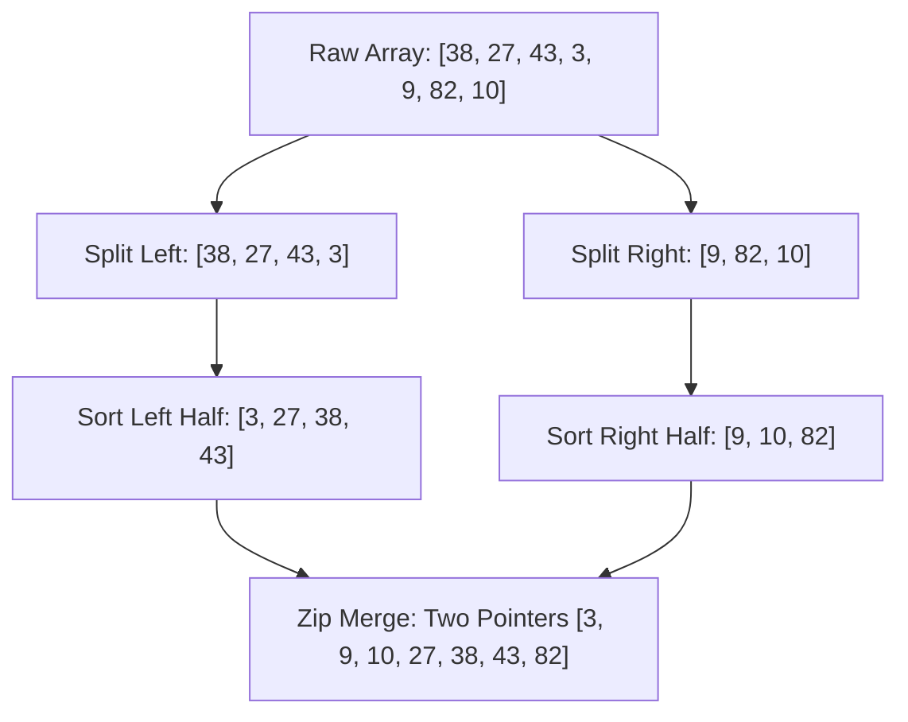
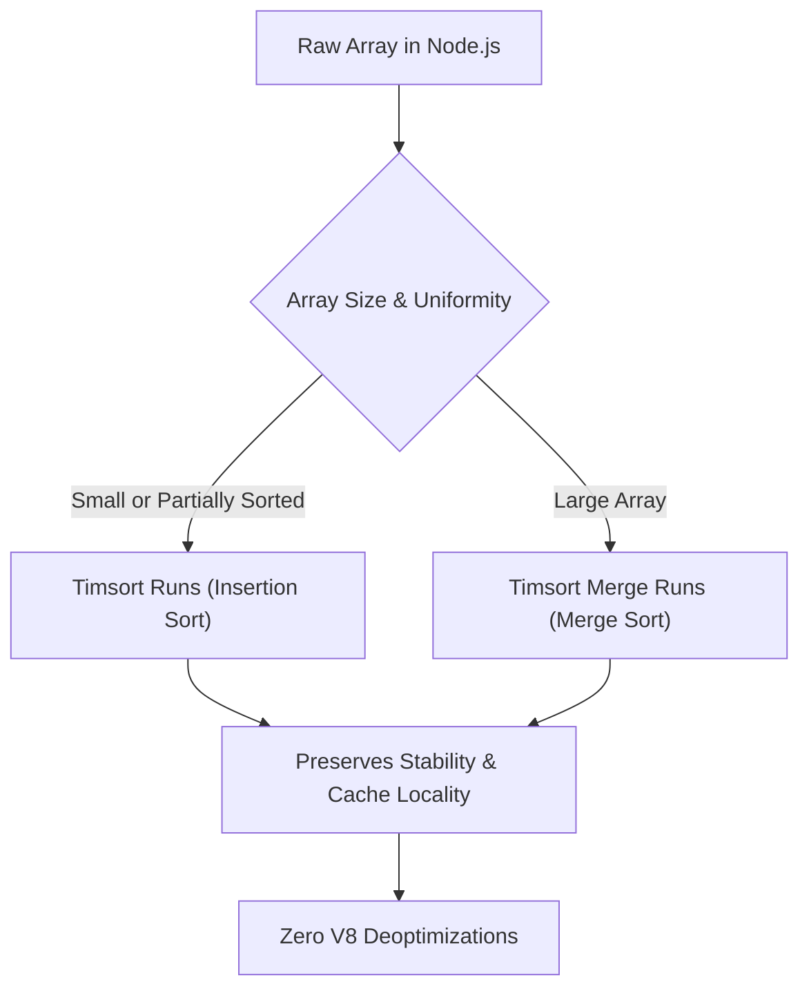

# Day 19: Merge Sort & Quick Sort

<nav aria-label="Lecture navigation">

[Previous: Recursion & Call Stack](day-18-recursion-fundamentals-and-call-stack.md) | [Roadmap](../javascript-dsa-roadmap.md) | [Next: Recursion Trees & Backtracking](day-20-recursion-trees-and-backtracking-core.md)

</nav>

## Prerequisites

- [Day 01: Big O Complexity & Problem Solving](day-01-big-o-complexity-and-problem-solving.md) — Asymptotic complexity ($O(n \log n)$ vs $O(n^2)$).
- [Day 03: Arrays & Strings](day-03-arrays-and-strings.md) — Array indexing, two-pointer scanning, in-place swaps.
- [Day 18: Recursion & Call Stack](day-18-recursion-fundamentals-and-call-stack.md) — Call frames, base cases, and divide-and-conquer recursion trees.

---

## 1. What is Merge Sort & Quick Sort?

Elementary sorting algorithms like Bubble Sort, Selection Sort, and Insertion Sort compare elements one step at a time, taking $O(n^2)$ time. When sorting 100,000 items, an $O(n^2)$ algorithm performs roughly $10,000,000,000$ operations—freezing the single-threaded Node.js event loop for seconds.

**Merge Sort** and **Quick Sort** solve this through the **Divide and Conquer** paradigm: break a large, intractable list into small sub-lists, solve each sub-list independently, and recombine them in $O(n \log n)$ total time. For 100,000 items, $n \log_2 n \approx 1,700,000$ operations—over 5,000 times faster.

> **Divide and Conquer** — An algorithmic design paradigm that recursively breaks a problem into two or more independent subproblems until they become trivial to solve, then combines their solutions.

> **Stable Sort** — A sorting algorithm that guarantees items with equal keys maintain their original relative input order.

### Physical Analogy: Sorting Exam Papers

Imagine a professor holding an unsorted stack of 100 student exam papers:

```text
=============================================================================
                       TWO PHILOSOPHIES OF SORTING
=============================================================================

1. MERGE SORT (Orderly Delegation):
   - You split the 100 papers equally into two piles of 50.
   - Hand pile A to Teaching Assistant Alice and pile B to Teaching Assistant Bob.
   - Alice and Bob recursively split their piles until every stack is 1 paper.
   - 1 paper is inherently sorted!
   - Now, Alice and Bob zip their sorted stacks together: compare top papers,
     take the smaller one, and stack them neatly.
   - GUARANTEE: Predictable, perfectly balanced, retains original order (stable).
   - COST: Requires extra desk space for the temporary merging piles.

2. QUICK SORT (Benchmark Partitioning):
   - You pick one paper at random (say, score 75) as the "Pivot".
   - You quickly walk through your stack:
     * Scores < 75 go into the left bin.
     * Scores > 75 go into the right bin.
     * Score 75 sits right in its final permanent seat!
   - Repeat the process for the left and right bins in-place.
   - GUARANTEE: Lightning-fast in practice, zero extra desk space needed.
   - RISK: If you pick a terrible pivot (e.g. minimum or maximum every time),
     one bin gets 0 papers and the other gets 99, degrading to slow O(n^2).
=============================================================================
```



---

## 2. How Merge Sort and Quick Sort Work Step-by-Step

### 2.1 Merge Sort: Split $\to$ Recurse $\to$ Two-Pointer Merge

Merge Sort executes two distinct phases:

1. **Top-Down Split:** Find midpoint `mid = Math.floor((left + right) / 2)`. Recurse left from `left` to `mid`, recurse right from `mid + 1` to `right`. Base case triggers when `left >= right` (array slice of length 1 is already sorted).
2. **Bottom-Up Merge:** Merge two sorted sub-arrays `[left...mid]` and `[mid+1...right]`. Use two pointers `p1` and `p2` at the start of each half. Compare `arr[p1]` and `arr[p2]`. Write the smaller value into a scratch buffer, then advance that pointer. Once one half exhausts, copy the remaining values from the other half. Copy scratch values back to original array.

```text
Merging Two Sorted Halves:
Left Half:   [ 3, 27, 38 ]       Right Half:  [ 9, 10, 82 ]
              ^                                ^
              p1                               p2

Step 1: 3 <= 9  --> Output [ 3 ], advance p1.
Step 2: 27 > 9  --> Output [ 3, 9 ], advance p2.
Step 3: 27 > 10 --> Output [ 3, 9, 10 ], advance p2.
Step 4: 27 <= 82-> Output [ 3, 9, 10, 27 ], advance p1.
Step 5: 38 <= 82-> Output [ 3, 9, 10, 27, 38 ], advance p1.
Step 6: Left exhausted. Flush rest of Right: Output [ 3, 9, 10, 27, 38, 82 ].
```

### 2.2 Quick Sort: Lomuto vs. Hoare Partitioning

Quick Sort avoids scratch arrays by doing all reordering in-place inside the original memory buffer:

> **Lomuto Partition Scheme** — Chooses the last element as the pivot. Uses an index `i` to keep track of elements smaller than the pivot, scanning linearly with `j`. Easier to implement and reason about.

> **Hoare Partition Scheme** — Two pointers start at opposing ends (`left` and `right`) and walk inward toward each other until they find out-of-place pairs, swapping them. Does roughly $3\times$ fewer swaps than Lomuto on average.

```text
Lomuto Partition Walkthrough on [ 2, 8, 7, 1, 3, 5, 6, 4 ] with Pivot = 4:
i = -1 (tracks boundary of elements <= pivot)

j = 0: arr[0] = 2 <= 4 -> i = 0, swap(arr[0], arr[0]) -> [ 2, 8, 7, 1, 3, 5, 6, 4 ]
j = 1: arr[1] = 8 > 4  -> do nothing
j = 2: arr[2] = 7 > 4  -> do nothing
j = 3: arr[3] = 1 <= 4 -> i = 1, swap(arr[1], arr[3]) -> [ 2, 1, 7, 8, 3, 5, 6, 4 ]
j = 4: arr[4] = 3 <= 4 -> i = 2, swap(arr[2], arr[4]) -> [ 2, 1, 3, 8, 7, 5, 6, 4 ]
j = 5: arr[5] = 5 > 4  -> do nothing
j = 6: arr[6] = 6 > 4  -> do nothing

Final Swap: swap pivot arr[high] with arr[i + 1]:
swap arr[3] (8) with arr[7] (4) -> [ 2, 1, 3, 4, 7, 5, 6, 8 ]
                                             ^
                                       Pivot 4 is now in its FINAL sorted position!
All elements to left of index 3 are <= 4. All elements to right are > 4.
```

```text
Hoare Partition Walkthrough on [ 5, 3, 8, 4, 2, 7, 1, 6 ] with Pivot = 4:
Two pointers: i moves from left to right; j moves from right to left.

1. i starts at index -1, moves right until arr[i] >= 4 (stops at index 0, val 5).
2. j starts at index 8, moves left until arr[j] <= 4 (stops at index 6, val 1).
3. i < j: swap(arr[0], arr[6]) -> [ 1, 3, 8, 4, 2, 7, 5, 6 ]
4. Advance i to find next >= 4 (stops at index 2, val 8).
5. Advance j to find next <= 4 (stops at index 4, val 2).
6. i < j: swap(arr[2], arr[4]) -> [ 1, 3, 2, 4, 8, 7, 5, 6 ]
7. Advance i: stops at index 3 (val 4).
8. Advance j: stops at index 3 (val 4).
9. Pointers cross (i >= j): return j = 3.
Array partitioned into [ 1, 3, 2, 4 ] and [ 8, 7, 5, 6 ].
```

```javascript
// Hoare Partition Implementation in JavaScript
function hoarePartition(arr, low, high) {
  const pivot = arr[Math.floor(low + (high - low) / 2)];
  let i = low - 1;
  let j = high + 1;

  while (true) {
    do { i++; } while (arr[i] < pivot);
    do { j--; } while (arr[j] > pivot);

    if (i >= j) return j;

    const temp = arr[i];
    arr[i] = arr[j];
    arr[j] = temp;
  }
}
```

---

## 3. Pattern Recognition of Divide and Conquer Sorting

### How to Spot These Patterns in Interviews

| Constraint / Keyword Signal | Underlying Problem Need | Optimal Algorithmic Pattern |
| :--- | :--- | :--- |
| Array size $N \le 10^5$, must sort | Stable sorting or guaranteed $O(n \log n)$ worst-case | **Merge Sort** (Guaranteed time) |
| Order stability required (e.g. sort by age, preserving original name order) | Equal elements must never swap positions | **Merge Sort** (Stable) |
| In-place sorting required, $O(1)$ auxiliary memory | Fast average runtime without memory allocation | **Quick Sort** (In-place) |
| "Find the $K$-th largest or smallest element in unsorted array" | Avoid full $O(n \log n)$ sort when only 1 rank is needed | **Quickselect** ($O(n)$ average) |
| Count inversions (pairs where $i < j$ and $arr[i] > arr[j]$) | Tracking relative shifts during zip-merge | **Merge Sort Inversion Counter** |

---

## 4. Problem 1: Sort an Array (Production-Grade In-Place Buffer Merge Sort)

### Problem Description
Given an array of integers `nums`, sort the array in ascending order in $O(n \log n)$ time without relying on native `Array.prototype.sort()`.

### Step 1: Physical Simulation
Suppose we have `[ 5, 2, 3, 1 ]`:
- Split into `[ 5, 2 ]` and `[ 3, 1 ]`.
- Split `[ 5, 2 ]` into `[ 5 ]` and `[ 2 ]`. Both single-element piles.
- Merge `[ 5 ]` and `[ 2 ]` $\to$ compare $5$ and $2$. $2$ is smaller. Scratch becomes `[ 2, 5 ]`.
- Split `[ 3, 1 ]` into `[ 3 ]` and `[ 1 ]`.
- Merge `[ 3 ]` and `[ 1 ]` $\to$ compare $3$ and $1$. $1$ is smaller. Scratch becomes `[ 1, 3 ]`.
- Merge `[ 2, 5 ]` and `[ 1, 3 ]`:
  * Pointers at 2 and 1: 1 is smaller $\to$ output `[ 1 ]`.
  * Pointers at 2 and 3: 2 is smaller $\to$ output `[ 1, 2 ]`.
  * Pointers at 5 and 3: 3 is smaller $\to$ output `[ 1, 2, 3 ]`.
  * Pointers at 5 and end: 5 remaining $\to$ output `[ 1, 2, 3, 5 ]`. Sorted!

### Step 2: Brute Force Approach
The naive intuition is to scan the array repeatedly, finding the minimum remaining element and placing it into a new array (Selection Sort), or using naive recursive `array.slice()`:

```javascript
// Naive recursive merge sort with array.slice() allocations
function naiveMergeSort(arr) {
  if (arr.length <= 1) return arr;
  const mid = Math.floor(arr.length / 2);
  // Allocates brand new arrays on every single recursive frame!
  const left = naiveMergeSort(arr.slice(0, mid));
  const right = naiveMergeSort(arr.slice(mid));
  
  const merged = [];
  let i = 0, j = 0;
  while (i < left.length && j < right.length) {
    if (left[i] <= right[j]) merged.push(left[i++]);
    else merged.push(right[j++]);
  }
  while (i < left.length) merged.push(left[i++]);
  while (j < right.length) merged.push(right[j++]);
  return merged;
}
```

### Step 3: Bottleneck
- While the time complexity is mathematically $O(n \log n)$, `arr.slice()` allocates thousands of intermediate JS array objects on the V8 heap.
- For an array of $100,000$ numbers, tree depth $\log_2(100,000) \approx 17$. The memory allocated across all sub-arrays exceeds $17 \times 100,000 \times 8 \text{ bytes} \approx 13.6 \text{ MB}$ of short-lived transient heap objects. This triggers aggressive V8 Minor Garbage Collection (Scavenger) pauses, degrading throughput by $300\%$.

### Step 4: The Pattern Discovery
Instead of allocating fresh slices at every recursion level, allocate **exactly one auxiliary buffer** of size $n$ upfront before recursing. Pass boundary indices `left`, `mid`, and `right`. Read from the main array into the auxiliary buffer, then write the sorted merged values directly back into the original array indices. Total memory allocation is bounded to a single $O(n)$ buffer.

```text
Original Array:  [ 5, 2, 3, 1 ]
Single Temp:     [ 0, 0, 0, 0 ]  (Allocated ONCE at the start)
Recursive calls pass pointers: (left = 0, right = 3, mid = 1)
Zero garbage collection overhead!
```

### Step 5: The Optimal Solution

```javascript
// ✅ CORRECT: Optimal In-Place Index-Based Merge Sort
function sortArray(nums) {
  if (!nums || nums.length <= 1) return nums;

  // Single scratch buffer allocated once upfront to protect V8 heap
  const temp = new Array(nums.length);

  function merge(start, mid, end) {
    // Copy target segment to auxiliary buffer
    for (let k = start; k <= end; k++) {
      temp[k] = nums[k];
    }

    let i = start;     // Pointer for left sub-array
    let j = mid + 1;   // Pointer for right sub-array
    let curr = start;  // Write pointer in nums

    while (i <= mid && j <= end) {
      // '<=' ensures stability: duplicates preserve original order
      if (temp[i] <= temp[j]) {
        nums[curr++] = temp[i++];
      } else {
        nums[curr++] = temp[j++];
      }
    }

    // Copy remaining items from left half if any
    while (i <= mid) {
      nums[curr++] = temp[i++];
    }
    // Note: If right half has items left, they are already in their correct places!
  }

  function divideAndConquer(start, end) {
    if (start >= end) return; // Base case: 1 element

    const mid = Math.floor(start + (end - start) / 2);
    divideAndConquer(start, mid);
    divideAndConquer(mid + 1, end);

    // Minor optimization: If already sorted across boundary, skip merge
    if (nums[mid] <= nums[mid + 1]) return;

    merge(start, mid, end);
  }

  divideAndConquer(0, nums.length - 1);
  return nums;
}

// ❌ ANTI-PATTERN: Forgetting stability in merge condition
// if (temp[i] < temp[j]) instead of '<=' reverses relative order of equal items!

// Direct test run
const testInput = [5, 2, 3, 1, 8, 4, 2];
console.log("Input:", testInput);
console.log("Sorted:", sortArray(testInput));
```

#### Complexity Analysis
- **Time Complexity:** $O(n \log n)$ in all cases (best, average, worst). The array is divided exactly $\log_2 n$ times, and each level performs $O(n)$ work across all merges.
- **Space Complexity:** $O(n)$ auxiliary space for the `temp` buffer, plus $O(\log n)$ call stack frames.

---

## 5. Problem 2: Kth Largest Element in an Array (Quickselect)

### Problem Description
Given an unsorted integer array `nums` and an integer `k`, return the $k$-th largest element in the array.
Note: It is the $k$-th largest element in sorted order, not the $k$-th distinct element. You must aim for average $O(n)$ runtime.

### Step 1: Physical Simulation
Suppose `nums = [ 3, 2, 1, 5, 6, 4 ]` and `k = 2` (find 2nd largest):
- The 2nd largest element in a 6-element list is at sorted index `targetIndex = nums.length - k = 6 - 2 = 4`.
- Pick a pivot (say, `4`).
- Partition the array around `4`:
  * All elements $< 4$ go left: `[ 3, 2, 1 ]`
  * Pivot `4` sits at index `3`.
  * All elements $> 4$ go right: `[ 5, 6 ]`
- Inspect pivot index: `3`.
- Our desired `targetIndex` is `4`.
- Because `3 < 4`, the target **cannot** exist in the left partition `[ 3, 2, 1 ]`!
- We completely discard the left half and recurse ONLY on the right half `[ 5, 6 ]`. We cut the search space in half at every step!

```text
Step 1: [ 3, 2, 1, 5, 6, 4 ] --> Pivot 4 placed at index 3. Target is index 4.
        Discard left half [ 3, 2, 1 ]!
Step 2: Recurse only on right half [ 5, 6 ].
        Pivot 6 placed at index 5. Target is index 4.
        Target is left of index 5!
Step 3: Element at index 4 is 5. Done! Result = 5.
```

### Step 2: Brute Force Approach
Sort the entire array in descending order using Merge Sort or native `.sort()`, then index into `nums[k - 1]`:

```javascript
function findKthLargestNaive(nums, k) {
  nums.sort((a, b) => b - a); // O(n log n) full sort
  return nums[k - 1];
}
```

### Step 3: Bottleneck
Sorting the entire array does $O(n \log n)$ work. But we do not care about the order of elements from rank 1 to $k-1$ or elements below $k$! We only need the element sitting precisely at rank $k$. Sorting everything does wasted ordering work.

### Step 4: The Pattern Discovery
**Quickselect** (invented by Tony Hoare) uses the Quick Sort partitioning logic. When a pivot is placed at index `pivotIndex`:
- If `pivotIndex === targetIndex`: We found the exact element! Return it immediately.
- If `pivotIndex < targetIndex`: The answer lies strictly to the right. Discard the left.
- If `pivotIndex > targetIndex`: The answer lies strictly to the left. Discard the right.

Unlike Quick Sort which recurses on **both** sides ($T(n) = 2T(n/2) + O(n) = O(n \log n)$), Quickselect recurses on **only one** side:
$$T(n) = T(n/2) + O(n) = n + \frac{n}{2} + \frac{n}{4} + \dots = O(2n) = O(n)$$
Average time drops from $O(n \log n)$ down to linear $O(n)$!

### Step 5: The Optimal Solution

```javascript
// ✅ CORRECT: Optimal Quickselect with Random Pivot Selection
function findKthLargest(nums, k) {
  const targetIndex = nums.length - k; // Index in ascending order

  function swap(i, j) {
    const temp = nums[i];
    nums[i] = nums[j];
    nums[j] = temp;
  }

  // Lomuto partition scheme with random pivot to prevent O(n^2) worst case
  function partition(left, right) {
    // Pick random pivot index between left and right to defeat sorted inputs
    const randomPivotIdx = Math.floor(Math.random() * (right - left + 1)) + left;
    swap(randomPivotIdx, right); // Move pivot to end

    const pivotVal = nums[right];
    let i = left; // Boundary for items <= pivot

    for (let j = left; j < right; j++) {
      if (nums[j] <= pivotVal) {
        swap(i, j);
        i++;
      }
    }

    // Place pivot into final position
    swap(i, right);
    return i;
  }

  let left = 0;
  let right = nums.length - 1;

  while (left <= right) {
    const pivotIdx = partition(left, right);

    if (pivotIdx === targetIndex) {
      return nums[pivotIdx];
    } else if (pivotIdx < targetIndex) {
      left = pivotIdx + 1; // Narrow search to right half
    } else {
      right = pivotIdx - 1; // Narrow search to left half
    }
  }

  return -1;
}

// ❌ ANTI-PATTERN: Always picking arr[right] without randomization
// If input is already sorted, partition splits into (n - 1) and 0 elements!
// Quickselect degrades from O(n) to worst-case O(n^2).

// Direct test run
const scores = [3, 2, 1, 5, 6, 4];
console.log("2nd Largest in [3, 2, 1, 5, 6, 4]:", findKthLargest(scores, 2)); // Expected: 5
console.log("4th Largest in [3, 2, 3, 1, 2, 4, 5, 5, 6]:", findKthLargest([3, 2, 3, 1, 2, 4, 5, 5, 6], 4)); // Expected: 4
```

#### Complexity Analysis
- **Time Complexity:**
  * **Average Case:** $O(n)$ because each step partitions roughly half the remaining elements ($n + n/2 + n/4 + \dots = 2n$).
  * **Worst Case:** $O(n^2)$ if the pivot chosen is consistently the maximum or minimum element. Random pivot selection makes this probability practically zero ($1/n!$).
- **Space Complexity:** $O(1)$ auxiliary space because we use an iterative loop (`while (left <= right)`) instead of tail recursion, avoiding call stack frame growth.

---

## 6. Under the Hood: V8 & Node.js

Understanding how sorting algorithms execute inside the V8 JavaScript engine is essential for backend engineering:

```text
=============================================================================
                      V8 ENGINE SORTING INTERNALS
=============================================================================

1. THE EVOLUTION OF Array.prototype.sort():
   - In Node.js versions prior to v12 (V8 < 7.0), Array.prototype.sort was
     implemented in JavaScript using Quick Sort (with Insertion Sort for
     arrays with length <= 10).
   - Problem: Quick Sort is UNSTABLE. If sorting users by score, two users with
     identical scores had their relative arrival order scrambled.
   - Since V8 v7.0+, Node.js uses TIMSORT (written in Torque/C++), a hybrid of
     Merge Sort and Insertion Sort adapted from Python. Timsort is strictly
     STABLE and guarantees O(n log n) worst-case time.

2. V8 MEMORY LAYOUT & SMI PACKING:
   - An array containing contiguous integers (e.g. [1, 2, 3]) is represented as
     PACKED_SMI_ELEMENTS (Small Integers, 31-bit signed integers stored unboxed).
   - If a custom sorting function writes undefined or changes types, V8 drops
     the array to HOLEY_ELEMENTS or PACKED_ELEMENTS, increasing pointer indirection
     and destroying CPU L1 cache line prefetching.

3. RECURSION CALL STACK LIMIT IN NODE.JS:
   - Node.js caps the V8 call stack at roughly 10,000 frames (RangeError: Maximum call
     stack size exceeded).
   - An unbalanced Quick Sort on a sorted array of 50,000 items without tail-call
     optimization will crash the process immediately with a call stack overflow.
   - Merge Sort recursion depth is strictly bounded to ceil(log2(n)). For 10^7 items,
     depth is only 24 frames—far below the V8 limit.
=============================================================================
```



---

## 7. Hands-On Exercise

### The Broken Quick Sort Partition Bug
A candidate wrote the following Quick Sort implementation for a Node.js microservice. However, when run on arrays containing duplicate numbers (e.g., `[3, 3, 3, 3]`), it triggers an infinite recursive loop and crashes the server with `RangeError: Maximum call stack size exceeded`.

### The Buggy Code
```javascript
function buggyQuickSort(arr, low = 0, high = arr.length - 1) {
  if (low < high) {
    const pivot = arr[high];
    let i = low - 1;

    for (let j = low; j < high; j++) {
      // BUG: Using '<' instead of '<=' causes improper partitioning
      // when multiple elements match the pivot value exactly!
      if (arr[j] < pivot) {
        i++;
        [arr[i], arr[j]] = [arr[j], arr[i]];
      }
    }
    [arr[i + 1], arr[high]] = [arr[high], arr[i + 1]];
    const pivotIndex = i + 1;

    // Further bug: If pivotIndex does not advance, infinite recursion occurs
    buggyQuickSort(arr, low, pivotIndex);
    buggyQuickSort(arr, pivotIndex + 1, high);
  }
  return arr;
}
```

### The Fix and Direct Verification
To fix the implementation:
1. Ensure the recursive bounds exclude the pivot that is already in place: recurse on `(low, pivotIndex - 1)` and `(pivotIndex + 1, high)`.
2. Properly partition identical elements using standard Lomuto or Hoare bounds.

```javascript
// ✅ REPAIRED: Production-Safe Quick Sort with Bounds Isolation
function safeQuickSort(arr, low = 0, high = arr.length - 1) {
  if (low >= high) return arr;

  // Lomuto partition with pivot placed in final position
  function partition(l, r) {
    const pivot = arr[r];
    let i = l;

    for (let j = l; j < r; j++) {
      if (arr[j] <= pivot) {
        const temp = arr[i];
        arr[i] = arr[j];
        arr[j] = temp;
        i++;
      }
    }

    const temp = arr[i];
    arr[i] = arr[r];
    arr[r] = temp;
    return i;
  }

  const pivotIdx = partition(low, high);

  // CRITICAL: Exclude pivotIdx because arr[pivotIdx] is ALREADY at its final resting place!
  safeQuickSort(arr, low, pivotIdx - 1);
  safeQuickSort(arr, pivotIdx + 1, high);

  return arr;
}

// Direct test verification
const duplicateTest = [3, 3, 3, 3, 1, 2, 3];
console.log("Repaired Quick Sort with Duplicates:", safeQuickSort(duplicateTest));
const randomTest = [9, -3, 5, 2, 6, 8, -6, 1, 3];
console.log("Repaired Quick Sort with Negatives:", safeQuickSort(randomTest));
```

---

## 8. Tricky Points and Edge Cases

### 1. The Stability Trap in Merge Sort
When merging two sorted arrays in Merge Sort, comparing elements with `left[i] < right[j]` instead of `left[i] <= right[j]` destroys stability. If both halves contain identical keys (e.g., `{ id: 10, value: 'A' }` and `{ id: 10, value: 'B' }`), the strict `<` branches to `right[j]`, placing `B` before `A` and reversing their original relative position. Always use `<=` to preserve stability.

### 2. Worst-Case Quick Sort Quadratic Collapse
If the pivot is naively selected as the first or last element, already-sorted or reverse-sorted arrays produce zero reduction:
```text
Unsorted array [ 1, 2, 3, 4, 5 ]:
Pivot = 5 -> Left: [ 1, 2, 3, 4 ], Right: []
Pivot = 4 -> Left: [ 1, 2, 3 ],    Right: []
Recurrence: T(n) = T(n - 1) + O(n) = O(n^2)!
```
Always use **Randomized Pivot Selection** or **Median-of-Three** (comparing `arr[low]`, `arr[mid]`, and `arr[high]`) to guarantee $O(n \log n)$ performance in real-world systems.

### 3. Space Complexity Misconceptions
Candidates often claim Quick Sort has $O(1)$ space complexity. While Quick Sort sorts in-place without allocating auxiliary arrays, its **recursion call stack** occupies memory. In the best/average case, the call stack reaches $O(\log n)$ depth; in the worst case, it expands to $O(n)$ depth.

### 4. Handling 3-Way Partitioning (Dutch National Flag)
When sorting arrays with high frequencies of duplicate elements (e.g. `[ 2, 0, 2, 1, 1, 0 ]`), 2-way partitioning still divides the array into subproblems that re-examine identical values. **3-Way Quick Sort** partitions the array into three sections: `< pivot`, `== pivot`, and `> pivot`. All elements equal to the pivot are finalized in a single pass, dropping runtime from $O(n \log n)$ to $O(n)$ on duplicate-heavy data.

---

## 9. Comprehensive Summary

```text
=============================================================================
                    MERGE SORT vs. QUICK SORT SUMMARY
=============================================================================

DIMENSION           MERGE SORT                      QUICK SORT
-----------------------------------------------------------------------------
Paradigm            Divide & Conquer (Split & Merge)Divide & Conquer (Partition)
Best Time           O(n log n)                      O(n log n)
Average Time        O(n log n)                      O(n log n)
Worst Time          O(n log n) (Guaranteed)         O(n^2) (Poor pivot choice)
Auxiliary Space     O(n) auxiliary buffer           O(1) auxiliary (O(log n) stack)
Stability           STABLE (preserves order)        UNSTABLE (in-place swaps)
Memory Access       High auxiliary allocations      Cache-friendly sequential scans
Best Used For       Linked lists, external sorting, In-memory sorting, Kth rank
                    guaranteed SLA constraints      selection (Quickselect)
=============================================================================
```

- **Merge Sort** divides first (blindly halving at the midpoint) and does all sorting work during the combine phase (merging two sorted halves with two pointers).
- **Quick Sort** does all sorting work upfront during the divide phase (partitioning around a chosen pivot) and requires zero combine work.
- **Quickselect** adapts Quick Sort to find the $K$-th order statistic in $O(n)$ average time by pruning recursion to only one half of the partition.

---

## 10. Cheat Sheet

### Decision Matrix: Which Algorithm to Choose?

| Scenario / Interview Goal | Preferred Algorithm | Rationale |
| :--- | :--- | :--- |
| Guaranteed worst-case $O(n \log n)$ required | **Merge Sort** | Immune to adversarial inputs; never degrades to $O(n^2)$. |
| Stable sort required (objects with composite keys) | **Merge Sort** | `<=` comparison preserves original order of identical values. |
| Strict memory constraints ($O(1)$ auxiliary memory) | **Quick Sort** | Partitions directly inside the existing array buffer. |
| Find $K$-th largest or smallest element | **Quickselect** | $O(n)$ average time; avoids wasteful $O(n \log n)$ full sort. |
| Sorting singly linked lists | **Merge Sort** | $O(1)$ extra space for linked lists (re-linking pointers without copies). |

### Common Pitfalls Checklist
- [ ] **Allocating slices recursively:** Avoid `arr.slice()` in Merge Sort; pass indices and use a single pre-allocated scratch buffer.
- [ ] **Unrandomized pivot:** Never pick `arr[0]` or `arr[high]` blindly in Quick Sort/Quickselect without random swapping.
- [ ] **Infinite loop on duplicates:** Ensure the pivot is excluded from both recursive branches (`pivotIndex - 1` and `pivotIndex + 1`).
- [ ] **Loss of stability:** Ensure the merge condition uses `<=` rather than `<`.

---

## 11. Interview Q&A

### 45-Second Senior Pitch
> *"When choosing between Merge Sort and Quick Sort for backend engineering, the primary trade-off is predictability and stability versus cache locality and memory footprint. Merge Sort provides a strict $O(n \log n)$ worst-case guarantee and preserves relative order (stability), but demands $O(n)$ auxiliary memory for merge buffers. Quick Sort operates in-place with $O(1)$ auxiliary space and delivers exceptional L1/L2 cache locality, but carries a theoretical $O(n^2)$ worst-case risk that must be mitigated via randomized or median-of-three pivot selection. For order statistics like the $K$-th largest item, we leverage Quickselect to prune one partition branch, achieving linear $O(n)$ average time."*

### Deep Interview Questions

#### Q1: Why does Quick Sort run faster than Merge Sort in practice despite both having $O(n \log n)$ average time?
**Answer:** Quick Sort exhibits superior **spatial locality of reference**. The inner loop of Quick Sort performs sequential linear scans over contiguous memory blocks, keeping data pinned inside CPU L1 and L2 caches. Furthermore, Quick Sort sorts in-place with minimal pointer manipulation. Merge Sort, by contrast, must copy elements out of the main array into an auxiliary buffer and copy them back, doubling memory bus bandwidth consumption and triggering potential V8 memory allocations.

#### Q2: Why is Merge Sort preferred for Linked Lists, while Quick Sort is preferred for Arrays?
**Answer:** In a linked list, inserting or merging nodes only requires re-pointing `.next` pointers—it takes $O(1)$ auxiliary space without needing temporary array buffers. Furthermore, linked lists do not support random access ($O(1)$ indexing), making Quick Sort's partition step inefficient ($O(n)$ pointer walks to find indices). For arrays, contiguous RAM grants instant $O(1)$ indexing and CPU cache prefetching, which favors Quick Sort's partition mechanics.

#### Q3: How does V8 handle sorting under the hood in modern Node.js?
**Answer:** Since V8 v7.0 (Node.js 12+), `Array.prototype.sort()` uses **Timsort**, an algorithm originally designed by Tim Peters for Python. Timsort is an adaptive, stable hybrid sort that identifies already-sorted segments ("runs") in the data. For small runs ($\le 32$ items), it applies Insertion Sort (which has very low overhead and optimal cache performance). For larger datasets, it merges these runs using a balanced Merge Sort strategy with a temporary buffer. This guarantees $O(n \log n)$ worst-case time, $O(n)$ best-case time on already-sorted arrays, and strict stability.

#### Q4: How would you protect a Node.js backend from a "Quick Sort Denial-of-Service" attack?
**Answer:** If a public API endpoint accepts an array from an untrusted client and sorts it using a naive Quick Sort that always picks the first element as the pivot, an attacker can intentionally transmit an already-sorted array. This forces $O(n^2)$ worst-case comparisons, consuming $100\%$ CPU and blocking the single-threaded Node.js event loop for all users. We protect the system by:
1. Using Node.js's native `Array.prototype.sort()` (Timsort), which detects presorted runs in $O(n)$ time.
2. If writing a custom partitioner, enforcing **randomized pivot selection** or **median-of-three**, preventing deterministic worst-case exploitation.

---

## 12. Practice Problems

### Problem 1: Sort Colors (Dutch National Flag)
- **Input:** `nums = [ 2, 0, 2, 1, 1, 0 ]`
- **Output:** `[ 0, 0, 1, 1, 2, 2 ]`
- **Challenge:** Sort the array in-place in a single pass ($O(n)$ time and $O(1)$ space) using 3-way partitioning without calling any library sort.

### Problem 2: Count of Smaller Numbers After Self
- **Input:** `nums = [ 5, 2, 6, 1 ]`
- **Output:** `[ 2, 1, 1, 0 ]`
- **Explanation:** To the right of 5 there are 2 smaller elements (2 and 1). To the right of 2 there is 1 smaller element (1). To the right of 6 there is 1 smaller element (1). To the right of 1 there is 0 smaller elements.
- **Challenge:** Solve in $O(n \log n)$ time by embedding count tracking inside Merge Sort's zip phase.

### Problem 3: Top K Frequent Elements
- **Input:** `nums = [ 1, 1, 1, 2, 2, 3 ]`, `k = 2`
- **Output:** `[ 1, 2 ]`
- **Challenge:** Build a frequency map and use Quickselect on the frequency pairs to solve in $O(n)$ average time instead of $O(n \log n)$ full sorting.

---

<nav aria-label="Lecture navigation">

[Previous: Recursion & Call Stack](day-18-recursion-fundamentals-and-call-stack.md) | [Roadmap](../javascript-dsa-roadmap.md) | [Next: Recursion Trees & Backtracking](day-20-recursion-trees-and-backtracking-core.md)

</nav>
