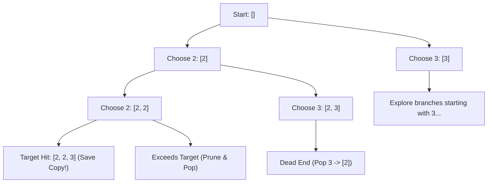
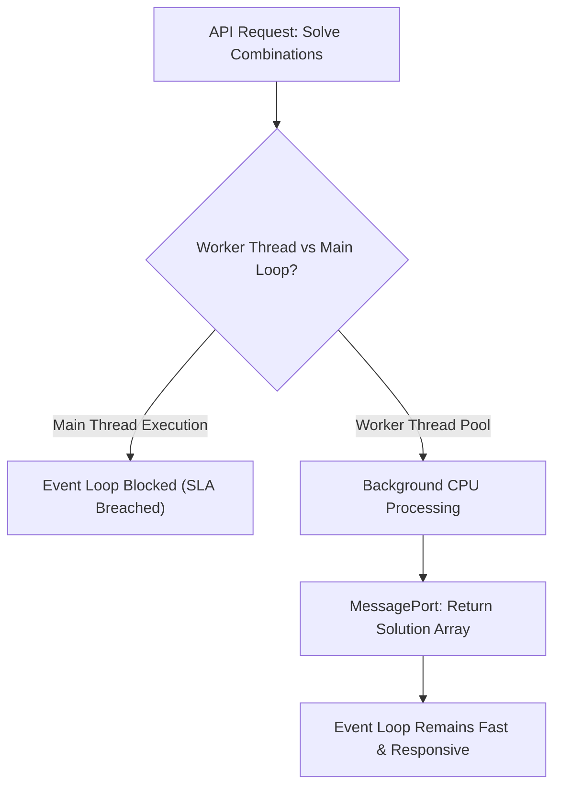

# Day 20: Recursion Trees & Backtracking

<nav aria-label="Lecture navigation">

[Previous: Merge Sort & Quick Sort](day-19-merge-sort-and-quick-sort.md) | [Roadmap](../javascript-dsa-roadmap.md) | [Next: Subsets, Permutations & Combinations](day-21-subsets-permutations-and-combinations.md)

</nav>

## Prerequisites

- [Day 01: Big O Complexity & Problem Solving](day-01-big-o-complexity-and-problem-solving.md) — Combinatorial complexity ($O(2^n)$, $O(n!)$).
- [Day 13: Stacks & Expression Parsing](day-13-stacks-and-expression-parsing.md) — LIFO state evaluation.
- [Day 18: Recursion & Call Stack](day-18-recursion-fundamentals-and-call-stack.md) — Call frames, activation records, and unwinding.

---

## 1. What is Backtracking?

In standard recursion, we decompose a single problem into independent subproblems (like splitting an array in Merge Sort) and return a value up the call chain. But many complex real-world problems require finding **all valid configurations**, navigating a **combinatorial search space**, or solving **constraint satisfaction puzzles** (such as Sudoku, route planning, or server resource allocation).

**Backtracking** is a systematic algorithmic technique for exploring all candidate solutions by building them incrementally, one choice at a time. The moment an incremental candidate cannot possibly lead to a valid final solution, the algorithm **abandons ("backtracks")** the candidate, undoes the last choice, and resumes searching down alternate branches.

> **Backtracking** — A refined brute-force search strategy that traverses a state-space tree via Depth-First Search, pruning invalid candidate subtrees as early as possible.

> **Pruning (Branch Cutting)** — Terminating search down a subtree immediately when a constraint violation guarantees no valid solutions exist beneath it.

### Physical Analogy: The Maze and the Thread

Imagine you are trapped inside an ancient, dark stone labyrinth:

```text
=============================================================================
                       THE MAZE & BALL OF YARN ANALOGY
=============================================================================

1. CHOOSE:
   - You reach an intersection with 3 passageways: Left, Straight, Right.
   - You drop a ball of glowing yarn at your feet and walk into the LEFT path.

2. EXPLORE:
   - You follow the left path deep into the maze. You reach another fork and
     continue deeper, unwinding the thread behind you.

3. HIT A DEAD END (Constraint Violated):
   - Suddenly, you hit a solid stone wall. You cannot proceed forward.

4. UNCHOOSE (Backtrack):
   - You do NOT wander aimlessly or start over from the maze entrance.
   - You rewind your ball of yarn, walking backwards step-by-step to the
     exact fork where you made the previous decision.
   - You erase the left path from your active journey.

5. NEXT CHOICE:
   - You step into the STRAIGHT path.
   - You systematically exhaust every possible corridor without ever getting
     permanently lost or duplicating dead-end steps.
=============================================================================
```



---

## 2. How Backtracking Works Step-by-Step

### The Universal 3-Step Lifecycle: Choose $\to$ Explore $\to$ Unchoose

Every backtracking algorithm in computer science executes this three-step rhythm inside an active recursive loop:

```text
=============================================================================
               THE CHOOSE -> EXPLORE -> UNCHOOSE LIFECYCLE
=============================================================================

function backtrack(state) {
    if (isGoal(state)) {
        recordSolution(state);     // Goal reached: save a snapshot
        return;
    }

    for (const choice of getAvailableChoices(state)) {
        if (!isValid(choice, state)) continue; // PRUNE dead branches

        makeChoice(state, choice);  // 1. CHOOSE: mutate state (e.g. path.push)
        backtrack(state);           // 2. EXPLORE: recurse down into subtree
        undoChoice(state, choice);  // 3. UNCHOOSE: rollback state (e.g. path.pop)
    }
}
=============================================================================
```

### Trace of Memory Flow: Why Single Mutable State + Rollback Beats Slicing

A critical junior mistake is creating fresh arrays at every recursive step:
`backtrack([...path, choice])`.

In an exponential search space with $2^{20} \approx 1,000,000$ leaves, allocating brand new arrays at every single node creates millions of temporary heap objects, exhausting V8 memory and triggering continuous garbage collection pauses.

Instead, a production backtracking engine maintains **one single mutable array buffer** (`path = []`):
1. **Choose:** `path.push(choice)` pushes an element in $O(1)$ time without new heap allocations.
2. **Explore:** Call `backtrack()` passing the same reference.
3. **Unchoose:** `path.pop()` removes the last element in $O(1)$ time, restoring the array to its pristine pre-decision state.
4. **Snapshot:** When the goal is reached, take an explicit shallow copy: `result.push([...path])`.

```text
Visualizing Single Buffer Mutation:
Stack Depth 0: path = []
  push(2)     --> path = [2]
    push(2)   --> path = [2, 2]
      push(3) --> path = [2, 2, 3]  ==> GOAL! result.push([...path]) (copy created)
      pop()   --> path = [2, 2]     <-- State restored!
    pop()     --> path = [2]        <-- State restored!
  push(3)     --> path = [2, 3]
```

---

## 3. Pattern Recognition of Backtracking

### How to Spot These Patterns in Interviews

| Constraint / Keyword Signal | Underlying Problem Need | Optimal Algorithmic Pattern |
| :--- | :--- | :--- |
| "Find all valid combinations / permutations / partitions" | Full state-space traversal required | **Standard Backtracking Template** |
| $N \le 12$ to $20$ | Exponential $O(2^N)$ or factorial $O(N!)$ upper bound | **Backtracking with Early Pruning** |
| "Generate all valid parentheses of length $2N$" | Valid prefix invariants dictate branch validity | **Pruned DFS (Catalan numbers)** |
| Elements may be reused an unlimited number of times | Decision branch includes self index `i` | **Unbounded Combination Sum** |
| Elements can only be used once; input has duplicates | Skip adjacent duplicates at the same tree level | **Sorted Subsets / Combination Sum II** |
| Matrix path finding / Word search ($N \times M$ grid) | Cell visited state tracking with in-place rollback | **Grid Backtracking (Visited Marker)** |

---

## 4. Problem 1: Combination Sum (LeetCode 39)

### Problem Description
Given an array of distinct integers `candidates` and a target integer `target`, return a list of all **unique combinations** of `candidates` where the chosen numbers sum to `target`. You may return the combinations in any order.

The same number may be chosen from `candidates` an **unlimited number of times**. Two combinations are unique if the frequency of at least one of the chosen numbers is different. All numbers in `candidates` are positive integers.

### Step 1: Physical Simulation
Suppose `candidates = [ 2, 3, 6, 7 ]` and `target = 7`:
- Start with `remaining = 7`, `path = []`.
- Try `2`: `remaining = 5`, `path = [ 2 ]`.
  * Try `2`: `remaining = 3`, `path = [ 2, 2 ]`.
    - Try `2`: `remaining = 1`, `path = [ 2, 2, 2 ]`.
      * Try `2`: `remaining = -1` (Negative! Dead end! Prune & backtrack `path.pop()`).
      * Try `3`: `remaining = -2` (Dead end! Prune & backtrack).
      * No more options. Backtrack `path.pop()`, `path` becomes `[ 2, 2 ]`.
    - Try `3`: `remaining = 0` (Target hit! `path = [ 2, 2, 3 ]` saved!).
    - Backtrack `path.pop()`, `path` becomes `[ 2, 2 ]`.
  * Backtrack `path.pop()`, `path` becomes `[ 2 ]`.
- Eventually try `7`: `remaining = 0` $\to$ save `[ 7 ]`.
- Final answers: `[[2, 2, 3], [7]]`.

### Step 2: Brute Force Approach
Generate all possible sequences of all lengths using unlimited repetition, then filter those that sum to 7 and deduplicate permutations (like `[2, 3, 2]` vs `[3, 2, 2]`):

```javascript
// Naive approach: Explores all permutations and filters duplicates with Set
function naiveCombinationSum(candidates, target) {
  const result = [];
  const seen = new Set();

  function generate(currSum, path) {
    if (currSum === target) {
      const key = [...path].sort((a, b) => a - b).join(",");
      if (!seen.has(key)) {
        seen.add(key);
        result.push([...path]);
      }
      return;
    }
    if (currSum > target) return; // Cut off infinite loops

    for (let num of candidates) {
      // Explores permutations: [2, 3, 2] AND [3, 2, 2] generated independently!
      generate(currSum + num, [...path, num]);
    }
  }

  generate(0, []);
  return result;
}
```

### Step 3: Bottleneck
1. **Permutation Explosion:** The naive approach treats `[2, 2, 3]`, `[2, 3, 2]`, and `[3, 2, 2]` as three distinct paths, wasting CPU cycles exploring all permutations of the same combination.
2. **Array Allocation Churn:** Passing `[...path, num]` creates a brand-new JavaScript array object on every recursive frame.
3. **Unsorted Scans:** Exploring elements smaller than the remaining target without sorting first fails to prune future candidates early.

### Step 4: The Pattern Discovery
1. **Enforce Monotonic Indexing (`startIndex`):** To generate **combinations** instead of **permutations**, once we explore choices starting at index `i`, we never look back at indices `< i`. If we choose `3` (index 1), future recursive decisions can only pick from index 1 (`3`), index 2 (`6`), and index 3 (`7`). This completely eliminates duplicate permutations at the root!
2. **Early Pruning via Sorting:** Sort `candidates` ascending upfront. If `candidates[i] > remainingTarget`, because the array is sorted, every subsequent candidate `candidates[i + 1]`, `candidates[i + 2]`, etc. will also exceed the target. We can execute an immediate `break` instead of continuing the loop!

```text
Decision Tree with startIndex & Sorting:
                   target = 7, candidates = [2, 3, 6, 7]
                               []
                 /          |        \      \
             [2]           [3]       [6]    [7] (Sum=7 -> SAVE!)
           /     \           |         \
       [2,2]    [2,3]      [3,3]      [6,6] (12 > 7 -> BREAK!)
       /   \       \         \
   [2,2,2] [2,2,3] [2,3,3]  [3,3,3]
     |      (SUM=7!  (8 > 7   (9 > 7
  (8 > 7)    SAVE!)   BREAK!)  BREAK!)
```

### Step 5: The Optimal Solution

```javascript
// ✅ CORRECT: Optimal Backtracking with Start Index & Sort Pruning
function combinationSum(candidates, target) {
  const result = [];
  const currentPath = [];

  // Sort ascending: Enables early loop termination (break)
  candidates.sort((a, b) => a - b);

  function backtrack(remainingTarget, startIndex) {
    // Goal state: exact target reached
    if (remainingTarget === 0) {
      // CRITICAL: Push a deep/shallow clone, never the mutable reference!
      result.push([...currentPath]);
      return;
    }

    for (let i = startIndex; i < candidates.length; i++) {
      const candidate = candidates[i];

      // PRUNING: Because candidates are sorted, all subsequent items will also exceed
      if (candidate > remainingTarget) {
        break; // Stop evaluating remaining candidates at this level
      }

      // 1. CHOOSE: Add candidate to path
      currentPath.push(candidate);

      // 2. EXPLORE: Recurse with updated target.
      // Pass 'i' (not 'i + 1') because elements can be reused unlimited times
      backtrack(remainingTarget - candidate, i);

      // 3. UNCHOOSE: Backtrack by popping element to restore pristine state
      currentPath.pop();
    }
  }

  backtrack(target, 0);
  return result;
}

// ❌ ANTI-PATTERN: Pushing path reference directly into result
// result.push(currentPath);
// When backtracking completes and pops all items, result contains only empty arrays [ [], [] ]!

// Direct test run
console.log("Combination Sum ([2, 3, 6, 7], target = 7):");
console.log(combinationSum([2, 3, 6, 7], 7)); // Expected: [ [2, 2, 3], [7] ]

console.log("Combination Sum ([2, 3, 5], target = 8):");
console.log(combinationSum([2, 3, 5], 8)); // Expected: [ [2, 2, 2, 2], [2, 3, 3], [3, 5] ]
```

#### Complexity Analysis
- **Time Complexity:** $O(N^{\frac{T}{M}})$, where $N$ is the number of candidates, $T$ is the target value, and $M$ is the minimal value among candidates. The maximum tree depth is $\frac{T}{M}$. Sorting takes $O(N \log N)$, which is dwarfed by the search tree.
- **Space Complexity:** $O(\frac{T}{M})$ auxiliary space for the recursion call stack and `currentPath` buffer. The solution array stores the final combinations.

---

## 5. Problem 2: Generate Parentheses (LeetCode 22)

### Problem Description
Given an integer `n`, generate all combinations of well-formed parentheses containing exactly `n` pairs of open `(` and closed `)` parentheses.

### Step 1: Physical Simulation
Suppose $n = 3$ (we must place 3 `(` and 3 `)`):
- Total length must be $2 \times 3 = 6$ characters.
- Start with empty string `""`.
- Can we place `)` as the very first character? `")"` $\to$ **Never!** An unmatched closing parenthesis is instantly invalid.
- Rule 1: We can always add an open parenthesis `(` as long as `openCount < n`.
- Rule 2: We can only add a close parenthesis `)` if `closeCount < openCount`.
- Trace for $n = 2$:
  * Place `(` $\to$ `open = 1, close = 0`
    - Place `(` $\to$ `open = 2, close = 0`
      * Cannot add `(` (`open == 2`). Must add `)` $\to$ `open = 2, close = 1` (`"(())"`).
        - Must add `)` $\to$ `open = 2, close = 2` $\to$ `"(())"` (Length 4 $\to$ Valid!).
    - Place `)` $\to$ `open = 1, close = 1` (`"()"`)
      * Place `(` $\to$ `open = 2, close = 1` (`"()("`)
        - Place `)` $\to$ `open = 2, close = 2` $\to$ `"()()"` (Length 4 $\to$ Valid!).
- Valid outputs for $n = 2$: `["(())", "()()"]`.

### Step 2: Brute Force Approach
Generate all $2^{2n}$ possible sequences of length $2n$ using characters `(` and `)`. After generating each string, validate it using a counter or stack:

```javascript
// Brute force: Generates 2^(2n) strings and checks validity
function generateParenthesesNaive(n) {
  const result = [];

  function isValid(str) {
    let balance = 0;
    for (let ch of str) {
      if (ch === '(') balance++;
      else balance--;
      if (balance < 0) return false; // More ')' than '('
    }
    return balance === 0;
  }

  function build(current) {
    if (current.length === 2 * n) {
      if (isValid(current)) result.push(current);
      return;
    }
    build(current + '(');
    build(current + ')');
  }

  build('');
  return result;
}
```

### Step 3: Bottleneck
For $n = 8$, $2^{2n} = 2^{16} = 65,536$ candidate strings are generated. However, the number of valid well-formed combinations is given by the 8th **Catalan number**:
$$C_8 = \frac{1}{9}\binom{16}{8} = 1,430$$
The naive algorithm builds over $64,000$ dead-end strings (such as `))))((((` or `)(()()()`) all the way to length 16 before discovering they were invalid from the very first character!

### Step 4: The Pattern Discovery
Instead of validating at the end, enforce **prefix validity invariants** at every branch decision:
1. **Add `(`:** Only if `openCount < n`.
2. **Add `)`:** Only if `closeCount < openCount`.
Any choice that would violate these invariants is never explored—the subtree is pruned before being created.

### Step 5: The Optimal Solution

```javascript
// ✅ CORRECT: Optimal Backtracking with Prefix Pruning
function generateParenthesis(n) {
  const result = [];
  const currentChars = []; // Single reusable character array buffer

  function backtrack(openCount, closeCount) {
    // Base case: string reached full length (2 * n)
    if (currentChars.length === 2 * n) {
      result.push(currentChars.join(''));
      return;
    }

    // Branch 1: Can we add an opening parenthesis?
    if (openCount < n) {
      currentChars.push('(');              // CHOOSE
      backtrack(openCount + 1, closeCount); // EXPLORE
      currentChars.pop();                  // UNCHOOSE
    }

    // Branch 2: Can we add a closing parenthesis?
    // Invariant: Only valid if strictly fewer closes than opens exist
    if (closeCount < openCount) {
      currentChars.push(')');              // CHOOSE
      backtrack(openCount, closeCount + 1); // EXPLORE
      currentChars.pop();                  // UNCHOOSE
    }
  }

  backtrack(0, 0);
  return result;
}

// ❌ ANTI-PATTERN: String concatenation in deep recursion
// backtrack(currentStr + '(', open + 1, close) creates a new string object
// on every call. Using an array buffer with push/pop avoids string churn.

// Direct test run
console.log("Generate Parentheses (n = 3):");
console.log(generateParenthesis(3));
// Expected: [ "((()))", "(()())", "(())()", "()(())", "()()()" ]

console.log("Generate Parentheses (n = 1):");
console.log(generateParenthesis(1));
// Expected: [ "()" ]
```

#### Complexity Analysis
- **Time Complexity:** $O(\frac{4^n}{\sqrt{n}})$ bounded by the $n$-th Catalan number $C_n = \frac{1}{n+1}\binom{2n}{n}$. For $n = 4$, $C_4 = 14$ operations instead of $2^8 = 256$.
- **Space Complexity:** $O(n)$ auxiliary space. The recursion call stack reaches depth $2n$, and the `currentChars` buffer holds at most $2n$ characters.

---

## 6. Under the Hood: V8 & Node.js

Executing backtracking algorithms in a Node.js backend requires careful attention to the single-threaded event loop and V8 heap mechanics:

```text
=============================================================================
               BACKTRACKING IN V8 & NODE.JS BACKENDS
=============================================================================

1. THE MUTABLE REFERENCE CAPTURE BUG:
   - In JavaScript, Arrays and Objects are reference types passed by pointer.
   - When you write:
       const results = [];
       const path = [1, 2];
       results.push(path); // Pushes the POINTER to path!
   - If subsequent backtracking calls path.pop(), the object stored inside
     results is mutated in-place!
   - ALWAYS take an explicit shallow copy: results.push([...path]) or
     results.push(path.slice()).

2. EVENT LOOP BLOCKING RISK:
   - Node.js executes JavaScript on a single thread.
   - A deep backtracking search (e.g. N-Queens with N=16 or Sudoku solver)
     can execute billions of recursive cycles, monopolizing the CPU for 10+ seconds.
   - During this time, the Node.js event loop CANNOT process incoming HTTP requests,
     socket heartbeats, or database callbacks!
   - Solution for production servers:
     * Offload heavy backtracking to a Worker Thread (`worker_threads`).
     * Or yield the event loop periodically using `await new Promise(r => setImmediate(r))`.

3. V8 CALL STACK DEPTH:
   - Standard V8 stack frame limit is ~10,000 frames.
   - Backtracking search trees generally have a depth equal to the problem size N
     (e.g., N <= 30 for Combination Sum or Subsets). Stack overflow is rare
     unless there is a missing base case or negative cycle.
=============================================================================
```



---

## 7. Hands-On Exercise

### The Missing Backtrack & Shallow Copy Bug
A developer built a subset combination generator for a coupon discount system in Node.js. However, running the function returns an array of empty arrays `[ [], [], [] ]`, and memory usage spikes abnormally.

### The Buggy Code
```javascript
function buggyCouponCombinations(coupons, targetDiscount) {
  const result = [];
  const currentSelection = [];

  function search(remaining, startIndex) {
    if (remaining === 0) {
      // BUG 1: Pushes reference to mutable array!
      result.push(currentSelection);
      return;
    }

    for (let i = startIndex; i < coupons.length; i++) {
      if (coupons[i] > remaining) continue;

      currentSelection.push(coupons[i]);
      search(remaining - coupons[i], i + 1);
      // BUG 2: Developer forgot to UNCHOOSE (currentSelection.pop())!
      // This pollutes sibling search branches with old selections!
    }
  }

  search(targetDiscount, 0);
  return result;
}
```

### The Fix and Direct Verification
1. Add `currentSelection.pop()` immediately after the recursive `search()` invocation to restore state.
2. Push a shallow copy `result.push([...currentSelection])` when the goal condition is met.

```javascript
// ✅ REPAIRED: Production-Grade Coupon Combination Generator
function safeCouponCombinations(coupons, targetDiscount) {
  const result = [];
  const currentSelection = [];

  // Sort coupons to allow deterministic and pruned traversal
  coupons.sort((a, b) => a - b);

  function search(remaining, startIndex) {
    if (remaining === 0) {
      // FIX 1: Take snapshot copy using spread operator
      result.push([...currentSelection]);
      return;
    }

    for (let i = startIndex; i < coupons.length; i++) {
      const coupon = coupons[i];

      // Prune if coupon value exceeds remaining target
      if (coupon > remaining) break;

      // 1. CHOOSE
      currentSelection.push(coupon);

      // 2. EXPLORE (i + 1 ensures each coupon is used at most once)
      search(remaining - coupon, i + 1);

      // FIX 2: UNCHOOSE - Crucial rollback for sibling branches!
      currentSelection.pop();
    }
  }

  search(targetDiscount, 0);
  return result;
}

// Direct test verification
const coupons = [10, 20, 30, 40, 50];
const target = 60;
console.log("Repaired Coupon Combinations for 60%:", safeCouponCombinations(coupons, target));
// Expected combinations: [ [10, 20, 30], [10, 50], [20, 40] ]
```

---

## 8. Tricky Points and Edge Cases

### 1. The Reference Trap (`result.push(path)`)
In JavaScript, arrays are mutable objects passed by reference. If you write `result.push(path)`, every element in `result` points to the exact same memory address. As the recursive functions return and execute their cleanup `path.pop()`, every entry inside `result` will be modified in-place until all entries become `[]`. Always write `result.push([...path])` or `result.push(path.slice())`.

### 2. Duplicates in Input vs Unique Combinations
When the input array contains duplicate elements (e.g., `[1, 2, 2]`), sorting the array upfront is mandatory. To avoid generating duplicate combinations:
```javascript
if (i > startIndex && nums[i] === nums[i - 1]) {
  continue; // Skip identical choices at the SAME tree level
}
```
Notice the condition is `i > startIndex`, **not** `i > 0`. This allows duplicate numbers down the same vertical branch (e.g. `[2, 2]`), but forbids starting two sibling branches with the same value.

### 3. Infinite Recursion on Zero Values
If an input candidate is `0` and elements can be reused an unlimited number of times, subtracting `0` from `remainingTarget` leaves `remainingTarget` unchanged, spawning an infinite recursion loop until V8 crashes with `RangeError: Maximum call stack size exceeded`. Always validate that candidates are strictly positive ($> 0$) before permitting unbounded reuse.

### 4. Pruning with `break` vs `continue`
- If the candidates array is **unsorted**, you must use `continue` because a later element might be smaller.
- If the candidates array is **sorted ascending**, you can safely use `break`, immediately terminating all remaining iterations of the loop and saving significant execution time.

---

## 9. Comprehensive Summary

```text
=============================================================================
                     BACKTRACKING ARCHITECTURE SUMMARY
=============================================================================

COMPONENT           RESPONSIBILITY                          IMPLEMENTATION
-----------------------------------------------------------------------------
Goal Condition      Detects when valid candidate is formed  path.length === K or
                                                            remainingTarget === 0
Snapshotting        Saves an immutable copy of candidate    result.push([...path])
Candidate Loop      Iterates available branch options       for (let i = start; ...)
Pruning Condition   Aborts exploring dead subtrees early    if (val > rem) break;
Choose              Mutates state buffer                    path.push(choice)
Explore             Recurses deeper into state space        backtrack(state, i + 1)
Unchoose (Rollback) Restores state buffer for next sibling  path.pop()
=============================================================================
```

- **Backtracking is DFS on a Decision Tree:** Every level of recursion represents a decision point; every loop iteration represents an available option.
- **`startIndex` Eliminates Permutation Redundancy:** To generate unique subsets/combinations, enforce an increasing index order. To generate permutations, scan all elements using a `visited` set.
- **Pruning converts $O(2^n)$ into Practical Runtimes:** Sort early and prune invalid branches at the root rather than evaluating failure at leaf nodes.

---

## 10. Cheat Sheet

### Decision Matrix: When to Use Which Backtracking Variant

| Problem Type | Search Space Traversal | Loop Indexing | Duplicate Handling |
| :--- | :--- | :--- | :--- |
| **Subsets / Combinations** | Combinations of size $K$ or all subsets | `for (let i = startIndex; ...)` | If input has dups: `i > start && nums[i] === nums[i - 1]` |
| **Permutations** | Order matters (`[1, 2] != [2, 1]`) | `for (let i = 0; ...)` with `visited` set | If input has dups: skip if `nums[i] === nums[i-1] && !visited[i-1]` |
| **Unbounded Combination** | Elements can be picked multiple times | Recurse with `i` instead of `i + 1` | Sort ascending; prune when `candidate > target` |
| **Grid Pathfinding** | 4-directional moves in 2D array | Loop over directions `[[-1,0], [1,0], [0,-1], [0,1]]` | Temporarily mark grid `grid[r][c] = '#'` and revert on backtrack |

### Backtracking Safety Checklist
- [ ] Did you take a copy when saving solutions (`[...path]`)?
- [ ] Does every single `path.push()` have a matching `path.pop()`?
- [ ] Is there an early pruning condition to cut dead subtrees?
- [ ] For combinations, are you advancing `startIndex`?
- [ ] Is the input sorted if early `break` pruning is used?

---

## 11. Interview Q&A

### 45-Second Senior Pitch
> *"Backtracking is a disciplined depth-first search over a combinatorial state-space tree. Instead of generating every conceivable combination and filtering them post-hoc, backtracking evaluates constraints incrementally at each decision step, pruning invalid subtrees before they expand. In JavaScript backends, production-grade backtracking demands two rules: first, maintain a single mutable array buffer with explicit push-explore-pop rollback to avoid heap allocation churn; and second, guard against single-threaded event loop starvation by offloading exponential searches to worker threads."*

### Deep Interview Questions

#### Q1: What is the exact difference between Backtracking and Dynamic Programming?
**Answer:** Both techniques solve problems by breaking them down into subproblems, but their applicability differs fundamentally:
- **Backtracking** is used when you need to **find all solutions**, generate all configurations, or find an optimal path where the decision at one step permanently alters future constraints (no overlapping subproblems). Its worst-case time is typically exponential ($O(2^N)$) or factorial ($O(N!)$).
- **Dynamic Programming** applies when a problem exhibits **optimal substructure and overlapping subproblems** (e.g. shortest path or count of ways). DP caches intermediate results in a memoization table, solving each subproblem exactly once and reducing exponential time down to polynomial time ($O(N^2)$ or $O(N \cdot W)$).

#### Q2: Why does `result.push([...path])` solve the mutable reference bug, and what is its performance cost?
**Answer:** In JavaScript, arrays are reference pointers stored on the heap. Pushing `path` directly copies the 64-bit pointer, not the contents. As the recursive engine unwinds and calls `path.pop()`, it mutates the exact array reference pointed to by the results array. Spreading `[...path]` creates a brand-new array shallow-copy containing the snapshot of elements at that exact moment. The performance cost is $O(K)$ time and memory per saved solution (where $K$ is path length), which is acceptable because it occurs only when a valid goal state is reached.

#### Q3: How do you prevent duplicate combinations when the input array contains duplicate values?
**Answer:** 
1. Sort the input array ascending upfront so duplicate values are adjacent.
2. In the decision loop, skip an element if it matches the previous element **at the current recursion depth**:
   ```javascript
   if (i > startIndex && nums[i] === nums[i - 1]) continue;
   ```
This allows an element to appear multiple times vertically down the same branch (e.g., picking the first `2` at index 0 and the second `2` at index 1 to form `[2, 2]`), but forbids picking the second `2` as the start of an alternate sibling branch, eliminating duplicate trees.

#### Q4: How would you safely run an exponential backtracking algorithm in a Node.js production service?
**Answer:** Because Node.js is single-threaded, running an unconstrained $O(2^N)$ backtracking search directly on the main thread will monopolize the CPU, causing incoming network requests to time out and health checks to fail. Production solutions include:
1. **Worker Threads:** Offload the computation to a background thread using the `worker_threads` module, communicating the final result array via `parentPort.postMessage()`.
2. **Asynchronous Slicing:** Insert cooperative yields into deep recursive branches:
   ```javascript
   if (iterations++ % 5000 === 0) {
     await new Promise(resolve => setImmediate(resolve));
   }
   ```
This yields execution back to the libuv event loop to drain pending I/O and timers.

---

## 12. Practice Problems

### Problem 1: Letter Combinations of a Phone Number (LeetCode 17)
- **Input:** `digits = "23"`
- **Mapping:** `2 -> "abc"`, `3 -> "def"`
- **Output:** `[ "ad", "ae", "af", "bd", "be", "bf", "cd", "ce", "cf" ]`
- **Challenge:** Traverse the mapping table using the standard backtracking template in $O(4^N \cdot N)$ time.

### Problem 2: Palindrome Partitioning (LeetCode 131)
- **Input:** `s = "aab"`
- **Output:** `[ ["a", "a", "b"], ["aa", "b"] ]`
- **Challenge:** Partition string `s` such that every substring in the partition is a palindrome. Use two-pointer palindrome validation to prune invalid branches early.

### Problem 3: Combination Sum II (LeetCode 40)
- **Input:** `candidates = [ 10, 1, 2, 7, 6, 1, 5 ]`, `target = 8`
- **Output:** `[ [1, 1, 6], [1, 2, 5], [1, 7], [2, 6] ]`
- **Constraint:** Each number in `candidates` may only be used **once** in the combination, and the solution set must not contain duplicate combinations.

---

<nav aria-label="Lecture navigation">

[Previous: Merge Sort & Quick Sort](day-19-merge-sort-and-quick-sort.md) | [Roadmap](../javascript-dsa-roadmap.md) | [Next: Subsets, Permutations & Combinations](day-21-subsets-permutations-and-combinations.md)

</nav>
