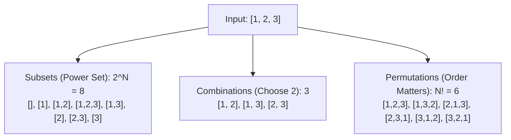

# Day 21: Subsets, Permutations & Combinations

<nav aria-label="Lecture navigation">

[Previous: Recursion Trees & Backtracking](day-20-recursion-trees-and-backtracking-core.md) | [Roadmap](../javascript-dsa-roadmap.md) | [Next: Grid Backtracking & Mazes](day-22-grid-backtracking-and-n-queens.md)

</nav>

## Prerequisites

- [Day 01: Big O Complexity & Problem Solving](day-01-big-o-complexity-and-problem-solving.md) — Asymptotic analysis of $O(2^n)$ and $O(n!)$.
- [Day 20: Recursion Trees & Backtracking](day-20-recursion-trees-and-backtracking-core.md) — The Choose, Explore, Unchoose (`path.pop()`) lifecycle.

---

## 1. What are Subsets, Permutations & Combinations?

Almost every combinatorial search question asked in mid-to-senior technical interviews maps directly onto one of three core mathematical structures: **Subsets**, **Combinations**, or **Permutations**. Understanding how they differ conceptually and structurally dictates your loop boundaries and visited states.

> **Subset (Power Set)** — Any selection of elements from a set, of any length from $0$ to $n$. Order does NOT matter (`[1, 2]` is the same as `[2, 1]`). Total count: $2^n$.

> **Combination ($n$ choose $k$)** — A selection of exactly $k$ items from a collection of $n$ items where order does NOT matter. Total count: $\binom{n}{k} = \frac{n!}{k!(n - k)!}$.

> **Permutation** — An arrangement of all $n$ items in a specific sequential order. Order DOES matter (`[1, 2, 3]` is distinct from `[3, 2, 1]`). Total count: $n!$.

### Physical Analogies: Pizza, Committee, and Olympic Podium

```text
=============================================================================
                    THE THREE COMBINATORIAL ARCHETYPES
=============================================================================

1. SUBSETS (Pizza Toppings):
   - You have 3 toppings available: [ Olives, Mushrooms, Peppers ].
   - For every topping, you have a binary choice: Put it on the pizza, or don't.
   - Outcome: 2^3 = 8 pizzas (from Plain Cheese [] to The Works [O, M, P]).
   - Length varies from 0 to n. Order does not matter.

2. COMBINATIONS (Hiring an Interview Committee):
   - You have 5 senior engineers and must choose exactly 3 for an interview panel.
   - Panel {Alice, Bob, Charlie} is identical to {Charlie, Alice, Bob}.
   - Outcome: 5! / (3! * 2!) = 10 unique committees.
   - Fixed length k. Order does not matter.

3. PERMUTATIONS (Olympic 100m Medal Podium):
   - 3 runners finish the race: [ Alice, Bob, Charlie ].
   - Alice winning Gold and Bob winning Silver is completely different from
     Bob winning Gold and Alice winning Silver!
   - Outcome: 3! = 6 distinct podium arrangements.
   - Always length n. Every element must be used. Order MATTERS.
=============================================================================
```



---

## 2. How the 3 Archetypes Work Step-by-Step

Understanding the structural differences between these three patterns reveals the exact algorithmic mechanics of their recursion loops:

```text
=============================================================================
                    STRUCTURAL MECHANICS COMPARISON
=============================================================================

ARCHETYPE       LOOP START          STATE TRACKING          SNAPSHOT TRIGGER
-----------------------------------------------------------------------------
Subsets         i = startIndex      Index increments (i+1)  EVERY state visited
Combinations    i = startIndex      Index increments (i+1)  When path.length === k
Permutations    i = 0 (Every time!) used[i] boolean array   When path.length === n
=============================================================================
```

### 2.1 The Decision Tree for Subsets vs Permutations

```text
SUBSETS of [1, 2]:
                         []
                    /          \
                [1]              [2]
               /
            [1, 2]
Every node is a valid subset: [], [1], [1, 2], [2].
Notice: We only move FORWARD (start index advances). We never look back at 1 from 2!

PERMUTATIONS of [1, 2]:
                         []
                    /          \
                 [1]            [2]
                  |              |
                [1, 2]         [2, 1]
Only LEAF nodes are valid permutations: [1, 2], [2, 1].
Notice: At the root, we can choose 1 OR 2.
From [2], we look back and choose 1 (because 1 was not yet used).
```

---

## 3. Pattern Recognition of Combinatorial Generation

### How to Spot These Patterns in Interviews

| Problem Statement Signal | Constraint Scale | Mathematical Complexity | Required Strategy |
| :--- | :--- | :--- | :--- |
| "Return all subsets / power set" | $N \le 15$ to $20$ | $O(N \cdot 2^N)$ | **Backtracking with `startIndex`** or **Bitmask** |
| "Subsets may contain duplicates, output must be unique" | $N \le 15$ | $O(N \cdot 2^N)$ | **Sort + Skip duplicates (`i > startIndex`)** |
| "Choose $K$ elements from $N$" | $K \le N \le 20$ | $O(K \cdot \binom{N}{K})$ | **Backtracking with early cutoff** ($n - i < k - \text{len}$) |
| "Return all possible arrangements / orders" | $N \le 10$ to $12$ | $O(N \cdot N!)$ | **Backtracking with `used` array** |
| "Array contains duplicates; return unique permutations" | $N \le 10$ | $O(N \cdot N!)$ | **Sort + Sibling skip (`!used[i - 1]`)** |

---

## 4. Problem 1: Subsets II (Handling Duplicates)

### Problem Description
Given an integer array `nums` that may contain duplicate elements, return all possible **unique subsets** (the power set). The solution set must not contain duplicate subsets. Return the solution in any order.

### Step 1: Physical Simulation
Suppose `nums = [ 1, 2, 2 ]`:
- If we naively generated subsets:
  * From the first `2`: `[1, 2]`, `[2]`
  * From the second `2`: `[1, 2]`, `[2]` (Identical duplicates!)
- Sort `nums` first: `[ 1, 2, 2 ]`.
- Start with `[]` $\to$ add to result.
- Level 1:
  * Choose index 0 (`1`): `path = [1]` $\to$ add.
    - Level 2:
      * Choose index 1 (`2`): `path = [1, 2]` $\to$ add.
        - Level 3:
          * Choose index 2 (`2`): `path = [1, 2, 2]` $\to$ add.
      * Look at index 2 (`2`): It matches index 1 (`2`), and it is at the **same level**! **Skip it!**
  * Choose index 1 (`2`): `path = [2]` $\to$ add.
    - Level 2:
      * Choose index 2 (`2`): `path = [2, 2]` $\to$ add.
  * Look at index 2 (`2`): Matches index 1, same level $\to$ **Skip it!**
- Final Unique Subsets: `[], [1], [1, 2], [1, 2, 2], [2], [2, 2]`. Total: 6 (instead of 8).

### Step 2: Brute Force Approach
Generate all $2^n$ subsets without deduplication, sort each subset, stringify it, and insert it into a JavaScript `Set`:

```javascript
// Naive approach: String serialization with Set deduplication
function subsetsWithDupNaive(nums) {
  const result = [];
  const seen = new Set();
  nums.sort((a, b) => a - b);

  function backtrack(start, path) {
    const key = path.join(',');
    if (!seen.has(key)) {
      seen.add(key);
      result.push([...path]);
    }

    for (let i = start; i < nums.length; i++) {
      path.push(nums[i]);
      backtrack(i + 1, path);
      path.pop();
    }
  }

  backtrack(0, []);
  return result;
}
```

### Step 3: Bottleneck
The naive approach still traverses all $2^n$ recursive branches, computing string hashes and inserting into a `Set` for each branch. For $N = 20$, $2^{20} = 1,048,576$ strings are allocated and hashed on the V8 heap. If half are duplicates, over 500,000 subtrees were explored fruitlessly, creating severe garbage collection pressure.

### Step 4: The Pattern Discovery
Sort `nums` upfront. In our recursive loop:
```javascript
for (let i = startIndex; i < nums.length; i++) {
  // If this element equals the previous one, and we are NOT at the start of this level:
  if (i > startIndex && nums[i] === nums[i - 1]) {
    continue; // Sibling branch duplicate! Prune!
  }
}
```
**Why `i > startIndex` and not `i > 0`?**
- When `i === startIndex`, we are going **deeper** (parent-child relationship). Picking the second `2` after picking the first `2` forms `[2, 2]`, which is completely valid!
- When `i > startIndex`, we are at the **same horizontal decision level** (sibling branches). Picking the second `2` after already having tested an identical branch starting with the first `2` creates redundant subsets.

```text
Decision Level Pruning:
                       startIndex = 0
                       nums = [1, 2, 2]
                             []
                 /            |            \
             i=0 (1)       i=1 (2)       i=2 (2)
             [1]           [2]           SKIP! (i > start && nums[2] == nums[1])
           /     \            |
       i=1 (2)  i=2 (2)    i=2 (2)
       [1, 2]    SKIP!     [2, 2]
         |
       i=2 (2)
      [1, 2, 2]
```

### Step 5: The Optimal Solution

```javascript
// ✅ CORRECT: Optimal Subsets II with In-Place Sibling Pruning
function subsetsWithDup(nums) {
  const result = [];
  const currentPath = [];

  // Sort ascending: Groups duplicate values contiguously
  nums.sort((a, b) => a - b);

  function backtrack(startIndex) {
    // Every node in the state-space tree represents a valid subset
    result.push([...currentPath]);

    for (let i = startIndex; i < nums.length; i++) {
      // PRUNING: Skip duplicate elements at the SAME tree level
      if (i > startIndex && nums[i] === nums[i - 1]) {
        continue;
      }

      // 1. CHOOSE
      currentPath.push(nums[i]);

      // 2. EXPLORE: Recurse with i + 1 (each element used at most once)
      backtrack(i + 1);

      // 3. UNCHOOSE: Rollback state for sibling branches
      currentPath.pop();
    }
  }

  backtrack(0);
  return result;
}

// ❌ ANTI-PATTERN: Checking (i > 0 && nums[i] === nums[i - 1])
// If you write (i > 0), you accidentally prune the child [2, 2]!
// You must write (i > startIndex) to prune only across sibling branches.

// Direct test run
console.log("Subsets with duplicates [1, 2, 2]:");
console.log(subsetsWithDup([1, 2, 2]));
// Expected: [ [], [1], [1, 2], [1, 2, 2], [2], [2, 2] ]
```

#### Complexity Analysis
- **Time Complexity:** $O(n \cdot 2^n)$ in the worst case (when all elements are distinct). Each of the $2^n$ subsets takes $O(n)$ time to copy into `result`. When duplicates exist, runtime is strictly proportional to the number of unique subsets generated.
- **Space Complexity:** $O(n)$ auxiliary space for the recursion call stack and `currentPath` buffer.

---

## 5. Problem 2: Permutations II (Unique Permutations with Duplicates)

### Problem Description
Given a collection of numbers `nums` that might contain duplicates, return all possible **unique permutations** in any order.

### Step 1: Physical Simulation
Suppose `nums = [ 1, 1, 2 ]`:
- Total permutations of 3 distinct items is $3! = 6$.
- But here, two items are identical (`1` and `1`).
- The 6 raw permutations are:
  1. `[1_a, 1_b, 2]`
  2. `[1_a, 2, 1_b]`
  3. `[1_b, 1_a, 2]` $\to$ Identical to 1!
  4. `[1_b, 2, 1_a]` $\to$ Identical to 2!
  5. `[2, 1_a, 1_b]`
  6. `[2, 1_b, 1_a]` $\to$ Identical to 5!
- Only 3 unique permutations exist: `[ [1, 1, 2], [1, 2, 1], [2, 1, 1] ]`.
- To avoid generating duplicates, we must establish an ironclad ordering rule: **"Only pick identical element $k$ if identical element $k - 1$ has ALREADY been picked in the current branch!"**

### Step 2: Brute Force Approach
Generate all $n!$ permutations using a boolean `used` array, serialize them to strings, and deduplicate with a `Set`:

```javascript
// Naive brute force: N! generations + string set deduplication
function permuteUniqueNaive(nums) {
  const result = [];
  const seen = new Set();
  const used = new Array(nums.length).fill(false);

  function backtrack(path) {
    if (path.length === nums.length) {
      const key = path.join(',');
      if (!seen.has(key)) {
        seen.add(key);
        result.push([...path]);
      }
      return;
    }
    for (let i = 0; i < nums.length; i++) {
      if (used[i]) continue;
      used[i] = true;
      path.push(nums[i]);
      backtrack(path);
      path.pop();
      used[i] = false;
    }
  }

  backtrack([]);
  return result;
}
```

### Step 3: Bottleneck
For an array like `[1, 1, 1, 1, 1, 1, 1, 1]`, there is only **1 unique permutation**. Yet the naive approach generates all $8! = 40,320$ identical permutations, creating 40,320 strings and objects before discarding 40,319 of them.

### Step 4: The Pattern Discovery
1. Sort `nums` ascending: `nums.sort((a, b) => a - b)`.
2. Use a boolean array `used = new Array(n).fill(false)`.
3. In the permutation loop (which starts at index `0` every time):
   - If `used[i]` is true, skip (an element cannot be reused at another position in the same permutation).
   - **The Golden Deduplication Rule:**
     ```javascript
     if (i > 0 && nums[i] === nums[i - 1] && !used[i - 1]) {
       continue;
     }
     ```
**Why `!used[i - 1]`?**
If `nums[i] === nums[i - 1]`, but `used[i - 1]` is **false**, it means the previous identical element was already explored as a choice at this level and has already been **backtracked (unmarked)**! Starting a new branch with `nums[i]` would duplicate the branch just finished. Enforcing `used[i - 1]` ensures identical numbers are only chosen in strict left-to-right order.

```text
Visualizing Permutations II Pruning on [ 1_a, 1_b, 2 ]:
                         []
            /            |           \
        Choose 1_a    Choose 1_b     Choose 2
       (used[0]=T)    (!used[0] ->   (used[2]=T)
                      DUPLICATE!
                      PRUNE!)
```

### Step 5: The Optimal Solution

```javascript
// ✅ CORRECT: Optimal Permutations II with State Pruning
function permuteUnique(nums) {
  const result = [];
  const currentPath = [];
  const used = new Array(nums.length).fill(false);

  // 1. Sort to cluster duplicates
  nums.sort((a, b) => a - b);

  function backtrack() {
    // Goal state: complete permutation built
    if (currentPath.length === nums.length) {
      result.push([...currentPath]);
      return;
    }

    for (let i = 0; i < nums.length; i++) {
      // Condition 1: Element already used in current branch
      if (used[i]) continue;

      // Condition 2: Duplicate pruning
      // If previous duplicate has NOT been used in this branch,
      // it means it was already used and backtracked in an earlier sibling branch!
      if (i > 0 && nums[i] === nums[i - 1] && !used[i - 1]) {
        continue;
      }

      // 1. CHOOSE
      used[i] = true;
      currentPath.push(nums[i]);

      // 2. EXPLORE
      backtrack();

      // 3. UNCHOOSE
      currentPath.pop();
      used[i] = false;
    }
  }

  backtrack();
  return result;
}

// ❌ ANTI-PATTERN: Using 'used[i - 1]' instead of '!used[i - 1]'
// While 'used[i - 1]' technically produces unique results, it explores
// reverse order and performs substantially more redundant branch evaluations.

// Direct test run
console.log("Unique Permutations of [1, 1, 2]:");
console.log(permuteUnique([1, 1, 2]));
// Expected: [ [1, 1, 2], [1, 2, 1], [2, 1, 1] ]

console.log("Unique Permutations of [1, 2, 3]:");
console.log(permuteUnique([1, 2, 3]).length); // Expected: 6
```

#### Complexity Analysis
- **Time Complexity:** $O(n \cdot n!)$ worst case (all elements distinct). With duplicates, it generates exactly $\frac{n!}{p_1! \cdot p_2! \dots}$ permutations, each copied in $O(n)$ time.
- **Space Complexity:** $O(n)$ auxiliary space for the `used` array and the recursion stack.

---

## 6. Under the Hood: V8 & Node.js

Understanding engine-level optimizations for combinatorial problems gives senior backend engineers a massive performance advantage:

```text
=============================================================================
               COMBINATORICS & V8 BITWISE ACCELERATION
=============================================================================

1. BITWISE POWER SET GENERATION (Zero Recursion):
   - For an array of size N (where N <= 30), the total number of subsets is 2^N.
   - Any integer from 0 to (2^N - 1) has a unique binary representation of length N!
   - Example: For [ 'A', 'B', 'C' ] (N = 3):
     Integer 0: 000 (binary) -> []
     Integer 1: 001 (binary) -> ['A']
     Integer 3: 011 (binary) -> ['A', 'B']
     Integer 7: 111 (binary) -> ['A', 'B', 'C']

2. V8 31-BIT SMI (SMALL INTEGER) SPEED:
   - In V8, integers fitting within 31 bits are stored as SMIs (direct unboxed values).
   - A bitwise loop running from 0 to (1 << N) executes entirely in CPU registers:
       for (let mask = 0; mask < (1 << n); mask++) { ... }
   - Zero call frames are created on the V8 stack!
   - CPU branch predictors easily vectorize bitwise operations ((mask >> i) & 1).

3. THE 32-BIT OVERFLOW HAZARD:
   - JavaScript bitwise operators (<<, >>, &, |) operate strictly on 32-bit signed ints.
   - (1 << 31) evaluates to -2147483648 (negative number)!
   - (1 << 32) evaluates to 1!
   - Rule: For N > 30, never use standard bitwise operators in JS. Use recursive
     backtracking or BigInt (1n << BigInt(n)).
=============================================================================
```

```javascript
// Bitwise Subsets Implementation (Non-recursive, pure V8 register execution)
function subsetsBitwise(nums) {
  const n = nums.length;
  const totalSubsets = 1 << n; // 2^n (Valid for n <= 30)
  const result = new Array(totalSubsets);

  for (let mask = 0; mask < totalSubsets; mask++) {
    const subset = [];
    for (let i = 0; i < n; i++) {
      // Check if the i-th bit is set
      if ((mask & (1 << i)) !== 0) {
        subset.push(nums[i]);
      }
    }
    result[mask] = subset;
  }

  return result;
}

console.log("Bitwise Subsets of [10, 20]:", subsetsBitwise([10, 20]));
// Output: [ [], [10], [20], [10, 20] ]
```

---

## 7. Hands-On Exercise

### The Flawed Permutations Pruning Bug
A backend engineer is implementing an inventory SKU bundler in Node.js. Given duplicate item SKUs, it must generate all unique bundles. However, the engineer's deduplication check is broken: it omits the `!used[i - 1]` condition, returning empty permutations or failing with incorrect counts.

### The Buggy Code
```javascript
function buggyPermuteUnique(nums) {
  const result = [];
  const path = [];
  const used = new Array(nums.length).fill(false);
  nums.sort((a, b) => a - b);

  function backtrack() {
    if (path.length === nums.length) {
      result.push([...path]);
      return;
    }

    for (let i = 0; i < nums.length; i++) {
      if (used[i]) continue;

      // BUG: Checks nums[i] === nums[i - 1] without checking !used[i - 1]!
      // This kills ALL valid permutations containing duplicate values!
      if (i > 0 && nums[i] === nums[i - 1]) {
        continue;
      }

      used[i] = true;
      path.push(nums[i]);
      backtrack();
      path.pop();
      used[i] = false;
    }
  }

  backtrack();
  return result;
}
```

### The Fix and Direct Verification
1. Add the condition `!used[i - 1]` to ensure that duplicate elements can be chosen as children, but skipped as redundant sibling choices.

```javascript
// ✅ REPAIRED: Production SKU Bundler
function safePermuteUnique(nums) {
  const result = [];
  const path = [];
  const used = new Array(nums.length).fill(false);

  nums.sort((a, b) => a - b);

  function backtrack() {
    if (path.length === nums.length) {
      result.push([...path]);
      return;
    }

    for (let i = 0; i < nums.length; i++) {
      if (used[i]) continue;

      // FIX: Only prune if the identical predecessor was backtracked
      if (i > 0 && nums[i] === nums[i - 1] && !used[i - 1]) {
        continue;
      }

      used[i] = true;
      path.push(nums[i]);
      backtrack();
      path.pop();
      used[i] = false;
    }
  }

  backtrack();
  return result;
}

// Direct test verification
const duplicateSKUs = [1, 1, 2];
console.log("Repaired Unique Permutations of [1, 1, 2]:", safePermuteUnique(duplicateSKUs));
// Expected length: 3 unique permutations ([1,1,2], [1,2,1], [2,1,1])
```

---

## 8. Tricky Points and Edge Cases

### 1. `i > startIndex` (Subsets) vs `!used[i - 1]` (Permutations)
This is the single most common source of interview confusion:
- In **Subsets / Combinations**, the loop index starts at `startIndex`. We compare `i > startIndex`. We do **not** need a `used` array because we only ever move forward.
- In **Permutations**, every recursion frame starts iterating from `i = 0`. Because `i` resets to 0, we cannot rely on `i > startIndex`. We must use a `used` boolean array and check `!used[i - 1]`.

### 2. Lexicographical Generation Order
When generating permutations or subsets, sorting the input array guarantees that the resulting outputs are emitted in exact **lexicographical (dictionary) order**. If an interview question demands "lexicographically sorted combinations", sort the input array first.

### 3. Space Allocation for Power Set
Remember that generating the power set of an array of length $N$ requires allocating $2^N$ arrays. For $N = 25$, $2^{25} \approx 33,554,432$ arrays. Attempting to store all of these in memory will exceed the standard 1.4 GB V8 old-space heap limit and crash Node.js with `FATAL ERROR: Ineffective mark-compacts near heap limit Allocation failed - JavaScript heap out of memory`. In production, stream or process subsets lazily via generators (`function*`) instead of collecting them in an array.

---

## 9. Comprehensive Summary

```text
=============================================================================
               SUBSETS vs COMBINATIONS vs PERMUTATIONS
=============================================================================

DIMENSION           SUBSETS                 COMBINATIONS            PERMUTATIONS
-----------------------------------------------------------------------------
Formula             2^n                     n! / (k!(n-k)!)         n!
Order matters?      No                      No                      Yes! ([1,2] != [2,1])
Target length       0 to n (all nodes)      Fixed k                 Fixed n (leaves only)
Loop initialization for (i = start; ...)    for (i = start; ...)    for (i = 0; ...)
Used tracking       startIndex increments   startIndex increments   used[i] boolean array
Duplicate pruning   i > start && n[i]==n[i-1]i > start && n[i]==n[i-1]n[i]==n[i-1] && !used[i-1]
Alternative         Bitmask (0 to 2^n - 1)  Gosper's Hack           Heap's Algorithm
=============================================================================
```

- **Subsets collect every node in the recursion tree**, because every prefix represents a valid subset.
- **Combinations and Permutations collect only leaf nodes** that satisfy the target length requirement.
- **Sorting is the universal foundation for duplicate handling**, converting duplicate items into adjacent neighbors that can be checked with $O(1)$ lookback comparisons.

---

## 10. Cheat Sheet

### Decision Matrix: Code Templates

#### Subsets Template
```javascript
function subsets(nums) {
  const res = [], path = [];
  function dfs(start) {
    res.push([...path]);
    for (let i = start; i < nums.length; i++) {
      path.push(nums[i]);
      dfs(i + 1);
      path.pop();
    }
  }
  dfs(0);
  return res;
}
```

#### Permutations Template
```javascript
function permute(nums) {
  const res = [], path = [], used = new Array(nums.length).fill(false);
  function dfs() {
    if (path.length === nums.length) return res.push([...path]);
    for (let i = 0; i < nums.length; i++) {
      if (used[i]) continue;
      used[i] = true;
      path.push(nums[i]);
      dfs();
      path.pop();
      used[i] = false;
    }
  }
  dfs();
  return res;
}
```

### Common Traps Checklist
- [ ] For permutations with duplicates, did you write `!used[i - 1]`?
- [ ] For subsets with duplicates, did you write `i > startIndex`?
- [ ] Did you sort `nums` before applying duplicate pruning?
- [ ] Are you taking shallow copies (`[...path]`) before saving to result?

---

## 11. Interview Q&A

### 45-Second Senior Pitch
> *"When tackling combinatorial problems—subsets, combinations, and permutations—the key senior distinction is recognizing how loop bounds and state trackers dictate the search space. Subsets and combinations advance a starting index forward, naturally eliminating order permutations in $O(2^n)$ or $O(\binom{n}{k})$ time. Permutations reset the loop to zero at every frame, utilizing a visited array to enforce unique element usage in $O(n!)$ time. When duplicates are present, sorting the input upfront enables horizontal sibling pruning: for combinations, we prune when `i > startIndex && nums[i] === nums[i - 1]`; for permutations, we prune when `nums[i] === nums[i - 1] && !used[i - 1]`."*

### Deep Interview Questions

#### Q1: Why does `!used[i - 1]` successfully prune duplicate permutations, whereas `used[i - 1]` is inferior?
**Answer:** Both conditions enforce that identical elements are processed in a fixed relative order. However, checking `!used[i - 1]` enforces that identical elements can only be selected in **left-to-right order** (element 0 must be chosen before element 1). If `used[i - 1]` is false, it indicates that element $i - 1$ was already evaluated at the current level and popped during backtracking. Exploring element $i$ would spawn an identical subtree. Checking `used[i - 1]` (without the negation) forces right-to-left exploration, which explores significantly more dead-end subtrees before pruning.

#### Q2: How can we optimize Combinations ($N$ choose $K$) to avoid exploring subtrees that cannot reach length $K$?
**Answer:** We apply **loop bound pruning**. If the number of remaining elements in `nums` plus the elements already in `path` is less than $k$, we can never form a valid combination.
Specifically: `remainingNeeded = k - path.length`.
We only need to iterate while: `i <= nums.length - remainingNeeded`.
Instead of looping to `nums.length`, the loop condition becomes:
```javascript
for (let i = startIndex; i <= nums.length - (k - path.length); i++)
```
This prunes large swathes of fruitless recursion branches early.

#### Q3: When should a senior engineer choose bit manipulation over recursive backtracking for generating subsets?
**Answer:** Bit manipulation is preferred when:
1. $N \le 30$, allowing mask integers to fit cleanly into V8's 31-bit Small Integer (SMI) optimization.
2. The problem requires checking if subsets satisfy an independent property where generating the whole subset in memory isn't strictly necessary.
3. Zero call-stack overhead and maximum CPU cache efficiency are required.
Conversely, recursive backtracking is preferred when:
1. $N > 30$ (avoiding JS 32-bit signed integer bitwise overflow).
2. Early pruning is possible (e.g. subset sum exceeds target). Bitmasking must evaluate all $2^N$ possibilities, while backtracking can prune entire branches early.

#### Q4: How would you prevent a 100% CPU lockup in Node.js when generating permutations of an array with length $N = 12$?
**Answer:** $12! = 479,001,600$ permutations. Generating nearly half a billion arrays synchronously will lock the Node.js event loop for minutes, breaching health-check timeouts. To resolve this:
1. **Generator / Stream Architecture:** Use a JavaScript generator (`function*`) to yield permutations on demand (pull-based) rather than materializing all 479 million in memory at once.
2. **Worker Thread Delegation:** Move execution out of the main event loop into a dedicated `Worker` thread.
3. **Partitioning:** Divide the top-level loop ($i = 0 \dots 11$) across a cluster of worker threads to leverage multi-core CPU parallelism.

---

## 12. Practice Problems

### Problem 1: Combinations of Size K (LeetCode 77)
- **Input:** `n = 4, k = 2`
- **Output:** `[ [1, 2], [1, 3], [1, 4], [2, 3], [2, 4], [3, 4] ]`
- **Challenge:** Implement loop pruning (`i <= n - (k - path.length) + 1`) to achieve optimal runtime.

### Problem 2: Non-decreasing Subsequences (LeetCode 491)
- **Input:** `nums = [ 4, 6, 7, 7 ]`
- **Output:** `[ [4, 6], [4, 6, 7], [4, 6, 7, 7], [4, 7], [4, 7, 7], [6, 7], [6, 7, 7], [7, 7] ]`
- **Constraint:** You **cannot** sort the input array! Use an in-frame hash set to deduplicate choices at each recursion level.

### Problem 3: Permutation Sequence (LeetCode 60)
- **Input:** `n = 3, k = 3`
- **Output:** `"213"`
- **Challenge:** Find the $k$-th permutation directly in $O(n^2)$ time using the factorial number system (Factoradic) without generating the preceding $k - 1$ permutations.

---

<nav aria-label="Lecture navigation">

[Previous: Recursion Trees & Backtracking](day-20-recursion-trees-and-backtracking-core.md) | [Roadmap](../javascript-dsa-roadmap.md) | [Next: Grid Backtracking & Mazes](day-22-grid-backtracking-and-n-queens.md)

</nav>
