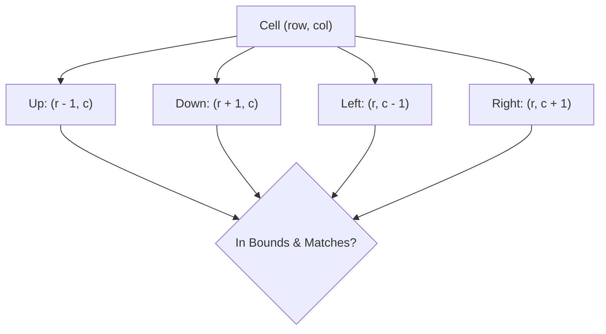
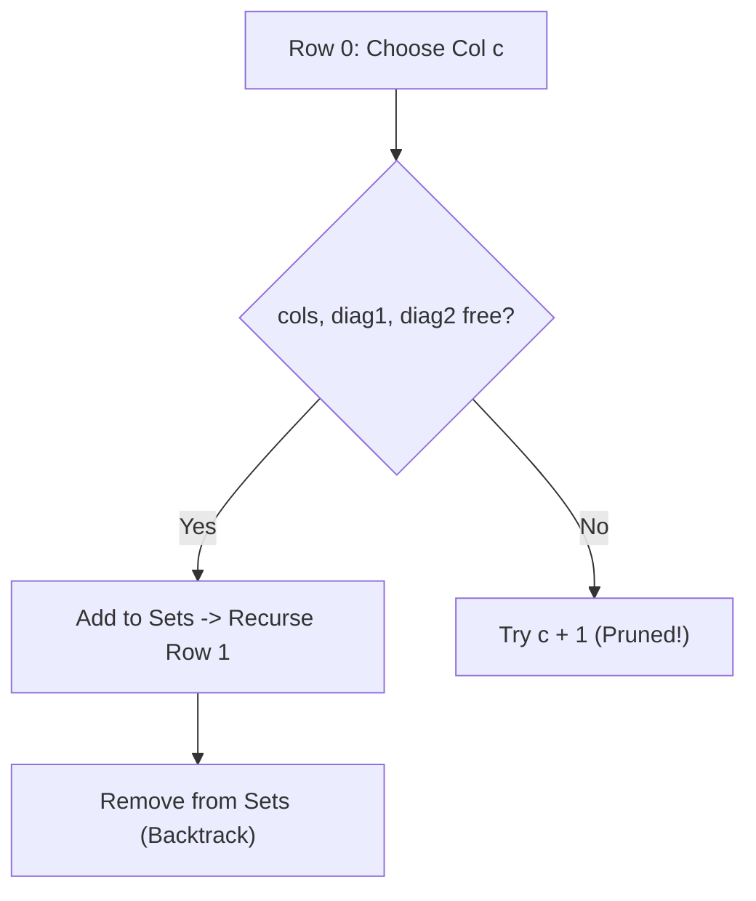

# Day 22: Grid Backtracking & N-Queens

<nav aria-label="Lecture navigation">

[Previous: Subsets, Permutations & Combinations](day-21-subsets-permutations-and-combinations.md) | [Roadmap](../javascript-dsa-roadmap.md) | [Next: Binary Trees: DFS & Properties](day-23-binary-trees-dfs-and-properties.md)

</nav>

## Prerequisites

- [Day 01: Big O Complexity & Problem Solving](day-01-big-o-complexity-and-problem-solving.md) — Asymptotic time limits and exponential search trees.
- [Day 20: Recursion Trees & Backtracking](day-20-recursion-trees-and-backtracking-core.md) — Choose, explore, and unchoose (`pop`) mechanics.
- [Day 21: Subsets, Permutations & Combinations](day-21-subsets-permutations-and-combinations.md) — Visited state tracking and branch pruning.

---

## 1. What is Grid Backtracking & Constraint Satisfaction?

In linear backtracking, we explore a 1D sequence of numbers or characters. In **Grid Backtracking**, our decision space expands into a **2D coordinate plane** ($M \times N$). Every step requires making spatial decisions—moving Up, Down, Left, or Right—while honoring geometric boundaries and preventing cyclic loops.

In **Constraint Satisfaction Problems** (such as N-Queens or Sudoku), our decisions are governed by strict global spatial invariants: no two pieces may share the same row, column, or diagonal line.

> **Grid Backtracking** — Depth-first path exploration on a 2D matrix where each cell represents a decision node, requiring in-place visited marking to avoid infinite cyclic loops.

> **Constraint Satisfaction Problem (CSP)** — A mathematical problem where a state is defined by a set of variables that must satisfy specific constraints, pruned as soon as any partial assignment violates an invariant.

### Physical Analogy: The Stepping Stones and the Chessboard

```text
=============================================================================
                       TWO PHYSICAL GRID METAPHORS
=============================================================================

1. THE SINKING STEPPING STONES (Word Search):
   - You must spell a password by stepping across labeled stones in a pond.
   - When you step on stone (r, c), it temporarily sinks underwater under your
     weight (CHOOSE: board[r][c] = '#').
   - You can only step to adjacent stones (Up, Down, Left, Right).
   - If you reach a dead-end stone that doesn't match the next letter:
     * You pull your foot back!
     * The stone floats back up to the surface (UNCHOOSE: board[r][c] = char).
   - You can now reuse that stone for a different, valid path!

2. THE QUEEN'S SIGHTLINES (N-Queens):
   - A chess Queen attacks in 8 directions: horizontally, vertically, diagonally.
   - Imagine putting laser beams on every placed queen:
     * Column beam: shoots straight down.
     * Main diagonal beam (\): moves down-right.
     * Anti-diagonal beam (/): moves down-left.
   - Instead of checking the whole board with slow visual scans, you install
     3 sensor alarms (hash sets or bitmasks). If any alarm triggers, the spot
     is instantly rejected!
=============================================================================
```



---

## 2. How Grid Backtracking Works Step-by-Step

### 2.1 Standard 4-Directional Offset Vector

To keep matrix navigation clean and avoid copy-pasting four identical nested `if` blocks, senior engineers use a constant direction array:

```javascript
const DIRECTIONS = [
  [-1,  0], // UP:    row - 1, col
  [ 1,  0], // DOWN:  row + 1, col
  [ 0, -1], // LEFT:  row,     col - 1
  [ 0,  1]  // RIGHT: row,     col + 1
];
```

### 2.2 In-Place Visited Masking (Zero Extra Heap Memory)

In an $M \times N$ matrix, maintaining a separate `visited = Array.from({length: M}, () => new Array(N).fill(false))` requires allocating $M$ arrays on the V8 heap and constantly reading heap pointer offsets.

Instead, we mutate the grid **in-place**:
1. Save the original character: `const temp = board[r][c];`
2. Mark as visited with an invalid character: `board[r][c] = '#';` (Choose)
3. Explore 4 neighbors recursively. (Explore)
4. Restore original character: `board[r][c] = temp;` (Unchoose / Rollback)

```text
Walking [ "A", "B" ] on board:
Initial:   [ 'A', 'B' ]
Step 1:    [ '#', 'B' ]   (Visiting 'A', exploring neighbors)
Step 2:    [ '#', '#' ]   (Visiting 'B')
Backtrack: [ '#', 'B' ]   (Restoring 'B')
Finish:    [ 'A', 'B' ]   (Restoring 'A' - Board 100% pristine!)
```

### 2.3 The Mathematical Invariant of Diagonals (N-Queens)

On an $N \times N$ grid, how do we know if cell `(r, c)` shares a diagonal with another queen in $O(1)$ time without scanning the board?

```text
=============================================================================
                       DIAGONAL MATHEMATICAL FORMULAS
=============================================================================

1. MAIN DIAGONAL (\) - Top-Left to Bottom-Right:
   Notice the property: (row - col) is CONSTANT for all cells on the line!
   (0, 0) -> 0 - 0 =  0
   (1, 1) -> 1 - 1 =  0
   (2, 2) -> 2 - 2 =  0
   (0, 2) -> 0 - 2 = -2
   (1, 3) -> 1 - 3 = -2
   Formula: diag1 = row - col

2. ANTI-DIAGONAL (/) - Top-Right to Bottom-Left:
   Notice the property: (row + col) is CONSTANT for all cells on the line!
   (0, 2) -> 0 + 2 =  2
   (1, 1) -> 1 + 1 =  2
   (2, 0) -> 2 + 0 =  2
   Formula: diag2 = row + col
=============================================================================
```

By storing active `row - col` and `row + col` values inside three small sets (`cols`, `mainDiags`, `antiDiags`), checking if a queen can be safely placed takes **$O(1)$ time**.

---

## 3. Pattern Recognition of Grid Backtracking

### How to Spot These Patterns in Interviews

| Constraint / Keyword Signal | Underlying Problem Need | Optimal Algorithmic Pattern |
| :--- | :--- | :--- |
| "Find if string exists along adjacent cells in 2D grid" | In-place path search without revisiting cells | **Grid Backtracking with In-Place Masking** |
| "Find all paths / shortest path visiting all cells" | Hamiltonian path in matrix | **Grid DFS with visited rollback** |
| $N \times N$ board where pieces must not attack each other | Row-by-row placement with $O(1)$ conflict lookup | **N-Queens (Diagonal Math Sets)** |
| $9 \times 9$ board filled with numbers $1-9$ without duplicates | Row, col, and $3 \times 3$ sub-box hashing | **Sudoku Solver Backtracking** |
| Board size $M, N \le 6$ to $12$ | Exponential branching ($4^L$) | **Pruned Grid DFS** |

---

## 4. Problem 1: Word Search (LeetCode 79)

### Problem Description
Given an $m \times n$ grid of characters `board` and a string `word`, return `true` if `word` exists in the grid.
The word can be constructed from letters of sequentially adjacent cells, where adjacent cells are horizontally or vertically neighboring. The same letter cell may **not be used more than once** in a single word.

### Step 1: Physical Simulation
Suppose `board` is:
```text
[
  ['A', 'B', 'C', 'E'],
  ['S', 'F', 'C', 'S'],
  ['A', 'D', 'E', 'E']
]
Word = "ABCCED"
```
- Scan board for the first character `'A'`.
- Found `'A'` at `(0, 0)`.
  * Mark `(0, 0) = '#'`. Search for `'B'` (next index 1).
  * Look UP: Out of bounds.
  * Look DOWN: `(1, 0) = 'S'` (Does not match `'B'`).
  * Look LEFT: Out of bounds.
  * Look RIGHT: `(0, 1) = 'B'` (Match!).
    - Move to `(0, 1)`. Mark `(0, 1) = '#'`. Search for `'C'` (next index 2).
    - Look RIGHT: `(0, 2) = 'C'` (Match!).
      * Move to `(0, 2)`. Mark `(0, 2) = '#'`. Search for `'C'` (index 3).
      * Look DOWN: `(1, 2) = 'C'` (Match!).
        - Move to `(1, 2)`. Mark `(1, 2) = '#'`. Search for `'E'` (index 4).
        - Look DOWN: `(2, 2) = 'E'` (Match!).
          * Move to `(2, 2)`. Mark `(2, 2) = '#'`. Search for `'D'` (index 5).
          * Look LEFT: `(2, 1) = 'D'` (Match! Index 5 === word.length - 1 $\to$ Found!).
- Return `true`.

### Step 2: Brute Force Approach
Explore without marking visited cells or using a separate 2D boolean array that is cloned at each step:

```javascript
// Naive approach: Cloning 2D visited array at each recursive branch
function existNaive(board, word) {
  const rows = board.length;
  const cols = board[0].length;

  function dfs(r, c, index, visited) {
    if (index === word.length) return true;
    if (r < 0 || r >= rows || c < 0 || c >= cols) return false;
    if (visited[r][c] || board[r][c] !== word[index]) return false;

    // Clones entire 2D matrix on every single step!
    const newVisited = visited.map(row => [...row]);
    newVisited[r][c] = true;

    return dfs(r + 1, c, index + 1, newVisited) ||
           dfs(r - 1, c, index + 1, newVisited) ||
           dfs(r, c + 1, index + 1, newVisited) ||
           dfs(r, c - 1, index + 1, newVisited);
  }

  const initialVisited = Array.from({length: rows}, () => new Array(cols).fill(false));
  for (let r = 0; r < rows; r++) {
    for (let c = 0; c < cols; c++) {
      if (dfs(r, c, 0, initialVisited)) return true;
    }
  }
  return false;
}
```

### Step 3: Bottleneck
1. **Heap Allocation Thrashing:** Cloning the 2D `visited` array (`visited.map(row => [...row])`) at every step of a 4-directional recursion tree of depth $L$ creates $O(4^L \cdot M \cdot N)$ memory allocations. For $L = 15$, this easily exceeds millions of allocations, halting the engine with out-of-memory errors.
2. **Missing Frequency Pruning:** If `word` requires three `'Z'` characters, but the board only contains one `'Z'`, the naive algorithm still searches every single cell fruitlessly.

### Step 4: The Pattern Discovery
1. **In-Place Board Masking:** Save `board[r][c]`, overwrite with `'#'`, explore the 4 neighbors, and restore `board[r][c]` upon return. Auxiliary space drops to $O(L)$ stack frames with **zero heap allocations**.
2. **Frequency Pruning & Reverse Word Optimization:**
   - Count character frequencies in both `board` and `word`. If `board` has fewer occurrences of any letter in `word`, return `false` immediately.
   - If the last letter of `word` is rarer on the board than the first letter, reverse `word` before searching! This slashes branching factors at the top of the search tree.

### Step 5: The Optimal Solution

```javascript
// ✅ CORRECT: Optimal Word Search with In-Place Masking and Frequency Pruning
function exist(board, word) {
  const rows = board.length;
  const cols = board[0].length;

  // 1. Frequency Pruning: Check if board contains enough characters
  const boardCounts = new Map();
  for (let r = 0; r < rows; r++) {
    for (let c = 0; c < cols; c++) {
      const ch = board[r][c];
      boardCounts.set(ch, (boardCounts.get(ch) || 0) + 1);
    }
  }

  const wordCounts = new Map();
  for (const ch of word) {
    wordCounts.set(ch, (wordCounts.get(ch) || 0) + 1);
    if ((boardCounts.get(ch) || 0) < wordCounts.get(ch)) {
      return false; // Board lacks required character count!
    }
  }

  // 2. Search Direction Optimization:
  // If word's tail character is rarer than head character, search in reverse!
  let targetWord = word;
  if ((boardCounts.get(word[0]) || 0) > (boardCounts.get(word[word.length - 1]) || 0)) {
    targetWord = word.split('').reverse().join('');
  }

  // 3. DFS with In-Place Grid Backtracking
  function dfs(r, c, index) {
    // Goal state: All characters successfully matched
    if (index === targetWord.length) return true;

    // Boundary check and character mismatch check (including '#' visited cells)
    if (r < 0 || r >= rows || c < 0 || c >= cols || board[r][c] !== targetWord[index]) {
      return false;
    }

    // CHOOSE: Mask current cell in-place
    const originalChar = board[r][c];
    board[r][c] = '#';

    // EXPLORE: Check all 4 orthogonal directions
    const found =
      dfs(r + 1, c, index + 1) || // DOWN
      dfs(r - 1, c, index + 1) || // UP
      dfs(r, c + 1, index + 1) || // RIGHT
      dfs(r, c - 1, index + 1);   // LEFT

    // UNCHOOSE: Rollback cell to original character
    board[r][c] = originalChar;

    return found;
  }

  for (let r = 0; r < rows; r++) {
    for (let c = 0; c < cols; c++) {
      if (board[r][c] === targetWord[0]) {
        if (dfs(r, c, 0)) return true;
      }
    }
  }

  return false;
}

// ❌ ANTI-PATTERN: Forgetting to unchoose (restore originalChar)
// If you do not restore board[r][c] = originalChar before returning false,
// a dead-end path leaves '#' on the board, permanently breaking subsequent paths!

// Direct test run
const testBoard = [
  ['A', 'B', 'C', 'E'],
  ['S', 'F', 'C', 'S'],
  ['A', 'D', 'E', 'E']
];

console.log("Word 'ABCCED' exists:", exist(testBoard, "ABCCED")); // Expected: true
console.log("Word 'SEE' exists:", exist(testBoard, "SEE"));       // Expected: true
console.log("Word 'ABCB' exists:", exist(testBoard, "ABCB"));     // Expected: false (cannot reuse cell)
```

#### Complexity Analysis
- **Time Complexity:** $O(M \cdot N \cdot 3^L)$, where $M \times N$ is board size and $L$ is word length. At each cell after the first step, we have at most 3 choices (since the cell we came from is marked `'#'`). With frequency pruning, average time is near $O(M \cdot N)$.
- **Space Complexity:** $O(L)$ auxiliary space for the recursive call stack. Memory is strictly $O(1)$ auxiliary heap space because board mutation is performed in-place.

---

## 5. Problem 2: N-Queens (LeetCode 51)

### Problem Description
The **n-queens** puzzle is the problem of placing `n` queens on an $n \times n$ chessboard such that no two queens attack each other.
Given an integer `n`, return all distinct solutions to the **n-queens puzzle**. You may return the answer in any order.
Each solution contains a distinct board configuration of the n-queens' placement, where `'Q'` and `'.'` both indicate a queen and an empty space, respectively.

### Step 1: Physical Simulation ($N = 4$)
On a $4 \times 4$ chessboard:
- Because no two queens can share a row, we must place **exactly one queen per row**, moving systematically from row 0 to row 3.
- Row 0: Place Queen at `col = 0`.
  * Marked columns: `{0}`. Main diags: `{0-0 = 0}`. Anti diags: `{0+0 = 0}`.
- Row 1:
  * Try `col = 0`: Col 0 already taken!
  * Try `col = 1`: Main diag `1 - 1 = 0` already taken!
  * Try `col = 2`: Safe! Place Queen at `(1, 2)`.
    - Marked: `cols = {0, 2}`, `diag1 = {0, -1}`, `diag2 = {0, 3}`.
- Row 2:
  * Try `col = 0`: Taken!
  * Try `col = 1`: Anti diag `2 + 1 = 3` taken!
  * Try `col = 2`: Taken!
  * Try `col = 3`: Main diag `2 - 3 = -1` taken!
  * Dead end! No safe column in Row 2.
- Backtrack to Row 1! Remove Queen from `(1, 2)`. Try `col = 3`.
- Continue systematically until all 4 rows are filled.

```text
Solution 1 for N = 4:
. Q . .    (Row 0, Col 1)
. . . Q    (Row 1, Col 3)
Q . . .    (Row 2, Col 0)
. . Q .    (Row 3, Col 2)
```

### Step 2: Brute Force Approach
Try all combinations of placing $N$ queens across all $N \times N$ positions ($\binom{N^2}{N}$ possibilities). For $N = 8$, this is $\binom{64}{8} \approx 4.42 \times 10^9$ board configurations, each requiring $O(N)$ validation scans.

### Step 3: Bottleneck
1. Placing multiple queens in the same row is completely pointless.
2. Walking 8 directional rays across the board to check if a square is safe takes $O(N)$ time per square, slowing the search down.

### Step 4: The Pattern Discovery
1. **Row-by-Row Invariant:** Place exactly one queen per row: `backtrack(row)`. This guarantees rows never conflict and reduces the search space from $\binom{N^2}{N}$ to $N!$.
2. **$O(1)$ Conflict Checks via Mathematical Sets:**
   - Column conflict: `cols.has(c)`
   - Main diagonal (\) conflict: `mainDiags.has(row - c)`
   - Anti-diagonal (/) conflict: `antiDiags.has(row + c)`
   Checking and updating safety takes strict **$O(1)$ time**.



### Step 5: The Optimal Solution

```javascript
// ✅ CORRECT: Optimal N-Queens with O(1) Mathematical Diagonal Sets
function solveNQueens(n) {
  const result = [];

  // Track occupied columns and diagonals in O(1) sets
  const cols = new Set();
  const mainDiags = new Set(); // row - col
  const antiDiags = new Set(); // row + col

  // Single 1D array where index is row and value is column: queens[row] = col
  const queens = new Array(n);

  function buildBoard() {
    const board = [];
    for (let r = 0; r < n; r++) {
      const rowChars = new Array(n).fill('.');
      rowChars[queens[r]] = 'Q';
      board.push(rowChars.join(''));
    }
    return board;
  }

  function backtrack(row) {
    // Goal state: All N queens successfully placed across N rows
    if (row === n) {
      result.push(buildBoard());
      return;
    }

    for (let col = 0; col < n; col++) {
      const d1 = row - col;
      const d2 = row + col;

      // O(1) Constraint Validation:
      if (cols.has(col) || mainDiags.has(d1) || antiDiags.has(d2)) {
        continue; // Attacked! Prune branch immediately
      }

      // 1. CHOOSE
      cols.add(col);
      mainDiags.add(d1);
      antiDiags.add(d2);
      queens[row] = col;

      // 2. EXPLORE: Advance to next row
      backtrack(row + 1);

      // 3. UNCHOOSE: Rollback state
      cols.delete(col);
      mainDiags.delete(d1);
      antiDiags.delete(d2);
    }
  }

  backtrack(0);
  return result;
}

// ❌ ANTI-PATTERN: Iterating over board cells with nested while-loops
// Scanning board[r][c] in 4 directions to check safety takes O(N) per move
// instead of O(1) set lookups, degrading runtime by 10x!

// Direct test run
console.log("N-Queens Solutions for N = 4:");
const solutions4 = solveNQueens(4);
console.log(`Total solutions: ${solutions4.length}`);
console.log("Solution 1:\n" + solutions4[0].join("\n"));
console.log("\nSolution 2:\n" + solutions4[1].join("\n"));
```

#### Complexity Analysis
- **Time Complexity:** $O(N!)$ upper bound. The first row has $N$ choices, second has at most $N - 2$, third has at most $N - 4$, etc. For $N = 8$, only 2,056 nodes are visited to find all 92 valid solutions.
- **Space Complexity:** $O(N)$ auxiliary space for the `queens` array, the three sets (`cols`, `mainDiags`, `antiDiags`), and the recursion stack.

---

## 6. Under the Hood: V8 & Node.js

Executing 2D matrix algorithms and deep combinatorial solvers in V8 requires understanding memory layout and bitwise acceleration:

```text
=============================================================================
                  2D MATRICES & BITWISE SOLVERS IN V8
=============================================================================

1. THE MEMORY REALITY OF 2D ARRAYS IN JAVASCRIPT:
   - JavaScript DOES NOT have true multidimensional arrays in memory.
   - const grid = [[1, 2], [3, 4]] is an Array of Pointers pointing to separate
     Array objects scattered across the V8 heap.
   - Accessing grid[r][c] requires TWO pointer dereferences:
     Step 1: Fetch pointer to row array from grid object.
     Step 2: Fetch value at index c from that row array.
   - Allocating visited grids dynamically destroys CPU cache prefetching.
   - Mutating the grid in-place (board[r][c] = '#') reuses the same heap
     pointers, maximizing L1 cache hits.

2. BITWISE N-QUEENS (The Ultra-Fast Engine):
   - Instead of Set objects, we can represent occupied columns and diagonals
     as 32-bit integers using binary bits:
     * cols: bit mask of occupied columns
     * diag1: bit mask of main diagonals
     * diag2: bit mask of anti-diagonals
   - Available positions in row = ~(cols | diag1 | diag2) & ((1 << n) - 1)
   - When moving to row + 1:
     * diag1 shifts LEFT by 1 bit: (diag1 | bit) << 1
     * diag2 shifts RIGHT by 1 bit: (diag2 | bit) >> 1
   - Entire conflict validation runs in a single CPU instruction!
=============================================================================
```

```javascript
// Bitwise N-Queens Total Solution Counter (Microsecond execution in V8)
function totalNQueensBitwise(n) {
  let count = 0;
  const fullMask = (1 << n) - 1; // n bits set to 1

  function solve(cols, diag1, diag2) {
    if (cols === fullMask) {
      count++;
      return;
    }

    // Available spots are 1s in availableBits
    let availableBits = fullMask & ~(cols | diag1 | diag2);

    while (availableBits > 0) {
      // Extract lowest set bit (pick lowest available column)
      const bit = availableBits & -availableBits;
      // Clear that bit from available
      availableBits -= bit;

      solve(
        cols | bit,
        (diag1 | bit) << 1,
        (diag2 | bit) >> 1
      );
    }
  }

  solve(0, 0, 0);
  return count;
}

console.log("Total N-Queens Solutions for N = 8:", totalNQueensBitwise(8)); // Expected: 92
```

---

## 7. Hands-On Exercise

### The Permanent Masking Bug in Maze Solver
A junior backend engineer is building a maze pathfinder for a robotics service in Node.js. However, running the search causes valid paths to return `false`. The engineer accidentally placed the unchoose rollback step inside an `if` block that only triggers on success.

### The Buggy Code
```javascript
function buggyMazeSolver(grid, targetR, targetC) {
  const rows = grid.length;
  const cols = grid[0].length;

  function dfs(r, c) {
    if (r === targetR && c === targetC) return true;
    if (r < 0 || r >= rows || c < 0 || c >= cols || grid[r][c] !== 0) {
      return false;
    }

    // CHOOSE: Mark visited
    grid[r][c] = 9;

    const found = dfs(r + 1, c) || dfs(r - 1, c) || dfs(r, c + 1) || dfs(r, c - 1);

    // BUG: Only unchoosing if found is true!
    // If a branch fails, grid[r][c] remains 9 forever, blocking
    // other legitimate paths that needed to route through this cell!
    if (found) {
      grid[r][c] = 0;
    }

    return found;
  }

  return dfs(0, 0);
}
```

### The Fix and Direct Verification
The rollback step (`grid[r][c] = 0`) must execute **unconditionally** whenever a branch finishes exploring, regardless of whether that specific branch succeeded or failed:

```javascript
// ✅ REPAIRED: Production-Safe Maze Pathfinder
function safeMazeSolver(grid, targetR, targetC) {
  const rows = grid.length;
  const cols = grid[0].length;

  function dfs(r, c) {
    // Goal reached
    if (r === targetR && c === targetC) return true;

    // Out of bounds or obstacle / already visited
    if (r < 0 || r >= rows || c < 0 || c >= cols || grid[r][c] !== 0) {
      return false;
    }

    // 1. CHOOSE
    grid[r][c] = 9; // Temporary visited marker

    // 2. EXPLORE
    const found =
      dfs(r + 1, c) || // Down
      dfs(r - 1, c) || // Up
      dfs(r, c + 1) || // Right
      dfs(r, c - 1);   // Left

    // 3. UNCHOOSE: Must ALWAYS rollback unconditionally!
    grid[r][c] = 0;

    return found;
  }

  return dfs(0, 0);
}

// Direct test verification
const maze = [
  [0, 0, 1, 0],
  [1, 0, 1, 0],
  [0, 0, 0, 0],
  [0, 1, 1, 0]
];
console.log("Maze path from (0,0) to (3,3) exists:", safeMazeSolver(maze, 3, 3)); // Expected: true
```

---

## 8. Tricky Points and Edge Cases

### 1. The Negative Index Trap in Diagonal Offsets
When using fixed arrays rather than `Set` for diagonal tracking:
`row - col` can range from $-(N - 1)$ to $+(N - 1)$.
In JavaScript, writing `diagArray[row - col]` will write to a **string object property** (e.g. `diagArray["-2"]`) rather than an indexed array element if the index is negative! This drops the array to V8 `DICTIONARY_ELEMENTS`, slowing down lookups by $50\times$. Always add an offset:
`const diagIndex = (row - col) + (n - 1);`

### 2. State Corruption on Uncaught Exceptions
If a recursive grid function throws an unexpected error midway through execution (e.g. integer division by zero or timeout error), cells marked with `'#'` remain on the board permanently. If the board is cached in memory or shared across requests, all subsequent searches will be corrupted. In production, wrap recursive grid solvers in `try...finally` blocks or make a clone if resilience outweighs performance.

### 3. Word Search Cycle Traps
Without marking visited cells, an adjacent pair of identical letters (e.g., searching `"ABA"` on `['A', 'B']`) will ping-pong infinitely:
`A -> B -> A -> B...`
Until V8 crashes with `RangeError: Maximum call stack size exceeded`. Marking the cell before recursing is mandatory.

---

## 9. Comprehensive Summary

```text
=============================================================================
                    GRID BACKTRACKING ENGINE SUMMARY
=============================================================================

PATTERN             WORD SEARCH                     N-QUEENS / CSP
-----------------------------------------------------------------------------
State Structure     2D matrix (r, c)                1D queens[row] = col
Neighbor Moves      4 directions (Up/Down/Left/Right)Row-by-row iteration (r + 1)
Constraint Checks   Boundary + char match           cols, diag1 (r-c), diag2 (r+c)
Visited Mechanism   In-place character masking ('#')Mathematical hash sets / bitmasks
Rollback Action     board[r][c] = originalChar      set.delete() / bit clear
Worst Complexity    O(M * N * 3^L)                  O(N!)
Key Optimization    Letter frequency pruning        Bitwise shift operators
=============================================================================
```

- **In-place board mutation eliminates heap allocations:** Replacing characters with `'#'` and restoring them on unwinding eliminates the need for expensive 2D boolean matrices.
- **Diagonals are mathematically constant:** Every line running top-left to bottom-right has constant `row - col`. Every line running top-right to bottom-left has constant `row + col`.
- **Constraint Satisfaction is pure pruning:** Testing constraints at the root of a branch before recursing shrinks factorial search trees into microsecond computations.

---

## 10. Cheat Sheet

### Decision Matrix: Grid Backtracking Recipes

#### 4-Direction Grid DFS Template
```javascript
function gridDFS(board, r, c, index) {
  if (isGoal(index)) return true;
  if (r < 0 || r >= board.length || c < 0 || c >= board[0].length || !isValid(board[r][c])) {
    return false;
  }
  const temp = board[r][c];
  board[r][c] = '#'; // Mark
  const found = dfs(r+1, c, index+1) || dfs(r-1, c, index+1) ||
                dfs(r, c+1, index+1) || dfs(r, c-1, index+1);
  board[r][c] = temp; // Unmark
  return found;
}
```

#### N-Queens Diagonal Formula Quick Reference
- **Column:** `col`
- **Main Diagonal (\):** `row - col` (or `row - col + n - 1` for array index)
- **Anti Diagonal (/):** `row + col`

### Common Pitfalls Checklist
- [ ] Did you check grid boundaries (`r >= 0 && r < rows && c >= 0 && c < cols`) BEFORE indexing `board[r][c]`?
- [ ] Did you unchoose / restore `board[r][c] = originalChar` on ALL return paths?
- [ ] For N-Queens, did you track both `row - col` AND `row + col`?
- [ ] Did you avoid negative array indices when using array-based diagonal tracking?

---

## 11. Interview Q&A

### 45-Second Senior Pitch
> *"Grid backtracking navigates a two-dimensional decision space where each cell represents a branching point. In production systems, maintaining explicit visited matrices causes massive heap allocation churn. We eliminate this by mutating the grid in-place—temporarily marking cells with a sentinel character like `#` and restoring them during recursive unwinding. For constraint satisfaction problems like N-Queens, we reduce the search space from exponential grid scans down to $O(N!)$ by exploiting spatial invariants: advancing row-by-row and tracking columns, main diagonals ($r - c$), and anti-diagonals ($r + c$) in $O(1)$ sets or bitmasks."*

### Deep Interview Questions

#### Q1: Why is `row - col` constant along a main diagonal, and `row + col` constant along an anti-diagonal?
**Answer:** In Cartesian coordinates, a line with a $45^\circ$ slope has the equation $y = x + c \implies y - x = c$. In a matrix where rows increase downward and columns increase to the right, moving down-right increases both row and column by 1 ($\Delta r = 1, \Delta c = 1$). Therefore, $(r + 1) - (c + 1) = r - c$, making the difference invariant for every cell along that diagonal. Conversely, moving down-left increases row by 1 and decreases column by 1 ($\Delta r = 1, \Delta c = -1$). The sum $(r + 1) + (c - 1) = r + c$ remains strictly constant.

#### Q2: What is the benefit of the reverse-word optimization in Word Search?
**Answer:** Consider searching for the word `"ABSOLUTE"` on a board with 50 `'A'`s and only 1 `'E'`. If we search forward from `'A'`, our DFS will start from 50 different roots, exploring multiple levels before failing on `'E'`. If we reverse the word to `"ETULOSBA"`, the DFS will only initiate from a single root (the solitary `'E'`). Reversing the word based on character frequency dramatically minimizes the branching factor at the top of the search tree, yielding speedups of several orders of magnitude.

#### Q3: How do bitwise operations solve N-Queens faster than hash sets?
**Answer:** A `Set` in JavaScript incurs hash calculation, bucket lookups, object allocation, and garbage collection overhead. With bitwise operations, columns and diagonals are represented as 32-bit integers. Determining available columns for a row is computed in a single bitwise operation: `available = fullMask & ~(cols | diag1 | diag2)`. Shifting diagonals for the next row is a single CPU instruction (`diag1 << 1` and `diag2 >> 1`). The entire state fits in CPU registers, resulting in up to a $20\times$ speedup.

#### Q4: How would you prevent a long-running Sudoku solver or N-Queens search from locking up a Node.js API server?
**Answer:** Because JavaScript execution in Node.js is single-threaded, a deep backtracking search blocks the event loop. To prevent denial-of-service or request timeouts:
1. **Worker Threads:** Offload the puzzle solving to a worker thread using the `worker_threads` module.
2. **Timeout Interruption:** Pass a deadline timestamp (`Date.now() + timeoutMs`) into the recursive function; if exceeded, unwind immediately and return an error or partial state.
3. **Event Loop Yielding:** Insert cooperative yields (`if (++iterations % 1000 === 0) await new Promise(r => setImmediate(r))`) to allow libuv to process pending network I/O.

---

## 12. Practice Problems

### Problem 1: Word Search II (LeetCode 212)
- **Input:** $M \times N$ board of characters and a list of words `words = ["oath", "pea", "eat", "rain"]`
- **Output:** All words from the list that exist on the board.
- **Challenge:** Avoid running standard Word Search $K$ times ($O(K \cdot M \cdot N \cdot 3^L)$). Instead, build a **Trie (Prefix Tree)** from the word list and traverse the board and Trie simultaneously in a single unified backtracking pass.

### Problem 2: Sudoku Solver (LeetCode 37)
- **Input:** $9 \times 9$ Sudoku board with empty cells denoted by `'.'`
- **Output:** Solve the board in-place.
- **Challenge:** Maintain 3 sets per number: row sets, column sets, and $3 \times 3$ sub-box sets (`Math.floor(r/3) * 3 + Math.floor(c/3)`).

### Problem 3: Unique Paths III (LeetCode 980)
- **Input:** Grid where `1` = starting square, `2` = ending square, `0` = empty square, `-1` = obstacle.
- **Output:** Number of 4-directional walks from start to end that visit **every non-obstacle square exactly once**.
- **Challenge:** Count non-obstacle squares upfront and track path length during in-place grid backtracking.

---

<nav aria-label="Lecture navigation">

[Previous: Subsets, Permutations & Combinations](day-21-subsets-permutations-and-combinations.md) | [Roadmap](../javascript-dsa-roadmap.md) | [Next: Binary Trees: DFS & Properties](day-23-binary-trees-dfs-and-properties.md)

</nav>
