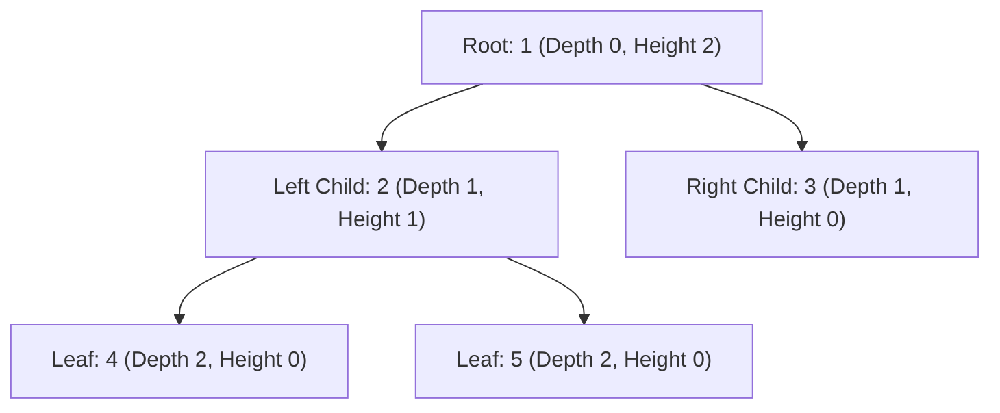

# Day 23: Binary Trees: DFS & Properties

<nav aria-label="Lecture navigation">

[Previous: Grid Backtracking & Mazes](day-22-grid-backtracking-and-n-queens.md) | [Roadmap](../javascript-dsa-roadmap.md) | [Next: Binary Trees: BFS & Views](day-24-binary-trees-bfs-views-and-lca.md)

</nav>

## Prerequisites

- [Day 11: Singly & Doubly Linked Lists](day-11-singly-and-doubly-linked-lists.md) — Pointer references and node structures.
- [Day 13: Stacks & Expression Parsing](day-13-stacks-and-expression-parsing.md) — Last-In, First-Out (LIFO) call frames.
- [Day 18: Recursion & Call Stack](day-18-recursion-fundamentals-and-call-stack.md) — Base cases and post-order unwinding.

---

## 1. What is a Binary Tree?

A **Binary Tree** is a non-linear, hierarchical data structure composed of nodes, where each node contains a value and references to at most **two children**, traditionally designated as `left` and `right`. Unlike linear arrays or linked lists where every element has exactly one predecessor and successor, trees represent parent-child relationships, nested taxonomies, and hierarchical decision boundaries.

> **Binary Tree** — A connected, acyclic graph where each node has at most two outgoing edges directed to child nodes.

> **Root Node** — The topmost node in the tree with no parent pointers.

> **Leaf Node** — A node with both `left === null` and `right === null`.

> **Depth vs. Height** — The **depth** of a node is the number of edges from the root down to that node. The **height** of a tree is the number of edges on the longest path from that node down to a leaf.

### Physical Analogy: The Corporate Hierarchy

Imagine an enterprise organizational chart:

```text
=============================================================================
                    CORPORATE ORGANIZATIONAL HIERARCHY
=============================================================================

                         [ CEO: Alice ]               <-- Root (Depth 0)
                         /            \
             [ VP Eng: Bob ]        [ VP Sales: Carol ] <-- Depth 1
             /             \                 \
      [ Dev: Dave ]   [ QA: Eve ]       [ Lead: Frank ] <-- Depth 2 (Leaves)

1. TOP-DOWN INFORMATION FLOW (Pre-Order):
   - The CEO makes an executive decision, pushes it down to the VPs, who push
     it down to individual developers.

2. BOTTOM-UP REPORTING (Post-Order):
   - The developers and QA estimate their sprint tasks. They report estimates
     up to the VPs. VPs aggregate the numbers and report the total budget to the CEO.
   - The CEO cannot compute the company budget until BOTH subtrees finish!
=============================================================================
```



### The Standard `TreeNode` Representation

```javascript
class TreeNode {
  constructor(val = 0, left = null, right = null) {
    this.val = val;
    this.left = left;
    this.right = right;
  }
}
```

---

## 2. How Binary Tree DFS Works Step-by-Step

### 2.1 The Three Classical DFS Orders

Depth-First Search (DFS) traverses as deep as possible along each branch before backtracking. The three traversals differ strictly in **when the parent node is evaluated relative to its children**:

```text
=============================================================================
                   THE THREE CLASSICAL DFS ORDERS
=============================================================================

1. PRE-ORDER (Node -> Left -> Right):
   - Use Case: Tree serialization, deep cloning, prefix expression parsing.
   - Process self FIRST, then pass data down to children (Top-Down).

2. IN-ORDER (Left -> Node -> Right):
   - Use Case: Emits nodes in STRICT ASCENDING ORDER on a Binary Search Tree (BST).
   - Process left subtree, process self, process right subtree.

3. POST-ORDER (Left -> Right -> Node):
   - Use Case: Tree deletion, computing height/diameter, bottom-up aggregation.
   - Children MUST be solved first before the parent can evaluate its own state!
=============================================================================
```

```text
Trace on tree:
        1
       / \
      2   3
     / \
    4   5

- Pre-Order  (Root -> L -> R): [ 1, 2, 4, 5, 3 ]
- In-Order   (L -> Root -> R): [ 4, 2, 5, 1, 3 ]
- Post-Order (L -> R -> Root): [ 4, 5, 2, 3, 1 ]
```

```javascript
// Canonical DFS Traversal Implementations
function preOrder(root, result = []) {
  if (!root) return result;
  result.push(root.val);          // 1. Process Parent First
  preOrder(root.left, result);    // 2. Recurse Left
  preOrder(root.right, result);   // 3. Recurse Right
  return result;
}

function inOrder(root, result = []) {
  if (!root) return result;
  inOrder(root.left, result);     // 1. Recurse Left
  result.push(root.val);          // 2. Process Parent
  inOrder(root.right, result);    // 3. Recurse Right
  return result;
}

function postOrder(root, result = []) {
  if (!root) return result;
  postOrder(root.left, result);   // 1. Recurse Left
  postOrder(root.right, result);  // 2. Recurse Right
  result.push(root.val);          // 3. Process Parent Last
  return result;
}
```

### 2.2 Bottom-Up vs. Top-Down Mental Models

Tree problems overwhelmingly fall into one of two recursive architectures:

1. **Top-Down (Pre-Order Propagation):** The parent calculates a state (e.g. `currentSum + node.val`) and passes it down into the children via function arguments.
2. **Bottom-Up (Post-Order Aggregation):** The function asks: *"If my left child gives me its answer, and my right child gives me its answer, how do I combine them to return my answer to my parent?"*

---

## 3. Pattern Recognition of Binary Tree DFS

### How to Spot These Patterns in Interviews

| Problem Statement Signal | Tree Characteristic | Optimal Algorithmic Pattern |
| :--- | :--- | :--- |
| "Find maximum/minimum depth of binary tree" | Longest/shortest root-to-leaf path | **Bottom-Up Post-Order DFS** |
| "Determine if tree is height-balanced" | For every node, $\|H_{left} - H_{right}\| \le 1$ | **Bottom-Up DFS with Sentinel Early-Exit** |
| "Find the longest path between any two nodes" | Path may or may not pass through root | **Diameter Pattern (Post-Order with Max Tracker)** |
| "Check if tree is a mirror / symmetric" | Compare left.left with right.right | **Dual-Pointer Simultaneous DFS** |
| "Invert / mirror a binary tree" | Swap child pointers | **Pre-Order or Post-Order Pointer Swap** |
| "Root to leaf numbers sum to target" | Path accumulates from top | **Top-Down DFS with Backtracking** |

---

## 4. Problem 1: Balanced Binary Tree (LeetCode 110)

### Problem Description
Given a binary tree, determine if it is **height-balanced**.
A **height-balanced** binary tree is defined as a binary tree in which the depth of the two subtrees of every node never differs by more than one:
$$\forall \text{ node } u: |\text{height}(u.\text{left}) - \text{height}(u.\text{right})| \le 1$$

### Step 1: Physical Simulation
Suppose we have tree:
```text
        3
       / \
      9  20
         /  \
        15   7
```
- For node `9`: Height is 1.
- For node `15`: Height is 1. Node `7`: Height is 1.
- For node `20`: Left height = 1, Right height = 1. Difference = $|1 - 1| = 0 \le 1$. Height of node 20 is $\max(1, 1) + 1 = 2$.
- For node `3` (Root): Left height = 1 (from node 9), Right height = 2 (from node 20).
  * Difference = $|1 - 2| = 1 \le 1$.
- Every node satisfies the invariant $\implies$ **Balanced (`true`)**.

Now consider an unbalanced tree:
```text
       1
      /
     2
    /
   3
```
- For node `3`: Height = 1.
- For node `2`: Left height = 1, Right height = 0. Diff = 1. Height = 2.
- For node `1`: Left height = 2, Right height = 0. Diff = $|2 - 0| = 2 > 1$!
- Invariant violated at node 1 $\implies$ **Unbalanced (`false`)**.

### Step 2: Brute Force Approach
Write a helper `getHeight(node)` function that computes the depth of any subtree. For every node in the tree, calculate the height of its left child, height of its right child, and recursively check both subtrees:

```javascript
// Naive O(N^2) Top-Down Balance Checker
function isBalancedNaive(root) {
  if (!root) return true;

  function getHeight(node) {
    if (!node) return 0;
    return 1 + Math.max(getHeight(node.left), getHeight(node.right));
  }

  const leftH = getHeight(root.left);
  const rightH = getHeight(root.right);

  if (Math.abs(leftH - rightH) > 1) return false;

  // Recurse down to verify children: Re-traverses entire subtrees!
  return isBalancedNaive(root.left) && isBalancedNaive(root.right);
}
```

### Step 3: Bottleneck
For a skewed tree of $N$ nodes, `getHeight()` runs in $O(N)$ time. Because `isBalancedNaive()` invokes `getHeight()` from the root, then from its child, then grandchild, it traverses nodes repeatedly:
$$T(N) = N + (N - 1) + (N - 2) + \dots + 1 = O(N^2)$$
For $N = 100,000$, $N^2 = 10,000,000,000$ operations—freezing Node.js.

### Step 4: The Pattern Discovery
Instead of computing height top-down, we use **Bottom-Up Post-Order DFS**:
1. Check height of left subtree.
2. Check height of right subtree.
3. If either subtree is already unbalanced, or if $|H_{left} - H_{right}| > 1$, immediately return **`-1` (sentinel value)** indicating failure!
4. If balanced, return the true height: $1 + \max(H_{left}, H_{right})$.
The moment any node returns `-1`, every parent immediately bubbles `-1` up to the root without doing any further comparisons. Each node is visited **exactly once**, dropping runtime from $O(N^2)$ to $O(N)$!

```mermaid
graph TD
    Leaf4["Leaf 4: returns H=1"] --> Node2["Node 2"]
    Leaf5["Leaf 5: returns H=1"] --> Node2
    Node2 -->|H = max(1,1)+1 = 2| Root1["Root 1"]
    Leaf3["Leaf 3: returns H=1"] --> Root1
    Root1 -->|Diff = 2 - 1 = 1 <= 1| Balanced["Valid Height = 3 (Balanced)"]
```

### Step 5: The Optimal Solution

```javascript
// ✅ CORRECT: Optimal O(N) Bottom-Up Balance Check with Sentinel -1
function isBalanced(root) {
  // Returns height of subtree if balanced, or -1 if unbalanced
  function checkHeight(node) {
    if (!node) return 0; // Base case: Null nodes have height 0

    // 1. Traverse Left Subtree
    const leftHeight = checkHeight(node.left);
    if (leftHeight === -1) return -1; // Early exit: Left is unbalanced

    // 2. Traverse Right Subtree
    const rightHeight = checkHeight(node.right);
    if (rightHeight === -1) return -1; // Early exit: Right is unbalanced

    // 3. Post-Order Evaluation: Check balance invariant at current node
    if (Math.abs(leftHeight - rightHeight) > 1) {
      return -1; // Unbalanced! Trigger sentinel failure
    }

    // Return true height to parent
    return 1 + Math.max(leftHeight, rightHeight);
  }

  return checkHeight(root) !== -1;
}

// ❌ ANTI-PATTERN: Calling getHeight() inside isBalanced()
// Calling getHeight() separately inside each recursive step duplicates work,
// causing O(N^2) complexity on skewed trees.

// Direct test run
const balancedTree = new TreeNode(3,
  new TreeNode(9),
  new TreeNode(20, new TreeNode(15), new TreeNode(7))
);

const unbalancedTree = new TreeNode(1,
  new TreeNode(2,
    new TreeNode(3, new TreeNode(4), null),
    null
  ),
  null
);

console.log("Tree 1 is balanced:", isBalanced(balancedTree));     // Expected: true
console.log("Tree 2 is balanced:", isBalanced(unbalancedTree));   // Expected: false
```

#### Complexity Analysis
- **Time Complexity:** $O(N)$ strictly. Every node in the binary tree is visited at most once during the single bottom-up post-order traversal.
- **Space Complexity:** $O(H)$ where $H$ is the tree height. In the worst case (skewed tree), $H = O(N)$; in a balanced tree, $H = O(\log N)$ frames on the call stack.

---

## 5. Problem 2: Diameter of Binary Tree (LeetCode 543)

### Problem Description
Given the `root` of a binary tree, return the **length of the diameter** of the tree.
The **diameter** of a binary tree is the **length of the longest path between any two nodes** in a tree. This path may or may not pass through the root.
The length of a path between two nodes is represented by the **number of edges** between them.

### Step 1: Physical Simulation
Consider the following tree:
```text
          1
         / \
        2   3
       / \
      4   5
```
- Path passing through root `1`: From `4` up to `2`, up to `1`, down to `3`.
  * Path: `4 -> 2 -> 1 -> 3`. Number of edges = 3.
- Path NOT passing through root: From `4` up to `2`, down to `5`.
  * Path: `4 -> 2 -> 5`. Number of edges = 2.
- Max diameter = 3.

Now consider this critical edge-case tree:
```text
               1
              /
             2
            / \
           3   4
          /     \
         5       6
```
- Path through root `1`: Max path from `1` to `5` is 3 edges.
- Path through node `2`: `5 -> 3 -> 2 -> 4 -> 6`. Number of edges = 4!
- **Key Insight:** The diameter does NOT have to pass through the root! The longest path could be contained entirely within a deep subtree.

### Step 2: Brute Force Approach
At every node `u`, compute `maxDepth(u.left) + maxDepth(u.right)`. Take the maximum across all nodes by recursively calling the function on `u.left` and `u.right`:

```javascript
function diameterOfBinaryTreeNaive(root) {
  if (!root) return 0;

  function maxDepth(node) {
    if (!node) return 0;
    return 1 + Math.max(maxDepth(node.left), maxDepth(node.right));
  }

  const currentDiameter = maxDepth(root.left) + maxDepth(root.right);
  const leftSubtreeDia = diameterOfBinaryTreeNaive(root.left);
  const rightSubtreeDia = diameterOfBinaryTreeNaive(root.right);

  return Math.max(currentDiameter, leftSubtreeDia, rightSubtreeDia);
}
```

### Step 3: Bottleneck
Calling `maxDepth()` repeatedly at every subtree repeats depth calculations for overlapping nodes, resulting in $O(N^2)$ time on skewed trees.

### Step 4: The Pattern Discovery
A single post-order traversal can simultaneously calculate **two distinct metrics**:
1. **The Subtree Height (Returned Value):** $1 + \max(H_{left}, H_{right})$. This is returned up to the parent so the parent can compute its own height.
2. **The Longest Path Through Current Node (Side-Effect):** At any node `u`, the longest path with `u` as its highest turning point has length:
$$\text{Diameter}_{u} = H_{left} + H_{right}$$
We maintain a global or closure variable `maxDiameter`. As post-order DFS unwinds, every node checks if the path through itself beats `maxDiameter`, then returns its height up to its parent.

```text
At Node 2:
Left Child 4 returns height = 1.
Right Child 5 returns height = 1.
Longest path turning at Node 2 = 1 + 1 = 2 edges (4 -> 2 -> 5).
Update maxDiameter = max(0, 2) = 2.
Node 2 returns its own height = 1 + max(1, 1) = 2 up to Root 1.

At Root 1:
Left child 2 returned height = 2.
Right child 3 returned height = 1.
Longest path turning at Root 1 = 2 + 1 = 3 edges (4 -> 2 -> 1 -> 3).
Update maxDiameter = max(2, 3) = 3.
```

### Step 5: The Optimal Solution

```javascript
// ✅ CORRECT: Optimal O(N) Tree Diameter in Single Bottom-Up Pass
function diameterOfBinaryTree(root) {
  let maxDiameter = 0;

  // Returns the maximum depth (in edges) from this node down to any leaf
  function calculateHeight(node) {
    if (!node) return 0;

    // 1. Bottom-up post-order: Resolve children heights first
    const leftHeight = calculateHeight(node.left);
    const rightHeight = calculateHeight(node.right);

    // 2. Longest path where current node is the highest turning point
    const diameterThroughNode = leftHeight + rightHeight;

    // Update global maximum diameter observed anywhere in tree
    if (diameterThroughNode > maxDiameter) {
      maxDiameter = diameterThroughNode;
    }

    // 3. Return maximum height to parent
    return 1 + Math.max(leftHeight, rightHeight);
  }

  calculateHeight(root);
  return maxDiameter;
}

// ❌ ANTI-PATTERN: Returning diameter instead of height from helper
// calculateHeight MUST return the linear height (max path down ONE branch).
// Returning diameter prevents the parent from correctly extending the path!

// Direct test run
const tree = new TreeNode(1,
  new TreeNode(2, new TreeNode(4), new TreeNode(5)),
  new TreeNode(3)
);

console.log("Diameter of Tree (Expected 3):", diameterOfBinaryTree(tree));

const deepSubtreeTree = new TreeNode(1,
  new TreeNode(2,
    new TreeNode(3, new TreeNode(5), null),
    new TreeNode(4, null, new TreeNode(6))
  ),
  null
);
console.log("Diameter of Deep Subtree (Expected 4):", diameterOfBinaryTree(deepSubtreeTree));
```

#### Complexity Analysis
- **Time Complexity:** $O(N)$ strictly. Every node is visited exactly once in the post-order traversal.
- **Space Complexity:** $O(H)$ auxiliary space for the recursion call stack, where $H$ is the height of the tree ($O(\log N)$ average, $O(N)$ worst case).

---

## 6. Under the Hood: V8 & Node.js

Executing tree algorithms in a production Node.js backend exposes critical V8 engine realities:

```text
=============================================================================
                     TREE STRUCTURES & V8 ENGINE REALITIES
=============================================================================

1. V8 HIDDEN CLASSES & SHAPES FOR TreeNode:
   - When new TreeNode(val, left, right) is instantiated, V8 creates a Map/Shape.
   - If a developer dynamically attaches ad-hoc properties later:
       node.visited = true; // Polymorphic shape change!
       node.depth = 5;       // Another shape change!
   - Dynamic property injection changes the object's hidden class, kicking
     the property access out of V8's Inline Cache (IC) and into megamorphic lookups.
   - Senior Rule: Declare all properties upfront in the TreeNode constructor.

2. CALL STACK OVERFLOW ON SKEWED TREES:
   - V8 allocates a fixed ~10,000 stack frame limit.
   - If an unbalanced binary tree has 15,000 nodes structured as a degenerate linked
     list (every node has only a left child), recursive DFS crashes:
     "RangeError: Maximum call stack size exceeded"
   - For ultra-deep trees in production, convert recursive DFS to an ITERATIVE DFS
     using an explicit Array on the V8 heap as a simulated stack. Heap arrays can
     grow to millions of elements without crashing the call stack!
=============================================================================
```

```javascript
// Production-Safe Iterative DFS (Immune to V8 Call Stack Overflow)
function maxDepthIterative(root) {
  if (!root) return 0;

  // Use heap memory instead of call stack
  const stack = [{ node: root, depth: 1 }];
  let maxDepth = 0;

  while (stack.length > 0) {
    const { node, depth } = stack.pop();

    if (depth > maxDepth) maxDepth = depth;

    if (node.left) stack.push({ node: node.left, depth: depth + 1 });
    if (node.right) stack.push({ node: node.right, depth: depth + 1 });
  }

  return maxDepth;
}

// Skewed tree with 12,000 nodes (would crash standard recursion)
let curr = new TreeNode(1);
const deepRoot = curr;
for (let i = 2; i <= 12000; i++) {
  curr.left = new TreeNode(i);
  curr = curr.left;
}

console.log("Iterative depth of 12,000 skewed nodes:", maxDepthIterative(deepRoot)); // 12000 (No crash!)
```

---

## 7. Hands-On Exercise

### The Off-By-One Invert Binary Tree Bug
A candidate was asked to implement `invertTree(root)` (mirror a binary tree). The candidate wrote recursive code, but due to mutating the left child before reading it, the function duplicates the left subtree and loses the right subtree.

### The Buggy Code
```javascript
function buggyInvertTree(root) {
  if (!root) return null;

  // BUG: Mutating root.left immediately overwrites the original pointer!
  root.left = buggyInvertTree(root.right);
  // When executing the next line, root.left is already inverted root.right!
  // The original root.left was never inverted and is lost to garbage collection!
  root.right = buggyInvertTree(root.left);

  return root;
}
```

### The Fix and Direct Verification
Save original references into temporary variables or invert both subtrees before reassigning child pointers:

```javascript
// ✅ REPAIRED: Production-Safe Invert Binary Tree
function safeInvertTree(root) {
  if (!root) return null;

  // 1. Post-order: Invert children first before reassigning pointers
  const invertedLeft = safeInvertTree(root.left);
  const invertedRight = safeInvertTree(root.right);

  // 2. Swap pointers
  root.left = invertedRight;
  root.right = invertedLeft;

  return root;
}

// Direct test verification
const originalTree = new TreeNode(4,
  new TreeNode(2, new TreeNode(1), new TreeNode(3)),
  new TreeNode(7, new TreeNode(6), new TreeNode(9))
);

safeInvertTree(originalTree);
console.log("Inverted Root Left Child Val (Expected 7):", originalTree.left.val);
console.log("Inverted Root Right Child Val (Expected 2):", originalTree.right.val);
console.log("Inverted Left-Left Val (Expected 9):", originalTree.left.left.val);
```

---

## 8. Tricky Points and Edge Cases

### 1. Edge Count vs. Node Count Definition
In technical interviews, clarify whether **height/depth/diameter** is measured in **edges** or **nodes**:
- A single node tree `[1]`:
  * By **node count**: Height = 1.
  * By **edge count**: Height = 0.
- LeetCode 104 (Maximum Depth) counts **nodes** (depth of `[1]` is 1).
- LeetCode 543 (Diameter) counts **edges** (diameter of `[1]` is 0).
Always confirm the metric before writing base cases.

### 2. Diameter Does Not Always Include Root
Never assume the longest path passes through the root node. In an unbalanced tree where one branch splits deeply into two massive subtrees, the diameter path turns entirely within that subtree. Always track `maxDiameter` globally across every node.

### 3. Tree Modification While Iterating
If you modify tree pointers (e.g. flattening a tree into a linked list or inverting children) while running DFS, be cautious not to create cyclic references. A cyclic reference `node.left = parent` causes infinite recursion and terminates Node.js with a stack overflow.

---

## 9. Comprehensive Summary

```text
=============================================================================
                    BINARY TREE DFS MASTER SUMMARY
=============================================================================

TRAVERSAL           EVALUATION ORDER        CORE INTERVIEW USAGE
-----------------------------------------------------------------------------
Pre-Order           Root -> Left -> Right   Tree cloning, prefix serialization
In-Order            Left -> Root -> Right   BST sorted validation & recovery
Post-Order          Left -> Right -> Root   Height, diameter, deletion, bottom-up
Top-Down DFS        Pass state down         Path sum, root-to-leaf paths
Bottom-Up DFS       Return state up         Balanced check, diameter, subtree sums
Iterative DFS       Explicit heap stack     Guards against V8 stack overflow (N > 10K)
=============================================================================
```

- **Bottom-Up Post-Order is the primary workhorse:** By gathering results from `left` and `right` subtrees before evaluating the parent, subproblems are solved once in $O(N)$ time.
- **Sentinel Returns eliminate $O(N^2)$ redundancy:** Returning `-1` or special error flags upon detecting invalidity prevents unnecessary upward recalculation.
- **Iterative heap stacks protect production backends:** Replace recursive call stacks with explicit JavaScript array stacks when tree depth is unconstrained.

---

## 10. Cheat Sheet

### Decision Matrix: Tree Traversal Patterns

| Goal / Requirement | Traversal Order | State Propagation |
| :--- | :--- | :--- |
| Compute height, diameter, subtree count | **Post-Order** | Bottom-up (children return to parent) |
| Print or validate BST values | **In-Order** | Left child $\to$ self $\to$ right child |
| Duplicate / serialize tree | **Pre-Order** | Self $\to$ left child $\to$ right child |
| Check if path sums to target | **Pre-Order** | Top-down (parent passes running sum down) |
| Deep tree with unknown height ($> 10^4$) | **Iterative DFS** | Use `stack = []` on heap to prevent crash |

### Tree DFS Safety Checklist
- [ ] Base case: Did you handle `if (!root) return ...` at the very top?
- [ ] Clarified edge count (0 for leaf) vs node count (1 for leaf)?
- [ ] For diameter, did your helper return **height**, not diameter?
- [ ] Did you avoid redundant calls like `getHeight()` inside `isBalanced()`?

---

## 11. Interview Q&A

### 45-Second Senior Pitch
> *"Binary tree problems are fundamentally solved by matching problem invariants to traversal direction. When calculations require local leaf metrics to bubble up—such as calculating subtree heights, verifying balance invariants, or measuring tree diameters—we use a bottom-up post-order DFS. This enables us to evaluate each node exactly once in strict $O(N)$ time. In production Node.js systems where unbalanced trees can exceed the 10,000-frame V8 call stack limit, we safeguard against RangeError crashes by substituting recursion with an iterative stack allocated on the heap."*

### Deep Interview Questions

#### Q1: Why does post-order traversal solve tree diameter in $O(N)$ time while pre-order takes $O(N^2)$?
**Answer:** A naive top-down pre-order approach visits a parent node, runs two independent tree traversals to calculate the depths of its left and right subtrees, and then recurses on its children. Because each child re-traverses all of its descendants, nodes near the bottom of a skewed tree are visited $N$ times, yielding $\sum_{i=1}^N i = O(N^2)$ time. Bottom-up post-order traversal calculates subtree heights from the leaves upward. When a parent node executes, its left and right heights are already computed and returned in $O(1)$ time. Every node is visited once, achieving $O(N)$ runtime.

#### Q2: How would you detect a cycle in a corrupted binary tree structure?
**Answer:** In a valid binary tree, every node except the root has exactly one parent, and there are zero cycles. If references become corrupted (e.g. `node.right = root`), standard DFS will enter an infinite loop. We can detect cycles using:
1. **Visited Set:** Store node references in a JavaScript `Set`. If `visited.has(node)` is true before visiting, a cycle exists.
2. **Node Count Property:** In any valid tree with $N$ nodes, there are exactly $N - 1$ edges. If edge count $\ge N$, a cycle exists.

#### Q3: What is the exact difference between tree Depth and tree Height?
**Answer:**
- **Depth:** Measured from the **root downward**. The depth of a node is the number of edges from the root to that node. The root node has depth 0.
- **Height:** Measured from the **leaves upward**. The height of a node is the number of edges on the longest downward path from that node to a leaf. A leaf node has height 0. The height of the entire tree is the height of its root node.

#### Q4: Why is it an anti-pattern to dynamically assign tracking properties directly to `TreeNode` objects in V8?
**Answer:** In V8, objects with the same properties in the same order share a Hidden Class (Map). When you initialize `new TreeNode(val)`, V8 optimizes property access (`.val`, `.left`, `.right`) via Inline Caching. If you dynamically inject properties during traversal (such as `node.visited = true` or `node.depth = 3`), V8 is forced to transition the node to a new hidden class. If nodes undergo different property additions, the call site becomes **megamorphic**, disabling inline caching and falling back to slow hash-table lookups, significantly reducing execution speed.

---

## 12. Practice Problems

### Problem 1: Invert Binary Tree (LeetCode 226)
- **Input:** `root = [4, 2, 7, 1, 3, 6, 9]`
- **Output:** `[4, 7, 2, 9, 6, 3, 1]`
- **Challenge:** Invert the tree in $O(N)$ time and $O(H)$ space using bottom-up post-order DFS.

### Problem 2: Symmetric Tree (LeetCode 101)
- **Input:** `root = [1, 2, 2, 3, 4, 4, 3]`
- **Output:** `true`
- **Challenge:** Solve both recursively using dual-pointer simultaneous DFS (`isMirror(t1, t2)`) and iteratively using a queue.

### Problem 3: Path Sum III (LeetCode 437)
- **Input:** `root = [10, 5, -3, 3, 2, null, 11, 3, -2, null, 1]`, `targetSum = 8`
- **Output:** `3`
- **Challenge:** Find all downward paths summing to target in $O(N)$ time by combining **Tree DFS with Prefix Sum Hash Maps** and backtracking.

---

<nav aria-label="Lecture navigation">

[Previous: Grid Backtracking & Mazes](day-22-grid-backtracking-and-n-queens.md) | [Roadmap](../javascript-dsa-roadmap.md) | [Next: Binary Trees: BFS & Views](day-24-binary-trees-bfs-views-and-lca.md)

</nav>
