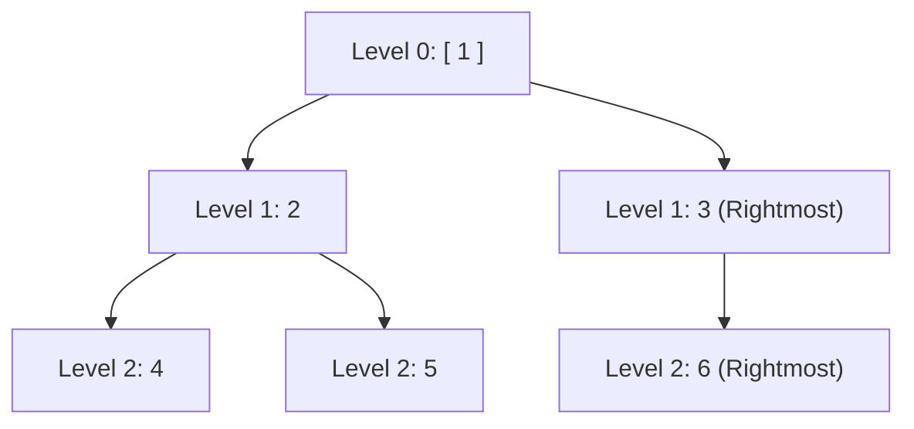
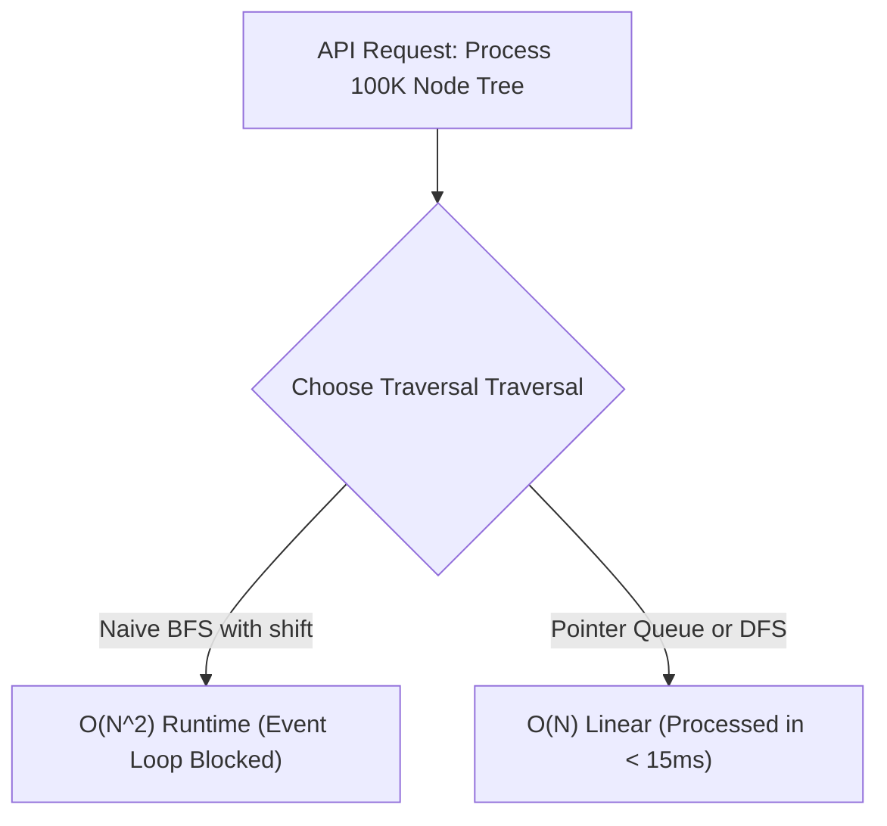

# Day 24: Binary Trees: BFS, Views & LCA

<nav aria-label="Lecture navigation">

[Previous: Binary Trees: DFS & Properties](day-23-binary-trees-dfs-and-properties.md) | [Roadmap](../javascript-dsa-roadmap.md) | [Next: Binary Search Trees](day-25-binary-search-trees-crud-and-validation.md)

</nav>

## Prerequisites

- [Day 15: Queues & Circular Buffers](day-15-queues-circular-buffers-and-design.md) — First-In, First-Out (FIFO) queue mechanics and the $O(n)$ `shift()` trap.
- [Day 23: Binary Trees: DFS & Properties](day-23-binary-trees-dfs-and-properties.md) — `TreeNode` structure and bottom-up post-order evaluation.

---

## 1. What is Breadth-First Search (BFS) & Tree Views?

While Depth-First Search (DFS) dives down a single branch to leaf level before backtracking, **Breadth-First Search (BFS)**—also known as **Level-Order Traversal**—visits nodes horizontally, layer by layer, from top to bottom and left to right.

BFS guarantees that every node at depth $d$ is visited strictly before any node at depth $d + 1$. This structural guarantee makes BFS the premier algorithm for finding **shortest paths**, determining **minimum tree depths**, and generating **directional views** (e.g. looking at a tree from the right or left edge).

> **Breadth-First Search (BFS)** — An iterative graph and tree traversal algorithm that explores all neighbor nodes at the present depth level before moving on to nodes at the next depth level, using a First-In, First-Out (FIFO) queue.

> **Tree View** — The visible subset of nodes observed when looking at a tree structure from a specific angle (Right View, Left View, Top View, or Bottom View).

> **Lowest Common Ancestor (LCA)** — The deepest node in a tree that has both target nodes $p$ and $q$ as descendants (where a node is allowed to be a descendant of itself).

### Physical Analogy: The Floor-by-Floor Building Scan

```text
=============================================================================
                  THE APARTMENT SCAN vs. THE RIGHT-SIDE FACADE
=============================================================================

1. LEVEL ORDER BFS (The Fire Inspector):
   - A fire inspector enters an apartment building.
   - They inspect Floor 0 (Penthouse / Root: [ 1 ]).
   - Then Floor 1 ([ 2, 3 ]).
   - Then Floor 2 ([ 4, 5, 6 ]).
   - All rooms on a floor are verified before taking the stairs down.

2. RIGHT-SIDE VIEW (The Street Observer):
   - You stand on the sidewalk to the right of the building at dusk.
   - You look straight at the right facade.
   - For every floor, only the RIGHTMOST window facing the street is visible.
     Inner rooms and leftmost rooms are blocked from view by the rightmost room!
   - Level 0: Room 1 is visible.
   - Level 1: Room 3 blocks Room 2.
   - Level 2: Room 6 blocks Room 5 and Room 4.
   - Visible facade: [ 1, 3, 6 ].
=============================================================================
```



---

## 2. How BFS and LCA Work Step-by-Step

### 2.1 The Level-Order Snapshot Pattern

The defining challenge of tree BFS is separating nodes by level. If you simply enqueue child nodes and dequeue parents in an unconstrained `while (queue.length)` loop, all levels blend together into a flat 1D stream.

To preserve **level boundaries**, senior engineers use the **Snapshot Pattern**:
At the start of each level, read and freeze `levelSize = queue.length`. Run an inner loop exactly `levelSize` times. Any child nodes enqueued during this loop belong strictly to the **next level** and will not be dequeued until the next iteration of the outer `while` loop!

```text
=============================================================================
                     THE BFS LEVEL-SIZE SNAPSHOT TRACE
=============================================================================

Tree:       1
          /   \
         2     3
        / \     \
       4   5     6

Initial:  Queue = [ 1 ]

--- LEVEL 0 ---
Snapshot: levelSize = queue.length = 1
Loop i = 0: Dequeue 1. Enqueue children (2, 3).
Level 0 finished! Level nodes: [ 1 ].
Queue now holds: [ 2, 3 ] (All Level 1 nodes!)

--- LEVEL 1 ---
Snapshot: levelSize = queue.length = 2
Loop i = 0: Dequeue 2. Enqueue children (4, 5).
Loop i = 1: Dequeue 3. Enqueue children (6).
Level 1 finished! Level nodes: [ 2, 3 ].
Queue now holds: [ 4, 5, 6 ] (All Level 2 nodes!)

--- LEVEL 2 ---
Snapshot: levelSize = queue.length = 3
Loop i = 0: Dequeue 4. (No children).
Loop i = 1: Dequeue 5. (No children).
Loop i = 2: Dequeue 6. (No children).
Level 2 finished! Level nodes: [ 4, 5, 6 ].
Queue now empty. Traversal complete!
=============================================================================
```

### 2.2 Lowest Common Ancestor (LCA) Bottom-Up Logic

To find the Lowest Common Ancestor of nodes $p$ and $q$ in a general binary tree, we post-order traverse the tree bottom-up:
1. If the current node is `null`, return `null`.
2. If the current node is `p` or `q`, return `root` (found one of the targets!).
3. Search left subtree: `left = lca(root.left, p, q)`
4. Search right subtree: `right = lca(root.right, p, q)`
5. **The Three Convergence Scenarios:**
   - If both `left !== null` AND `right !== null`: One target was found in the left subtree, and the other target in the right subtree. The current node is their point of divergence $\implies$ **Current node is the LCA!**
   - If only `left !== null`: Both targets (or target $p$ containing $q$) are in the left subtree $\implies$ Return `left`.
   - If only `right !== null`: Both targets are in the right subtree $\implies$ Return `right`.
   - If both are `null`: Neither target exists below this node $\implies$ Return `null`.

```text
LCA Decision Matrix at Node u:
        u
       / \
    left  right

Case 1: left != null && right != null  ==> Node u is the LCA!
Case 2: left != null && right == null  ==> Target(s) in left subtree (bubble left up)
Case 3: left == null && right != null  ==> Target(s) in right subtree (bubble right up)
Case 4: left == null && right == null  ==> Return null
```

---

## 3. Pattern Recognition of BFS & Tree Views

### How to Spot These Patterns in Interviews

| Problem Statement Signal | Structural Requirement | Optimal Algorithmic Pattern |
| :--- | :--- | :--- |
| "Level by level", "Row by row" | Group nodes by their vertical depth | **BFS with `levelSize` Snapshot** |
| "Shortest path / minimum steps to target in tree" | Unweighted shortest path | **BFS (guaranteed shortest depth first)** |
| "Right side view / Left side view" | Extract last (or first) node per level | **BFS with boundary capture** OR **Depth DFS** |
| "Zigzag / Spiral level order" | Alternate left-to-right and right-to-left | **BFS with level deque / parity reversal** |
| "Find lowest common ancestor in generic tree" | Bottom-up target convergence | **Post-Order Bottom-Up DFS** |
| "Find lowest common ancestor in BST" | Exploit value ordering ($L < Root < R$) | **$O(H)$ Iterative BST Descent** |

---

## 4. Problem 1: Binary Tree Right Side View (LeetCode 199)

### Problem Description
Given the `root` of a binary tree, imagine yourself standing on the **right side** of it. Return the values of the nodes you can see ordered from top to bottom.

### Step 1: Physical Simulation
Suppose we have the following tree:
```text
        1            <-- See 1
       / \
      2   3          <-- See 3
       \
        5            <-- See 5 (Node 3 has no right child; 5 peeks through!)
```
- Level 0: `[ 1 ]`. Rightmost visible node: `1`.
- Level 1: `[ 2, 3 ]`. Rightmost visible node: `3`.
- Level 2: `[ 5 ]`. Even though node `5` is a child of the **left** subtree (node 2), because node 3 has no children at level 2, node `5` is unobstructed and visible from the right side!
- Result: `[ 1, 3, 5 ]`.

### Step 2: Brute Force Approach
Perform a standard BFS level-order traversal, collecting every node on each level into an array. After completing the tree, map each level array to its last element:

```javascript
// Naive BFS: Collects all nodes in memory, uses array.shift()
function rightSideViewNaive(root) {
  if (!root) return [];
  const levels = [];
  const queue = [root];

  while (queue.length > 0) {
    const size = queue.length;
    const currentLevel = [];
    for (let i = 0; i < size; i++) {
      const node = queue.shift(); // O(N) shift operation!
      currentLevel.push(node.val);
      if (node.left) queue.push(node.left);
      if (node.right) queue.push(node.right);
    }
    levels.push(currentLevel);
  }

  return levels.map(level => level[level.length - 1]);
}
```

### Step 3: Bottleneck
1. **Memory Allocation:** Collecting every node into `currentLevel` arrays wastes memory when we only ever care about 1 node per level.
2. **The $O(n)$ `queue.shift()` Trap:** In JavaScript, `Array.prototype.shift()` shifts all remaining elements in memory down by 1 index. In a tree with $50,000$ nodes, calling `shift()` for every node turns a linear $O(N)$ algorithm into a quadratic $O(N^2)$ disaster.

### Step 4: The Pattern Discovery
We can solve this using either:
1. **High-Performance BFS:** Maintain an array queue with a `head` pointer index to achieve true $O(1)$ dequeues. In the inner loop, when `i === levelSize - 1` (the last node in the level), push `node.val` directly to `result`.
2. **Right-First DFS:** Traverse in `Root -> Right -> Left` order, tracking `currentDepth`. If `currentDepth === result.length`, this is the **first time** we have ever reached this depth—and because we explore the right child before the left child, this node is guaranteed to be the rightmost visible node!

```text
Right-First DFS Walk:
Visit 1 (depth 0): result.length is 0 === depth 0 -> Add 1! result = [1]
  Recurse Right: Visit 3 (depth 1): result.length is 1 === depth 1 -> Add 3! result = [1, 3]
    Recurse Right: null
    Recurse Left: null
  Recurse Left: Visit 2 (depth 1): result.length is 2 !== depth 1 -> Skip!
    Recurse Right: Visit 5 (depth 2): result.length is 2 === depth 2 -> Add 5! result = [1, 3, 5]
```

### Step 5: The Optimal Solution

```javascript
// ✅ CORRECT APPROACH 1: High-Performance BFS with Index Pointer Queue
function rightSideViewBFS(root) {
  if (!root) return [];

  const result = [];
  const queue = [root];
  let head = 0; // O(1) queue read pointer, zero shift() re-indexing!

  while (head < queue.length) {
    const levelSize = queue.length - head;

    for (let i = 0; i < levelSize; i++) {
      const node = queue[head++];

      // If this is the last element on the current level, it is visible from the right
      if (i === levelSize - 1) {
        result.push(node.val);
      }

      if (node.left) queue.push(node.left);
      if (node.right) queue.push(node.right);
    }
  }

  return result;
}

// ✅ CORRECT APPROACH 2: Right-First DFS (Optimal Memory O(H))
function rightSideViewDFS(root) {
  const result = [];

  function dfs(node, depth) {
    if (!node) return;

    // First time visiting this depth level means this is the rightmost node
    if (depth === result.length) {
      result.push(node.val);
    }

    // Traverse RIGHT child first!
    dfs(node.right, depth + 1);
    // Then traverse LEFT child
    dfs(node.left, depth + 1);
  }

  dfs(root, 0);
  return result;
}

// ❌ ANTI-PATTERN: Merely walking right pointers (node = node.right)
// Fails when right subtree terminates early, hiding deeper left-subtree nodes!

// Direct test run
class TreeNode {
  constructor(val = 0, left = null, right = null) {
    this.val = val;
    this.left = left;
    this.right = right;
  }
}

const testTree = new TreeNode(1,
  new TreeNode(2, null, new TreeNode(5)),
  new TreeNode(3, null, new TreeNode(4))
);

console.log("Right Side View BFS:", rightSideViewBFS(testTree)); // Expected: [ 1, 3, 4 ]
console.log("Right Side View DFS:", rightSideViewDFS(testTree)); // Expected: [ 1, 3, 4 ]
```

#### Complexity Analysis
- **Time Complexity:** $O(N)$ strictly. Every node is visited exactly once in both BFS and DFS implementations.
- **Space Complexity:**
  * **BFS:** $O(W) = O(N)$ auxiliary space where $W$ is the maximum width of the tree (for a complete binary tree, the last level contains $\lceil N/2 \rceil$ nodes).
  * **DFS:** $O(H)$ auxiliary space for call stack where $H$ is tree height ($O(\log N)$ balanced, $O(N)$ skewed). DFS is generally more memory-efficient on balanced trees.

---

## 5. Problem 2: Lowest Common Ancestor of a Binary Tree (LeetCode 236)

### Problem Description
Given a binary tree, find the lowest common ancestor (LCA) of two given nodes `p` and `q`.
According to the definition of LCA on Wikipedia: “The lowest common ancestor is defined between two nodes `p` and `q` as the lowest node in `T` that has both `p` and `q` as descendants (where we allow **a node to be a descendant of itself**).”

### Step 1: Physical Simulation
Suppose we have:
```text
              3
            /   \
          5       1
         / \     / \
        6   2   0   8
           / \
          7   4
```
- Target 1: `p = 5`, `q = 1`
  * Node `5` is in the left subtree of `3`. Node `1` is in the right subtree of `3`.
  * The divergence point is `3`. $\implies$ LCA is `3`.
- Target 2: `p = 5`, `q = 4`
  * Node `4` is a descendant inside the subtree of `5` (`5 -> 2 -> 4`).
  * Since a node is allowed to be a descendant of itself, node `5` contains both `5` and `4`. $\implies$ LCA is `5`!

### Step 2: Brute Force Approach
Find the path from the root to node `p` (e.g. `[3, 5]`) and store it in an array. Find the path from root to node `q` (e.g. `[3, 5, 2, 4]`) and store it in an array. Iterate through both arrays simultaneously until the paths diverge. The last common element is the LCA:

```javascript
// Naive path-storing approach
function lowestCommonAncestorNaive(root, p, q) {
  function findPath(node, target, path) {
    if (!node) return false;
    path.push(node);
    if (node === target) return true;
    if (findPath(node.left, target, path) || findPath(node.right, target, path)) {
      return true;
    }
    path.pop();
    return false;
  }

  const pathP = [];
  const pathQ = [];
  findPath(root, p, pathP);
  findPath(root, q, pathQ);

  let lca = null;
  let i = 0;
  while (i < pathP.length && i < pathQ.length && pathP[i] === pathQ[i]) {
    lca = pathP[i];
    i++;
  }
  return lca;
}
```

### Step 3: Bottleneck
Storing full node path arrays consumes $O(H)$ additional heap arrays, requiring two full traversals of the tree, plus path string/array manipulations.

### Step 4: The Pattern Discovery
We can solve this in a **single post-order DFS pass** without allocating any path arrays:
- As we descend, if the current node matches `p` or `q`, return `root`.
- Subtrees report upward:
  * If both `leftSubtree` and `rightSubtree` return a non-null node, this current node is the exact point of divergence where $p$ and $q$ split into different branches $\implies$ **Return `root`!**
  * If only one side returns a non-null node, propagate that non-null node upward.
  * If neither returns a node, return `null`.

```text
Bottom-Up LCA Bubble Trace for p = 5, q = 1:
At Node 5: Matches p! Returns Node 5.
At Node 1: Matches q! Returns Node 1.
At Root 3:
  left returned Node 5 (non-null).
  right returned Node 1 (non-null).
  Both children returned a target! Root 3 is the LCA!
```

### Step 5: The Optimal Solution

```javascript
// ✅ CORRECT: Optimal O(N) Post-Order LCA in Single Pass
function lowestCommonAncestor(root, p, q) {
  // Base case: Null node or we found one of the targets
  if (!root || root === p || root === q) {
    return root;
  }

  // Post-order: Search both left and right subtrees
  const left = lowestCommonAncestor(root.left, p, q);
  const right = lowestCommonAncestor(root.right, p, q);

  // If both left and right returned non-null, p and q are in separate subtrees.
  // Current root is their lowest common ancestor!
  if (left && right) {
    return root;
  }

  // Otherwise, return whichever subtree found a target (or null if neither found)
  return left ? left : right;
}

// ❌ ANTI-PATTERN: Comparing node values (node.val === p.val)
// In a general binary tree, duplicate values may exist.
// Always compare object identity references (root === p), not values!

// Direct test run
const n7 = new TreeNode(7);
const n4 = new TreeNode(4);
const n2 = new TreeNode(2, n7, n4);
const n6 = new TreeNode(6);
const n5 = new TreeNode(5, n6, n2);
const n0 = new TreeNode(0);
const n8 = new TreeNode(8);
const n1 = new TreeNode(1, n0, n8);
const treeRoot = new TreeNode(3, n5, n1);

console.log("LCA of 5 and 1 (Expected 3):", lowestCommonAncestor(treeRoot, n5, n1).val);
console.log("LCA of 5 and 4 (Expected 5):", lowestCommonAncestor(treeRoot, n5, n4).val);
```

#### Complexity Analysis
- **Time Complexity:** $O(N)$ in the worst case, as we may need to visit every node in the binary tree.
- **Space Complexity:** $O(H)$ auxiliary space for the recursion call stack, where $H$ is the height of the tree ($O(\log N)$ balanced, $O(N)$ skewed). Zero heap arrays are allocated.

---

## 6. Under the Hood: V8 & Node.js

Executing BFS at high volume in Node.js exposes severe runtime characteristics:

```text
=============================================================================
                     BFS & V8 QUEUE PERFORMANCE REALITIES
=============================================================================

1. THE Array.prototype.shift() PERFORMANCE CLIFF:
   - JavaScript arrays are implemented as contiguous memory buffers (FixedArray).
   - queue.shift() removes index 0 and re-indexes every subsequent element:
     [1, 2, 3, 4] -> shift() -> copies [2, 3, 4] down by 1 memory slot.
   - For an array of length K, shift() is O(K).
   - In a BFS on a tree of 50,000 nodes, cumulative cost is:
     Sum_{i=1}^{50000} i = 1,250,000,000 memory moves!
   - Runtime explodes from 5 milliseconds to over 3 seconds!

2. SENIOR MITIGATION PATTERNS:
   a) Index Pointer Queue (queue[head++]):
      - Keeps an advancing read pointer. O(1) amortized, zero re-indexing.
      - Trade-off: Array grows to size N in memory before being GC'd.
   b) Linked List Queue / Ring Buffer:
      - Uses { val, next } nodes or fixed-size Uint32Array circular buffer.
      - Truly O(1) enqueue, O(1) dequeue, bounded memory footprint.

3. BFS QUEUE MEMORY SPIKE IN FULL TREES:
   - For a balanced binary tree, the leaf level contains roughly N / 2 nodes.
   - The queue holds all nodes of a level concurrently.
   - For N = 1,000,000 nodes, queue peak memory holds 500,000 node pointers!
   - In contrast, DFS call stack memory is bounded by tree height: log2(1,000,000) ≈ 20 frames!
   - Architecture Takeaway: DFS is significantly more memory-efficient than BFS
     on deep, wide trees.
=============================================================================
```



---

## 7. Hands-On Exercise

### The Asymmetric Zigzag Parity Bug
A candidate was asked to implement `zigzagLevelOrder(root)` (Level 0: Left to Right; Level 1: Right to Left; Level 2: Left to Right...). The candidate wrote BFS, but modified the queue traversal direction directly inside the loop, corrupting child enqueuing.

### The Buggy Code
```javascript
function buggyZigzag(root) {
  if (!root) return [];
  const result = [];
  const queue = [root];
  let leftToRight = true;

  while (queue.length > 0) {
    const size = queue.length;
    const level = [];

    for (let i = 0; i < size; i++) {
      const node = queue.shift();
      level.push(node.val);

      // BUG: Flipping child enqueuing order corrupts parent-child FIFO sequence
      // across subsequent levels!
      if (leftToRight) {
        if (node.left) queue.push(node.left);
        if (node.right) queue.push(node.right);
      } else {
        if (node.right) queue.push(node.right);
        if (node.left) queue.push(node.left);
      }
    }

    result.push(level);
    leftToRight = !leftToRight;
  }

  return result;
}
```

### The Fix and Direct Verification
Keep child enqueuing strictly standard (`node.left` then `node.right`). Alter **only where values are inserted into the `level` result array** (using `push` for Left-to-Right and `unshift` for Right-to-Left, or reversing the level array after the loop):

```javascript
// ✅ REPAIRED: Production-Safe Zigzag Level Order
function safeZigzagLevelOrder(root) {
  if (!root) return [];

  const result = [];
  const queue = [root];
  let head = 0;
  let leftToRight = true;

  while (head < queue.length) {
    const levelSize = queue.length - head;
    // Pre-allocate fixed array for this level to avoid unshift() O(K) penalties
    const currentLevel = new Array(levelSize);

    for (let i = 0; i < levelSize; i++) {
      const node = queue[head++];

      // Place value at left or right index based on direction flag
      const writeIndex = leftToRight ? i : (levelSize - 1 - i);
      currentLevel[writeIndex] = node.val;

      // Always enqueue children in standard Left -> Right order!
      if (node.left) queue.push(node.left);
      if (node.right) queue.push(node.right);
    }

    result.push(currentLevel);
    leftToRight = !leftToRight;
  }

  return result;
}

// Direct test verification
const zigzagTree = new TreeNode(3,
  new TreeNode(9),
  new TreeNode(20, new TreeNode(15), new TreeNode(7))
);

console.log("Repaired Zigzag Output:", safeZigzagLevelOrder(zigzagTree));
// Expected: [ [3], [20, 9], [15, 7] ]
```

---

## 8. Tricky Points and Edge Cases

### 1. The Right Side View "Shadowing" Fallacy
A frequent misconception is assuming that the right side view consists solely of the right child pointers:
`curr = root; while (curr) { res.push(curr.val); curr = curr.right; }`
This fails completely when a left subtree is deeper than a right subtree. Once the right subtree terminates, the leaves of the left subtree become visible from the right side.

### 2. Node Value Matching vs Reference Equality in LCA
Never write `if (root.val === p.val)`. In real-world enterprise databases or graph structures, multiple nodes may contain the same payload value (e.g., duplicate usernames or statuses). LCA requires determining the ancestor of **the specific object instances** `p` and `q`. Always use reference equality: `if (root === p || root === q)`.

### 3. Queue Memory Exhaustion
In ultra-wide trees (e.g. N-ary trees with 1,000 children per node), a BFS queue can hold tens of thousands of references simultaneously. If memory bounds are tight, use DFS traversal with depth tracking instead of BFS.

---

## 9. Comprehensive Summary

```text
=============================================================================
                    TREE BFS & LCA MASTER SUMMARY
=============================================================================

TECHNIQUE           CORE MECHANISM                  INTERVIEW APPLICATION
-----------------------------------------------------------------------------
Level-Order BFS     Queue + Frozen levelSize        Shortest path, level grouping
Pointer Queue       queue[head++] instead of shift  O(N) runtime, avoids O(N^2) bug
Right-Side View     BFS last element OR             Exterior facade visualization
                    Right-First DFS (depth === len)
LCA (General Tree)  Bottom-Up Post-Order DFS        Convergence point of p and q
LCA (BST)           Compare root.val with p & q     O(H) iterative directional walk
Zigzag BFS          Fixed array index assignment    Alternating level display
=============================================================================
```

- **Freezing `levelSize` is mandatory for level-order BFS:** Processing exactly `levelSize` elements per outer iteration prevents parent and child levels from bleeding together.
- **`queue.shift()` is an $O(N^2)$ trap:** Always use an advancing `head` pointer or linked list queue in Node.js interviews.
- **LCA in generic trees is bottom-up post-order:** A node is the LCA if and only if both its left and right child searches return non-null, or the node itself is a target whose child contains the other target.

---

## 10. Cheat Sheet

### Decision Matrix: BFS vs DFS for Tree Queries

| Problem Goal | Preferred Approach | Rationale |
| :--- | :--- | :--- |
| Find minimum depth / nearest leaf | **BFS** | Terminates at the very first leaf encountered without deep scans. |
| Output nodes level-by-level | **BFS** | Natural FIFO level grouping via `levelSize`. |
| Right / Left View with minimal memory | **DFS** | $O(H)$ stack frames vs $O(N)$ queue width. |
| Lowest Common Ancestor (Generic) | **DFS (Post-Order)** | Bubbles target node references upward. |
| Zigzag / Spiral Traversal | **BFS** | Reverses insertion indices per level parity. |

### BFS / LCA Safety Checklist
- [ ] Did you check `if (!root) return []` at the beginning?
- [ ] Did you freeze `const levelSize = queue.length - head` BEFORE iterating?
- [ ] Did you avoid `queue.shift()` inside high-volume loops?
- [ ] For LCA, did you use reference equality (`root === p`) instead of value equality?

---

## 11. Interview Q&A

### 45-Second Senior Pitch
> *"Level-order traversal and tree view algorithms rely on Breadth-First Search to isolate nodes by depth layer. In Node.js, standard arrays used with `.shift()` introduce an $O(N^2)$ re-indexing bottleneck. We mitigate this using an advancing head pointer or circular queue, freezing `levelSize` at each iteration to enforce clean level boundaries. For directional views, we can either extract the boundary element from our BFS queue or use a depth-indexed DFS. For Lowest Common Ancestor in generic trees, we leverage a post-order traversal to bubble target references upward, identifying the LCA in a single $O(N)$ pass where both subtrees return non-null."*

### Deep Interview Questions

#### Q1: Why does `Array.prototype.shift()` degrade BFS performance in Node.js, and how do you fix it?
**Answer:** In JavaScript engines like V8, arrays are stored as contiguous memory buffers. Deleting the first element with `shift()` requires copying all remaining elements to the left by one position, an $O(K)$ operation where $K$ is array length. For $N$ total nodes, cumulative operations reach $\sum_{i=1}^N i = O(N^2)$. We fix this by maintaining an integer pointer `let head = 0` and reading `const node = queue[head++]`. This converts dequeues into $O(1)$ operations with zero memory shifting.

#### Q2: How does Lowest Common Ancestor in a Binary Search Tree (BST) differ from a general Binary Tree?
**Answer:** In a general binary tree, we must search all branches because node values have no order, requiring $O(N)$ post-order DFS. In a **Binary Search Tree (BST)**, we exploit the ordering invariant ($L < Root < R$):
- If both `p.val` and `q.val` are smaller than `root.val`, the LCA must lie strictly in the **left subtree**.
- If both `p.val` and `q.val` are greater than `root.val`, the LCA must lie strictly in the **right subtree**.
- If one value is smaller and the other is larger (or one equals `root.val`), the paths diverge here $\implies$ `root` is the LCA!
This allows us to find the LCA iteratively in $O(H)$ time and $O(1)$ auxiliary space without recursion.

#### Q3: Why is Right-First DFS often preferred over BFS for Binary Tree Right Side View?
**Answer:** Both algorithms have identical $O(N)$ time complexity. However, their memory profiles differ significantly. In a balanced binary tree of 100,000 nodes:
- **BFS:** The queue must hold all nodes on the widest level ($N/2 = 50,000$ nodes), consuming significant heap memory.
- **DFS:** Memory is bounded by the tree's maximum height, which is $\log_2(100,000) \approx 17$ stack frames. Right-First DFS (`Root -> Right -> Left`) with `depth === result.length` checks requires negligible memory compared to BFS.

#### Q4: How would you find the LCA if the tree nodes contain parent pointers (`node.parent`)?
**Answer:** If parent pointers exist, the problem reduces to finding the **intersection point of two singly linked lists**:
1. Walk from node `p` up to the root, counting depth $D_p$.
2. Walk from node `q` up to the root, counting depth $D_q$.
3. Advance the deeper pointer upward by $|D_p - D_q|$ steps so both nodes are at the same depth.
4. Walk both pointers upward together step-by-step; the first node where `ptrP === ptrQ` is the LCA.
This takes $O(H)$ time and $O(1)$ auxiliary space.

---

## 12. Practice Problems

### Problem 1: Binary Tree Zigzag Level Order Traversal (LeetCode 103)
- **Input:** `root = [3, 9, 20, null, null, 15, 7]`
- **Output:** `[ [3], [20, 9], [15, 7] ]`
- **Challenge:** Implement with an advancing-pointer queue and direct array indexing in $O(N)$ time.

### Problem 2: Populating Next Right Pointers in Each Node (LeetCode 116)
- **Input:** Perfect binary tree where each node has a `next` pointer initialized to `null`.
- **Output:** Populate each `next` pointer to point to its next right neighbor.
- **Challenge:** Solve in $O(N)$ time and **$O(1)$ auxiliary space** by using already-established `next` pointers on level $L$ to connect children on level $L + 1$.

### Problem 3: Lowest Common Ancestor of a Binary Search Tree (LeetCode 235)
- **Input:** BST `root = [6, 2, 8, 0, 4, 7, 9]`, `p = 2, q = 8`
- **Output:** Node `6`
- **Challenge:** Implement the $O(H)$ iterative traversal with $O(1)$ extra memory.

---

<nav aria-label="Lecture navigation">

[Previous: Binary Trees: DFS & Properties](day-23-binary-trees-dfs-and-properties.md) | [Roadmap](../javascript-dsa-roadmap.md) | [Next: Binary Search Trees](day-25-binary-search-trees-crud-and-validation.md)

</nav>
