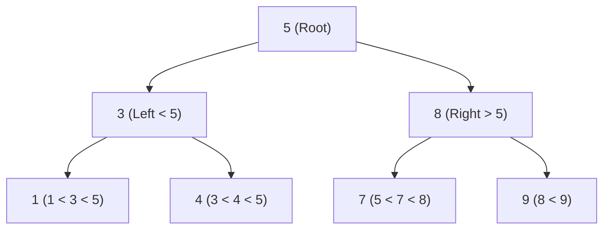
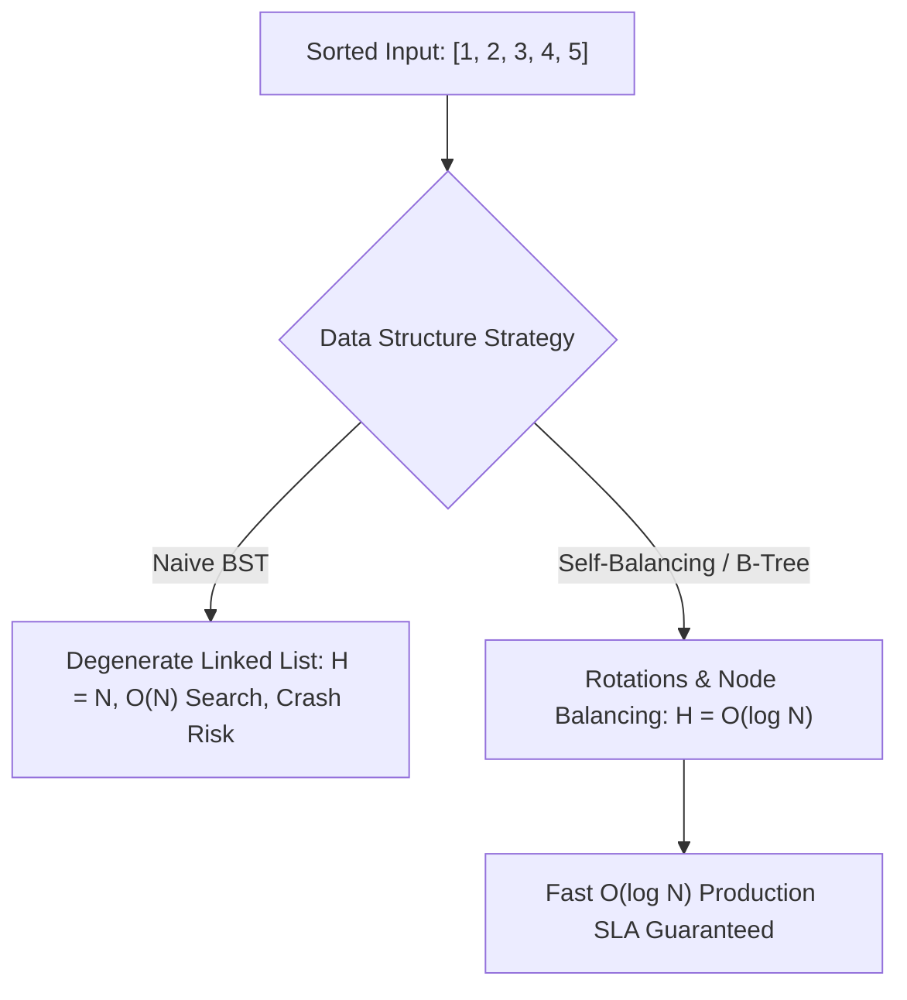

# Day 25: Binary Search Trees: CRUD & Validation

<nav aria-label="Lecture navigation">

[Previous: Binary Trees: BFS & Views](day-24-binary-trees-bfs-views-and-lca.md) | [Roadmap](../javascript-dsa-roadmap.md) | [Next: Graphs: BFS & DFS](day-26-graphs-bfs-shortest-path-and-dfs-components.md)

</nav>

## Prerequisites

- [Day 16: Binary Search Bounds & Rotated Arrays](day-16-binary-search-bounds-and-rotated-arrays.md) — Binary decision halving ($O(\log n)$).
- [Day 23: Binary Trees: DFS & Properties](day-23-binary-trees-dfs-and-properties.md) — In-order traversal and tree pointers.

---

## 1. What is a Binary Search Tree (BST)?

A standard binary tree provides no guarantees about the numerical ordering of its keys. A **Binary Search Tree (BST)** enforces a strict global ordering invariant that makes searching, insertion, and deletion run in $O(\log n)$ average time:

> **The Universal BST Invariant** — For every node $X$ in the tree:
> 1. All node values in the **left subtree** must be **strictly smaller** than $X.\text{val}$.
> 2. All node values in the **right subtree** must be **strictly greater** than $X.\text{val}$.
> 3. Both the left and right subtrees must themselves be valid binary search trees.

> **In-Order Monotonicity** — An In-Order Traversal (`Left -> Node -> Right`) of a valid BST visits keys in **strictly ascending sorted order**.

### Physical Analogy: The Alphabetical Filing Cabinet

```text
=============================================================================
                  THE EXPANDING ALPHABETICAL FILING SYSTEM
=============================================================================

                                  [ M ]
                                 /     \
                             [ F ]     [ T ]
                            /     \   /     \
                          [ C ]  [ H ][ P ] [ Z ]

1. LOOKING FOR "P":
   - You start at "M". "P" is alphabetically after "M".
     Turn RIGHT. You completely eliminate the entire left half [A through L]!
   - You reach "T". "P" is alphabetically before "T".
     Turn LEFT. You eliminate [U through Z]!
   - You reach "P". Found in 2 comparisons instead of scanning 7 drawers!

2. THE GLOBAL INVARIANT RULE:
   - It is NOT enough that "H" is to the right of "F".
   - "H" MUST also be strictly to the left of "M" (before "M" in the alphabet).
   - If someone files "W" inside the left subtree of "M", the entire filing
     cabinet is broken!
=============================================================================
```



---

## 2. How BST Operations Work Step-by-Step

### 2.1 The CRUD Operations: Search, Insert, and Delete

```text
=============================================================================
                          BST CRUD COMPLEXITY
=============================================================================

OPERATION       BEST CASE       AVERAGE (Balanced)      WORST (Skewed)
-----------------------------------------------------------------------------
Search          O(1)            O(log n)                O(n)
Insert          O(1)            O(log n)                O(n)
Delete          O(1)            O(log n)                O(n)
Min / Max       O(1)            O(log n)                O(n)
=============================================================================
```

### 2.2 The Deletion Mechanics: The Three Structural Cases

Deleting a node from a BST is one of the most critical whiteboard interview challenges because the tree must preserve the BST invariant without losing disconnected child branches:

```text
=============================================================================
                         DELETING A NODE FROM A BST
=============================================================================

CASE 1: Node has NO children (Leaf Node):
  - Action: Simply set parent's pointer to null.
  - Example: Delete 1 -> parent.left = null.

CASE 2: Node has EXACTLY ONE child:
  - Action: Bypass the node. Point parent directly to the single child.
  - Example: Delete 3 (only has child 4) -> parent.left = 4.

CASE 3: Node has TWO children:
  - You CANNOT simply delete the node; which child becomes the new parent?
  - Action: Find the IN-ORDER SUCCESSOR (the smallest node in the RIGHT subtree).
  - Alternative: Find the IN-ORDER PREDECESSOR (the largest node in the LEFT subtree).
  - Step A: Copy successor's value into the target node.
  - Step B: Recursively delete the successor from the right subtree (the successor
    guarantees at most 1 child, reducing to Case 1 or Case 2!).
=============================================================================
```

```text
Deleting Node 5 (has two children: left subtree with root 3, right subtree with root 8):
        [ 5 ] <--- Target
       /     \
    [ 3 ]   [ 8 ]
           /     \
        [ 6 ]   [ 9 ]  <--- In-order successor is 6 (smallest in right subtree)

Step 1: Overwrite target's value with successor value 6:
        [ 6 ]
       /     \
    [ 3 ]   [ 8 ]
           /     \
        [ 6 ]   [ 9 ]

Step 2: Delete duplicate node 6 from right subtree:
        [ 6 ]
       /     \
    [ 3 ]   [ 8 ]
                 \
                [ 9 ]
Invariant preserved! In-order: 3, 6, 8, 9 (Strictly ascending!).
```

---

## 3. Pattern Recognition of BSTs

### How to Spot These Patterns in Interviews

| Problem Statement Signal | Invariant to Exploit | Optimal Algorithmic Pattern |
| :--- | :--- | :--- |
| "Validate if tree is a BST" | Every node must lie within `(min, max)` range | **DFS Range Propagation** OR **In-Order Scan** |
| "Find $K$-th smallest/largest element in BST" | In-order traversal visits in ascending order | **Iterative In-Order DFS with Early Return** |
| "Find lowest common ancestor in BST" | Values guide navigation ($p < \text{root} < q$) | **$O(H)$ Iterative Range Divergence** |
| "Construct BST from sorted array" | Pick middle element as root recursively | **Divide & Conquer Midpoint Recursion** |
| "In-order successor / predecessor" | Find next greater / smaller value | **Directional Binary Search Walk** |
| "Range sum of BST" | Skip branches outside target range $[L, R]$ | **Pruned DFS (Branch Trimming)** |

---

## 4. Problem 1: Validate Binary Search Tree (LeetCode 98)

### Problem Description
Given the `root` of a binary tree, determine if it is a **valid binary search tree (BST)**.
A valid BST is defined as follows:
- The left subtree of a node contains only nodes with keys **strictly less** than the node's key.
- The right subtree of a node contains only nodes with keys **strictly greater** than the node's key.
- Both the left and right subtrees must also be binary search trees.

### Step 1: Physical Simulation
Consider the following deceptive tree:
```text
          10
         /  \
        5    15
            /  \
           6    20
```
- Node 5: Left of 10, $5 < 10$. Valid.
- Node 15: Right of 10, $15 > 10$. Valid.
- Node 20: Right of 15, $20 > 15$. Valid.
- Node 6:
  * Locally: Node 6 is the left child of 15, and $6 < 15$. Looks valid locally!
  * **Globally:** Node 6 sits inside the **right subtree of Root 10**. Every node in the right subtree of 10 must be strictly $> 10$! Because $6 < 10$, this tree is **INVALID**!

### Step 2: Brute Force Approach
Check only direct parent-child relationships locally:

```javascript
// ❌ WRONG / NAIVE: The "Local Check" Trap
function isValidBSTNaive(root) {
  if (!root) return true;

  if (root.left && root.left.val >= root.val) return false;
  if (root.right && root.right.val <= root.val) return false;

  return isValidBSTNaive(root.left) && isValidBSTNaive(root.right);
}
```

### Step 3: Bottleneck
The naive approach tests only immediate neighbors (`root.left.val < root.val`). It has zero awareness of ancestor constraints. A node 5 levels deep in the right subtree of 100 could have value 4, and the naive check would declare it valid as long as its immediate parent was 5!

### Step 4: The Pattern Discovery
We can solve this using either of two battle-tested paradigms:

1. **Top-Down Range Propagation:**
   Every node inherits an allowed valid range: `(low, high)`.
   - The root starts with range: $(-\infty, +\infty)$.
   - When going **left**, the upper bound shrinks: `(low, root.val)`.
   - When going **right**, the lower bound grows: `(root.val, high)`.
   - If any node violates `node.val <= low || node.val >= high`, return `false` immediately.

2. **In-Order Traversal Monotonicity:**
   Because an In-Order traversal visits keys in strictly ascending order, we keep track of `prevVal`. Every newly visited node must satisfy:
   $$\text{curr}.\text{val} > \text{prevVal}$$
   If `curr.val <= prevVal`, the BST is invalid!

```text
Range Propagation Trace on Deceptive Tree:
Root 10: Range (-inf, +inf) -> Valid!
  Left 5:  Range (-inf, 10)  -> Valid!
  Right 15: Range (10, +inf) -> Valid!
    Left 6: Range (10, 15)   -> 6 is NOT > 10! INVALID! (Instantly pruned!)
```

### Step 5: The Optimal Solution

```javascript
// ✅ CORRECT APPROACH 1: Top-Down Range Propagation
function isValidBST(root) {
  function validate(node, low, high) {
    if (!node) return true; // Empty subtrees are valid

    // Must be strictly greater than lower bound and strictly less than upper bound
    if (node.val <= low || node.val >= high) {
      return false;
    }

    // Left child: upper bound becomes node.val
    // Right child: lower bound becomes node.val
    return (
      validate(node.left, low, node.val) &&
      validate(node.right, node.val, high)
    );
  }

  // Use Number.NEGATIVE_INFINITY and POSITIVE_INFINITY to handle any 32-bit int
  return validate(root, -Infinity, Infinity);
}

// ✅ CORRECT APPROACH 2: In-Order Traversal with Monotonic State Tracking
function isValidBSTInOrder(root) {
  let prevVal = -Infinity;

  function inOrder(node) {
    if (!node) return true;

    // 1. Validate Left Subtree
    if (!inOrder(node.left)) return false;

    // 2. Validate Invariant: Current must be strictly greater than previous
    if (node.val <= prevVal) return false;
    prevVal = node.val;

    // 3. Validate Right Subtree
    return inOrder(node.right);
  }

  return inOrder(root);
}

// Direct test run
class TreeNode {
  constructor(val = 0, left = null, right = null) {
    this.val = val;
    this.left = left;
    this.right = right;
  }
}

const validTree = new TreeNode(5,
  new TreeNode(3, new TreeNode(1), new TreeNode(4)),
  new TreeNode(8, new TreeNode(7), new TreeNode(9))
);

const deceptiveTree = new TreeNode(10,
  new TreeNode(5),
  new TreeNode(15, new TreeNode(6), new TreeNode(20))
);

console.log("Valid Tree Check:", isValidBST(validTree));         // Expected: true
console.log("Deceptive Tree Check:", isValidBST(deceptiveTree)); // Expected: false
```

#### Complexity Analysis
- **Time Complexity:** $O(N)$ strictly. In the worst case, every node is visited once. With range violation pruning, invalid subtrees terminate in $O(1)$ from the failure point.
- **Space Complexity:** $O(H)$ auxiliary space for the recursion call stack ($O(\log N)$ average for balanced trees, $O(N)$ worst case for degenerate skewed trees).

---

## 5. Problem 2: Kth Smallest Element in a BST (LeetCode 230)

### Problem Description
Given the `root` of a binary search tree and an integer `k`, return the $k$-th smallest value (**1-indexed**) of all the values of the nodes in the tree.

### Step 1: Physical Simulation
Suppose we have the BST:
```text
          5
         / \
        3   6
       / \
      2   4
     /
    1
k = 3 (Find 3rd smallest)
```
- In-Order walk (`Left -> Root -> Right`):
  1. Deepest left leaf: `1` ($1^{\text{st}}$ smallest).
  2. Parent: `2` ($2^{\text{nd}}$ smallest).
  3. Parent: `3` ($3^{\text{rd}}$ smallest) $\implies$ Stop!
- Return `3`. We never even need to visit nodes `4`, `5`, or `6`!

### Step 2: Brute Force Approach
Run a full recursive in-order traversal, dumping all node values into an array, then return `arr[k - 1]`:

```javascript
function kthSmallestNaive(root, k) {
  const values = [];
  function inOrder(node) {
    if (!node) return;
    inOrder(node.left);
    values.push(node.val);
    inOrder(node.right);
  }
  inOrder(root);
  return values[k - 1];
}
```

### Step 3: Bottleneck
1. **Wasteful Traversals:** If $N = 1,000,000$ and $k = 1$, the naive algorithm traverses all 1,000,000 nodes before returning the minimum!
2. **Unnecessary Memory Allocation:** Allocates an array of size $N$ on the V8 heap when only a single integer answer is required.

### Step 4: The Pattern Discovery
Use an **Iterative In-Order Traversal with an explicit stack**:
1. Dive as far left as possible, pushing every node onto the stack.
2. Pop the top node from the stack (this is the next smallest node in the BST).
3. Decrement `k`.
4. If `k === 0`, we have reached the $k$-th smallest element! Return its value immediately.
5. Move to `node.right` and repeat.
Total nodes visited is bounded strictly to $H + k$.

```text
Stack State Trace for k = 3 on above tree:
Step 1: Push 5, Push 3, Push 2, Push 1. Stack = [ 5, 3, 2, 1 ]
Step 2: Pop 1. k = 2. curr = 1.right = null.
Step 3: Pop 2. k = 1. curr = 2.right = null.
Step 4: Pop 3. k = 0. TARGET HIT! Return 3!
Execution ends instantly. Zero unnecessary node evaluations!
```

### Step 5: The Optimal Solution

```javascript
// ✅ CORRECT: Optimal Iterative In-Order Traversal with Early Exit
function kthSmallest(root, k) {
  const stack = [];
  let curr = root;
  let remaining = k;

  while (curr !== null || stack.length > 0) {
    // 1. Go as far left as possible, caching ancestors on stack
    while (curr !== null) {
      stack.push(curr);
      curr = curr.left;
    }

    // 2. Pop the current smallest element
    curr = stack.pop();
    remaining--;

    // 3. Goal reached: Found k-th smallest element
    if (remaining === 0) {
      return curr.val;
    }

    // 4. Explore right subtree
    curr = curr.right;
  }

  return -1; // Fallback if k > total nodes
}

// ❌ ANTI-PATTERN: Collecting all nodes in an array first
// Collecting all nodes wastes O(N) heap space and visits all remaining
// nodes after k is already known.

// Direct test run
const bstRoot = new TreeNode(5,
  new TreeNode(3,
    new TreeNode(2, new TreeNode(1), null),
    new TreeNode(4)
  ),
  new TreeNode(6)
);

console.log("1st Smallest (Expected 1):", kthSmallest(bstRoot, 1));
console.log("3rd Smallest (Expected 3):", kthSmallest(bstRoot, 3));
console.log("5th Smallest (Expected 5):", kthSmallest(bstRoot, 5));
```

#### Complexity Analysis
- **Time Complexity:** $O(H + k)$ where $H$ is tree height. In a balanced BST, $H = \log_2 N$. Finding the $1^{\text{st}}$ smallest takes $O(\log N)$ time instead of $O(N)$.
- **Space Complexity:** $O(H)$ auxiliary space for the stack on the heap ($O(\log N)$ balanced, $O(N)$ skewed).

---

## 6. Under the Hood: V8 & Node.js

Understanding why production systems rarely use raw BSTs and how database engines leverage balanced tree variants is vital for backend systems:

```text
=============================================================================
                BSTs IN PRODUCTION: THE BALANCING REALITY
=============================================================================

1. THE UNBALANCED BST NIGHTMARE (Degenerate Linked Lists):
   - If an API receives sorted user IDs [ 1, 2, 3, 4, 5 ] and inserts them
     into a naive BST, every node becomes a right child:
       1 -> 2 -> 3 -> 4 -> 5
   - Tree height H becomes N!
   - Search complexity collapses from O(log n) down to O(n).
   - In Node.js, recursive search on this tree crashes with:
     "RangeError: Maximum call stack size exceeded".

2. PRODUCTION DATABASE ENGINES (MongoDB, PostgreSQL):
   - Databases NEVER use raw BSTs for indexes.
   - They use B-TREES and B+ TREES (multi-way balanced search trees).
   - Why?
     * Disk / SSD Block Locality: An SSD page reads 4 KB or 16 KB at a time.
     * A binary tree node holds 1 key and 2 pointers (24 bytes). Reading it wastes 99% of the disk page.
     * A B-Tree node holds hundreds of keys and children in a single contiguous block,
       saturating the disk I/O page and keeping tree height <= 4 even for 100 million rows!

3. IN-MEMORY BALANCED TREES (Red-Black / AVL):
   - Linux kernel scheduler (`epoll`, process scheduler) and C++ `std::map` use
     Red-Black Trees.
   - Self-balancing trees guarantee H <= 2 * log2(N) via tree rotations, preventing
     quadratic performance collapse.
=============================================================================
```



---

## 7. Hands-On Exercise

### The Flawed BST Deletion Bug
A backend engineer built an in-memory session index using a BST. When deleting a node that has two children, the delete function replaces the node with its right child directly, orphaning the entire left subtree and losing user sessions!

### The Buggy Code
```javascript
function buggyDeleteNode(root, key) {
  if (!root) return null;

  if (key < root.val) {
    root.left = buggyDeleteNode(root.left, key);
  } else if (key > root.val) {
    root.right = buggyDeleteNode(root.right, key);
  } else {
    // Found node to delete!
    if (!root.left) return root.right;
    if (!root.right) return root.left;

    // BUG: Node has two children, but developer naively attaches right child
    // and completely drops root.left! All left descendants are lost!
    return root.right;
  }

  return root;
}
```

### The Fix and Direct Verification
Implement the true **Case 3 Deletion**:
1. Find the **in-order successor** (the minimum node in the right subtree: `curr = root.right; while (curr.left) curr = curr.left;`).
2. Overwrite `root.val = successor.val`.
3. Recursively delete the successor key from `root.right`.

```javascript
// ✅ REPAIRED: Production-Safe BST Deletion
function safeDeleteNode(root, key) {
  if (!root) return null;

  if (key < root.val) {
    root.left = safeDeleteNode(root.left, key);
  } else if (key > root.val) {
    root.right = safeDeleteNode(root.right, key);
  } else {
    // Case 1 & 2: Zero or One Child
    if (!root.left) return root.right;
    if (!root.right) return root.left;

    // Case 3: Two Children
    // Find In-Order Successor (smallest node in right subtree)
    let successor = root.right;
    while (successor.left !== null) {
      successor = successor.left;
    }

    // Copy successor value to current node
    root.val = successor.val;

    // Delete the duplicate successor node from right subtree
    root.right = safeDeleteNode(root.right, successor.val);
  }

  return root;
}

// Direct test verification
const treeForDelete = new TreeNode(5,
  new TreeNode(3, new TreeNode(2), new TreeNode(4)),
  new TreeNode(6, null, new TreeNode(7))
);

console.log("Original Root Val:", treeForDelete.val);
safeDeleteNode(treeForDelete, 5); // Delete root 5
console.log("New Root Val after deleting 5 (Expected 6):", treeForDelete.val);
console.log("New Right Child Val (Expected 7):", treeForDelete.right.val);
```

---

## 8. Tricky Points and Edge Cases

### 1. Integer Bound Limits (`Number.MIN_SAFE_INTEGER` vs `Infinity`)
If a BST node contains `Number.MIN_SAFE_INTEGER` (or $-2^{31}$), initializing range boundaries with `-2147483648` causes immediate false negatives on equality checks (`node.val <= low`). Always use `-Infinity` and `Infinity` in JavaScript when setting default validation bounds.

### 2. Strict Inequality Invariant
A standard BST prohibits duplicate keys. The invariant is strictly:
$$\text{left.val} < \text{node.val} < \text{right.val}$$
If duplicate keys are permitted in a custom implementation, the convention must be defined upfront (e.g. duplicates stored strictly on the right: `left.val < node.val <= right.val`, or maintained via a `count` counter inside each node).

### 3. Tree Rotation Basics
When an insertion imbalances a BST, self-balancing trees (AVL / Red-Black) execute a **single or double rotation** in $O(1)$ pointer swaps. Remembering that rotations preserve the in-order sequence while reducing tree height is a senior-level distinction.

---

## 9. Comprehensive Summary

```text
=============================================================================
                    BINARY SEARCH TREE MASTER SUMMARY
=============================================================================

CONCEPT             KEY INVARIANT                           COMPLEXITY
-----------------------------------------------------------------------------
BST Invariant       All Left < Node.val < All Right         O(H) search/insert/del
In-Order Property   Left -> Node -> Right is sorted         O(N) full traversal
Validation          Top-Down Range (low, high)              O(N) time, O(H) stack
Kth Smallest        Iterative In-order with stack           O(H + k) time, O(H) stack
Deletion Case 1     Leaf: set parent pointer to null        O(1) pointer swap
Deletion Case 2     1 Child: bypass node with child         O(1) pointer swap
Deletion Case 3     2 Children: replace with successor      O(H) find + O(H) delete
Production Reality  B-Trees / Red-Black Trees prevent O(N)  Guaranteed O(log N)
=============================================================================
```

- **The BST invariant is global, not local:** Every node in a left subtree must be smaller than all ancestors above it on right-hand turns.
- **In-Order Traversal is the universal key to BSTs:** Sorting, finding the $K$-th element, validating bounds, and successor search all map directly onto in-order mechanics.
- **Early exit saves orders of magnitude:** Iterative stack-based traversals prevent exploring unnecessary subtrees once a target rank $k$ is fulfilled.

---

## 10. Cheat Sheet

### Decision Matrix: BST Problem Resolution

| Problem Type | Recommended Approach | Key Invariant / Formula |
| :--- | :--- | :--- |
| Validate BST | Top-down range `(low, high)` | `validate(node.left, low, node.val)` |
| $K$-th Smallest | Iterative stack in-order | Decrement $k$ on pop; return when $k === 0$ |
| LCA in BST | Directional while loop | If $p, q < \text{root} \to \text{left}$; if $p, q > \text{root} \to \text{right}$ |
| Delete Node | 3-case replacement | Replace with min node of right subtree |
| Sorted Array to BST | Divide & conquer | `mid = Math.floor((L + R) / 2)` becomes root |

### BST Safety Checklist
- [ ] Did you use `-Infinity` / `Infinity` for range validation bounds?
- [ ] Did you enforce **strict** inequalities (`<=` and `>=` trigger failure)?
- [ ] For deletion with 2 children, did you properly delete the duplicate successor?
- [ ] Did you stop $K$-th smallest traversal immediately when $k === 0$?

---

## 11. Interview Q&A

### 45-Second Senior Pitch
> *"A Binary Search Tree enforces a global ordering invariant: all keys in a node's left subtree are strictly smaller, and all keys in its right subtree are strictly greater. Consequently, an in-order traversal yields elements in strictly monotonic ascending order. In interviews, naive local checks fail to detect global ancestor constraint violations; we solve this via top-down range propagation with $(-\infty, +\infty)$ boundaries. For production backends, naive BSTs are dangerous because presorted insertions degrade performance to $O(N)$ linked lists. Real-world systems like PostgreSQL and MongoDB rely on self-balancing B-Trees and Red-Black trees to enforce strict $O(\log N)$ logarithmic SLAs and optimize disk block locality."*

### Deep Interview Questions

#### Q1: Why does checking `root.left.val < root.val && root.right.val > root.val` locally fail to validate a BST?
**Answer:** Local validation only checks immediate parent-child relationships and ignores inherited ancestor constraints. For instance, consider a tree where Root is 10, Right child is 15, and the Left child of 15 is 6. Locally, $6 < 15$ and $15 > 10$, so a local check reports valid. However, because 6 sits inside the right subtree of 10, it violates the global invariant that all descendants in the right subtree of 10 must be strictly greater than 10. We must propagate allowable minimum and maximum ranges down the tree.

#### Q2: How does finding the Lowest Common Ancestor in a BST differ in complexity from a general Binary Tree?
**Answer:** In a general binary tree, because node values are unordered, we must perform a post-order traversal visiting all nodes in $O(N)$ time. In a BST, we navigate deterministically in $O(H)$ time:
```javascript
function lowestCommonAncestorBST(root, p, q) {
  let curr = root;
  while (curr) {
    if (p.val < curr.val && q.val < curr.val) curr = curr.left;
    else if (p.val > curr.val && q.val > curr.val) curr = curr.right;
    else return curr; // Divergence point found!
  }
}
```
This requires $O(1)$ auxiliary space and $O(\log N)$ average time.

#### Q3: What is the In-Order Successor of a node in a BST, and how do you find it without parent pointers?
**Answer:** The in-order successor of a node $X$ is the node with the smallest key strictly greater than $X.\text{val}$.
1. If $X$ has a **right child**: The successor is the minimum node in its right subtree (`curr = X.right; while (curr.left) curr = curr.left`).
2. If $X$ has **no right child**: Start from the root and perform binary search for $X$. Whenever we turn **left** from an ancestor node, that ancestor is a candidate successor. The last ancestor from which we turned left is the in-order successor. This runs in $O(H)$ time.

#### Q4: Why do database storage engines use B-Trees instead of Red-Black Trees or standard BSTs?
**Answer:** B-Trees are optimized for secondary storage (SSDs and hard drives). Disk operations read data in fixed block sizes (typically 4 KB to 16 KB pages). A binary search tree has a fan-out of only 2, meaning a million records require a tree depth of $\approx 20$. In disk terms, that could mean 20 random disk seek operations. A B-Tree has a high branching factor (fan-out of 100 to 500), storing hundreds of keys per node to completely fill a 4 KB page. A tree of 1,000,000 keys has a height of only 3, requiring at most 3 disk seeks.

---

## 12. Practice Problems

### Problem 1: Delete Node in a BST (LeetCode 450)
- **Input:** `root = [5, 3, 6, 2, 4, null, 7]`, `key = 3`
- **Output:** Valid BST with node 3 removed.
- **Challenge:** Handle all three deletion cases cleanly in $O(H)$ time.

### Problem 2: Convert Sorted Array to Balanced BST (LeetCode 108)
- **Input:** `nums = [-10, -3, 0, 5, 9]`
- **Output:** Height-balanced BST `[0, -3, 9, -10, null, 5]`
- **Challenge:** Pick the middle element recursively to guarantee $|H_{left} - H_{right}| \le 1$ in $O(N)$ time.

### Problem 3: Binary Search Tree Iterator (LeetCode 173)
- **Input:** BST Root
- **Methods:** `next()` returns next smallest element; `hasNext()` returns boolean.
- **Challenge:** Implement an iterator where `next()` and `hasNext()` run in **$O(1)$ amortized time** and memory is strictly bounded by $O(H)$ using a controlled stack.

---

<nav aria-label="Lecture navigation">

[Previous: Binary Trees: BFS & Views](day-24-binary-trees-bfs-views-and-lca.md) | [Roadmap](../javascript-dsa-roadmap.md) | [Next: Graphs: BFS & DFS](day-26-graphs-bfs-shortest-path-and-dfs-components.md)

</nav>
