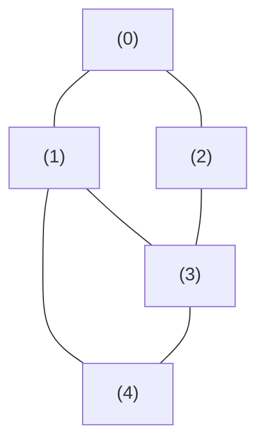
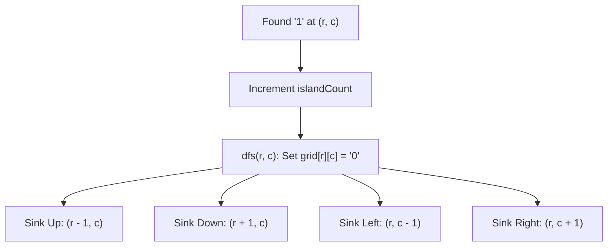
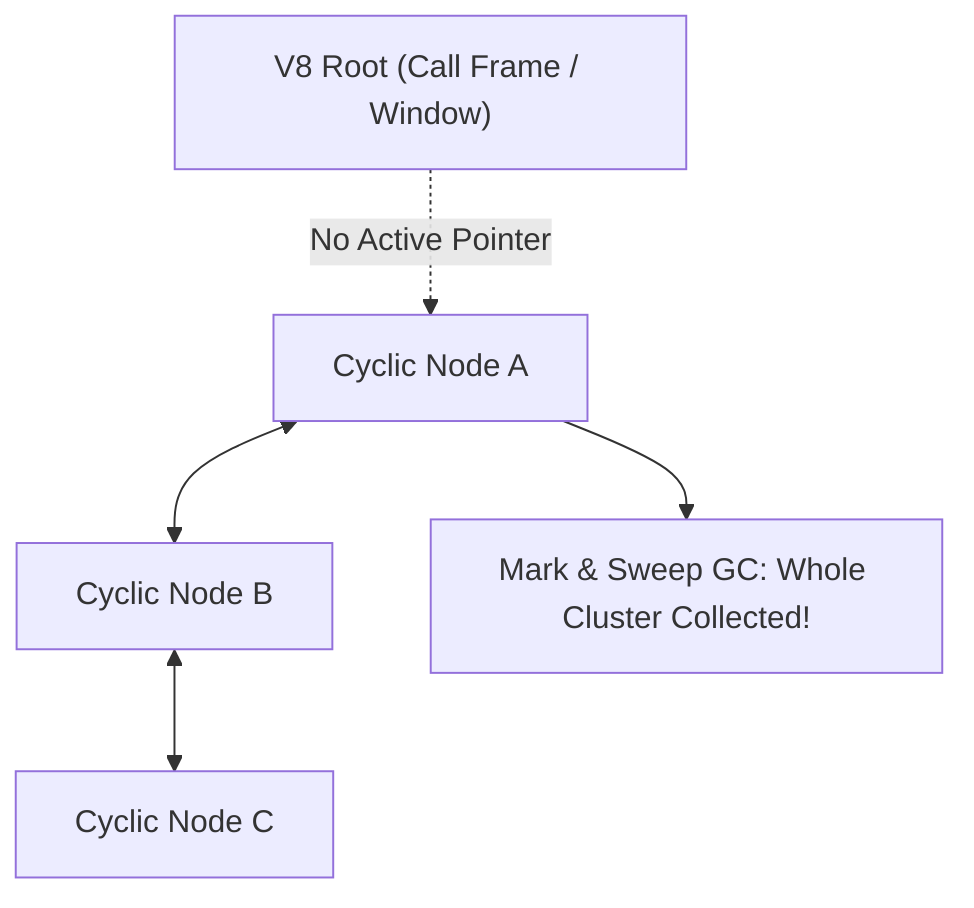

# Day 26: Graphs: BFS, Shortest Path & DFS Components

<nav aria-label="Lecture navigation">

[Previous: Binary Search Trees](day-25-binary-search-trees-crud-and-validation.md) | [Roadmap](../javascript-dsa-roadmap.md) | [Next: Directed Graphs & Topological Sort](day-27-cycle-detection-and-topological-sort.md)

</nav>

## Prerequisites

- [Day 15: Queues & Circular Buffers](day-15-queues-circular-buffers-and-design.md) — FIFO queue mechanics.
- [Day 22: Grid Backtracking & Mazes](day-22-grid-backtracking-and-n-queens.md) — 2D matrix navigation and visited markers.
- [Day 24: Binary Trees: BFS, Views & LCA](day-24-binary-trees-bfs-views-and-lca.md) — Level-order traversal patterns.

---

## 1. What is a Graph?

A **Graph** is a non-linear data structure consisting of a finite set of **Vertices** (nodes) and a collection of **Edges** (links) connecting pairs of vertices. Trees are actually a specialized subset of graphs: a tree is simply a connected, undirected graph with $N$ vertices, $N - 1$ edges, and **zero cycles**.

In general graphs, however, connections are arbitrary:
- Graphs may contain **cycles** (paths starting and ending at the same node).
- Graphs may be **directed** (one-way streets, like Twitter followers or dependency DAGs) or **undirected** (two-way relationships, like LinkedIn connections or Bluetooth pairing).
- Graphs may be **disconnected** into multiple independent "islands" of components.

> **Graph ($G = (V, E)$)** — A mathematical structure where $V$ is the set of vertices (entities) and $E$ is the set of edges (relationships).

> **Adjacency List** — A collection of unordered lists used to represent a graph, where each vertex associates with an array of its immediate neighbors.

> **Connected Component** — A maximal subgraph in which any two vertices are connected to each other by paths, and which is connected to no additional vertices in the supergraph.

### Physical Analogy: Airline Flight Networks

```text
=============================================================================
                    AIRLINE HUBS & FLIGHT CONNECTIONS
=============================================================================

          [ Seattle ] ────────────── [ Chicago ] ──────── [ New York ]
               │                          │                      │
               │                          │                      │
          [ San Fran ] ───────────── [ Denver ] ────────── [ Miami ]
               │
          [ Los Angeles ]

1. SHORTEST PATH IN STOPS (BFS):
   - You want to travel from Seattle to Miami with the minimum number of layovers.
   - BFS explores all direct flights (1 hop: Chicago, San Fran).
   - Then all 2-hop flights (Denver, New York, Los Angeles).
   - Then 3-hop flights (Miami!).
   - BFS guarantees the very first time you hit Miami, you took the SHORTEST route!

2. CONNECTED COMPONENTS (DFS):
   - Imagine a separate private airline operating solely in Hawaii ([Honolulu] - [Maui]).
   - A single BFS/DFS from Seattle will NEVER reach Honolulu!
   - To find all airlines in the world, you must run an outer loop over ALL airports.
=============================================================================
```



### Representation in JavaScript: Adjacency List vs Adjacency Matrix

```javascript
// 1. Adjacency List (Production Standard): O(V + E) Space
const adjList = {
  0: [1, 2],
  1: [0, 3, 4],
  2: [0, 3],
  3: [1, 2, 4],
  4: [1, 3]
};

// 2. Adjacency Matrix: O(V^2) Space (Sparse graphs waste 95% RAM)
const adjMatrix = [
  [0, 1, 1, 0, 0],
  [1, 0, 0, 1, 1],
  [1, 0, 0, 1, 0],
  [0, 1, 1, 0, 1],
  [0, 1, 0, 1, 0]
];
```

---

## 2. How Graph BFS & DFS Work Step-by-Step

### 2.1 The Two Fundamental Traversal Engines

```text
=============================================================================
                        GRAPH BFS vs. GRAPH DFS
=============================================================================

DIMENSION           BREADTH-FIRST SEARCH (BFS)      DEPTH-FIRST SEARCH (DFS)
-----------------------------------------------------------------------------
Core Data Structure FIFO Queue                      Call Stack / Explicit Stack
Search Strategy     Expands outward in concentric   Dives deep along one branch
                    rings (layer by layer)          until hitting dead-end
Cycle Prevention    Track visited nodes in Set      Track visited nodes in Set
Guaranteed Feature  SHORTEST PATH in unweighted     Exhaustive path discovery,
                    graphs                          Connected components, Cycles
Space Complexity    O(V) (Peak width in queue)      O(V) (Longest path on stack)
Time Complexity     O(V + E)                        O(V + E)
=============================================================================
```

### 2.2 The Visited State Invariant

Because graphs contain cycles ($A \to B \to C \to A$), traversing without tracking visited nodes will enter an **infinite ping-pong loop**, crashing Node.js with a stack overflow or running out of memory.

**The Golden BFS Rule (Enqueue-Time Marking):**
Always mark a node as `visited` the **instant it is placed into the queue**, NOT when it is dequeued!
If you wait until dequeueing to mark a node as visited, multiple adjacent neighbors can enqueue that same node thousands of times before it is processed, causing the queue to swell exponentially ($O(2^V)$ memory explosion).

```text
Enqueue-Time vs Dequeue-Time Marking:
         A
       /   \
      B     C
       \   /
         D

WRONG (Dequeue-Time):
1. Dequeue A. Enqueue B and C.
2. Dequeue B. Look at neighbor D -> D not visited! Enqueue D.
3. Dequeue C. Look at neighbor D -> D not visited! Enqueue D AGAIN! (Duplicate!)
In a dense graph, duplicate enqueues compound exponentially.

CORRECT (Enqueue-Time):
1. Queue = [ A ], Visited = { A }
2. Pop A. Add B and C to Queue. IMMEDIATELY add B and C to Visited!
3. Pop B. Look at D -> D not in Visited. Enqueue D and IMMEDIATELY add D to Visited!
4. Pop C. Look at D -> D ALREADY in Visited! Skip! (Zero duplicates!).
```

---

## 3. Pattern Recognition of Graph Traversal

### How to Spot These Patterns in Interviews

| Constraint / Keyword Signal | Underlying Problem Need | Optimal Algorithmic Pattern |
| :--- | :--- | :--- |
| "Find shortest path / minimum layovers / fewest edits" | Shortest unweighted distance from Source to Target | **Queue-Based BFS** |
| "Find number of islands / count connected networks" | Exhaust all nodes reachable in each disconnected cluster | **DFS / BFS Component Flood Fill** |
| "Clone / deep copy a graph with cycles" | Map original nodes to cloned instances | **DFS / BFS with Hash Map** |
| "Can all people be divided into two opposing teams?" | 2-Coloring check (no edge between same color) | **Bipartite BFS / DFS Graph Coloring** |
| Vertices $V \le 10^5$, Edges $E \le 2 \times 10^5$ | Linear graph traversal SLA | **$O(V + E)$ Adjacency List BFS/DFS** |

---

## 4. Problem 1: Number of Islands (LeetCode 200)

### Problem Description
Given an $m \times n$ 2D binary grid `grid` which represents a map of `'1'`s (land) and `'0'`s (water), return the **number of islands**.
An island is surrounded by water and is formed by connecting adjacent lands horizontally or vertically. You may assume all four edges of the grid are all surrounded by water.

### Step 1: Physical Simulation
Suppose we have the grid:
```text
[
  ["1", "1", "0", "0", "0"],
  ["1", "1", "0", "0", "0"],
  ["0", "0", "1", "0", "0"],
  ["0", "0", "0", "1", "1"]
]
```
- We scan the grid starting at `(0, 0)`.
- At `(0, 0)`: We see `'1'`. This is a **new island**!
  * Increment `islandCount = 1`.
  * Now, explore and sink this entire landmass so we never recount it!
  * Mark `(0, 0)` as `'0'`. Sink neighbors: `(0, 1)`, `(1, 0)`, `(1, 1)`.
  * The entire top-left cluster is now sunk to `'0'`.
- Continue scanning: `(0, 2)` is `'0'`, `(0, 3)` is `'0'`, etc.
- At `(2, 2)`: We find `'1'`. This is a **new island**!
  * Increment `islandCount = 2`.
  * Sink `(2, 2)` to `'0'`.
- Continue scanning until `(3, 3)`: We find `'1'`. **New island**!
  * Increment `islandCount = 3`.
  * Sink `(3, 3)` and `(3, 4)` to `'0'`.
- Total islands found: **3**.

### Step 2: Brute Force Approach
Create a separate $M \times N$ `visited` matrix. For every cell, traverse its neighbors using recursion without marking cells in-place, leading to redundant scans and high memory allocations:

```javascript
// Naive approach with separate visited 2D array
function numIslandsNaive(grid) {
  const rows = grid.length;
  const cols = grid[0].length;
  const visited = Array.from({ length: rows }, () => new Array(cols).fill(false));
  let count = 0;

  function dfs(r, c) {
    if (r < 0 || r >= rows || c < 0 || c >= cols) return;
    if (grid[r][c] === '0' || visited[r][c]) return;

    visited[r][c] = true;
    dfs(r + 1, c);
    dfs(r - 1, c);
    dfs(r, c + 1);
    dfs(r, c - 1);
  }

  for (let r = 0; r < rows; r++) {
    for (let c = 0; c < cols; c++) {
      if (grid[r][c] === '1' && !visited[r][c]) {
        count++;
        dfs(r, c);
      }
    }
  }
  return count;
}
```

### Step 3: Bottleneck
1. **Auxiliary Memory Waste:** Allocating a separate $M \times N$ `visited` array consumes $O(M \cdot N)$ additional heap space and causes pointer-chasing through two layers of JavaScript arrays.
2. **Double Scanning:** Checking both `grid[r][c] === '1'` and `visited[r][c]` doubles condition checks.

### Step 4: The Pattern Discovery
**In-Place Matrix Sinking:**
Whenever we find a `'1'`, immediately overwrite it with `'0'` (or `'2'` if the original grid must remain non-destructive). By changing the cell directly to `'0'`, future scans naturally ignore it without needing any auxiliary `visited` table. Memory overhead drops to the call stack depth alone.



### Step 5: The Optimal Solution

```javascript
// ✅ CORRECT: Optimal In-Place Component Flood Fill DFS
function numIslands(grid) {
  if (!grid || grid.length === 0) return 0;

  const rows = grid.length;
  const cols = grid[0].length;
  let islandCount = 0;

  // DFS helper that sinks all connected land cells
  function sinkIsland(r, c) {
    // Boundary check and water check
    if (r < 0 || r >= rows || c < 0 || c >= cols || grid[r][c] === '0') {
      return;
    }

    // Mutate cell in-place to water ('0') so it is never re-visited
    grid[r][c] = '0';

    // Flood fill all 4 adjacent neighbors
    sinkIsland(r + 1, c); // Down
    sinkIsland(r - 1, c); // Up
    sinkIsland(r, c + 1); // Right
    sinkIsland(r, c - 1); // Left
  }

  // Scan every cell in the 2D grid
  for (let r = 0; r < rows; r++) {
    for (let c = 0; c < cols; c++) {
      if (grid[r][c] === '1') {
        islandCount++;
        sinkIsland(r, c); // Sinks the entire connected component
      }
    }
  }

  return islandCount;
}

// ❌ ANTI-PATTERN: Forgetting boundary checks before array index
// if (grid[r][c] === '1') before checking r >= 0 triggers:
// TypeError: Cannot read property 'c' of undefined!

// Direct test run
const sampleMap = [
  ["1", "1", "0", "0", "0"],
  ["1", "1", "0", "0", "0"],
  ["0", "0", "1", "0", "0"],
  ["0", "0", "0", "1", "1"]
];

console.log("Total Islands (Expected 3):", numIslands(sampleMap));
```

#### Complexity Analysis
- **Time Complexity:** $O(M \cdot N)$ where $M$ is the number of rows and $N$ is the number of columns. Every cell in the matrix is visited at most twice (once by the outer loop, and once during flood fill sinking).
- **Space Complexity:** $O(M \cdot N)$ in the worst case (grid completely filled with land) for the recursion call stack frames. Auxiliary heap space is $O(1)$.

---

## 5. Problem 2: Shortest Path in Binary Matrix (LeetCode 1091)

### Problem Description
Given an $n \times n$ binary matrix `grid`, return the length of the **shortest clear path** in the matrix. If there is no clear path, return `-1`.
A **clear path** in a binary matrix is a path from the top-left cell `(0, 0)` to the bottom-right cell `(n - 1, n - 1)` such that:
- All visited cells of the path are `0`.
- All adjacent cells of the path are **8-directionally connected** (horizontally, vertically, or diagonally).
- The length of a clear path is the **number of visited cells** of this path.

### Step 1: Physical Simulation
Suppose $N = 3$:
```text
[
  [0, 0, 0],
  [1, 1, 0],
  [1, 1, 0]
]
```
- Start at `(0, 0)` (val = 0). Initial path length = 1.
- Move diagonally to `(1, 1)`? No, `grid[1][1] === 1` (blocked).
- Move right to `(0, 1)`? Yes (`0`). Path length = 2.
- From `(0, 1)`, move right to `(0, 2)`? Yes (`0`). Path length = 3.
- From `(0, 2)`, move down to `(1, 2)`? Yes (`0`). Path length = 4.
- From `(1, 2)`, move down to `(2, 2)`? Yes (`0`, target reached!). Path length = 5.
- Alternatively: `(0, 0) -> (0, 1) -> (1, 2) -> (2, 2)` (Length = 4!).
- BFS guarantees finding the minimum step length of 4!

### Step 2: Brute Force Approach
Using DFS to find all possible paths from `(0, 0)` to `(n - 1, n - 1)` and taking the minimum path length:

```javascript
// Naive DFS approach: Explores all exponential paths
function shortestPathDFSNaive(grid) {
  // DFS explores every possible branch to leaf level: O(8^(N^2)) worst case!
  // Will time out or stack overflow on grids larger than 6x6.
}
```

### Step 3: Bottleneck
DFS wanders deep down sub-optimal meandering paths. In an unweighted graph, DFS cannot guarantee that the first path reaching the destination is the shortest. Finding the shortest path via DFS requires an exhaustive traversal of all exponential paths ($O(8^{N^2})$).

### Step 4: The Pattern Discovery
**Breadth-First Search (BFS):**
BFS expands uniformly outward in all 8 directions simultaneously like a wave of water. The very first time the BFS wavefront touches the bottom-right coordinate `(n - 1, n - 1)`, the distance traveled is **mathematically guaranteed to be the shortest possible path**.

```text
The 8 Direction Vectors:
[-1, -1], [-1, 0], [-1, 1]
[ 0, -1],          [ 0, 1]
[ 1, -1], [ 1, 0], [ 1, 1]
```

### Step 5: The Optimal Solution

```javascript
// ✅ CORRECT: Optimal 8-Directional Shortest Path BFS
function shortestPathBinaryMatrix(grid) {
  const n = grid.length;

  // Edge Case: Start or End cell is blocked
  if (grid[0][0] !== 0 || grid[n - 1][n - 1] !== 0) {
    return -1;
  }

  // Base case: 1x1 matrix with 0
  if (n === 1) return 1;

  // 8-directional offset vectors (Orthogonal + Diagonal)
  const DIRECTIONS = [
    [-1, -1], [-1,  0], [-1,  1],
    [ 0, -1],           [ 0,  1],
    [ 1, -1], [ 1,  0], [ 1,  1]
  ];

  // High-performance pointer queue storing [row, col, distance]
  const queue = [[0, 0, 1]];
  let head = 0;

  // CRITICAL: Mark (0, 0) as visited at ENQUEUE TIME by setting grid value to 1
  grid[0][0] = 1;

  while (head < queue.length) {
    const [r, c, dist] = queue[head++];

    // Explore all 8 adjacent neighbors
    for (const [dr, dc] of DIRECTIONS) {
      const nr = r + dr;
      const nc = c + dc;

      // Check boundary and cell availability (0 is open)
      if (nr >= 0 && nr < n && nc >= 0 && nc < n && grid[nr][nc] === 0) {
        // Target reached: Because this is BFS, this is guaranteed shortest!
        if (nr === n - 1 && nc === n - 1) {
          return dist + 1;
        }

        // ENQUEUE TIME MARKING: Mutate cell to 1 immediately to block duplicates
        grid[nr][nc] = 1;
        queue.push([nr, nc, dist + 1]);
      }
    }
  }

  return -1; // Destination unreachable
}

// ❌ ANTI-PATTERN: Marking grid[r][c] = 1 AFTER dequeueing
// Delaying visited marking allows multiple neighbors to enqueue the same open cell,
// blowing up queue size and causing exponential slowdown!

// Direct test run
const testGrid = [
  [0, 0, 0],
  [1, 1, 0],
  [1, 1, 0]
];
console.log("Shortest Path (Expected 4):", shortestPathBinaryMatrix(testGrid));
```

#### Complexity Analysis
- **Time Complexity:** $O(N^2)$ strictly. In an $N \times N$ matrix, there are $N^2$ vertices and at most $8 N^2$ edges. Each cell is enqueued and dequeued at most once.
- **Space Complexity:** $O(N^2)$ worst case for the BFS queue. Auxiliary heap space is $O(1)$ beyond the queue because visited state is stored in-place.

---

## 6. Under the Hood: V8 & Node.js

Executing graph algorithms in Node.js backends requires understanding V8 memory representation and garbage collector behavior with cyclic structures:

```text
=============================================================================
                  GRAPHS & V8 ENGINE MEMORY ARCHITECTURE
=============================================================================

1. THE "CIRCULAR REFERENCE MEMORY LEAK" MYTH:
   - Myth: "If Node A points to Node B, and Node B points to Node A, JavaScript
     will leak memory because the reference count never drops to zero."
   - Reality: V8 DOES NOT use reference counting.
   - V8 uses MARK-AND-SWEEP Garbage Collection starting from ROOT references
     (global variables, active execution call frames).
   - If an entire cyclical graph of 100,000 interconnected nodes becomes unreachable
     from any active root, V8's Mark phase will ignore the entire graph. The entire
     cyclic cluster is swept away in the next Major GC cycle with ZERO memory leak!

2. ADJACENCY LIST PERFORMANCE: Map vs Plain Object:
   - For string-based vertices (e.g. user IDs "usr_102"):
     * Using const graph = {} forces V8 to treat IDs as object keys.
     * When vertex count exceeds 1,000, V8 downgrades the object to DICTIONARY_ELEMENTS
       (hash table with string hashing overhead).
     * Senior Pattern: Use new Map() for dynamic vertex additions. Map maintains
       deterministic lookup performance and avoids prototype collision bugs.

3. QUEUE SWELLING IN DENSE GRAPHS:
   - In a dense graph where each node connects to 100 neighbors, BFS queue length
     can peak at thousands of items.
   - Always avoid Array.prototype.shift()! Use advancing pointer index queues
     (queue[head++]) or custom circular buffers to guarantee O(1) dequeue speed.
=============================================================================
```



---

## 7. Hands-On Exercise

### The Dequeue-Time Visited Bug
A candidate was asked to build a social network degree-of-separation finder in Node.js. When tested on a densely connected network of 2,000 users, the server froze for 8 seconds and crashed with an out-of-memory error. The candidate marked users as visited *after* dequeuing them instead of *before* enqueuing them.

### The Buggy Code
```javascript
function buggyDegreesOfSeparation(adjList, startUser, targetUser) {
  const queue = [[startUser, 0]];
  const visited = new Set();
  let head = 0;

  while (head < queue.length) {
    const [user, distance] = queue[head++];

    if (user === targetUser) return distance;

    // BUG: Marking visited AFTER dequeueing!
    // In a dense graph, user A and user B both have neighbor C.
    // Both user A and user B see C as unvisited and push C to the queue!
    // C is pushed hundreds of times, swelling the queue to millions of items!
    visited.add(user);

    for (const neighbor of adjList[user] || []) {
      if (!visited.has(neighbor)) {
        queue.push([neighbor, distance + 1]);
      }
    }
  }

  return -1;
}
```

### The Fix and Direct Verification
Move `visited.add()` to **enqueue time**: add `startUser` to `visited` before starting, and add `neighbor` to `visited` the exact moment it is pushed to `queue`.

```javascript
// ✅ REPAIRED: Production-Safe Degree of Separation Finder
function safeDegreesOfSeparation(adjList, startUser, targetUser) {
  if (startUser === targetUser) return 0;

  const queue = [[startUser, 0]];
  const visited = new Set([startUser]); // FIX: Mark root at enqueue time!
  let head = 0;

  while (head < queue.length) {
    const [user, distance] = queue[head++];

    for (const neighbor of adjList[user] || []) {
      if (neighbor === targetUser) {
        return distance + 1; // Immediate target return
      }

      if (!visited.has(neighbor)) {
        visited.add(neighbor); // FIX: Mark visited IMMEDIATELY at enqueue time!
        queue.push([neighbor, distance + 1]);
      }
    }
  }

  return -1; // Unreachable
}

// Direct test verification on dense interconnected network
const denseNetwork = {
  "Alice": ["Bob", "Charlie", "Dave"],
  "Bob": ["Alice", "Charlie", "Dave", "Eve"],
  "Charlie": ["Alice", "Bob", "Dave", "Eve"],
  "Dave": ["Alice", "Bob", "Charlie", "Frank"],
  "Eve": ["Bob", "Charlie", "Frank"],
  "Frank": ["Dave", "Eve"]
};

console.log("Separation from Alice to Frank:", safeDegreesOfSeparation(denseNetwork, "Alice", "Frank")); // Expected: 2 (Alice -> Dave -> Frank)
```

---

## 8. Tricky Points and Edge Cases

### 1. Disconnected Graph Traversal
Never assume a graph is a single connected component. If an interview asks to traverse all nodes or count components, you must iterate over every vertex in the graph with an outer loop:
```javascript
for (const vertex of Object.keys(graph)) {
  if (!visited.has(vertex)) {
    componentCount++;
    bfs(vertex);
  }
}
```

### 2. 4-Direction vs. 8-Direction Movements
Read problem statements carefully:
- **Number of Islands (LeetCode 200)** allows only **4-directional moves** (Up, Down, Left, Right). Diagonals do NOT connect land!
- **Shortest Path in Binary Matrix (LeetCode 1091)** allows **8-directional moves** (includes diagonals).
Using 8 directions in Number of Islands erroneously merges separate islands together!

### 3. Immediate Edge Case Rejections
In grid shortest path problems, always verify the start cell `(0, 0)` and end cell `(n - 1, n - 1)` before running BFS. If either is blocked (e.g. `grid[0][0] === 1`), return `-1` immediately.

---

## 9. Comprehensive Summary

```text
=============================================================================
                    GRAPH TRAVERSAL MASTER SUMMARY
=============================================================================

ALGORITHM           CORE MECHANISM                  TYPICAL INTERVIEW USE
-----------------------------------------------------------------------------
BFS (Queue)         Layer-by-layer wavefront        Shortest path in unweighted graphs
DFS (Recursion)     Deep recursive dive             Connected components, cycle checks
Enqueue-Time Mark   visited.add() on queue.push()   Prevents exponential duplicate explosion
In-Place Sinking    grid[r][c] = '0' / visited char Eliminates O(M*N) visited matrix memory
Adjacency List      Map or Array of Arrays          Optimal O(V + E) memory & scan speed
Mark-and-Sweep GC   Roots-based reclamation         Cyclic graph structures do not leak in V8
=============================================================================
```

- **BFS is the absolute gold standard for unweighted shortest path:** Its layer-by-layer wavefront ensures the first time a target is visited, it is via the minimum number of edges.
- **DFS is the natural choice for exhaustive component discovery:** Sinking connected components via in-place mutation minimizes memory allocations.
- **Marking visited at enqueue time is non-negotiable:** Dequeue-time marking leads to catastrophic duplicate enqueuing on dense graphs.

---

## 10. Cheat Sheet

### Decision Matrix: BFS vs. DFS for Graphs

| Problem Goal | Preferred Algorithm | Core Rationale |
| :--- | :--- | :--- |
| Shortest path (unweighted) | **BFS** | Stops at first target hit; guarantees minimum edges. |
| Count connected components / islands | **DFS** | In-place flood fill is concise and space-efficient. |
| Detect cycle in undirected graph | **DFS / BFS** | Check if visited neighbor is not parent. |
| Clone a graph with cycles | **DFS / BFS** | Map old nodes to new nodes via `Map<Node, Node>`. |
| Shortest transformation sequence (Word Ladder)| **Bidirectional BFS** | Expands from both start and target to meet in middle. |

### Graph Traversal Safety Checklist
- [ ] Did you mark visited **at enqueue time**?
- [ ] For disconnected graphs, is there an outer loop over all vertices?
- [ ] Did you verify start and end cells aren't blocked upfront?
- [ ] Did you avoid `Array.prototype.shift()` in high-scale BFS?

---

## 11. Interview Q&A

### 45-Second Senior Pitch
> *"Graph algorithms expand linear and tree concepts into arbitrary networks with cycles and disconnected components. For unweighted shortest paths, Breadth-First Search is optimal because its concentric layer-by-layer expansion guarantees that the first arrival at the target is the shortest path. For connected component counting and flood fills, we leverage Depth-First Search with in-place grid sinking to eliminate auxiliary memory allocations. In production Node.js systems, high-density graphs risk exponential queue swelling unless visited markers are enforced at enqueue time, and queue dequeues are decoupled from $O(N)$ array shifting."*

### Deep Interview Questions

#### Q1: Why does marking a node as visited at dequeue-time cause an exponential memory explosion in BFS?
**Answer:** In a dense graph, multiple vertices share the same common neighbors. If node $X$ is added to the queue but not marked as visited until it is dequeued, every other active neighbor of $X$ will inspect $X$, find it unvisited, and push another duplicate reference to $X$ into the queue. In dense networks, the same node can be pushed thousands of times. Memory usage explodes from $O(V)$ to $O(V \cdot E)$, degrading performance from milliseconds to seconds and risking out-of-memory process crashes.

#### Q2: How do you detect cycles in an undirected graph using DFS?
**Answer:** In an undirected graph, an edge connects two nodes bidirectionally ($u \leftrightarrow v$). When recursing from $u$ to $v$, $v$ will see $u$ as a neighbor. To prevent false-positive cycle reports, we pass the `parent` node into our DFS helper:
```javascript
function hasCycle(node, parent, visited) {
  visited.add(node);
  for (const neighbor of adjList[node]) {
    if (!visited.has(neighbor)) {
      if (hasCycle(neighbor, node, visited)) return true;
    } else if (neighbor !== parent) {
      return true; // Visited an already-seen node that is NOT our parent -> Cycle!
    }
  }
  return false;
}
```

#### Q3: Why is Adjacency List preferred over Adjacency Matrix in almost all backend systems?
**Answer:** Real-world networks (social graphs, flight routes, API dependencies) are highly **sparse**. If a social network has 1,000,000 users where each user has 200 friends:
- **Adjacency Matrix:** Requires a $1,000,000 \times 1,000,000$ matrix ($10^{12}$ entries $\approx 1$ Terabyte of RAM), and finding a user's friends requires scanning all 1,000,000 entries ($O(V)$ time).
- **Adjacency List:** Requires storing only $1,000,000$ vertex keys and $200,000,000$ edge entries ($O(V + E)$ space $\approx$ few megabytes of RAM), and finding friends takes $O(\text{degree}) = O(200)$ time.

#### Q4: How does Bidirectional BFS optimize Word Ladder or pathfinding problems?
**Answer:** Standard BFS starting from a single node with branching factor $b$ to reach depth $d$ visits $O(b^d)$ nodes. **Bidirectional BFS** initiates two simultaneous searches: one forward from the source and one backward from the target. The search terminates when the two wavefronts collide. Each search only needs to reach depth $d / 2$:
$$O(b^{d/2} + b^{d/2}) \ll O(b^d)$$
For $b = 10$ and $d = 6$, standard BFS visits $10^6 = 1,000,000$ nodes, while Bidirectional BFS visits $2 \times 10^3 = 2,000$ nodes—a $500\times$ performance improvement.

---

## 12. Practice Problems

### Problem 1: Clone Graph (LeetCode 133)
- **Input:** A reference to a node in a connected undirected graph.
- **Output:** A deep copy of the graph.
- **Challenge:** Use a hash map `Map<OriginalNode, ClonedNode>` with DFS or BFS to duplicate nodes and wire up cyclic edges correctly without infinite recursion.

### Problem 2: Word Ladder (LeetCode 127)
- **Input:** `beginWord = "hit"`, `endWord = "cog"`, `wordList = ["hot","dot","dog","lot","log","cog"]`
- **Output:** `5` (`"hit" -> "hot" -> "dot" -> "dog" -> "cog"`)
- **Challenge:** Model word transformations as graph edges where words differing by 1 letter are adjacent. Solve via BFS in $O(M^2 \times N)$ time.

### Problem 3: Is Graph Bipartite? (LeetCode 785)
- **Input:** Adjacency list `graph`.
- **Output:** `true` if graph can be partitioned into two independent sets such that every edge connects a node in set A to set B.
- **Challenge:** Color nodes using two colors (`1` and `-1`) via BFS/DFS, verifying no two adjacent nodes share the same color.

---

<nav aria-label="Lecture navigation">

[Previous: Binary Search Trees](day-25-binary-search-trees-crud-and-validation.md) | [Roadmap](../javascript-dsa-roadmap.md) | [Next: Directed Graphs & Topological Sort](day-27-cycle-detection-and-topological-sort.md)

</nav>
