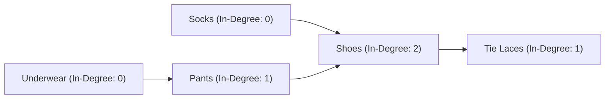
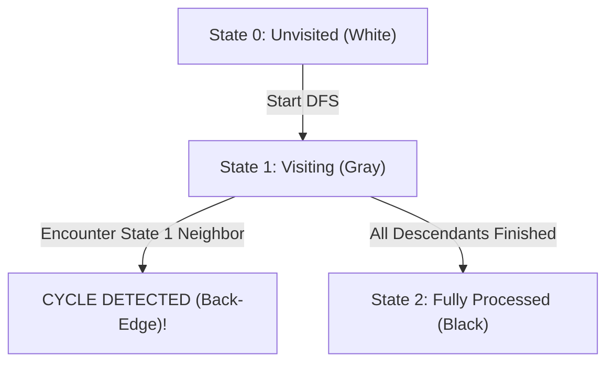
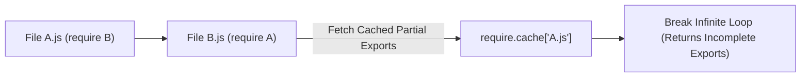

# Day 27: Cycle Detection & Topological Sort

<nav aria-label="Lecture navigation">

[Previous: Graphs: BFS & DFS](day-26-graphs-bfs-shortest-path-and-dfs-components.md) | [Roadmap](../javascript-dsa-roadmap.md) | [Next: Binary Heaps & Priority Queues](day-28-binary-heaps-and-priority-queues.md)

</nav>

## Prerequisites

- [Day 15: Queues & Circular Buffers](day-15-queues-circular-buffers-and-design.md) — First-In, First-Out (FIFO) queue mechanics.
- [Day 26: Graphs: BFS, Shortest Path & DFS Components](day-26-graphs-bfs-shortest-path-and-dfs-components.md) — Adjacency list construction and graph traversals.

---

## 1. What is a DAG & Topological Sort?

A **Directed Graph** consists of vertices connected by one-way arrows: an edge $u \to v$ signifies an asymmetric relationship where $u$ must precede or lead directly to $v$. 

When a directed graph contains no closed loops (cycles), it is called a **Directed Acyclic Graph (DAG)**. DAGs are the universal mathematical foundation for modeling workflows, task scheduling, build systems, compiler execution pipelines, and package dependency managers (like `npm` or `yarn`).

> **Directed Acyclic Graph (DAG)** — A directed graph with no directed cycles. If you start at any vertex $u$ and follow directed edges, you can never return to $u$.

> **Topological Sort** — A linear ordering of all vertices in a DAG such that for every directed edge $u \to v$, vertex $u$ appears before vertex $v$ in the ordering.

> **In-Degree vs. Out-Degree** — The **in-degree** of a vertex is the number of incoming directed edges pointing into it. The **out-degree** is the number of outgoing directed edges pointing away from it.

### Physical Analogy: Getting Dressed & Dependency Deadlocks

```text
=============================================================================
                 DEPENDENCY CHAINS vs. CIRCULAR DEADLOCK
=============================================================================

1. VALID TOPOLOGICAL ORDER (Getting Dressed in the Morning):
   - Constraints:
     * Underwear must go on BEFORE Pants.
     * Socks must go on BEFORE Shoes.
     * Pants must go on BEFORE Shoes.
     * Shoes must go on BEFORE Tying Laces.
   - Can you put your shoes on before your socks? NO!
   - A valid linear sequence:
     [ Underwear, Socks, Pants, Shoes, Tie Laces ]
   - Notice: Multiple valid topological orders may exist!
     [ Socks, Underwear, Pants, Shoes, Tie Laces ] is also completely valid.

2. THE CIRCULAR DEADLOCK (Cycle Detection):
   - Suppose Module A requires Module B to start.
   - Module B requires Module C to start.
   - Module C requires Module A to start!
   - Deadlock! Which module can possibly compile first? NONE.
   - Mathematical Rule: A graph has a valid topological sort
     IF AND ONLY IF it has ZERO cycles!
=============================================================================
```



---

## 2. How Topological Sort & Cycle Detection Work Step-by-Step

There are two primary paradigms for solving topological sort and detecting cycles in directed graphs:

```text
=============================================================================
                    TWO PARADIGMS FOR DIRECTED GRAPHS
=============================================================================

ALGORITHM           PARADIGM        CYCLE DETECTION MECHANISM
-----------------------------------------------------------------------------
Kahn's Algorithm    BFS Queue       Count of processed nodes < Total Vertices
3-Color Traversal   DFS Recursion   Hitting a node currently active on Call Stack
=============================================================================
```

### 2.1 Kahn's Algorithm (BFS In-Degree Peeling)

Kahn's algorithm operates on a simple, physical intuition: **"A task can only begin when all of its prerequisites are completed."**

1. **Calculate In-Degrees:** Scan all edges and compute the `inDegree` count for every vertex.
2. **Find Starting Tasks:** Any vertex with `inDegree === 0` has zero prerequisites! Push all such vertices into a FIFO queue.
3. **Peel Vertices:** While the queue is not empty:
   - Dequeue vertex $u$ and append it to our `topologicalOrder` list.
   - For every outgoing neighbor $v$ of $u$ ($u \to v$):
     * Decrement $v$'s in-degree: `inDegree[v]--`. (Prerequisite fulfilled!)
     * If $v$'s in-degree drops to `0`, all prerequisites for $v$ are met $\implies$ Enqueue $v$!
4. **Cycle Verification:** If `topologicalOrder.length === V`, we found a complete, valid order. If `topologicalOrder.length < V`, the graph contains a **cycle** that locked nodes from ever reaching an in-degree of 0!

```text
Kahn's Algorithm Walkthrough:
Edges: 0 -> 1, 0 -> 2, 1 -> 3, 2 -> 3
In-Degrees: { 0: 0, 1: 1, 2: 1, 3: 2 }

Step 1: Queue = [ 0 ] (Only node with in-degree 0)
Step 2: Pop 0. Add 0 to Order.
        Decrement neighbor 1 -> inDegree[1] = 0 -> Enqueue 1!
        Decrement neighbor 2 -> inDegree[2] = 0 -> Enqueue 2!
        Queue = [ 1, 2 ]
Step 3: Pop 1. Add 1 to Order.
        Decrement neighbor 3 -> inDegree[3] = 1 (not 0 yet).
Step 4: Pop 2. Add 2 to Order.
        Decrement neighbor 3 -> inDegree[3] = 0 -> Enqueue 3!
Step 5: Pop 3. Add 3 to Order.
Final Order: [ 0, 1, 2, 3 ] (Length 4 === 4 Vertices -> DAG Valid!)
```

### 2.2 3-Color DFS (Recursion Stack Tracking)

In an undirected graph, a simple boolean `visited` array detects cycles. In a **directed graph**, a boolean visited array causes **false positives on Diamond Graphs**:

```text
Diamond Graph (NO cycle):
      0
     / \
    1   2
     \ /
      3
Path 1: 0 -> 1 -> 3 (3 marked visited)
Path 2: 0 -> 2 -> 3 (3 is already visited, but this is NOT a cycle! 3 is just a common dependent!)
```

To prevent false positives, we must distinguish between:
1. A node that was visited and finished in a completely different branch (Cross-edge).
2. A node that is **currently active in the current recursion call stack** (Back-edge $\implies$ Cycle!).

We classify vertices into **Three States (Colors)**:
- **0 (White / Unvisited):** The vertex has not yet been discovered.
- **1 (Gray / Visiting):** The vertex is currently being explored on the active call stack. If DFS ever encounters a neighbor that is in state `1`, we have looped back onto our own tail $\implies$ **CYCLE DETECTED!**
- **2 (Black / Visited):** The vertex and all of its descendants have been fully explored and are safe.



```javascript
// DFS Post-Order Topological Sort Implementation
function topologicalSortDFS(numCourses, adj) {
  const state = new Uint8Array(numCourses); // 0 = unvisited, 1 = visiting, 2 = finished
  const reversedOrder = [];

  function dfs(node) {
    state[node] = 1; // Mark Gray (on stack)

    for (const neighbor of adj[node] || []) {
      if (state[neighbor] === 1) return false; // Cycle!
      if (state[neighbor] === 0) {
        if (!dfs(neighbor)) return false;
      }
    }

    state[node] = 2; // Mark Black (finished)
    // In a DAG, a node finishes AFTER all its dependents finish!
    reversedOrder.push(node);
    return true;
  }

  for (let i = 0; i < numCourses; i++) {
    if (state[i] === 0) {
      if (!dfs(i)) return []; // Return empty on cycle
    }
  }

  // Reverse post-order to get valid prerequisite-first sequence
  return reversedOrder.reverse();
}
```

---

## 3. Pattern Recognition of Topological Sort & Cycles

### How to Spot These Patterns in Interviews

| Constraint / Keyword Signal | Underlying Problem Need | Optimal Algorithmic Pattern |
| :--- | :--- | :--- |
| "Prerequisites: to take course A you must take course B" | Dependency resolution or deadlock detection | **Kahn's BFS** OR **3-Color DFS** |
| "Find an ordering / build sequence of all tasks" | Linear DAG ordering required | **Kahn's Algorithm (Course Schedule II)** |
| "Determine if it is possible to finish all courses" | Cycle detection boolean answer | **Cycle Detection (Course Schedule I)** |
| "Alien Dictionary: derive alphabet order from sorted words" | Pairwise prefix comparison to build DAG | **Character DAG + Topological Sort** |
| "Root node that minimizes tree height" | Inward dependency peeling | **Topological In-Degree Leaf Peeling** |
| Vertices $V \le 10^5$, Edges $E \le 2 \times 10^5$ | Linear graph traversal bound | **$O(V + E)$ Kahn's Algorithm** |

---

## 4. Problem 1: Course Schedule I (LeetCode 207)

### Problem Description
There are a total of `numCourses` courses you have to take, labeled from `0` to `numCourses - 1`. You are given an array `prerequisites` where `prerequisites[i] = [a_i, b_i]` indicates that you **must take course $b_i$ first** if you want to take course $a_i$.
Return `true` if you can finish all courses. Otherwise, return `false`.

### Step 1: Physical Simulation
Suppose `numCourses = 4`, `prerequisites = [[1, 0], [2, 0], [3, 1], [3, 2]]`:
- Note the edge direction: `[a, b]` means $b \to a$ ($b$ is a prerequisite for $a$).
- Edges:
  * $0 \to 1$
  * $0 \to 2$
  * $1 \to 3$
  * $2 \to 3$
- In-degrees: `inDegree[0] = 0`, `inDegree[1] = 1`, `inDegree[2] = 1`, `inDegree[3] = 2`.
- Course 0 has 0 prerequisites. We can take Course 0!
- Taking 0 unlocks courses 1 and 2.
- Taking courses 1 and 2 unlocks course 3.
- All 4 courses completed $\implies$ Return `true`.

Now suppose `prerequisites = [[1, 0], [0, 1]]`:
- Edges: $0 \to 1$ and $1 \to 0$.
- In-degrees: `inDegree[0] = 1`, `inDegree[1] = 1`.
- Neither course has 0 prerequisites! The queue starts empty.
- Zero courses can be taken $\implies$ Return `false` (Deadlock!).

### Step 2: Brute Force Approach
For every single course from $0$ to $numCourses - 1$, run a naive DFS to check if any path can reach back to itself without recording black/finished states, exploring exponential paths:

```javascript
// Naive brute-force cycle search without global visited memoization
function canFinishNaive(numCourses, prerequisites) {
  // Explores every branch exhaustively from scratch: O(V * (V + E)) or O(V^2)
  // Times out on large graphs with dense interconnects.
}
```

### Step 3: Bottleneck
Running an independent traversal for every vertex re-traverses already-verified acyclic subgraphs. If Course 50 was already proven to be part of an acyclic subtree, subsequent searches starting from Course 1, Course 2, and Course 3 must not re-traverse Course 50.

### Step 4: The Pattern Discovery
We use **3-Color DFS (Cycle Detection)**:
1. Build adjacency list: `adj[prereq].push(course)`.
2. Array `state = new Array(numCourses).fill(0)`.
3. Loop from $0$ to $numCourses - 1$. If `state[i] === 0`:
   - Run `hasCycle(i)`. If a cycle is detected, return `false` immediately.
4. If all components are explored with zero cycles, return `true`.

### Step 5: The Optimal Solution

```javascript
// ✅ CORRECT: Optimal 3-Color DFS Cycle Detection
function canFinish(numCourses, prerequisites) {
  // 1. Build Adjacency List: prereq -> course
  const adj = Array.from({ length: numCourses }, () => []);
  for (const [course, prereq] of prerequisites) {
    adj[prereq].push(course);
  }

  // State tracker: 0 = Unvisited, 1 = Visiting (Active Stack), 2 = Finished
  const state = new Uint8Array(numCourses);

  function hasCycle(node) {
    // Mark node as currently active in recursion stack (Gray)
    state[node] = 1;

    for (const neighbor of adj[node]) {
      // If neighbor is currently on active stack, we found a back-edge! Cycle!
      if (state[neighbor] === 1) {
        return true;
      }

      // If neighbor is unvisited, recurse into it
      if (state[neighbor] === 0) {
        if (hasCycle(neighbor)) return true;
      }

      // If state[neighbor] === 2, it is fully processed and safe. Skip!
    }

    // Mark node as completely processed and safe (Black)
    state[node] = 2;
    return false;
  }

  // Graph may be disconnected: Check every component
  for (let i = 0; i < numCourses; i++) {
    if (state[i] === 0) {
      if (hasCycle(i)) {
        return false; // Cycle detected: cannot finish all courses!
      }
    }
  }

  return true; // Zero cycles found: all courses can be completed!
}

// ❌ ANTI-PATTERN: Using a 2-state boolean visited array
// A simple visited boolean cannot distinguish between a cycle and a diamond graph!
// A diamond graph (0 -> 1 -> 3 and 0 -> 2 -> 3) would be falsely flagged as a cycle.

// Direct test run
console.log("Can finish [[1, 0]] (Expected true):", canFinish(2, [[1, 0]]));
console.log("Can finish [[1, 0], [0, 1]] (Expected false):", canFinish(2, [[1, 0], [0, 1]]));
console.log("Can finish Diamond Graph (Expected true):", canFinish(4, [[1, 0], [2, 0], [3, 1], [3, 2]]));
```

#### Complexity Analysis
- **Time Complexity:** $O(V + E)$ where $V = \text{numCourses}$ and $E = \text{prerequisites.length}$. Every vertex is marked Gray and Black exactly once, and every directed edge is traversed once.
- **Space Complexity:** $O(V + E)$ auxiliary space for the adjacency list and $O(V)$ for the `state` array and recursion call stack.

---

## 5. Problem 2: Course Schedule II (LeetCode 210)

### Problem Description
There are a total of `numCourses` courses you have to take, labeled from `0` to `numCourses - 1`. You are given an array `prerequisites` where `prerequisites[i] = [a_i, b_i]` indicates that you must take course $b_i$ first if you want to take course $a_i$.
Return the **ordering of courses you should take to finish all courses**. If there are many valid answers, return **any** of them. If it is impossible to finish all courses, return an **empty array `[]`**.

### Step 1: Physical Simulation
Suppose `numCourses = 4`, `prerequisites = [[1,0],[2,0],[3,1],[3,2]]`:
- Build in-degree counts:
  * Course 0: 0 incoming edges
  * Course 1: 1 incoming edge (from 0)
  * Course 2: 1 incoming edge (from 0)
  * Course 3: 2 incoming edges (from 1 and 2)
- Start with `queue = [ 0 ]`, `order = []`.
- Iteration 1:
  * Pop `0`. Add to `order`: `[ 0 ]`.
  * Decrement Course 1 in-degree: $1 \to 0 \implies$ Enqueue 1!
  * Decrement Course 2 in-degree: $1 \to 0 \implies$ Enqueue 2!
  * `queue = [ 1, 2 ]`.
- Iteration 2:
  * Pop `1`. Add to `order`: `[ 0, 1 ]`.
  * Decrement Course 3 in-degree: $2 \to 1$.
  * `queue = [ 2 ]`.
- Iteration 3:
  * Pop `2`. Add to `order`: `[ 0, 1, 2 ]`.
  * Decrement Course 3 in-degree: $1 \to 0 \implies$ Enqueue 3!
  * `queue = [ 3 ]`.
- Iteration 4:
  * Pop `3`. Add to `order`: `[ 0, 1, 2, 3 ]`.
- Queue empty. `order.length === 4` $\implies$ Valid order found! Return `[ 0, 1, 2, 3 ]`.

### Step 2: Brute Force Approach
Generate all $V!$ permutations of course orders and check if all prerequisite constraints are satisfied for each permutation ($O(V! \cdot E)$).

### Step 3: Bottleneck
For $V = 10$, $10! = 3,628,800$ permutations. For $V = 2,000$, factorial search is mathematically impossible.

### Step 4: The Pattern Discovery
**Kahn's Algorithm (BFS In-Degree Peeling):**
By continuously taking courses that have zero remaining prerequisites (`inDegree === 0`), we systematically build the topological sequence from left to right. If a cycle exists, the nodes in the cycle will never reach an in-degree of 0, causing the queue to terminate prematurely with `order.length < numCourses`.

```text
Decision Queue State:
Initial In-Degrees: [ 0: 0, 1: 1, 2: 1, 3: 2 ]
Queue: [ 0 ]
Order: []

Pop 0 -> Order: [0] -> Decr 1 & 2 -> Queue: [1, 2]
Pop 1 -> Order: [0, 1] -> Decr 3 (remains 1)
Pop 2 -> Order: [0, 1, 2] -> Decr 3 (becomes 0!) -> Queue: [3]
Pop 3 -> Order: [0, 1, 2, 3] -> Finished!
```

### Step 5: The Optimal Solution

```javascript
// ✅ CORRECT: Optimal Kahn's BFS Topological Order Construction
function findOrder(numCourses, prerequisites) {
  // 1. Build Adjacency List and In-Degree Array
  const adj = Array.from({ length: numCourses }, () => []);
  const inDegree = new Int32Array(numCourses);

  for (const [course, prereq] of prerequisites) {
    adj[prereq].push(course); // prereq -> course
    inDegree[course]++;
  }

  // 2. High-performance pointer queue for all courses with 0 prerequisites
  const queue = [];
  let head = 0;

  for (let i = 0; i < numCourses; i++) {
    if (inDegree[i] === 0) {
      queue.push(i);
    }
  }

  const order = [];

  // 3. Process BFS Queue
  while (head < queue.length) {
    const currCourse = queue[head++];
    order.push(currCourse);

    for (const nextCourse of adj[currCourse]) {
      inDegree[nextCourse]--;

      // When all prerequisites are fulfilled, course is ready to be taken!
      if (inDegree[nextCourse] === 0) {
        queue.push(nextCourse);
      }
    }
  }

  // 4. Cycle check: If order length matches numCourses, DAG is valid!
  // If not, a cycle prevented some courses from ever reaching in-degree 0.
  return order.length === numCourses ? order : [];
}

// ❌ ANTI-PATTERN: Inverting edge direction in adjacency list
// Writing adj[course].push(prereq) points edges backwards,
// producing reverse order or freezing in-degrees!

// Direct test run
console.log("Order for 4 courses (Expected [0, 1, 2, 3] or [0, 2, 1, 3]):");
console.log(findOrder(4, [[1, 0], [2, 0], [3, 1], [3, 2]]));

console.log("Order for cycle [[1, 0], [0, 1]] (Expected []):");
console.log(findOrder(2, [[1, 0], [0, 1]]));
```

#### Complexity Analysis
- **Time Complexity:** $O(V + E)$ where $V = \text{numCourses}$ and $E = \text{prerequisites.length}$. We initialize in-degrees in $O(E)$, enqueue nodes in $O(V)$, and decrement edge weights in $O(E)$.
- **Space Complexity:** $O(V + E)$ for the adjacency list and $O(V)$ for the `inDegree` array, `queue`, and `order` array.

---

## 6. Under the Hood: V8 & Node.js

Understanding dependency resolution and cycle handling in Node.js internals provides immense systems context:

```text
=============================================================================
                  DEPENDENCY RESOLUTION IN NODE.JS INTERNALS
=============================================================================

1. HOW Node.js require() HANDLES CIRCULAR DEPENDENCIES:
   - What happens when file A.js requires B.js, and B.js requires A.js?
     * Step 1: require('./A.js') begins execution.
     * Step 2: A.js starts and calls require('./B.js').
     * Step 3: B.js starts and calls require('./A.js').
     * DOES IT CRASH WITH INFINITE RECURSION? NO!
   - Node.js Module Cache: In require.cache, module A is already registered as an
     empty object { exports: {} } before executing its code!
   - When B requires A, Node.js returns an INCOMPLETE (partially evaluated)
     exports object from the cache to break the cycle!
   - This prevents stack overflow, but can lead to silent undefined runtime bugs.

2. ES MODULES (ESM) vs COMMONJS (CJS) DEPENDENCY GRAPH:
   - ESM (import / export) parses dependencies STATICALLY before running any code.
   - The V8 engine builds a true Dependency DAG during the Module Parsing phase.
   - It performs a Topological Sort to determine module evaluation order.
   - ESM uses "Live Bindings"—circular dependencies don't return stale copies;
     they point to heap memory slots that resolve dynamically.

3. TYPED ARRAYS IN V8 FOR GRAPH NODES:
   - Using new Int32Array(numCourses) instead of new Array(numCourses).fill(0)
     allocates contiguous C++ flat memory without V8 object wrapper overhead.
   - In-degree decrements run as single assembly instructions without SMI checks.
=============================================================================
```



---

## 7. Hands-On Exercise

### The Reversed Edge Direction Bug
A backend developer is building an automated database migration runner in Node.js. Each migration specifies a prerequisite table. However, the migration runner hangs indefinitely on valid migrations. The developer accidentally reversed the edge direction when incrementing in-degrees.

### The Buggy Code
```javascript
function buggyMigrationRunner(numMigrations, dependencies) {
  const adj = Array.from({ length: numMigrations }, () => []);
  const inDegree = new Int32Array(numMigrations);

  for (const [migration, prereq] of dependencies) {
    adj[prereq].push(migration);

    // BUG: Increments prereq instead of migration!
    // This flags the independent prerequisite as having an in-degree > 0,
    // meaning the queue starts empty and nothing ever runs!
    inDegree[prereq]++;
  }

  const queue = [];
  for (let i = 0; i < numMigrations; i++) {
    if (inDegree[i] === 0) queue.push(i);
  }

  const executionOrder = [];
  while (queue.length > 0) {
    const curr = queue.shift();
    executionOrder.push(curr);
    for (const next of adj[curr]) {
      inDegree[next]--;
      if (inDegree[next] === 0) queue.push(next);
    }
  }

  return executionOrder.length === numMigrations ? executionOrder : [];
}
```

### The Fix and Direct Verification
Ensure that for edge `prereq -> migration`, it is the dependent `migration` whose `inDegree` is incremented: `inDegree[migration]++`. Replace `queue.shift()` with a pointer index.

```javascript
// ✅ REPAIRED: Production-Safe Database Migration Scheduler
function safeMigrationRunner(numMigrations, dependencies) {
  const adj = Array.from({ length: numMigrations }, () => []);
  const inDegree = new Int32Array(numMigrations);

  for (const [migration, prereq] of dependencies) {
    adj[prereq].push(migration);
    // FIX: Increment the dependent migration's in-degree!
    inDegree[migration]++;
  }

  const queue = [];
  let head = 0;

  for (let i = 0; i < numMigrations; i++) {
    if (inDegree[i] === 0) {
      queue.push(i);
    }
  }

  const executionOrder = [];
  while (head < queue.length) {
    const curr = queue[head++];
    executionOrder.push(curr);

    for (const next of adj[curr]) {
      inDegree[next]--;
      if (inDegree[next] === 0) {
        queue.push(next);
      }
    }
  }

  return executionOrder.length === numMigrations ? executionOrder : [];
}

// Direct test verification
const migrations = [
  [1, 0], // Migration 1 requires Migration 0
  [2, 0], // Migration 2 requires Migration 0
  [3, 1], // Migration 3 requires Migration 1
  [3, 2]  // Migration 3 requires Migration 2
];

console.log("Repaired Migration Execution Order:", safeMigrationRunner(4, migrations));
// Expected output: [ 0, 1, 2, 3 ] or [ 0, 2, 1, 3 ]
```

---

## 8. Tricky Points and Edge Cases

### 1. Inverted Problem Definitions
In Course Schedule, `[a, b]` means "to take $a$, you must take $b$ first". The edge is $b \to a$.
In other problems, `[u, v]` means "task $u$ must be executed before task $v$" ($u \to v$).
Always draw a 2-node diagram on paper to verify the arrow direction before constructing the adjacency list!

### 2. Disconnected Graphs with Multiple In-Degree 0 Roots
A DAG often has multiple independent entry points (e.g. 5 different courses that have zero prerequisites). Kahn's algorithm handles this naturally because all 5 will be initially pushed into `queue`.

### 3. Self-Loops
If a prerequisite list contains `[0, 0]` (Course 0 requires Course 0), `inDegree[0]` will be incremented, and it can never be cleared. Both Kahn's algorithm and 3-color DFS correctly flag this as a cycle.

---

## 9. Comprehensive Summary

```text
=============================================================================
                  TOPOLOGICAL SORT & CYCLES MASTER SUMMARY
=============================================================================

DIMENSION           KAHN'S ALGORITHM (BFS)          3-COLOR DFS
-----------------------------------------------------------------------------
Core Concept        In-degree peeling               Active recursion call stack
Data Structures     Queue + inDegree array          Call stack + state array
Cycle Detection     order.length < totalVertices    Neighbor encountered with state === 1
Topological Order   Built naturally from Left to Right Built in Reverse (Post-Order push, reverse)
Best Used For       Scheduling problems, build queues Fast cycle verification boolean answers
Complexity          O(V + E) time, O(V + E) space   O(V + E) time, O(V + E) space
=============================================================================
```

- **Topological sort requires a DAG:** If any directed cycle exists, no linear ordering is mathematically possible.
- **Kahn's Algorithm peels in-degrees:** Nodes with in-degree 0 are ready to execute; processing them unlocks subsequent dependent nodes.
- **3-Color DFS detects back-edges:** State 0 (White/Unvisited), State 1 (Gray/Visiting on stack), State 2 (Black/Finished). Seeing Gray means a cycle.

---

## 10. Cheat Sheet

### Decision Matrix: When to Use Which Method

| Goal / Requirement | Preferred Method | Rationale |
| :--- | :--- | :--- |
| Generate valid task execution order | **Kahn's BFS** | Emits order directly from left to right; intuitive to debug. |
| Check if graph has cycle (Boolean answer) | **3-Color DFS** | Terminates immediately on the very first cycle edge hit. |
| Graph may have self-loops | **Either** | Both handle self-loops cleanly ($u \to u$). |
| Lexicographically smallest topological order | **Kahn's with Min-Heap** | Replace standard queue with a Min-Priority Queue. |

### Topological Sort Safety Checklist
- [ ] Did you confirm edge direction ($b \to a$ vs $a \to b$)?
- [ ] For Kahn's, did you verify `order.length === numCourses`?
- [ ] For 3-Color DFS, did you color node `2` (Black) after exploring its neighbors?
- [ ] Did you loop over all vertices $0 \dots V - 1$ to handle disconnected components?

---

## 11. Interview Q&A

### 45-Second Senior Pitch
> *"Topological sorting establishes a valid sequential execution order for dependencies in a Directed Acyclic Graph (DAG). If a cycle exists, the system is deadlocked and no valid ordering exists. In interviews, we solve this using either Kahn's Algorithm—which iteratively peels nodes with in-degree zero via a FIFO queue—or 3-Color DFS, which tracks whether a neighbor is currently active on the recursion call stack. In production Node.js architectures, understanding dependency DAGs is fundamental to how module loaders resolve static ESM bindings, build tools like Vite schedule compilation pipelines, and database migration runners prevent deadlocks."*

### Deep Interview Questions

#### Q1: Why does a standard boolean `visited` array fail to detect cycles in a directed graph?
**Answer:** In a directed graph, multiple distinct paths can lead to the same destination vertex without forming a cycle. For example, in a Diamond Graph ($0 \to 1 \to 3$ and $0 \to 2 \to 3$), vertex 3 is visited via two separate paths. A simple boolean visited array would encounter vertex 3 during the second path, see `visited[3] === true`, and falsely declare a cycle. A true cycle requires encountering a node that is **currently active in the current recursion stack branch** (a back-edge). This is why 3-state tracking (Unvisited, Visiting, Finished) is mandatory for directed graphs.

#### Q2: How does Kahn's algorithm mathematically prove that a cycle exists?
**Answer:** In any valid DAG, there is guaranteed to be at least one vertex with an in-degree of 0. When that vertex is removed, the remaining subgraph is still a DAG, which again must have at least one vertex with in-degree 0. If a graph contains a directed cycle ($A \to B \to C \to A$), every vertex in that cycle has an in-degree of at least 1. Therefore, none of the vertices in the cycle can ever reach an in-degree of 0, and none of them will ever enter the queue. When the queue exhausts, the total number of processed vertices will be strictly less than $V$, proving the existence of a cycle.

#### Q3: How can you find the lexicographically smallest topological sort?
**Answer:** In Kahn's algorithm, when multiple vertices have an in-degree of 0 simultaneously, any of them can be processed next. To guarantee the lexicographically smallest order (e.g. Course 1 before Course 2), replace the standard FIFO queue with a **Min-Priority Queue (Binary Min-Heap)**. At each step, extract the minimum value from the heap. This ensures the smallest available vertex is always scheduled first, running in $O((V + E) \log V)$ time.

#### Q4: How does Node.js resolve circular dependencies between CommonJS modules without crashing?
**Answer:** When Node.js loads a CommonJS module via `require()`, it creates a module record and inserts an empty object into `require.cache` before executing the file's JavaScript code. If Module A requires Module B, and Module B requires Module A, Module B receives the current (partially exported) object from the cache rather than triggering a new evaluation of A. This breaks the recursion cycle and prevents call stack overflow, though it may result in `undefined` properties if Module B accesses exports from A that haven't been assigned yet.

---

## 12. Practice Problems

### Problem 1: Alien Dictionary (LeetCode 269)
- **Input:** Sorted dictionary of words in an alien language: `words = ["wrt","wrf","er","ett","rftt"]`
- **Output:** String of unique letters in valid alien alphabet order: `"wertf"`
- **Challenge:** Compare adjacent words to find the first differing character, build a character DAG, and extract the topological order in $O(C)$ time (where $C$ is total length of all words).

### Problem 2: Minimum Height Trees (LeetCode 310)
- **Input:** Undirected tree with $n$ nodes labeled `0` to `n - 1` and an array of $n - 1$ edges.
- **Output:** All root labels that minimize the tree's height.
- **Challenge:** Use **Topological In-Degree Leaf Peeling**: trim all leaves (degree = 1) layer-by-layer inward until only 1 or 2 centroids remain.

### Problem 3: Sequence Reconstruction (LeetCode 444)
- **Input:** Integer array `nums` and a list of sequences `sequences`.
- **Output:** `true` if `nums` is the **unique** shortest common supersequence that can be reconstructed from `sequences`.
- **Challenge:** Verify via Kahn's algorithm that at **every single step**, the BFS queue has a size of **exactly 1** (proving no alternate branch choices exist).

---

<nav aria-label="Lecture navigation">

[Previous: Graphs: BFS & DFS](day-26-graphs-bfs-shortest-path-and-dfs-components.md) | [Roadmap](../javascript-dsa-roadmap.md) | [Next: Binary Heaps & Priority Queues](day-28-binary-heaps-and-priority-queues.md)

</nav>
