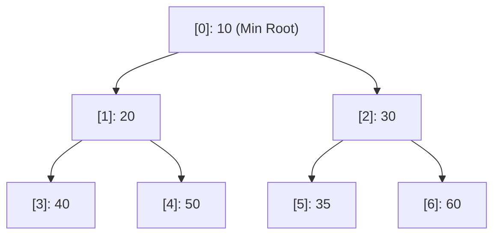
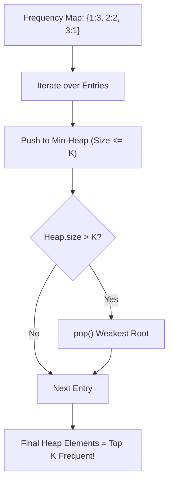
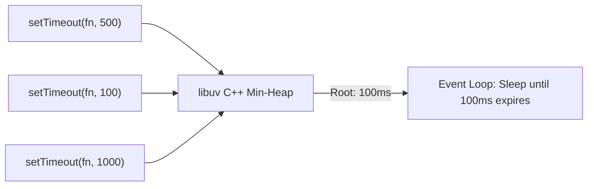

# Day 28: Binary Heaps & Priority Queues

<nav aria-label="Lecture navigation">

[Previous: Directed Graphs & Topological Sort](day-27-cycle-detection-and-topological-sort.md) | [Roadmap](../javascript-dsa-roadmap.md) | [Next: Dynamic Programming: 1D & 2D](day-29-dynamic-programming-1d-and-2d.md)

</nav>

## Prerequisites

- [Day 01: Big O Complexity & Problem Solving](day-01-big-o-complexity-and-problem-solving.md) — Logarithmic scaling ($O(\log n)$) and asymptotic bounds.
- [Day 03: Arrays & Strings](day-03-arrays-and-strings.md) — Contiguous array indexing, swapping, and cache locality.
- [Day 23: Binary Trees: DFS & Properties](day-23-binary-trees-dfs-and-properties.md) — Tree hierarchies and parent-child navigation.

---

## 1. What is a Binary Heap & Priority Queue?

A standard FIFO queue serves elements strictly in the order they arrived (First-In, First-Out). However, real-world systems prioritize tasks based on urgency, cost, deadline, or weight. A **Priority Queue** is an Abstract Data Type (ADT) where each element possesses a priority, and the element with the highest (or lowest) priority is always served first.

A **Binary Heap** is the canonical, battle-tested data structure used to implement a Priority Queue. It represents a **Complete Binary Tree** stored inside a single flat contiguous array with **zero pointer overhead**.

> **Priority Queue** — An abstract interface supporting three core operations: `insert(val)` in $O(\log n)$, `peek()` the highest priority element in $O(1)$, and `extract()` (pop) the highest priority element in $O(\log n)$.

> **Complete Binary Tree** — A binary tree where every level is completely filled, except possibly the last level, which is filled strictly from left to right with no gaps.

> **Min-Heap Invariant** — For every node $i$ other than the root: $\text{val}(\text{parent}(i)) \le \text{val}(i)$. The absolute minimum element in the entire structure sits at index `0`.

> **Max-Heap Invariant** — For every node $i$ other than the root: $\text{val}(\text{parent}(i)) \ge \text{val}(i)$. The absolute maximum element in the entire structure sits at index `0`.

### Physical Analogy: The Hospital Emergency Room Triage

```text
=============================================================================
                  FIFO QUEUE vs. PRIORITY QUEUE (TRIAGE)
=============================================================================

1. STANDARD FIFO QUEUE (The Bank Teller):
   - Person A arrives at 9:00 AM with a deposit.
   - Person B arrives at 9:01 AM with a check.
   - Person A is served strictly before Person B. Arrival time is everything.

2. PRIORITY QUEUE (The Hospital Emergency Room):
   - Patient A arrives with a mild wrist sprain (Priority 3).
   - Patient B arrives with an ear infection (Priority 4).
   - Patient C arrives in an ambulance with severe cardiac arrest (Priority 1)!
   - Patient C DOES NOT wait behind Patients A and B.
   - Patient C bubbles directly to the top of the triage list in O(log n) time
     and is treated immediately in O(1) time.
=============================================================================
```



### The Zero-Pointer Array Math

Because a binary heap is a complete binary tree, we do not need `TreeNode` objects with `.left` and `.right` reference pointers. We store the nodes sequentially in a contiguous JavaScript array:

```text
=============================================================================
                       BINARY HEAP ARRAY FORMULAS
=============================================================================

For any element sitting at index i:

1. Parent Index:      Math.floor((i - 1) / 2)
2. Left Child Index:  2 * i + 1
3. Right Child Index: 2 * i + 2

Example Tree:         [ 10,  20,  30,  40,  50,  35,  60 ]
Array Indices:          0    1    2    3    4    5    6

- Parent of index 4 (50): Math.floor((4 - 1) / 2) = index 1 (val 20) -> Valid!
- Left child of index 1 (20): 2 * 1 + 1 = index 3 (val 40)           -> Valid!
- Right child of index 1 (20): 2 * 1 + 2 = index 4 (val 50)          -> Valid!
=============================================================================
```

---

## 2. How Binary Heaps Work Step-by-Step

### 2.1 The Two Fundamental Re-Balancing Operations

A binary heap maintains its structural shape and value invariant through two operations:

#### 1. Bubble-Up (Sift-Up) on `push(val)` — $O(\log n)$
When a new element is added:
1. Append the new value to the **very end of the array** (satisfies complete tree property).
2. Compare the value with its parent: `Math.floor((i - 1) / 2)`.
3. If it violates the heap invariant (e.g. smaller than parent in a Min-Heap), **swap with the parent**.
4. Repeat upward until the parent is smaller or the value reaches index `0` (the root).

```text
Pushing 5 into Min-Heap [ 10, 20, 30 ]:
Step 1: Append to end: [ 10, 20, 30, 5 ] (Index 3)
Step 2: Compare with parent at index Math.floor((3-1)/2) = 1 (val 20).
        5 < 20 -> Swap! Array becomes: [ 10, 5, 30, 20 ]
Step 3: Compare with parent at index Math.floor((1-1)/2) = 0 (val 10).
        5 < 10 -> Swap! Array becomes: [ 5, 10, 30, 20 ]
Step 4: Reached root (index 0). Done! Valid Min-Heap restored in O(log n).
```

#### 2. Bubble-Down (Sift-Down / Heapify) on `pop()` — $O(\log n)$
When the highest priority element is removed:
1. Save the root element `heap[0]` to return later.
2. Remove the **last element** of the array and place it at index `0` (restores complete tree property).
3. Compare the new root with both its left child (`2i + 1`) and right child (`2i + 2`).
4. Find the **smallest of the two children** (in a Min-Heap).
5. If the current element is larger than the smallest child, **swap with that child**.
6. Repeat downward until the element is smaller than both children or reaches a leaf.

```text
Popping Root (5) from [ 5, 10, 30, 20 ]:
Step 1: Save 5. Move last element (20) to index 0: [ 20, 10, 30 ]
Step 2: Compare 20 with left child (10) and right child (30).
        Smallest child is 10 at index 1.
        Since 20 > 10, swap with index 1!
Step 3: Array becomes: [ 10, 20, 30 ]
Step 4: Index 1 has no children. Done! Valid Min-Heap restored in O(log n).
```

### 2.2 Production-Grade `MinHeap` Class in JavaScript

```javascript
// Production-grade MinHeap supporting custom comparator functions
class MinHeap {
  constructor(compareFn = (a, b) => a - b) {
    this.heap = [];
    this.compare = compareFn; // Negative if a < b, positive if a > b
  }

  size() {
    return this.heap.length;
  }

  isEmpty() {
    return this.heap.length === 0;
  }

  peek() {
    return this.heap.length > 0 ? this.heap[0] : null;
  }

  push(val) {
    this.heap.push(val);
    this._bubbleUp(this.heap.length - 1);
  }

  pop() {
    if (this.heap.length === 0) return null;
    if (this.heap.length === 1) return this.heap.pop();

    const root = this.heap[0];
    this.heap[0] = this.heap.pop(); // Place last element at root
    this._bubbleDown(0);
    return root;
  }

  _bubbleUp(index) {
    while (index > 0) {
      const parentIdx = Math.floor((index - 1) / 2);
      // If child is smaller than parent, swap
      if (this.compare(this.heap[index], this.heap[parentIdx]) < 0) {
        this._swap(index, parentIdx);
        index = parentIdx;
      } else {
        break; // Invariant satisfied
      }
    }
  }

  _bubbleDown(index) {
    const len = this.heap.length;

    while (true) {
      let smallest = index;
      const leftIdx = 2 * index + 1;
      const rightIdx = 2 * index + 2;

      if (leftIdx < len && this.compare(this.heap[leftIdx], this.heap[smallest]) < 0) {
        smallest = leftIdx;
      }

      if (rightIdx < len && this.compare(this.heap[rightIdx], this.heap[smallest]) < 0) {
        smallest = rightIdx;
      }

      if (smallest !== index) {
        this._swap(index, smallest);
        index = smallest;
      } else {
        break; // Invariant satisfied
      }
    }
  }

  _swap(i, j) {
    const temp = this.heap[i];
    this.heap[i] = this.heap[j];
    this.heap[j] = temp;
  }
}
```

---

## 3. Pattern Recognition of Heaps & Priority Queues

### How to Spot These Patterns in Interviews

| Constraint / Keyword Signal | Underlying Problem Need | Optimal Algorithmic Pattern |
| :--- | :--- | :--- |
| "Find top $K$ frequent / largest elements in array" | Dynamically maintain top $K$ boundaries | **Min-Heap of fixed size $K$ ($O(N \log K)$)** |
| "Find $K$-th smallest element in unsorted data" | Filter out larger values | **Max-Heap of fixed size $K$** |
| "Find continuous median from an incoming data stream" | Split numbers into lower half and upper half | **Two Heaps Pattern (Max-Heap + Min-Heap)** |
| "Merge $K$ sorted arrays / linked lists" | Repeatedly extract minimum across $K$ heads | **Min-Heap of size $K$ ($O(N \log K)$)** |
| "Task scheduler / CPU cooldown intervals" | Always greedily execute highest frequency task | **Max-Heap + Waiting Queue** |
| $N \le 10^5$, $K \ll N$ | Sub-linear sorting SLA | **$O(N \log K)$ Heap beats $O(N \log N)$ Sort** |

---

## 4. Problem 1: Top K Frequent Elements (LeetCode 347)

### Problem Description
Given an integer array `nums` and an integer `k`, return the `k` **most frequent elements**. You may return the answer in any order. Your algorithm's time complexity must be better than $O(n \log n)$, where $n$ is the array's size.

### Step 1: Physical Simulation
Suppose `nums = [ 1, 1, 1, 2, 2, 3 ]`, `k = 2`:
- Count frequencies: `{ 1: 3, 2: 2, 3: 1 }`.
- We want the 2 elements with the largest frequencies.
- Intuition Trap: Should we use a Max-Heap of size 3?
  * If we put all elements in a Max-Heap, heap construction takes $O(M \log M)$.
- **The Bounded Min-Heap Trick:**
  * Maintain a Min-Heap of size **at most $K = 2$**, ordered by frequency.
  * Insert `(1, freq: 3)` $\to$ Heap: `[ (1, 3) ]`.
  * Insert `(2, freq: 2)` $\to$ Heap: `[ (2, 2), (1, 3) ]` (Root is 2 with freq 2).
  * Insert `(3, freq: 1)` $\to$ Heap size becomes 3 ($> K$!).
  * Pop the root! The root has frequency 2, but 3 has frequency 1.
  * The smallest frequency is ejected! Heap retains the **top 2 largest**: `[ (2, 2), (1, 3) ]`.
- Result: `[ 1, 2 ]`.

### Step 2: Brute Force Approach
Build the frequency map, dump all unique entries into an array, and sort the entire array descending by frequency:

```javascript
// Naive full-sort approach: O(N log N)
function topKFrequentNaive(nums, k) {
  const counts = new Map();
  for (const n of nums) counts.set(n, (counts.get(n) || 0) + 1);

  // Full O(M log M) sort across all M unique elements
  const sorted = Array.from(counts.entries()).sort((a, b) => b[1] - a[1]);
  return sorted.slice(0, k).map(entry => entry[0]);
}
```

### Step 3: Bottleneck
Sorting all unique elements takes $O(M \log M)$ time. If an e-commerce platform has 1,000,000 unique SKUs and we only want the **Top 5 trending items** ($k = 5$), sorting all 1,000,000 entries wastes massive CPU bandwidth ordering ranks 6 through 1,000,000.

### Step 4: The Pattern Discovery
By using a **Min-Heap strictly bounded to size $K$**:
- The heap holds only the best $K$ candidates seen so far.
- The root of the Min-Heap is always the **weakest member** of the top $K$.
- When a new candidate arrives:
  * Push to heap ($O(\log K)$).
  * If heap size exceeds $K$, pop the root ($O(\log K)$).
  * The weakest candidate is automatically discarded!
Total time complexity drops from $O(N \log N)$ to **$O(N \log K)$**. When $K = 5$, $\log_2(5) \approx 2.3$ operations per element—effectively linear!



### Step 5: The Optimal Solution

```javascript
// ✅ CORRECT: Optimal Bounded Min-Heap O(N log K) Top-K Frequent
function topKFrequent(nums, k) {
  // 1. Build Frequency Map: O(N)
  const freqMap = new Map();
  for (let i = 0; i < nums.length; i++) {
    freqMap.set(nums[i], (freqMap.get(nums[i]) || 0) + 1);
  }

  // 2. Min-Heap ordered by frequency (entry[1])
  // Root is always the element with the LEAST frequency in the top K
  const minHeap = new MinHeap((a, b) => a[1] - b[1]);

  for (const entry of freqMap.entries()) {
    minHeap.push(entry);

    // If heap size exceeds k, eject the lowest frequency element
    if (minHeap.size() > k) {
      minHeap.pop();
    }
  }

  // 3. Extract the K remaining elements
  const result = [];
  while (!minHeap.isEmpty()) {
    result.push(minHeap.pop()[0]);
  }

  return result;
}

// ❌ ANTI-PATTERN: Using a Max-Heap of size N
// Pushing all N elements into a Max-Heap takes O(N log N) time and O(N) memory,
// yielding zero asymptotic benefit over Array.prototype.sort().

// Direct test run
const testNums = [1, 1, 1, 2, 2, 3];
console.log("Top 2 Frequent in [1,1,1,2,2,3]:", topKFrequent(testNums, 2)); // Expected: [2, 1] or [1, 2]
console.log("Top 1 Frequent in [4]:", topKFrequent([4], 1));                 // Expected: [4]
```

#### Complexity Analysis
- **Time Complexity:** $O(N \log K)$ where $N$ is array length and $K$ is the target rank. Counting frequencies takes $O(N)$. Iterating through $M$ unique keys and maintaining a heap of size $K$ takes $O(M \log K)$ where $M \le N$.
- **Space Complexity:** $O(N)$ for the frequency map and $O(K)$ for the Min-Heap buffer.

---

## 5. Problem 2: Merge K Sorted Lists (LeetCode 23)

### Problem Description
You are given an array of `k` linked-lists `lists`, each linked-list is sorted in ascending order.
Merge all the linked-lists into one sorted linked-list and return it.

### Step 1: Physical Simulation
Suppose $k = 3$ sorted lists:
- List 0: `1 -> 4 -> 5`
- List 1: `1 -> 3 -> 4`
- List 2: `2 -> 6`
At any given moment, the very next smallest node in the combined list **MUST be one of the current head nodes** of the $K$ lists!
- Step 1: Put all list heads into a Min-Heap of size $K = 3$:
  * Heap holds: `Node(1 from L0)`, `Node(1 from L1)`, `Node(2 from L2)`.
- Step 2: Pop minimum: `Node(1 from L0)`.
  * Append to result list.
  * Advance L0 to its next node `Node(4)`. Push `Node(4)` into the Min-Heap!
  * Heap now holds: `Node(1 from L1)`, `Node(2 from L2)`, `Node(4 from L0)`.
- Step 3: Pop minimum: `Node(1 from L1)`.
  * Append to result list.
  * Advance L1 to its next node `Node(3)`. Push `Node(3)` into the Min-Heap!
- Repeat until the heap is empty. All $N$ total nodes are merged in perfect ascending order!

### Step 2: Brute Force Approach
Extract all values from all $K$ linked lists into an array ($O(N)$), sort the entire array with $O(N \log N)$ quicksort/mergesort, and construct a brand-new linked list:

```javascript
function mergeKListsNaive(lists) {
  const values = [];
  for (let list of lists) {
    while (list) {
      values.push(list.val);
      list = list.next;
    }
  }
  values.sort((a, b) => a - b); // O(N log N) full sort

  const dummy = new ListNode(0);
  let curr = dummy;
  for (let val of values) {
    curr.next = new ListNode(val);
    curr = curr.next;
  }
  return dummy.next;
}
```

### Step 3: Bottleneck
1. **Destroys Existing Pointers:** Allocates $N$ brand-new `ListNode` objects on the V8 heap rather than reusing existing node references in-place.
2. **Ignores Sorted Invariant:** Each of the $K$ lists is **already sorted**! Sorting everything from scratch throws away all existing order.

### Step 4: The Pattern Discovery
At each step, we only need to compare $K$ active head nodes. By maintaining a **Min-Heap of size $K$**:
- Extracting the minimum takes $O(\log K)$ time.
- Inserting the next node from that specific list takes $O(\log K)$ time.
- Re-linking pointers occurs directly in-place without new node allocations.
Total runtime for $N$ total nodes across $K$ lists is **$O(N \log K)$**, and auxiliary space is strictly bounded to **$O(K)$**.

```text
Heap Evolution (k = 3):
Initial Heap: [ L0:1, L1:1, L2:2 ]
Pop L0:1 -> Heap pushes L0:4 -> Heap: [ L1:1, L2:2, L0:4 ]
Pop L1:1 -> Heap pushes L1:3 -> Heap: [ L2:2, L1:3, L0:4 ]
Pop L2:2 -> Heap pushes L2:6 -> Heap: [ L1:3, L0:4, L2:6 ]
Every pop takes O(log K) operations!
```

### Step 5: The Optimal Solution

```javascript
// ✅ CORRECT: Optimal O(N log K) Merge K Sorted Lists with Min-Heap
class ListNode {
  constructor(val = 0, next = null) {
    this.val = val;
    this.next = next;
  }
}

function mergeKLists(lists) {
  if (!lists || lists.length === 0) return null;

  // Min-Heap ordered by node value
  const minHeap = new MinHeap((a, b) => a.val - b.val);

  // 1. Initialize heap with the head of each non-empty list: O(K log K)
  for (let i = 0; i < lists.length; i++) {
    if (lists[i] !== null) {
      minHeap.push(lists[i]);
    }
  }

  const dummyHead = new ListNode(0);
  let tail = dummyHead;

  // 2. Continuously extract minimum node and advance its list pointer: O(N log K)
  while (!minHeap.isEmpty()) {
    const smallestNode = minHeap.pop();

    // Re-link existing node in-place (Zero new node allocations!)
    tail.next = smallestNode;
    tail = tail.next;

    // If the extracted node has a successor, push it to compete in the heap
    if (smallestNode.next !== null) {
      minHeap.push(smallestNode.next);
    }
  }

  return dummyHead.next;
}

// ❌ ANTI-PATTERN: Linear scanning of all K heads on every step
// Searching all K heads without a heap takes O(K) per step, yielding O(N * K) time.
// When K = 10,000, O(N * K) breaches SLA, while O(N log K) executes in milliseconds.

// Direct test run
const l1 = new ListNode(1, new ListNode(4, new ListNode(5)));
const l2 = new ListNode(1, new ListNode(3, new ListNode(4)));
const l3 = new ListNode(2, new ListNode(6));

let merged = mergeKLists([l1, l2, l3]);
const mergedValues = [];
while (merged) {
  mergedValues.push(merged.val);
  merged = merged.next;
}
console.log("Merged K Lists (Expected [1,1,2,3,4,4,5,6]):", mergedValues);
```

#### Complexity Analysis
- **Time Complexity:** $O(N \log K)$ where $N$ is the total number of nodes across all lists and $K$ is the number of linked lists. There are $N$ total iterations, and each heap push/pop takes $O(\log K)$.
- **Space Complexity:** $O(K)$ auxiliary space for the Min-Heap buffer. Pointers are re-linked in-place with zero additional `ListNode` allocations.

---

## 6. Under the Hood: V8 & Node.js

Understanding how Priority Queues execute inside the V8 engine and the Node.js runtime runtime reveals why they are indispensable for systems engineering:

```text
=============================================================================
                  PRIORITY QUEUES & NODE.JS INTERNALS
=============================================================================

1. WHY JAVASCRIPT HAS NO BUILT-IN PriorityQueue:
   - Unlike Python (heapq), Java (PriorityQueue), or C++ (std::priority_queue),
     the ECMAScript standard library DOES NOT include a built-in Priority Queue.
   - Candidates must be capable of implementing a clean array-backed Heap in
     under 30 lines on an interview whiteboard.

2. HOW Node.js TIMERS WORK INTERNALLY (libuv & Timers Queue):
   - In Node.js, when you call setTimeout(fn, 1000) or setInterval(fn, 500):
     * Does Node.js maintain an independent OS thread for every timer? ABSOLUTELY NOT!
     * libuv maintains an internal C++ MIN-HEAP of active timer timestamps.
     * The root of the Min-Heap is always the timer that expires SOONEST.
     * During each loop iteration, the event loop compares Date.now() with heap[0].
     * If the root hasn't expired yet, libuv puts the thread to sleep for exactly
       (heap[0].dueTime - now) milliseconds. Zero CPU polling wasted!

3. ARRAY HEAPS vs BALANCED BSTs (CPU Cache Supremacy):
   - A self-balancing BST (like a Red-Black Tree) also provides O(log n) inserts.
   - However, an Array-backed Heap is substantially faster in practice due to
     SPATIAL CACHE LOCALITY.
   - A flat array keeps parents and children pinned within the same 64-byte L1 CPU
     cache line. BSTs store node objects at scattered memory addresses, incurring
     frequent CPU cache misses during pointer dereferences.
=============================================================================
```



---

## 7. Hands-On Exercise

### The Bubble-Down Right-Child Out-of-Bounds Bug
A developer implemented an in-memory priority task queue for background email processing in Node.js. When popping tasks, the queue periodically threw `TypeError: Cannot read property 'priority' of undefined` or returned tasks in scrambled order. The developer forgot to verify if the right child index was within the array bounds before comparing it.

### The Buggy Code
```javascript
function buggyBubbleDown(heap, index) {
  const len = heap.length;
  while (index < len) {
    let smallest = index;
    const left = 2 * index + 1;
    const right = 2 * index + 2;

    if (left < len && heap[left].priority < heap[smallest].priority) {
      smallest = left;
    }

    // BUG: Compares right child without checking if right < len!
    // When left is the last element, right is out-of-bounds (undefined).
    // Accessing heap[right].priority crashes Node.js with TypeError!
    if (heap[right].priority < heap[smallest].priority) {
      smallest = right;
    }

    if (smallest !== index) {
      [heap[index], heap[smallest]] = [heap[smallest], heap[index]];
      index = smallest;
    } else {
      break;
    }
  }
}
```

### The Fix and Direct Verification
Ensure that `right < len` is checked **before** indexing `heap[right]`:

```javascript
// ✅ REPAIRED: Production-Safe Bubble Down
function safeBubbleDown(heap, index) {
  const len = heap.length;

  while (true) {
    let smallest = index;
    const left = 2 * index + 1;
    const right = 2 * index + 2;

    if (left < len && heap[left].priority < heap[smallest].priority) {
      smallest = left;
    }

    // FIX: Strictly guard right < len before accessing properties!
    if (right < len && heap[right].priority < heap[smallest].priority) {
      smallest = right;
    }

    if (smallest !== index) {
      const temp = heap[index];
      heap[index] = heap[smallest];
      heap[smallest] = temp;
      index = smallest;
    } else {
      break;
    }
  }
}

// Direct test verification
const taskHeap = [
  { id: "A", priority: 50 },
  { id: "B", priority: 10 }
];

safeBubbleDown(taskHeap, 0);
console.log("Repaired Task Queue Root (Expected B with priority 10):", taskHeap[0]);
```

---

## 8. Tricky Points and Edge Cases

### 1. Min-Heap vs. Max-Heap Inverse Logic
This is the single most common confusion in interview heap questions:
- To find **Top $K$ Largest elements**, use a **Min-Heap of size $K$**! The root holds the smallest of the top $K$. When an element is larger than the root, eject the root.
- To find **Top $K$ Smallest elements**, use a **Max-Heap of size $K$**! The root holds the largest of the bottom $K$.

### 2. $O(N)$ Build-Heap vs $O(N \log N)$ Successive Inserts
If you already have an unsorted array of $N$ items and want to turn it into a heap:
- Successive `push()` calls take $N \times O(\log N) = O(N \log N)$ time.
- **Bottom-Up Heapify (Floyd's Algorithm):** Start from the last internal node `Math.floor(n / 2) - 1` down to index `0`, calling `bubbleDown(i)` on each. This builds the entire heap in mathematically proven **$O(N)$ linear time**!

### 3. Ties in Custom Comparators
When priority keys are identical (e.g. two tasks with priority 5), standard heaps do not guarantee FIFO order among ties. If strict FIFO ordering among equal priorities is required, include an incrementing sequence counter `seq` in each entry and break ties using `a.seq - b.seq`.

---

## 9. Comprehensive Summary

```text
=============================================================================
                    BINARY HEAP MASTER SUMMARY
=============================================================================

OPERATION           TIME COMPLEXITY                 MEMORY FLOW
-----------------------------------------------------------------------------
peek()              O(1)                            Read index 0
push(val)           O(log n)                        Append to end, bubbleUp
pop()               O(log n)                        Swap end to root, bubbleDown
buildHeap(arr)      O(n)                            Bottom-up heapify from n/2 down
Top-K Pattern       O(n log k)                      Bounded heap of fixed size K
Merge-K Pattern     O(n log k)                      Active head nodes in heap
Heap Representation Flat Array                      Parent = (i-1)/2, Left = 2i+1, Right = 2i+2
=============================================================================
```

- **Zero pointer overhead:** Array-backed heaps utilize contiguous RAM, maximizing CPU cache line utilization and outperforming pointer-based BSTs.
- **Bounded heaps optimize $O(N \log N)$ down to $O(N \log K)$:** Maintaining a fixed-size heap of $K$ items discards sub-optimal candidates on the fly.
- **Node.js relies on heaps for timers:** The libuv event loop manages asynchronous timeouts via an internal C++ min-heap.

---

## 10. Cheat Sheet

### Index Math Quick Reference
- **Parent:** `Math.floor((i - 1) / 2)`
- **Left Child:** `2 * i + 1`
- **Right Child:** `2 * i + 2`
- **First Leaf Index:** `Math.floor(n / 2)`

### Decision Matrix: Which Heap to Use?

| Problem Goal | Heap Type | Size Constraint |
| :--- | :--- | :--- |
| Top $K$ Largest elements | **Min-Heap** | Bounded to size $K$ |
| Top $K$ Smallest elements | **Max-Heap** | Bounded to size $K$ |
| Continuous Median Stream | **Max-Heap (lower half) + Min-Heap (upper half)** | Balanced size difference $\le 1$ |
| Merge $K$ Sorted Streams | **Min-Heap** | Size $K$ (holds one item per active stream) |

### Heap Safety Checklist
- [ ] Did you check `right < len` BEFORE inspecting `heap[right]`?
- [ ] For Top $K$ largest, did you use a **Min-Heap** (not Max-Heap)?
- [ ] Did you use `tail.next = smallestNode` to avoid creating duplicate nodes?
- [ ] Did you handle single-element popping (`if (this.heap.length === 1) return this.heap.pop()`)?

---

## 11. Interview Q&A

### 45-Second Senior Pitch
> *"A Priority Queue is an abstract data type where the highest or lowest priority element is retrieved in $O(1)$ time, traditionally implemented using an array-backed Binary Heap. By representing a complete binary tree inside a flat contiguous array, parent and child navigation is achieved through simple index arithmetic—parent at `(i-1)/2` and children at `2i+1` and `2i+2`—with zero object pointer overhead and optimal CPU cache locality. In technical interviews, we leverage bounded heaps of size $K$ to solve Top-K and stream merging problems in $O(N \log K)$ time, bypassing wasteful $O(N \log N)$ full sorts."*

### Deep Interview Questions

#### Q1: Why does bottom-up `buildHeap` take $O(N)$ time while successive insertions take $O(N \log N)$?
**Answer:** In an array of size $N$, roughly half the nodes ($\lceil N/2 \rceil$) are leaves sitting at the bottom level. When inserting elements sequentially using `push()`, the nodes added last must bubble all the way up through the entire tree height ($\approx \log N$), meaning roughly $N/2$ nodes do $\log N$ work ($O(N \log N)$). In bottom-up heap construction (Floyd's algorithm), we start from the bottom leaves and call `bubbleDown`. The $N/2$ leaves do **0 swaps**. The $N/4$ nodes above them do at most 1 swap. Only the single root node does $\log N$ swaps. The summation $\sum_{h=0}^{\log N} \frac{N}{2^{h+1}} \cdot h$ converges mathematically to $O(N)$.

#### Q2: Why does finding the Top $K$ largest elements require a Min-Heap instead of a Max-Heap?
**Answer:** If we maintain a heap bounded strictly to size $K$:
- We want to keep the $K$ largest numbers seen so far.
- When an incoming element arrives, we must compare it against the **smallest member of the current top $K$**. If the incoming element is larger than that minimum, the minimum must be evicted to make room.
- A **Min-Heap** exposes its minimum element at root index `0` in $O(1)$ time. If incoming value $>$ root, we pop the root and push the new value.
- A Max-Heap would expose the maximum element at the root, giving us zero visibility into the weakest member of the set without an $O(K)$ linear scan.

#### Q3: How do you find the running median of a continuous data stream in $O(\log N)$ time?
**Answer:** We maintain two balanced heaps:
1. **Max-Heap (`small`):** Stores the smaller half of the numbers.
2. **Min-Heap (`large`):** Stores the larger half of the numbers.
**Invariants:**
- Every element in `small` is $\le$ every element in `large`.
- The size difference between `small` and `large` is at most 1.
**Querying Median in $O(1)$:**
- If total elements is odd: the median is the root of the larger heap.
- If total elements is even: the median is `(small.peek() + large.peek()) / 2`.
Each insertion takes $O(\log N)$ to balance the two heaps.

#### Q4: Why is an array-backed heap preferred over a balanced Binary Search Tree for priority queues in Node.js?
**Answer:** Both data structures provide $O(\log N)$ insertions and deletions. However, an array-backed heap holds data in **contiguous memory**. When iterating or bubbling through array indices, the CPU hardware prefetcher loads neighboring elements directly into L1 and L2 CPU caches. A balanced BST (such as an AVL or Red-Black tree) stores nodes as dynamically allocated heap objects with pointers (`node.left`, `node.right`). Traversing pointers incurs repeated CPU cache misses. Additionally, a binary heap has zero pointer memory overhead, whereas BST nodes require 2 to 3 pointers per key.

---

## 12. Practice Problems

### Problem 1: Find Median from Data Stream (LeetCode 295)
- **Input:** Continuous stream of numbers via `addNum(val)` and `findMedian()`.
- **Output:** Current median after any number of insertions.
- **Challenge:** Implement using the **Two Heaps Pattern** (Max-Heap for lower half, Min-Heap for upper half) with $O(\log N)$ insert and $O(1)$ median lookup.

### Problem 2: Kth Largest Element in a Stream (LeetCode 703)
- **Input:** Stream of scores with fixed threshold $K$.
- **Output:** The $K$-th largest score after every incoming score.
- **Challenge:** Maintain a bounded Min-Heap of size $K$ in $O(\log K)$ time per addition.

### Problem 3: Task Scheduler (LeetCode 621)
- **Input:** Task list `tasks = ["A","A","A","B","B","B"]`, cooldown interval `n = 2`.
- **Output:** Minimum CPU intervals required to execute all tasks with mandatory cooldowns.
- **Challenge:** Combine a **Max-Heap** (always picking the highest frequency remaining task) with a **Cooldown Queue**.

---

<nav aria-label="Lecture navigation">

[Previous: Directed Graphs & Topological Sort](day-27-cycle-detection-and-topological-sort.md) | [Roadmap](../javascript-dsa-roadmap.md) | [Next: Dynamic Programming: 1D & 2D](day-29-dynamic-programming-1d-and-2d.md)

</nav>
