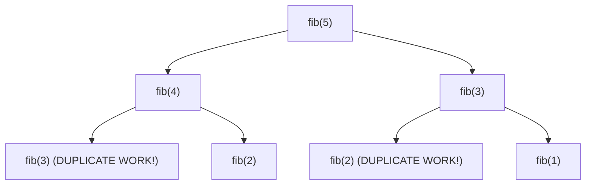
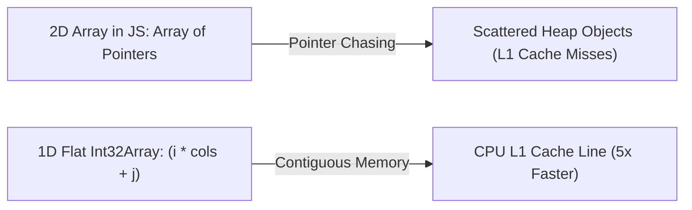

# Day 29: Dynamic Programming: 1D & 2D

<nav aria-label="Lecture navigation">

[Previous: Binary Heaps & Priority Queues](day-28-binary-heaps-and-priority-queues.md) | [Roadmap](../javascript-dsa-roadmap.md) | [Next: Advanced Systems DSA & Capstone](day-30-advanced-patterns-nodejs-dsa-and-interview-capstone.md)

</nav>

## Prerequisites

- [Day 01: Big O Complexity & Problem Solving](day-01-big-o-complexity-and-problem-solving.md) — Asymptotic complexity ($O(2^n)$ vs $O(n)$).
- [Day 18: Recursion & Call Stack](day-18-recursion-fundamentals-and-call-stack.md) — Recursive trees, base cases, and memoization.
- [Day 20: Recursion Trees & Backtracking](day-20-recursion-trees-and-backtracking-core.md) — Combinatorial state-space trees.

---

## 1. What is Dynamic Programming?

**Dynamic Programming (DP)** is an algorithmic optimization paradigm that solves complex problems by breaking them down into simpler, overlapping subproblems, computing each subproblem's solution exactly once, and storing the result in a table (cache) so that **the exact same calculation is never repeated**.

Dynamic Programming transforms exponential-time brute force algorithms ($O(2^n)$ or $O(n!)$) into polynomial-time solutions ($O(n)$ or $O(n^2)$), making otherwise intractable problems execute in milliseconds.

> **Dynamic Programming** — A method for solving complex optimization problems by decomposing them into subproblems, storing subproblem solutions, and recombining them bottom-up.

> **Overlapping Subproblems** — The property where a recursive decomposition revisits the exact same subproblems repeatedly rather than generating unique ones.

> **Optimal Substructure** — The property where an optimal solution to the overall problem is composed directly of optimal solutions to its smaller subproblems.

### Physical Analogy: The Blackboard Equation

```text
=============================================================================
                  THE FIRST-PRINCIPLES INTUITION OF DP
=============================================================================

Question: What is 1 + 1 + 1 + 1 + 1?
Answer:   You count: 1, 2, 3, 4, 5. The answer is 5.

Now, I write another "+ 1" on the right side of the board:
          1 + 1 + 1 + 1 + 1 + 1

Question: What is the new total?
Answer:   You IMMEDIATELY say: 6!

Did you recount the first five 1s from scratch? NO!
You REMEMBERED that the previous total was 5, and simply added 1!
(5 + 1 = 6).

Dynamic Programming is simply remembering the past to solve the future
without doing redundant work.
=============================================================================
```



---

## 2. How DP Works Step-by-Step: The 4-Step Framework

Every dynamic programming problem in computer science can be derived from first principles using this structured 4-step framework:

```text
=============================================================================
                       THE 4-STEP DP DERIVATION ENGINE
=============================================================================

STEP 1: DEFINE THE STATE (In Plain English):
  - What does dp[i] or dp[i][j] represent?
  - Example: dp[i] = "The minimum number of coins needed to make amount i."
  - Precision in this definition makes the recurrence trivial to derive.

STEP 2: IDENTIFY BASE CASES:
  - What are the smallest, trivially known subproblems?
  - Example: dp[0] = 0 (Zero coins are needed to make an amount of $0).

STEP 3: FORMULATE THE STATE TRANSITION (Recurrence Relation):
  - How does dp[i] relate to earlier states like dp[i - 1] or dp[i - coin]?
  - Example: dp[i] = 1 + min(dp[i - c1], dp[i - c2], ...)

STEP 4: SPACE OPTIMIZATION:
  - Look at the recurrence: Does dp[i] depend on all previous states, or
    ONLY the last 1 or 2 states?
  - If dp[i] only depends on dp[i-1] and dp[i-2], replace the O(N) array
    with two scalar variables (O(1) memory)!
=============================================================================
```

### Top-Down (Memoization) vs. Bottom-Up (Tabulation)

```text
=============================================================================
                     MEMOIZATION vs. TABULATION
=============================================================================

DIMENSION           TOP-DOWN (Memoization)          BOTTOM-UP (Tabulation)
-----------------------------------------------------------------------------
Approach            Starts at target N, recurses    Starts at base cases (0, 1),
                    downward, caching return values iterates upward via for-loop
Implementation      Recursion + Hash Map / Array   Iterative loop + DP Array
Call Stack Depth    O(N) (Risk of V8 Stack Overflow)O(1) (Zero call stack memory)
Execution Pattern   Lazy (only visits needed states)Eager (computes entire table)
Space Optimization  Difficult to compress memory    Easy to compress O(N) to O(1)
Production Best     Prototyping                     Production-Grade Code
=============================================================================
```

### 2.1 Case Study in Evolution: Climbing Stairs

To see how the 4-step framework transforms an algorithm from exponential disaster to optimal production code, consider **Climbing Stairs** (reaching step $N$ taking 1 or 2 steps at a time):

```text
Physical Step Analysis:
To reach Step 5:
- We could come from Step 4 (take a 1-step jump).
- We could come from Step 3 (take a 2-step jump).
Therefore: ways(5) = ways(4) + ways(3)!
```

```javascript
// Evolution Phase 1: Naive Recursion (O(2^N) - Freezes for N > 40)
function climbStairsNaive(n) {
  if (n <= 2) return n;
  return climbStairsNaive(n - 1) + climbStairsNaive(n - 2);
}

// Evolution Phase 2: Top-Down Memoization (O(N) Time, O(N) Stack + Cache)
function climbStairsMemo(n, memo = new Map()) {
  if (n <= 2) return n;
  if (memo.has(n)) return memo.get(n);
  const result = climbStairsMemo(n - 1, memo) + climbStairsMemo(n - 2, memo);
  memo.set(n, result);
  return result;
}

// Evolution Phase 3: Bottom-Up Tabulation (O(N) Time, O(N) Array)
function climbStairsTable(n) {
  if (n <= 2) return n;
  const dp = new Int32Array(n + 1);
  dp[1] = 1;
  dp[2] = 2;
  for (let i = 3; i <= n; i++) {
    dp[i] = dp[i - 1] + dp[i - 2];
  }
  return dp[n];
}

// Evolution Phase 4: State-Compressed Space-Optimized O(1) (Production Standard)
function climbStairsOptimal(n) {
  if (n <= 2) return n;
  let prev2 = 1; // ways to step 1
  let prev1 = 2; // ways to step 2

  for (let i = 3; i <= n; i++) {
    const curr = prev1 + prev2;
    prev2 = prev1;
    prev1 = curr;
  }
  return prev1;
}

console.log("Ways to climb 5 stairs (Expected 8):", climbStairsOptimal(5));
```

### 2.2 The 0/1 Knapsack Decision Pattern

The **0/1 Knapsack Problem** is the parent pattern for dozens of partition and subset-sum interview questions. You are given $N$ items, each with a `weight` and a `value`, and a bag with maximum capacity $W$. For every item, you have a binary choice:
1. **Exclude the item:** State remains `dp[i - 1][w]`.
2. **Include the item:** Gain `value`, remaining capacity becomes `w - weight` $\implies \text{val} + \text{dp}[i - 1][w - \text{weight}]$.

```text
Recurrence:
dp[i][w] = max(
  dp[i - 1][w],                          // Choice 1: Skip item
  value[i] + dp[i - 1][w - weight[i]]    // Choice 2: Take item (if w >= weight[i])
)
```

---

## 3. Pattern Recognition of Dynamic Programming

### How to Spot These Patterns in Interviews

| Problem Statement Signal | DP Sub-Pattern | Complexity Target |
| :--- | :--- | :--- |
| "Find maximum / minimum cost / fewest steps" | **1D Min/Max Optimization** (Coin Change, Robber) | $O(N)$ time, $O(1)$ to $O(N)$ space |
| "Count total number of distinct ways to reach target" | **1D Counting DP** (Climbing Stairs, Decode Ways) | $O(N)$ time, $O(1)$ space |
| "Longest common subsequence / substring across 2 strings" | **2D Grid Alignment DP** (LCS, Edit Distance) | $O(M \times N)$ time, $O(N)$ space |
| "Can elements be chosen to sum exactly to target?" | **0/1 Knapsack / Subset Sum** | $O(N \times W)$ pseudo-polynomial |
| Constraints $N \le 10^3 \implies O(N^2)$ or $N \le 10^5 \implies O(N)$ | Eliminates exponential backtracking | **Polynomial DP Table** |

---

## 4. Problem 1: Coin Change (LeetCode 322 - 1D Optimization)

### Problem Description
You are given an integer array `coins` representing coins of different denominations and an integer `amount` representing a total amount of money.
Return the **fewest number of coins** that you need to make up that amount. If that amount of money cannot be made up by any combination of the coins, return `-1`.
You may assume that you have an infinite number of each kind of coin.

### Step 1: Physical Simulation
Suppose `coins = [ 1, 2, 5 ]` and `amount = 11`:
- To make $0$: 0 coins.
- To make $1$: Take coin 1 $\implies 1 + \text{ways}(0) = 1$ coin.
- To make $2$:
  * Take coin 1 $\implies 1 + \text{ways}(1) = 2$ coins.
  * Take coin 2 $\implies 1 + \text{ways}(0) = 1$ coin.
  * Minimum is $1$ coin.
- To make $5$: Take coin 5 $\implies 1$ coin.
- To make $11$:
  * If we take coin 1: Need $1 + \text{ways}(10)$ coins.
  * If we take coin 2: Need $1 + \text{ways}(9)$ coins.
  * If we take coin 5: Need $1 + \text{ways}(6)$ coins.
  * $\text{ways}(6) = 1 + \text{ways}(1) = 2$ coins (coins 5 and 1).
  * Best is: $1 + \text{ways}(6) = 1 + 2 = 3$ coins (two 5s and one 1).

### Step 2: Brute Force Approach
At every step, recursively try subtracting every coin denomination:

```javascript
// Naive exponential recursion: O(C^A) where C = coins.length, A = amount
function coinChangeNaive(coins, amount) {
  if (amount === 0) return 0;
  if (amount < 0) return -1;

  let minCoins = Infinity;
  for (const coin of coins) {
    const subResult = coinChangeNaive(coins, amount - coin);
    if (subResult >= 0 && subResult < minCoins) {
      minCoins = subResult + 1;
    }
  }

  return minCoins === Infinity ? -1 : minCoins;
}
```

### Step 3: Bottleneck
The recursive tree explodes exponentially. For `amount = 100`, the branching factor is 3, generating roughly $3^{100}$ operations! The tree repeatedly recomputes `coinChange(50)` hundreds of thousands of times across different branches.

### Step 4: The Pattern Discovery
We apply our 4-step framework:
1. **State Definition:** `dp[i]` = Minimum number of coins required to make amount `i`.
2. **Base Case:** `dp[0] = 0` (zero coins needed for amount 0).
   All other entries `dp[1...amount]` are initialized to `Infinity` (representing unreachable amounts).
3. **Recurrence Relation:** For every amount `i` from $1$ to `amount`, test every available `coin`:
$$\text{If } i - \text{coin} \ge 0: \quad dp[i] = \min(dp[i], 1 + dp[i - \text{coin}])$$
4. **Final Answer:** `dp[amount] === Infinity ? -1 : dp[amount]`.

```text
Table Progression for coins = [1, 2, 5], amount = 11:
Index (Amount):  0   1   2   3   4   5   6   7   8   9  10  11
dp value:        0   1   1   2   2   1   2   2   3   3   2   3
dp[11] = 1 + min(dp[10], dp[9], dp[6]) = 1 + min(2, 3, 2) = 3!
```

### Step 5: The Optimal Solution

```javascript
// ✅ CORRECT: Optimal Bottom-Up Tabulation O(Amount * Coins)
function coinChange(coins, amount) {
  if (amount === 0) return 0;

  // 1. Initialize DP table of size amount + 1 with Infinity
  // dp[i] represents min coins to make amount i
  const dp = new Array(amount + 1).fill(Infinity);

  // 2. Base case: 0 coins needed to produce amount 0
  dp[0] = 0;

  // 3. Bottom-Up Iteration: Compute min coins for all amounts from 1 to amount
  for (let i = 1; i <= amount; i++) {
    for (let j = 0; j < coins.length; j++) {
      const coin = coins[j];

      // If current coin can contribute to amount i
      if (i - coin >= 0) {
        // Recurrence: 1 coin (current) + optimal coins for remaining amount
        dp[i] = Math.min(dp[i], 1 + dp[i - coin]);
      }
    }
  }

  // 4. Return result or -1 if target amount remains unreachable
  return dp[amount] === Infinity ? -1 : dp[amount];
}

// ❌ ANTI-PATTERN: Initializing table with Number.MAX_SAFE_INTEGER
// If you write (1 + dp[i - coin]) when dp[i - coin] is MAX_SAFE_INTEGER,
// it overflows 53-bit float precision or causes negative wrap bugs!
// Use Infinity or (amount + 1) as the sentinel unreachable value.

// Direct test run
console.log("Min coins for 11 with [1, 2, 5]:", coinChange([1, 2, 5], 11)); // Expected: 3
console.log("Min coins for 3 with [2]:", coinChange([2], 3));               // Expected: -1
console.log("Min coins for 0 with [1]:", coinChange([1], 0));               // Expected: 0
```

#### Complexity Analysis
- **Time Complexity:** $O(A \cdot C)$ where $A = \text{amount}$ and $C = \text{coins.length}$. For amount 10,000 and 3 coins, runtime is 30,000 operations (sub-millisecond execution).
- **Space Complexity:** $O(A)$ auxiliary space for the `dp` array of length `amount + 1`.

---

## 5. Problem 2: Longest Common Subsequence (LeetCode 1143 - 2D DP)

### Problem Description
Given two strings `text1` and `text2`, return the **length of their longest common subsequence**. If there is no common subsequence, return `0`.
A **subsequence** of a string is a new string generated from the original string with some characters (can be none) deleted without changing the relative order of the remaining characters (e.g., `"ace"` is a subsequence of `"abcde"` while `"aec"` is not).

### Step 1: Physical Simulation
Suppose `text1 = "abcde"` and `text2 = "ace"`:
- Compare from left to right:
  * Character `'a'` matches `'a'`! Count = 1. Remaining: `"bcde"` and `"ce"`.
  * Character `'b'` does NOT match `'c'`.
    - Option 1: Drop `'b'` from text1, compare `"cde"` with `"ce"`.
    - Option 2: Drop `'c'` from text2, compare `"bcde"` with `"e"`.
  * Branch 1 matches `'c'` with `'c'`! Count = $1 + 1 = 2$. Remaining: `"de"` and `"e"`.
  * Branch 1 matches `'e'` with `'e'`! Count = $2 + 1 = 3$.
- Longest Common Subsequence is `"ace"`, length = 3.

### Step 2: Brute Force Approach
Generate all $2^M$ subsequences of `text1` and all $2^N$ subsequences of `text2`, finding the longest match: $O(2^M \cdot 2^N)$. For strings of length 50, $2^{50} \approx 10^{15}$ operations.

### Step 3: Bottleneck
Comparing suffixes generates a tree of redundant identical string slice comparisons. Comparing prefixes of `text1[i...]` and `text2[j...]` has only $M \times N$ unique state combinations.

### Step 4: The Pattern Discovery
We apply our 4-step framework to a **2D Matrix**:
1. **State Definition:** `dp[i][j]` = Length of LCS between prefix `text1[0...i - 1]` and prefix `text2[0...j - 1]`.
2. **Base Cases:**
   - `dp[0][j] = 0` (empty string compared with any string has LCS length 0).
   - `dp[i][0] = 0` (any string compared with empty string has LCS length 0).
3. **State Transition:**
   - If characters match: `text1[i - 1] === text2[j - 1]`:
     $$\text{dp}[i][j] = 1 + \text{dp}[i - 1][j - 1]$$
   - If characters differ: `text1[i - 1] !== text2[j - 1]`:
     $$\text{dp}[i][j] = \max(\text{dp}[i - 1][j], \text{dp}[i][j - 1])$$
4. **Space Optimization:**
   Notice that `dp[i][j]` depends ONLY on the **current row** and the **previous row (`i - 1`)**! We can reduce the 2D matrix down to two 1D rows (`prev` and `curr`), dropping space from $O(M \cdot N)$ to **$O(N)$**!

```text
2D Grid Alignment for "abcde" vs "ace":
         ""   a   c   e
    "" [  0,  0,  0,  0 ]
    a  [  0,  1,  1,  1 ]  <- 'a' matches 'a' -> 1 + dp[0][0] = 1
    b  [  0,  1,  1,  1 ]
    c  [  0,  1,  2,  2 ]  <- 'c' matches 'c' -> 1 + dp[2][1] = 2
    d  [  0,  1,  2,  2 ]
    e  [  0,  1,  2,  3 ]  <- 'e' matches 'e' -> 1 + dp[4][2] = 3
Result = dp[5][3] = 3!
```

### Step 5: The Optimal Solution

```javascript
// ✅ CORRECT: Optimal 2D Longest Common Subsequence
function longestCommonSubsequence(text1, text2) {
  const m = text1.length;
  const n = text2.length;

  // dp[i][j] stores LCS length for text1[0...i-1] and text2[0...j-1]
  const dp = Array.from({ length: m + 1 }, () => new Int32Array(n + 1));

  for (let i = 1; i <= m; i++) {
    const char1 = text1[i - 1];

    for (let j = 1; j <= n; j++) {
      const char2 = text2[j - 1];

      if (char1 === char2) {
        // Characters match: take diagonal previous result + 1
        dp[i][j] = 1 + dp[i - 1][j - 1];
      } else {
        // Mismatch: take the best outcome from dropping a character from either string
        dp[i][j] = Math.max(dp[i - 1][j], dp[i][j - 1]);
      }
    }
  }

  return dp[m][n];
}

// ✅ ADVANCED SENIOR PATTERN: Space-Optimized O(N) 1D Row Compression
function longestCommonSubsequenceOptimized(text1, text2) {
  // Ensure text2 is the shorter string to minimize auxiliary array memory
  if (text1.length < text2.length) {
    return longestCommonSubsequenceOptimized(text2, text1);
  }

  const m = text1.length;
  const n = text2.length;

  let prev = new Int32Array(n + 1);
  let curr = new Int32Array(n + 1);

  for (let i = 1; i <= m; i++) {
    const char1 = text1[i - 1];

    for (let j = 1; j <= n; j++) {
      if (char1 === text2[j - 1]) {
        curr[j] = 1 + prev[j - 1];
      } else {
        curr[j] = Math.max(prev[j], curr[j - 1]);
      }
    }

    // Roll row arrays for next iteration
    prev.set(curr);
  }

  return prev[n];
}

// Direct test run
console.log("LCS of 'abcde' and 'ace' (Expected 3):", longestCommonSubsequence("abcde", "ace"));
console.log("LCS of 'abc' and 'abc' (Expected 3):", longestCommonSubsequence("abc", "abc"));
console.log("LCS of 'abc' and 'def' (Expected 0):", longestCommonSubsequence("abc", "def"));
console.log("Space-Optimized LCS (Expected 3):", longestCommonSubsequenceOptimized("abcde", "ace"));
```

#### Complexity Analysis
- **Time Complexity:** $O(M \cdot N)$ where $M$ is `text1.length` and $N$ is `text2.length`. Every cell in the grid is evaluated exactly once in $O(1)$ time.
- **Space Complexity:**
  * Standard 2D Table: $O(M \cdot N)$ auxiliary space.
  * Space-Optimized Row Rolling: $O(\min(M, N))$ auxiliary space.

---

## 6. Under the Hood: V8 & Node.js

Understanding engine memory allocations and TypedArrays transforms standard DP code into high-performance backend systems:

```text
=============================================================================
                  V8 MEMORY ARCHITECTURE & DP SPEED
=============================================================================

1. THE 2D JAVASCRIPT ARRAY TRASHING PROBLEM:
   - Creating a 2D array via Array.from({length: M}, () => new Array(N)):
     * Allocates M separate JavaScript array objects on the V8 heap.
     * Accessing dp[i][j] requires TWO pointer dereferences.
     * The row arrays are scattered across RAM, destroying CPU L1 cache prefetching.

2. SENIOR OPTIMIZATION: SINGLE FLAT 1D TYPED ARRAY:
   - For an M x N grid, allocate ONE flat typed array:
       const dp = new Int32Array((m + 1) * (n + 1));
   - Access cell (i, j) via row-major index formula:
       const index = i * (n + 1) + j;
   - Benefits:
     * Exactly ONE contiguous C++ heap buffer allocated.
     * Zero Garbage Collection overhead.
     * Pinned directly inside CPU L1 cache lines, accelerating loops by up to 5x!

3. RECURSIVE MEMOIZATION STACK LIMIT IN NODE.JS:
   - In Node.js, the V8 call stack size limit is ~10,000 frames.
   - For a Top-Down memoized function with N = 20,000, recursion crashes:
     "RangeError: Maximum call stack size exceeded".
   - Bottom-Up Tabulation (iterative loops) executes purely in heap memory and CPU
     registers, capable of handling billions of iterations safely.
=============================================================================
```



---

## 7. Hands-On Exercise

### The Sentinel Overflow Bug in Min-Cost DP
A candidate is building a cloud server cost minimizer in Node.js. Given server bundle sizes and a target capacity, it computes the minimum cost. However, the candidate initialized unreachable states with `Number.MAX_SAFE_INTEGER`, which caused integer addition overflow and resulted in negative values and incorrect selections.

### The Buggy Code
```javascript
function buggyMinServerCost(bundles, targetCapacity) {
  // BUG: Initializing with MAX_SAFE_INTEGER!
  const dp = new Array(targetCapacity + 1).fill(Number.MAX_SAFE_INTEGER);
  dp[0] = 0;

  for (let i = 1; i <= targetCapacity; i++) {
    for (const [size, cost] of bundles) {
      if (i - size >= 0) {
        // When dp[i - size] is MAX_SAFE_INTEGER, adding cost produces
        // precision loss or exceeds safe integer bounds!
        dp[i] = Math.min(dp[i], dp[i - size] + cost);
      }
    }
  }

  return dp[targetCapacity] === Number.MAX_SAFE_INTEGER ? -1 : dp[targetCapacity];
}
```

### The Fix and Direct Verification
Use `Infinity` in JavaScript, because `Infinity + cost === Infinity`, preventing overflow. Or guard the subproblem condition: `if (dp[i - size] !== Infinity)`.

```javascript
// ✅ REPAIRED: Production-Safe Min-Cost Server Allocation
function safeMinServerCost(bundles, targetCapacity) {
  // Use Infinity to guarantee clean IEEE 754 infinity propagation
  const dp = new Array(targetCapacity + 1).fill(Infinity);
  dp[0] = 0;

  for (let i = 1; i <= targetCapacity; i++) {
    for (const [size, cost] of bundles) {
      if (i - size >= 0 && dp[i - size] !== Infinity) {
        dp[i] = Math.min(dp[i], dp[i - size] + cost);
      }
    }
  }

  return dp[targetCapacity] === Infinity ? -1 : dp[targetCapacity];
}

// Direct test verification
const serverBundles = [
  [1, 10], // Size 1 costs $10
  [2, 15], // Size 2 costs $15
  [5, 35]  // Size 5 costs $35
];

console.log("Min cost for capacity 6 (Expected 45: 5+1 or 2+2+2):", safeMinServerCost(serverBundles, 6));
console.log("Min cost for unreachable capacity 7 with bundle [4, 10]:", safeMinServerCost([[4, 10]], 7)); // -1
```

---

## 8. Tricky Points and Edge Cases

### 1. The "+1" Sizing Rule for DP Tables
When solving for target `N`, your DP table must be sized `N + 1` (indices from `0` to `N`).
Allocating `new Array(N)` will cause `dp[N]` to be `undefined`, yielding `NaN` on arithmetic operations and corrupting the entire table.

### 2. Base Case Zero Indexing
Always define what `dp[0]` represents:
- In Coin Change (minimum coins): `dp[0] = 0`.
- In Target Sum / Combination Ways: `dp[0] = 1` (there is exactly 1 way to form sum 0: choose nothing).
- In Maximum Product Subarray: `dp[0] = nums[0]`.

### 3. Space-Optimization Order in 0/1 Knapsack
In a 0/1 Knapsack problem where each item can only be used **once**, when compressing a 2D table into a 1D array, you **must iterate backwards** (from `capacity` down to `weight`). Iterating forwards accidentally allows the same item to be reused multiple times, turning 0/1 Knapsack into Unbounded Knapsack!

### 4. Unbounded vs. 0/1 Knapsack Directionality
- **Unbounded Knapsack (Coin Change):** Unlimited item reuse is permitted. Iterate **forwards** ($i = \text{coin} \to \text{amount}$) so that earlier updates in the same row can compound themselves.
- **0/1 Knapsack (Subset Sum):** Each item can be used at most once. Iterate **backwards** ($w = W \to \text{weight}$) so that an item reads values strictly from the un-mutated previous step.

### 5. Floating-Point Financial Values in Node.js
If amount values represent real-world currency (e.g. $10.99), never use JavaScript floating-point numbers in DP indices (`dp[10.99]` converts to a string object key!). Always multiply currency by 100 to convert dollars to integer cents ($1099$), compute with pure integer array indexing, and divide by 100 at the end.

---

## 9. Comprehensive Summary

```text
=============================================================================
                    DYNAMIC PROGRAMMING MASTER SUMMARY
=============================================================================

PATTERN             STATE DEFINITION                RECURRENCE RELATION
-----------------------------------------------------------------------------
1D Optimization     dp[i] = min/max for target i    dp[i] = min(dp[i], 1 + dp[i - choice])
1D Counting         dp[i] = number of ways for i    dp[i] = dp[i - 1] + dp[i - 2]
2D Grid Match       dp[i][j] = LCS of prefixes      Match: 1 + dp[i-1][j-1]
                                                    Mismatch: max(dp[i-1][j], dp[i][j-1])
0/1 Knapsack        dp[w] = max value for weight w  Reverse iterate: max(dp[w], val + dp[w - wt])
Space Optimization  Drop table dimension            Keep only previous 1 or 2 states
=============================================================================
```

- **Dynamic Programming is memoized recursion inverted:** Identify the state variables, establish base cases, and iterate from small subproblems to the target.
- **Optimal Substructure is mandatory:** If an optimal solution to the parent problem does not derive from optimal solutions to its children (e.g. longest simple path in general graphs), DP cannot be used.
- **TypedArrays and 1D rolling buffers maximize V8 performance:** Replace multi-dimensional arrays with flat TypedArrays to eliminate GC pressure.

---

## 10. Cheat Sheet

### Decision Matrix: When to Apply DP

| Problem Goal | Signal / Pattern | Recurrence Template |
| :--- | :--- | :--- |
| Min / Max to target | Overlapping choices | `dp[i] = Math.min(dp[i], cost + dp[i - choice])` |
| Count distinct paths | Addition of previous states | `dp[i] = dp[i - 1] + dp[i - 2]` |
| 2 String alignments | 2D matrix matching | `dp[i][j] = match ? 1 + diag : max(top, left)` |
| Pick or Skip (0/1) | Item used at most once | `dp[w] = Math.max(dp[w], val + dp[w - weight])` |

### DP Safety Checklist
- [ ] Table allocated to `target + 1`?
- [ ] Base case `dp[0]` explicitly initialized?
- [ ] Guarded against integer overflow with `Infinity`?
- [ ] Checked for unreachable target (`dp[target] === Infinity ? -1 : dp[target]`)?

---

## 11. Interview Q&A

### 45-Second Senior Pitch
> *"Dynamic Programming solves complex optimization and counting problems with overlapping subproblems and optimal substructure. Instead of re-evaluating identical states exponentially, DP caches subproblem solutions in a table. In technical interviews, we derive solutions using a disciplined four-step progression: define state semantics in plain English, establish base cases, formulate the recurrence relation, and optimize space. In production Node.js systems, Bottom-Up Tabulation is strictly preferred over Top-Down memoization because it guarantees $O(1)$ call stack depth, prevents V8 stack overflows, and allows compressing 2D tables into contiguous 1D TypedArrays for optimal CPU L1 cache locality."*

### Deep Interview Questions

#### Q1: What is the exact difference between Greedy Algorithms and Dynamic Programming?
**Answer:** A **Greedy Algorithm** makes the locally optimal choice at each decision stage without reconsidering past decisions or evaluating future consequences, hoping that local optima lead to a global optimum. Greedy algorithms run faster (typically $O(N)$ or $O(N \log N)$), but fail whenever a local sacrifice is required to achieve global optimality (e.g. Coin Change with coins `[1, 3, 4]` and amount `6`: greedy picks `4 + 1 + 1` = 3 coins; DP finds `3 + 3` = 2 coins). **Dynamic Programming** evaluates all possible transitions from smaller subproblems, guaranteeing global optimality at the cost of polynomial time ($O(N^2)$ or $O(N \cdot W)$).

#### Q2: Why does iterating backwards in 1D array space-optimization solve the 0/1 Knapsack problem?
**Answer:** In 2D Knapsack, the recurrence is `dp[i][w] = Math.max(dp[i - 1][w], val + dp[i - 1][w - weight])`. Notice that the second term reads from the **previous row (`i - 1`)**. If we compress the table to a 1D array `dp[w]` and iterate **forward** ($w = 0 \to W$), when computing `dp[w]`, the value at `dp[w - weight]` has **already been updated in the current row**, allowing the current item to be added repeatedly (Unbounded Knapsack). By iterating **backward** ($w = W \to 0$), `dp[w - weight]` is guaranteed to hold the value from the *previous row*, ensuring each item is considered at most once.

#### Q3: When does Top-Down Memoization outperform Bottom-Up Tabulation?
**Answer:** Top-Down Memoization outperforms Tabulation when the state space is massive, but **only a small fraction of the states are reachable**. For example, in a knapsack problem with weight capacity $W = 10^9$ and 20 items, a bottom-up table must iterate through all $10^9$ entries ($O(N \cdot W)$), which times out. Top-Down Memoization only computes states that are explicitly reached by subtracting available item weights, visiting at most $2^{20} \approx 1,000,000$ states.

#### Q4: How would you prevent a 2D Dynamic Programming table from exhausting the V8 heap in Node.js?
**Answer:** An $M \times N$ matrix where $M = 20,000$ and $N = 20,000$ requires 400,000,000 entries. Storing this as standard JavaScript objects or arrays will exceed V8's default 1.4 GB heap limit and crash Node.js with an out-of-memory error. We resolve this by:
1. **Row Rolling:** If `dp[i]` only depends on `dp[i - 1]`, maintain only two rows of length $N$ (`prev` and `curr`), reducing memory from 400M entries to 40,000 entries ($O(N)$ memory).
2. **TypedArrays:** Use `Int32Array` or `Float64Array`, which store unboxed numbers directly in contiguous binary buffers, cutting memory consumption per element by $4\times$.

---

## 12. Practice Problems

### Problem 1: House Robber (LeetCode 198)
- **Input:** `nums = [2, 7, 9, 3, 1]`
- **Output:** `12` (Rob house 1 ($2$), house 3 ($9$), and house 5 ($1$))
- **Challenge:** Solve with $O(N)$ time and **$O(1)$ space** using two rolling variables (`prev1`, `prev2`).

### Problem 2: Unique Paths (LeetCode 62)
- **Input:** `m = 3, n = 7` (Grid of size $3 \times 7$)
- **Output:** `28`
- **Challenge:** Compute total paths from top-left to bottom-right using 2D grid DP, then compress to an $O(N)$ 1D array.

### Problem 3: Edit Distance (LeetCode 72)
- **Input:** `word1 = "horse", word2 = "ros"`
- **Output:** `3` (Replace 'h' with 'r', remove 'r', remove 'e')
- **Challenge:** Model 3 string operations (Insert, Delete, Replace) in an $O(M \times N)$ 2D DP matrix.

---

<nav aria-label="Lecture navigation">

[Previous: Binary Heaps & Priority Queues](day-28-binary-heaps-and-priority-queues.md) | [Roadmap](../javascript-dsa-roadmap.md) | [Next: Advanced Systems DSA & Capstone](day-30-advanced-patterns-nodejs-dsa-and-interview-capstone.md)

</nav>
