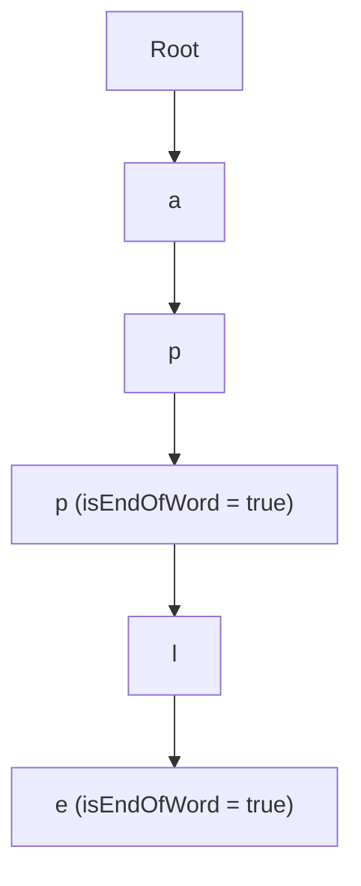

# Day 30: Advanced Systems DSA & Capstone

<nav aria-label="Lecture navigation">

[Previous: Dynamic Programming: 1D & 2D](day-29-dynamic-programming-1d-and-2d.md) | [Roadmap](../javascript-dsa-roadmap.md) | [Back to Day 01: Big O & Problem Solving](day-01-big-o-complexity-and-problem-solving.md)

</nav>

## Prerequisites

- [Day 04: Objects, Maps, Sets & Hash Tables](day-04-objects-maps-sets-and-hash-tables.md) — $O(1)$ average hash lookups.
- [Day 11: Singly & Doubly Linked Lists](day-11-singly-and-doubly-linked-lists.md) — Doubly linked list node insertion and deletion in $O(1)$.
- [Day 19: Merge Sort & Quick Sort](day-19-merge-sort-and-quick-sort.md) — Sorting intervals by start coordinate.

---

## 1. What is Systems DSA & The Capstone Patterns?

Over the preceding 29 days, we built algorithmic intuition from first principles—traversing arrays, linked lists, stacks, queues, trees, graphs, heaps, and dynamic programming tables. 

In mid-to-senior technical interviews, however, top-tier engineering teams test your ability to **compose multiple data structures together** to architect high-throughput, low-latency system components. These are **Systems Data Structures**:
1. **LRU Cache (Least Recently Used Cache):** The gold standard for in-memory caching in databases, web servers, and operating system page tables.
2. **Trie (Prefix Tree):** The core engine behind search autocomplete, IP network routing, dictionary spell-checkers, and HTTP router path matching (like Express and Fastify).
3. **Interval Merge & Sweep-Line:** The backbone of calendar booking engines, resource reservations, and cloud container CPU scheduler windows.

> **LRU Cache** — A fixed-capacity key-value cache that evicts the least recently accessed item in strict $O(1)$ time whenever capacity is exceeded.

> **Trie (Prefix Tree)** — A specialized tree where edges or nodes represent characters, allowing prefix lookups and word searches in $O(L)$ time, strictly independent of the total number of words in the corpus.

> **Interval Scheduling** — Managing 1D continuous coordinate ranges `[start, end]`, resolved by sorting by boundary endpoints to discover overlaps.

### Physical Analogy: The Desk Workspace and the Router

```text
=============================================================================
                  THE PHYSICAL METAPHORS OF SYSTEMS DSA
=============================================================================

1. THE DESK WORKSPACE (LRU Cache):
   - Your office desk can only hold 3 open books at a time (Capacity = 3).
   - When you read a book, you place it right in front of you (Most Recently Used).
   - If you need a 4th book:
     * Your desk is full!
     * You don't throw away a random book.
     * You take the book that has been sitting untouched at the far corner of
       your desk the longest (Least Recently Used) and put it back on the shelf!
   - Both finding a book and moving it to the front must take O(1) time.

2. THE TELEPHONE SWITCHBOARD (Trie / Prefix Tree):
   - You manage phone routing for a global enterprise.
   - When someone dials +1 (USA) -> 415 (San Francisco) -> 555 -> 0199:
   - The switchboard doesn't scan a flat list of 8 billion phone numbers!
   - It steps down a tree: Root -> '1' -> '4' -> '1' -> '5'...
   - Each digit narrows the path instantly in O(1) time per character.
=============================================================================
```

```mermaid
graph LR
    Map["Hash Map (Key -> Node)"] -->|O(1) Direct Lookup| DLL["Doubly Linked List"]
    DLL --> Head["Dummy Head (Most Recent)"]
    Head <--> N1["Node A"]
    N1 <--> N2["Node B"]
    N2 <--> Tail["Dummy Tail (Least Recent / Eviction Target)"]
```

---

## 2. How LRU Cache and Trie Work Step-by-Step

### 2.1 The Architectural Anatomy of an LRU Cache

To achieve true **$O(1)$ time for BOTH `get(key)` and `put(key, val)`**, a single data structure is insufficient:
- An **Array** has $O(1)$ index access, but evicting or moving an element to the front requires $O(N)$ element shifting.
- A **Hash Map** gives $O(1)$ lookups, but has zero awareness of chronological usage order.
- A **Singly Linked List** can remove and insert at the head in $O(1)$, but removing an arbitrary node requires an $O(N)$ search to find the predecessor!

**The Master Solution: Hash Map + Doubly Linked List:**
1. A **Doubly Linked List** maintains chronological order. Each node stores `{ key, val, prev, next }`.
   - Node right after `dummyHead` is the **Most Recently Used (MRU)**.
   - Node right before `dummyTail` is the **Least Recently Used (LRU)**.
2. A **Hash Map** stores `key -> NodeReference`.
   - Finding any node takes $O(1)$ via the Map.
   - Once we have the node reference, removing it from its current position and moving it to the head takes **$O(1)$ pointer rewiring**:
     `node.prev.next = node.next; node.next.prev = node.prev;`

```text
=============================================================================
                    LRU CACHE POINTER REWIRING (O(1))
=============================================================================

1. REMOVE NODE FROM CURRENT SEAT:
   [ prev ] <=====> [ curr ] <=====> [ next ]
   prev.next = next;
   next.prev = prev;

2. INSERT NODE AT HEAD (MRU):
   [ dummyHead ] <=====> [ oldFirst ]
   dummyHead.next = curr;
   curr.prev = dummyHead;
   curr.next = oldFirst;
   oldFirst.prev = curr;
=============================================================================
```

### 2.2 The Trie (Prefix Tree) Node Architecture

In a Trie, every node contains:
1. `children`: A Map or fixed array of size 26 pointing to child Trie nodes.
2. `isEndOfWord`: A boolean flag indicating whether a complete word terminates at this node.

```text
Inserting "app" and "apple":
                 (Root: "")
                     | 'a'
                    (a)
                     | 'p'
                    (p)
                     | 'p'
                   [ p ]  <-- isEndOfWord = true ("app")
                     | 'l'
                    (l)
                     | 'e'
                   [ e ]  <-- isEndOfWord = true ("apple")
- Search "app": Follows path -> hits node with isEndOfWord = true -> true!
- StartsWith "ap": Follows path -> path exists -> true!
- Search "appl": Follows path -> hits 'l' where isEndOfWord = false -> false!
```

---

## 3. Pattern Recognition of Systems DSA

### How to Spot These Patterns in Interviews

| Constraint / Keyword Signal | System Invariant | Optimal Algorithmic Pattern |
| :--- | :--- | :--- |
| "Design a data structure with $O(1)$ get and put and capacity limit" | Evict least recently accessed item | **Hash Map + Doubly Linked List (LRU)** |
| "Implement autocomplete / typeahead / prefix matching" | Character-by-character shared prefix walk | **Trie (Prefix Tree)** |
| "Merge overlapping intervals / Meeting Rooms" | 1D range collisions | **Sort by start coordinate + Sweep-Line** |
| "Design in-memory key-value store with expiration" | Priority of timestamps | **Hash Map + Min-Heap / TTL Linked List** |
| "Design LFU (Least Frequently Used) Cache" | Evict item with minimum access count | **Hash Map + Frequency Buckets of Doubly Linked Lists** |

---

## 4. Problem 1: LRU Cache (LeetCode 146)

### Problem Description
Design a data structure that follows the constraints of a **Least Recently Used (LRU) cache**.
Implement the `LRUCache` class:
- `LRUCache(int capacity)`: Initialize the LRU cache with positive size `capacity`.
- `int get(int key)`: Return the value of the `key` if the key exists, otherwise return `-1`. Accessing the key marks it as **most recently used**.
- `void put(int key, int value)`: Update the value of the `key` if the `key` exists. Otherwise, add the `key-value` pair to the cache. If the number of keys exceeds the `capacity` from this operation, **evict the least recently used key**.
The functions `get` and `put` must each run in **$O(1)$ average time complexity**.

### Step 1: Physical Simulation
Suppose `capacity = 2`:
- `put(1, 1)`: Cache = `[ (1, 1) ]`. Map = `{ 1 }`.
- `put(2, 2)`: Cache = `[ (2, 2), (1, 1) ]` (2 is at head, 1 is at tail).
- `get(1)`: Returns 1. **Accessing 1 promotes it to the head!**
  * Cache becomes: `[ (1, 1), (2, 2) ]`.
- `put(3, 3)`: Capacity 2 exceeded!
  * Evict tail node: `(2, 2)` is evicted! Map deletes key 2.
  * Insert 3 at head: `[ (3, 3), (1, 1) ]`.
- `get(2)`: Returns `-1` (already evicted!).
- `put(4, 4)`: Capacity exceeded! Evict tail node `(1, 1)`.
  * Insert 4 at head: `[ (4, 4), (3, 3) ]`.
- `get(1)`: Returns `-1`.
- `get(3)`: Returns 3.
- `get(4)`: Returns 4.

### Step 2: Brute Force Approach
Maintain a plain JavaScript object or array of items with timestamps. On every `get()` or `put()`, update the timestamp. On capacity overflow, linearly scan the entire array to find the minimum timestamp ($O(N)$ eviction):

```javascript
// Naive O(N) Array-Scanning LRU
class NaiveLRU {
  constructor(capacity) {
    this.capacity = capacity;
    this.items = []; // [{ key, val, time }]
  }
  get(key) {
    const item = this.items.find(i => i.key === key); // O(N) scan
    if (!item) return -1;
    item.time = Date.now();
    return item.val;
  }
  put(key, val) {
    // If full, scan all N items to find smallest time: O(N)
  }
}
```

### Step 3: Bottleneck
In high-throughput microservices handling 50,000 requests per second, an $O(N)$ scan per cache operation saturates the CPU, turning in-memory caching into an operational bottleneck.

### Step 4: The Pattern Discovery
We combine **two sentinel nodes (`dummyHead` and `dummyTail`)** in a Doubly Linked List with a JavaScript `Map`:
- Sentinel nodes completely eliminate edge-case `null` checks when inserting at the head or removing from the tail.
- `moveToHead(node)`: Unlink node in $O(1)$, link after `dummyHead` in $O(1)$.
- `evictTail()`: Target `dummyTail.prev`. Unlink from list, delete from Map.
Every operation executes in strict **$O(1)$ time**.

### Step 5: The Optimal Solution

```javascript
// ✅ CORRECT: Optimal O(1) Hash Map + Doubly Linked List LRU Cache
class DListNode {
  constructor(key = 0, val = 0) {
    this.key = key;
    this.val = val;
    this.prev = null;
    this.next = null;
  }
}

class LRUCache {
  constructor(capacity) {
    this.capacity = capacity;
    this.map = new Map(); // key -> DListNode

    // Sentinel dummy nodes to eliminate boundary null checks
    this.head = new DListNode();
    this.tail = new DListNode();
    this.head.next = this.tail;
    this.tail.prev = this.head;
  }

  get(key) {
    if (!this.map.has(key)) {
      return -1;
    }

    const node = this.map.get(key);
    // Mark as Most Recently Used
    this._moveToHead(node);
    return node.val;
  }

  put(key, value) {
    if (this.map.has(key)) {
      // Key exists: update value and promote to head
      const node = this.map.get(key);
      node.val = value;
      this._moveToHead(node);
    } else {
      // Key does not exist: create new node
      const newNode = new DListNode(key, value);
      this.map.set(key, newNode);
      this._addNode(newNode);

      // Check if capacity breached
      if (this.map.size > this.capacity) {
        // Evict Least Recently Used (node right before dummy tail)
        const lruNode = this._popTail();
        this.map.delete(lruNode.key);
      }
    }
  }

  // Helper 1: Add node right after head (MRU position)
  _addNode(node) {
    node.prev = this.head;
    node.next = this.head.next;
    this.head.next.prev = node;
    this.head.next = node;
  }

  // Helper 2: Unlink arbitrary node from list
  _removeNode(node) {
    const prev = node.prev;
    const next = node.next;
    prev.next = next;
    next.prev = prev;
  }

  // Helper 3: Promote existing node to MRU
  _moveToHead(node) {
    this._removeNode(node);
    this._addNode(node);
  }

  // Helper 4: Remove and return LRU node
  _popTail() {
    const lru = this.tail.prev;
    this._removeNode(lru);
    return lru;
  }
}

// ❌ ANTI-PATTERN: Forgetting to store 'key' inside DListNode
// When evicting lruNode from the tail, you must delete it from this.map!
// If DListNode does not store its own key, you cannot delete it from the Map in O(1)!

// Direct test run
const lru = new LRUCache(2);
lru.put(1, 1);
lru.put(2, 2);
console.log("get(1):", lru.get(1)); // Expected: 1 (promotes 1, 2 is now LRU)
lru.put(3, 3);                      // Evicts 2!
console.log("get(2) after eviction:", lru.get(2)); // Expected: -1
lru.put(4, 4);                      // Evicts 1!
console.log("get(1) after eviction:", lru.get(1)); // Expected: -1
console.log("get(3):", lru.get(3)); // Expected: 3
console.log("get(4):", lru.get(4)); // Expected: 4
```

#### Complexity Analysis
- **Time Complexity:** $O(1)$ strictly for both `get()` and `put()`. Map lookups and doubly linked list pointer rewires take constant time.
- **Space Complexity:** $O(\text{capacity})$ auxiliary space for the Map entries and linked list nodes.

---

## 5. Problem 2: Implement Trie (Prefix Tree - LeetCode 208)

### Problem Description
A **trie** (pronounced as "try") or **prefix tree** is a tree data structure used to efficiently store and retrieve keys in a dataset of strings. There are various applications of this data structure, such as autocomplete and spellchecker.
Implement the `Trie` class:
- `Trie()`: Initializes the trie object.
- `void insert(String word)`: Inserts the string `word` into the trie.
- `boolean search(String word)`: Returns `true` if the string `word` is in the trie (i.e., was inserted before), and `false` otherwise.
- `boolean startsWith(String prefix)`: Returns `true` if there is a previously inserted string `word` that has the prefix `prefix`, and `false` otherwise.

### Step 1: Physical Simulation
- `insert("apple")`:
  * Start at `root`.
  * Add `'a'`, `'p'`, `'p'`, `'l'`, `'e'`.
  * Set `isEndOfWord = true` at node `'e'`.
- `search("apple")`: Walk path `a -> p -> p -> l -> e`. Reached `'e'` and `isEndOfWord === true` $\implies$ Return `true`.
- `search("app")`: Walk path `a -> p -> p`. Reached `'p'`, but `isEndOfWord === false`! $\implies$ Return `false`.
- `startsWith("app")`: Walk path `a -> p -> p`. Path exists! $\implies$ Return `true`.
- `insert("app")`: Mark `isEndOfWord = true` at existing node `'p'`.
- `search("app")`: Now returns `true`!

### Step 2: Brute Force Approach
Store words in an array or Set. Searching for words takes $O(1)$ with a Set, but `startsWith(prefix)` requires linearly scanning all $N$ words and checking `word.startsWith(prefix)`:

```javascript
class NaiveTrie {
  constructor() {
    this.words = new Set();
  }
  insert(word) { this.words.add(word); }
  search(word) { return this.words.has(word); }
  startsWith(prefix) {
    // O(N * L): Scans entire dictionary! Unusable for autocomplete!
    for (const w of this.words) {
      if (w.startsWith(prefix)) return true;
    }
    return false;
  }
}
```

### Step 3: Bottleneck
Scanning a dictionary of 1,000,000 words on every keystroke takes seconds, creating an unacceptable lag in user-facing search bars.

### Step 4: The Pattern Discovery
In a **Trie**, all words sharing a common prefix (e.g. `"inter"`, `"interview"`, `"intermediate"`) share the exact same nodes. Searching or testing a prefix takes time proportional **only to the length of the query string $L$**, completely independent of whether the dictionary contains 10 words or 10,000,000 words!



### Step 5: The Optimal Solution

```javascript
// ✅ CORRECT: Optimal Production Trie (Prefix Tree)
class TrieNode {
  constructor() {
    // Map supports any Unicode characters (or new Array(26) for lowercase a-z)
    this.children = new Map();
    this.isEndOfWord = false;
  }
}

class Trie {
  constructor() {
    this.root = new TrieNode();
  }

  // Insert word into Trie in O(L) time
  insert(word) {
    let curr = this.root;

    for (let i = 0; i < word.length; i++) {
      const char = word[i];
      if (!curr.children.has(char)) {
        curr.children.set(char, new TrieNode());
      }
      curr = curr.children.get(char);
    }

    // Mark end of complete word
    curr.isEndOfWord = true;
  }

  // Search if exact word exists in O(L) time
  search(word) {
    const node = this._traverse(word);
    return node !== null && node.isEndOfWord === true;
  }

  // Test if any word starts with prefix in O(L) time
  startsWith(prefix) {
    return this._traverse(prefix) !== null;
  }

  // Common traversal helper
  _traverse(str) {
    let curr = this.root;

    for (let i = 0; i < str.length; i++) {
      const char = str[i];
      if (!curr.children.has(char)) {
        return null; // Character branch missing
      }
      curr = curr.children.get(char);
    }

    return curr;
  }
}

// ❌ ANTI-PATTERN: Conflating search() and startsWith()
// search() MUST verify isEndOfWord === true!
// If you return true without checking isEndOfWord, searching "app" when only
// "apple" exists will return a false positive!

// Direct test run
const trie = new Trie();
trie.insert("apple");
console.log("search('apple'):", trie.search("apple"));   // Expected: true
console.log("search('app'):", trie.search("app"));       // Expected: false
console.log("startsWith('app'):", trie.startsWith("app"));// Expected: true
trie.insert("app");
console.log("search('app') after insert:", trie.search("app")); // Expected: true
```

#### Complexity Analysis
- **Time Complexity:**
  * `insert(word)`: $O(L)$ where $L$ is word length.
  * `search(word)`: $O(L)$.
  * `startsWith(prefix)`: $O(P)$ where $P$ is prefix length.
  * All operations are completely independent of the total dictionary size $N$!
- **Space Complexity:** $O(N \cdot L)$ worst case (all words have disjoint characters). Shared prefixes dramatically reduce real-world heap space.

---

## 6. Under the Hood: V8 & Node.js

Understanding engine memory and real-world system implementations of these patterns is essential for senior backend engineers:

```text
=============================================================================
                  SYSTEMS DSA IN NODE.JS & PRODUCTION
=============================================================================

1. THE JAVASCRIPT Map INSERTION-ORDER SUPERPOWER:
   - In ECMAScript 2015 (ES6+), the standard specifies that Map entries iterate
     in exact INSERTION ORDER.
   - You can implement an LRU cache in 15 lines of JavaScript using Map alone:
       get(key) {
         if (!this.map.has(key)) return -1;
         const val = this.map.get(key);
         this.map.delete(key);
         this.map.set(key, val); // Re-inserts at tail!
         return val;
       }
   - Interviewer Note: Always ask if you can use native Map re-insertion or if
     they want the canonical Doubly Linked List + Hash Map from scratch.

2. FASTIFY & EXPRESS RADIX TREE ROUTING:
   - How does a web framework route GET /api/v1/users/:id/profile in 2 microseconds?
   - Older frameworks used regular expressions (RegExp). Regex evaluation is slow.
   - Fastify and modern routers use RADIX TREES (compressed Tries):
     * Nodes store URL segments ("/api/v1/").
     * Parametric matching (:id) executes via deterministic Trie branch descent.

3. MEMORY LEAK PITFALLS IN BACKEND CACHES:
   - If an in-memory cache has NO eviction policy or capacity limit:
     * High traffic will continuously append objects to a global Map.
     * V8's Old-Space Heap fills up until hitting the default 1.4 GB limit.
     * Process crashes with: "Allocation failed - JavaScript heap out of memory".
   - Senior Rule: Every cache in a long-running Node.js process MUST have either
     an LRU capacity bound or a TTL (Time-To-Live) expiration policy!
=============================================================================
```


---

## 7. Hands-On Exercise

### The Flawed Interval Merge Bug
A backend developer built a calendar scheduling conflict detector in Node.js. When passed intervals out of order, the merge function returns overlapping intervals or fails completely. The developer forgot to sort the input intervals before merging!

### The Buggy Code
```javascript
function buggyMergeIntervals(intervals) {
  if (intervals.length <= 1) return intervals;

  // BUG: Missing sorting step!
  // If intervals are [[2, 6], [1, 3], [8, 10]]:
  // Comparing [2, 6] with [1, 3] without sorting fails to detect
  // that [1, 3] actually started earlier!
  const merged = [intervals[0]];

  for (let i = 1; i < intervals.length; i++) {
    const curr = intervals[i];
    const prev = merged[merged.length - 1];

    if (curr[0] <= prev[1]) {
      prev[1] = Math.max(prev[1], curr[1]);
    } else {
      merged.push(curr);
    }
  }

  return merged;
}
```

### The Fix and Direct Verification
Sort intervals ascending by start time (`intervals.sort((a, b) => a[0] - b[0])`) before beginning the single linear sweep:

```javascript
// ✅ REPAIRED: Production-Safe Merge Intervals
function safeMergeIntervals(intervals) {
  if (!intervals || intervals.length <= 1) return intervals;

  // FIX: Sort ascending by start coordinate!
  intervals.sort((a, b) => a[0] - b[0]);

  const merged = [intervals[0]];

  for (let i = 1; i < intervals.length; i++) {
    const current = intervals[i];
    const lastMerged = merged[merged.length - 1];

    // If current interval starts before or when previous ends, they collide!
    if (current[0] <= lastMerged[1]) {
      // Merge by expanding the end boundary
      lastMerged[1] = Math.max(lastMerged[1], current[1]);
    } else {
      // No overlap: add as new independent interval
      merged.push(current);
    }
  }

  return merged;
}

// Direct test verification
const unsortedIntervals = [[2, 6], [1, 3], [15, 18], [8, 10]];
console.log("Repaired Merge Intervals:", safeMergeIntervals(unsortedIntervals));
// Expected output: [ [1, 6], [8, 10], [15, 18] ]
```

---

## 8. Tricky Points and Edge Cases

### 1. Dummy Sentinels in Doubly Linked Lists
Writing doubly linked lists without `dummyHead` and `dummyTail` requires checking `if (node === this.head)` and `if (node === this.tail)` on every single insertion, deletion, and eviction. A single missed null check will crash your interview code. Always initialize two dummy nodes connected to each other.

### 2. Updating Existing Keys in `put()`
When calling `put(key, value)` with a key that **already exists in the cache**:
- Do **not** increment size or trigger eviction!
- Overwrite `node.val = value`.
- Promote the node to the head (it was accessed!).

### 3. Eviction Must Clean BOTH Structures
When evicting the least recently used element from an LRU cache:
- You must unlink `lruNode` from the doubly linked list.
- **AND** you must delete `lruNode.key` from the Hash Map!
If you forget `this.map.delete(lruNode.key)`, the map will retain zombie references, leaking memory and reporting stale hits on `map.has(key)`.

---

## 9. Comprehensive Summary

```text
=============================================================================
                    SYSTEMS DATA STRUCTURES SUMMARY
=============================================================================

DATA STRUCTURE      COMPONENTS                      KEY ADVANTAGE
-----------------------------------------------------------------------------
LRU Cache           Hash Map + Doubly Linked List   Strict O(1) get, put, evict
Trie (Prefix Tree)  Tree of Character Nodes (Map)   O(L) search independent of corpus
Radix Tree          Compressed Trie (edge strings)  URL path routing in Express/Fastify
Interval Sweep      Sort + Linear Scan              O(N log N) collision resolution
Two Heaps           Max-Heap + Min-Heap             O(1) continuous median query
=============================================================================
```

- **Systems DSA is compositional:** Real-world components combine standard primitives (Maps, Linked Lists, Trees) to satisfy multi-constraint SLAs.
- **Sentinel nodes guarantee robust pointer safety:** Head and tail sentinels eliminate boundary edge cases in pointer-heavy structures.
- **Sorting is the universal foundation for 1D range collisions:** Always sort by start coordinates before merging intervals.

---

## 10. Cheat Sheet

### The 30-Day Master Algorithmic Selection Guide

```text
=============================================================================
                    THE 30-DAY MASTER SELECTION MATRIX
=============================================================================

PROBLEM TYPE                DATA STRUCTURE / ALGORITHM              COMPLEXITY
-----------------------------------------------------------------------------
Sorted Array Search         Binary Search Bounds (Day 16-17)        O(log N)
Contiguous Subarray Window  Sliding Window / Two Pointers (Day 05)  O(N)
Next Greater Element        Monotonic Stack (Day 14)                O(N)
FIFO / Level Order          Queue with advancing pointer (Day 15,24)O(N)
Combinatorial Generation    Backtracking + Pruning (Day 20-22)      O(2^N) / O(N!)
Unweighted Shortest Path    Breadth-First Search (Day 26)           O(V + E)
Dependency Scheduling / DAG Kahn's In-Degree BFS (Day 27)           O(V + E)
Top-K Extremes / Streaming  Binary Min/Max Heap (Day 28)            O(N log K)
Overlapping Optimization    Dynamic Programming Tabulation (Day 29) O(N) / O(N*M)
LRU In-Memory Cache         Map + Doubly Linked List (Day 30)       O(1)
String Prefix Matching      Trie (Prefix Tree) (Day 30)             O(L)
=============================================================================
```

### Capstone Safety Checklist
- [ ] LRU: Did you initialize both `dummyHead` and `dummyTail`?
- [ ] LRU: Did you delete the key from `this.map` upon eviction?
- [ ] Trie: Did you distinguish `search()` (`isEndOfWord`) from `startsWith()`?
- [ ] Intervals: Did you sort intervals by start time before merging?

---

## 11. Interview Q&A

### 45-Second Senior Pitch
> *"Systems-level data structure problems assess the ability to compose primitive structures to achieve strict performance SLAs. The classic LRU Cache exemplifies this: combining a Hash Map for constant-time key lookups with a Doubly Linked List for constant-time chronological reordering, backed by sentinel head and tail nodes to prevent pointer edge cases. Similarly, Tries solve prefix and autocomplete bottlenecks by bounding search time strictly to word length $O(L)$, independent of corpus scale. In high-throughput Node.js microservices, bounded caches with deterministic evictions are mandatory to prevent V8 heap exhaustion and eliminate single-threaded event loop blocking."*

### Deep Interview Questions

#### Q1: Why is a Doubly Linked List strictly required for an LRU Cache rather than a Singly Linked List?
**Answer:** In an LRU Cache, accessing an existing key via `get(key)` requires promoting that node to the head of the list. To do this, the node must first be removed from its current position in the list. In a **singly linked list**, removing an arbitrary node requires updating `prev.next = curr.next`. Because a singly linked list has no backward pointers, finding `prev` requires an $O(N)$ linear scan from the head. A **doubly linked list** provides a direct `node.prev` reference, enabling $O(1)$ node detachment without any linear traversal.

#### Q2: How does a Radix Tree optimize a standard Trie for HTTP routers?
**Answer:** In a standard Trie, each edge represents a single character, creating deep trees where non-branching prefixes (like `"/api/v1/checkout"`) require 17 sequential node allocations. A **Radix Tree** (or Patricia Trie) compresses consecutive nodes that have only one child into a single edge containing a string segment (`"/api/v1/checkout"`). This dramatically reduces node count, flattens tree depth, eliminates pointer chasing, and allows HTTP routers to match URLs in sub-microsecond times.

#### Q3: How would you implement an LFU (Least Frequently Used) Cache in $O(1)$ time?
**Answer:** LFU requires evicting the item with the lowest access frequency, breaking ties using LRU. We implement LFU using **two Hash Maps and a collection of Doubly Linked Lists**:
1. `keyMap`: Maps `key -> Node` (stores `{ key, val, freq }`).
2. `freqMap`: Maps `frequency -> DoublyLinkedList` (each list contains all nodes accessed that many times).
3. `minFreq`: An integer tracking the current lowest frequency in the cache.
When a node is accessed:
- Unlink it from its current `freqMap.get(freq)` list.
- Increment `node.freq++`.
- Add to `freqMap.get(node.freq)` list.
- If the old list becomes empty and `oldFreq === minFreq`, increment `minFreq++`.
Eviction simply removes the tail from `freqMap.get(minFreq)`. All operations run in $O(1)$ time.

#### Q4: What happens to a Node.js process if an in-memory cache has no eviction policy?
**Answer:** In Node.js, JavaScript objects created in memory reside on the V8 heap. If an in-memory cache continually stores data without an eviction policy (like LRU) or TTL bounds:
1. Heap memory continuously grows toward V8's default memory limit (typically $\approx 1.4 \text{ GB}$ on 64-bit systems).
2. As memory limits approach, V8's Garbage Collector runs frequent, aggressive **Mark-Sweep-Compact** cycles, blocking the single thread and causing severe latency spikes.
3. Once the heap limit is breached, the Node.js process crashes immediately with `FATAL ERROR: Reached heap limit Allocation failed - JavaScript heap out of memory`, taking down the service.

---

## 12. Practice Problems

### Problem 1: Meeting Rooms II (LeetCode 253)
- **Input:** Array of meeting time intervals: `intervals = [[0, 30], [5, 10], [15, 20]]`
- **Output:** `2` (Minimum conference rooms required)
- **Challenge:** Sort start and end times independently, or use a **Min-Heap of end times** to find maximum concurrent overlapping intervals in $O(N \log N)$ time.

### Problem 2: Design In-Memory File System (LeetCode 588)
- **Commands:** `ls(path)`, `mkdir(path)`, `addContentToFile(path, content)`, `readContentFromFile(path)`
- **Challenge:** Combine a **Trie** structure where path segments (`"home"`, `"user"`, `"docs"`) are tree nodes with file payload storage.

### Problem 3: LFU Cache (Least Frequently Used - LeetCode 460)
- **Requirement:** Design and implement a data structure for a Least Frequently Used (LFU) cache.
- **Challenge:** Achieve strict $O(1)$ average time for both `get` and `put` using two hash maps and frequency doubly-linked-list buckets.

---

<nav aria-label="Lecture navigation">

[Previous: Dynamic Programming: 1D & 2D](day-29-dynamic-programming-1d-and-2d.md) | [Roadmap](../javascript-dsa-roadmap.md) | [Back to Day 01: Big O & Problem Solving](day-01-big-o-complexity-and-problem-solving.md)

</nav>
