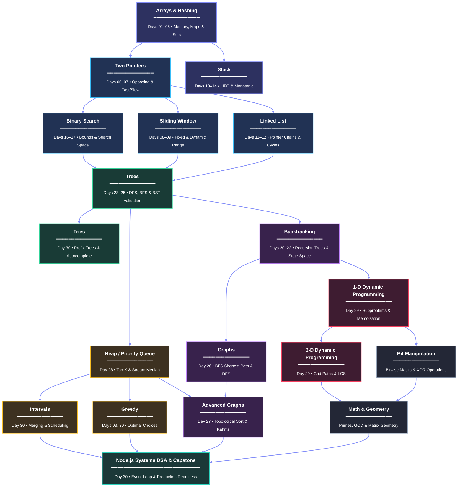

# DSA Roadmap for JavaScript & Node.js (30-Day Master Curriculum)

A comprehensive, beginner-to-master Data Structures and Algorithms roadmap engineered specifically for JavaScript and Node.js developers. 

This curriculum consolidates foundational computer science, high-frequency interview patterns, low-level V8 engine memory internals, and real-world Node.js single-threaded backend performance into **30 exhaustive master day units**.

---

## Pacing Options

Each numbered "Day" represents a complete, self-contained **master knowledge unit**. The pace is fully adaptable based on your target interview schedule:

- **1-Month Intensive Sprint (4 Weeks):** 1 master unit per day, 7 days per week (or 5 study days + 2 review days). Recommended for candidates with upcoming technical screens.
- **8-Week Balanced Track (2 Months):** 3 to 4 master units per week (1.5 to 2.5 hours per day). Recommended for solid foundational retention.
- **6-Month Deep Mastery Track:** 1 to 2 master units per week with extensive LeetCode medium/hard drilling and backend benchmarking.

---

## Master Visual Topic & Dependency Roadmap

This visual roadmap models the conceptual prerequisite and dependency graph across all core algorithmic patterns and data structures, progressing from foundational contiguous memory and hash lookups up through hierarchical trees, priority queues, graph topologies, and dynamic programming, culminating in the production Node.js systems DSA capstone:




## The 3-Phase Lecture Architecture

To ensure **beginners can understand every concept effortlessly** without sacrificing **senior-level depth**, every lecture file follows this strict progression:

```text
┌─────────────────────────────────────────────────────────────────────────────────────────────┐
│                       STANDARDIZED 3-PHASE LECTURE ARCHITECTURE                             │
└─────────────────────────────────────────────────────────────────────────────────────────────┘

  PHASE 1: ABSOLUTE BASICS & INSTANT PATTERN RECOGNITION (Top of File)
  ├── 1. The Real-Life Analogy: Plain-English visual mental model (No jargon, zero math)
  ├── 2. How the Algorithm Works: Step-by-step mechanical walkthrough with ASCII visual trace
  └── 3. The Instant Pattern Radar:
         • Problem statement trigger words ("When you see X, think Y")
         • Diagnostic questions: "Is this Hashing? Sliding Window? Two Pointers?"
         • Constraint hints: How N <= 10^5 immediately dictates the target Big-O

  PHASE 2: CLEAN PROBLEM-SOLVING & CODE (The Execution Core)
  ├── 4. The Brute Force Baseline: Naive solution first, explaining why it fails at scale
  ├── 5. The "Aha!" Insight: What redundant work is eliminated by the pattern
  ├── 6. Clean, Idiomatic JavaScript Code: Production-grade, descriptive names, invariant comments
  └── 7. Step-by-Step Complexity Derivation: How to manually calculate Time and Auxiliary Space

  PHASE 3: UNDER THE HOOD, DEEP DIVES & TECHNICAL DISCUSSION (End of File)
  ├── 8. Under the Hood: Engine & Runtime Mechanics: Packed vs Holey arrays, SMI vs Double, GC
  ├── 9. Node.js Event Loop Impact: Single-threaded blocking, cooperative yielding (setImmediate)
  ├── 10. Expanded Tricky Points & Traps: 5+ subtle traps, off-by-one errors, mutation bugs
  ├── 11. Hands-On Exercises (3 Tiers): Warm-Up (Easy) -> Core Challenge (Med) -> Scaled Follow-Up (Hard)
  ├── 12. Comprehensive Summary & Master Cheat Sheet: Complete recap, pattern cues, and templates
  ├── 13. Technical Discussion & Deep Q&A: 45-second technical walkthroughs & conceptual discussion Q&A
  └── 14. LeetCode Practice Problems: Curated challenge bank with inputs and expected outputs (no answers)
```

---

# Instant Pattern-Recognition System

How to immediately identify the correct data structure or algorithmic pattern when reading any interview problem statement.

### The Diagnostic Decision Flowchart

```text
                              [ YOUR PROBLEM STATEMENT ]
                                          │
       ┌──────────────────────────────────┴──────────────────────────────────┐
       ▼                                                                     ▼
[ Contiguous Subarray / Substring? ]                         [ Elements Can Be Scrambled or Any Order? ]
       │                                                                     │
  ┌────┴──────────────────────────────┐                         ┌────────────┴────────────────────────────┐
  ▼                                   ▼                         ▼                                         ▼
[ Fixed Window Size K? ]      [ Dynamic Condition? ]     [ Need Target Sum or Pair? ]             [ Need Frequency / Grouping? ]
  │                             │ (e.g. Longest without    │                                        │
  ▼                             │        duplicates)       ├── If Array is SORTED:                  ▼
[ FIXED SLIDING WINDOW ]        ▼                          │   --> TWO POINTERS (Opposing)      [ HASH MAP / SET ]
                           [ VARIABLE SLIDING WINDOW ]     └── If Array is UNSORTED:
                                                               --> HASH COMPLEMENTS (Map.has(target - x))
```

### The Universal Trigger Keywords

| Problem Keyword / Signal | Target Pattern | Primary JavaScript Structure | Lecture Reference |
| :--- | :--- | :--- | :--- |
| **"Contiguous sequence" + fixed size $K$** | Fixed Sliding Window | Two pointers / Rolling variable | [Day 08](dsa-lectures/day-08-sliding-window-fixed-size.md) |
| **"Longest / shortest substring with condition"** | Variable Sliding Window | Two pointers (`left`, `right`) + Map | [Day 09](dsa-lectures/day-09-sliding-window-variable-size.md) |
| **"Sorted array" + "Pair summing to target"** | Two Pointers (Opposing) | `left = 0`, `right = arr.length - 1` | [Day 06](dsa-lectures/day-06-two-pointers-opposing-and-symmetrical.md) |
| **"In-place duplicate removal / move zeroes"** | Fast & Slow Pointers | Two forward pointers (`slow`, `fast`) | [Day 07](dsa-lectures/day-07-two-pointers-fast-slow-and-partitioning.md) |
| **"Find duplicates" / "Frequency" / "Anagrams"** | Hash Map / Set | `new Map()`, `new Set()` | [Day 04](dsa-lectures/day-04-frequency-counting-anagrams-and-complements.md) |
| **"Subarray sum equals $K$" / range totals** | Prefix Sum + Hash Map | Array + `Map<prefixSum, count>` | [Day 10](dsa-lectures/day-10-prefix-sum-and-subarray-totals.md) |
| **"Next greater / smaller element" / histograms**| Monotonic Stack | Array with `push()` / `pop()` | [Day 14](dsa-lectures/day-14-monotonic-stack-patterns.md) |
| **"Reverse / detect cycle in pointer sequence"** | Linked List Fast/Slow | Objects with `.next` pointer | [Day 12](dsa-lectures/day-12-linked-list-reversals-and-cycle-detection.md) |
| **"Sorted search" / "Rotated array" / "Find peak"**| Binary Search | `while (low <= high)`, `mid` | [Day 16](dsa-lectures/day-16-binary-search-bounds-and-rotated-arrays.md) |
| **"Find minimum speed / capacity to finish in $D$ days"**| Binary Search on Solution | Range $[low, high]$ + Feasibility function | [Day 17](dsa-lectures/day-17-binary-search-on-solution-space.md) |
| **"Generate all valid combinations / permutations"**| Backtracking | Recursive Choose $\to$ Explore $\to$ Unchoose | [Day 21](dsa-lectures/day-21-subsets-permutations-and-combinations.md) |
| **"Hierarchical data" / "Tree views" / "Ancestor"**| Tree DFS / BFS | Recursive call stack or Queue | [Day 23](dsa-lectures/day-23-binary-trees-dfs-and-properties.md), [Day 24](dsa-lectures/day-24-binary-trees-bfs-views-and-lca.md) |
| **"Shortest path in unweighted network"** | Breadth-First Search (BFS)| Queue + `visited` Set | [Day 26](dsa-lectures/day-26-graphs-bfs-shortest-path-and-dfs-components.md) |
| **"Course prerequisites" / "Build dependencies"**| Topological Sort (Kahn's) | In-degree array + Queue | [Day 27](dsa-lectures/day-27-cycle-detection-and-topological-sort.md) |
| **"Top $K$ frequent" / "Running stream median"** | Binary Heap / Priority Queue | Custom array-backed Binary Heap | [Day 28](dsa-lectures/day-28-binary-heaps-and-priority-queues.md) |
| **"Maximum profit" / "Minimum cost" / "Count ways"**| Dynamic Programming | Memoization array/Map or Tabulation table | [Day 29](dsa-lectures/day-29-dynamic-programming-1d-and-2d.md) |
| **"Prefix autocomplete" / "Dictionary lookup"** | Trie (Prefix Tree) | Nested character nodes / `Map` | [Day 30](dsa-lectures/day-30-advanced-patterns-nodejs-dsa-and-interview-capstone.md) |

---

### The Constraint-to-Complexity Decoupling Heuristic

Modern CPU cores process roughly $10^7$ to $10^8$ operations per second. Given the input size $N$ in the problem description, you can deduce the expected Big-O complexity before writing a single line of code:

| Input Constraint ($N$) | Maximum Allowable Complexity | Target Patterns & Architectures |
| :--- | :--- | :--- |
| **$N \le 10 \dots 16$** | $O(2^N)$ or $O(N!)$ | Backtracking, Permutations, Subsets, N-Queens |
| **$N \le 100$** | $O(N^3)$ or $O(N^4)$ | 3D/4D Dynamic Programming, Floyd-Warshall |
| **$N \le 1,000 \dots 2,000$** | $O(N^2)$ | 2D Dynamic Programming, Matrix Traversal, Nested Scans |
| **$N \le 100,000$ ($10^5$)** | **$O(N \log N)$ or $O(N)$** | **Sorting, Heaps, Two Pointers, Sliding Window, Divide & Conquer** |
| **$N \le 1,000,000$ ($10^6$)** | **$O(N)$ or $O(1)$** | **Hash Map, Set, Prefix Sum, Monotonic Stack, Single Pass** |
| **$N \ge 10^9$ (Very Large)**| **$O(\log N)$ or $O(1)$** | **Binary Search on Solution Space, Bitwise Operations, Math** |

---

# Complete 30-Day Master Syllabus

---

## Week 1: Foundations, Primitive Memory, Hashing & Linear Pointers (Days 01–07)
*Objective: Build rock-solid mental models of Big O, memory buffers, hashing, and linear pointer navigation.*

### [Day 01: Big O Complexity, Problem Solving & Constraint Decoding](dsa-lectures/day-01-big-o-complexity-and-problem-solving.md)
- **Core Topics:** Asymptotic growth orders ($O(1)$ to $O(n!)$), Big $\Omega$ and $\Theta$, Drop constants & non-dominant terms, Amortized analysis, Constraint Decoding heuristic.
- **Why It Matters:** Enables comparing solutions without relying on wall-clock seconds that fluctuate with CPU load.
- **Pattern & Trigger:** When given constraint $N \le 10^5$, immediately reject $O(N^2)$ and target $O(N)$ or $O(N \log N)$.
- **Benchmark Problems:** Sum 1 to N, Pair search baseline, Constraint Decoding Challenge.
- **End-of-Lecture Deep-Dive:** V8 TurboFan compiler optimizations, Node.js event-loop thread starvation caused by $O(N^2)$ synchronous loops.
- **Hands-On Exercises:** Linear vs Binary operation counter (Easy), Amortized `Array.push` simulator (Medium), Node event loop blocking benchmark (Hard).

### [Day 02: JavaScript Arrays, Strings & Primitive Memory](dsa-lectures/day-02-arrays-strings-and-primitive-memory.md)
- **Core Topics:** Contiguous memory buffers, $O(1)$ offset access, string immutability, UTF-16 code units vs code points, surrogate pairs, sequence reversal.
- **Why It Matters:** Arrays and strings form the foundation of 60%+ of all technical interviews.
- **Pattern & Trigger:** Direct indexing, boundary checking, and character iteration.
- **Benchmark Problems:** Valid Palindrome (LC 125), Reverse String in-place (LC 344), Longest Common Prefix (LC 14).
- **End-of-Lecture Deep-Dive:** V8 Packed vs Holey arrays, SMI (Small Integer) vs Double element kinds, string memory allocation in the V8 heap.
- **Hands-On Exercises:** In-place string reversal (Easy), Unicode surrogate-pair scanner (Medium), Packed vs Holey memory benchmark (Hard).

### [Day 03: Searching, Elementary Sorting & Core Array Algorithms](dsa-lectures/day-03-searching-and-sorting-algorithms.md)
- **Core Topics:** What is an Algorithm (deterministic state transitions, invariants), Linear Search ($O(N)$), Binary Search Fundamentals ($O(\log N)$ halving trace, overflow-safe midpoint), The 3 Elementary Sorts (Bubble Sort with early exit, Selection Sort with minIndex, Insertion Sort adaptive cards), Kadane's Algorithm ($O(N)$ Max Subarray), Boyer-Moore Voting Algorithm ($O(N)$ Majority Element).
- **Why It Matters:** The essential algorithmic toolkit. Teaches fundamental search bounds, sorting mechanics, and greedy single-pass invariants before advanced techniques.
- **Pattern & Trigger:** "Search element in sorted collection", "Sort small array without library", "Find maximum contiguous subarray sum", "Find element appearing > N/2 times".
- **Benchmark Problems:** Binary Search (LC 704), Maximum Subarray (LC 53), Majority Element (LC 169), Search Insert Position (LC 35).
- **End-of-Lecture Deep-Dive:** JavaScript `Array.prototype.sort()` UTF-16 string coercion trap (`[10, 2].sort()` $\to$ `[10, 2]`), numeric comparator contract `(a, b) => a - b`, in-place mutation vs `toSorted()`, sort stability, and V8 TimSort.
- **Hands-On Exercises:** Binary search first occurrence (Easy), Kadane's algorithm with subarray indices (Medium), Adaptive insertion sort benchmark (Medium).

### [Day 04: Objects, Maps, Sets & Hash Tables](dsa-lectures/day-04-objects-maps-sets-and-hash-tables.md)
- **Core Topics:** Plain object `{}` vs ES2015 `Map`, prototype collision trap, `Set` uniqueness, hash collisions, bucket array mechanics, custom hash table implementation.
- **Why It Matters:** Hash structures trade $O(N)$ memory to turn expensive searches into instantaneous $O(1)$ lookups.
- **Pattern & Trigger:** "Check existence in $O(1)$", "Ensure uniqueness", "Deduplicate in $O(N)$ time".
- **Benchmark Problems:** Prototype Collision Exploit & Fix, Custom Mini-Hash Table Implementation, Array Deduplication.
- **End-of-Lecture Deep-Dive:** V8 Hidden Classes (Shapes), `Object.create(null)` dictionary mode, `Map` insertion order guarantees.
- **Hands-On Exercises:** Fast array deduplication (Easy), Hash table with separate chaining (Medium), Object vs Map lookup benchmark under churn (Hard).

### [Day 05: Hash Table Patterns: Frequency, Complements & Duplicates](dsa-lectures/day-05-hash-patterns-frequency-counting-and-duplicates.md)
- **Core Topics:** The 4 Core Hash Patterns: Whiteboard Tally (Frequency counter, anagrams), Rearview Mirror (Single-pass hash complements, Two Sum), Bouncer's Clipboard (Early-exit Set deduplication), Sliding Clipboard (Windowed duplicate within distance $K$). Array intersections (Unique Set vs Multiset Map).
- **Why It Matters:** The highest-frequency interview category. Replaces nested $O(N^2)$ loops with optimal $O(N)$ single-pass lookups.
- **Pattern & Trigger:** "Count frequencies / Anagrams", "Find matching pair summing to target", "Check if any duplicate exists", "Duplicates within distance $K$", "Intersect two arrays".
- **Benchmark Problems:** Valid Anagram (LC 242), Two Sum (LC 1), Group Anagrams (LC 49), Contains Duplicate II (LC 219), Intersection of Two Arrays II (LC 350).
- **End-of-Lecture Deep-Dive:** Flat `Int32Array(26)` vs `Map` performance & CPU cache locality, signature collision prevention (delimiters), ES2025 native C++ Set operations.
- **Hands-On Exercises:** First unique character (Easy), Sliding window set within distance K (Medium), Group Anagrams with delimited signatures (Medium).

### [Day 06: Two Pointers: Opposing & Symmetrical Scans](dsa-lectures/day-06-two-pointers-opposing-and-symmetrical.md)
- **Core Topics:** Two-end inward convergence (`left = 0`, `right = n - 1`), monotonicity in sorted arrays, greedy pruning invariant, handling duplicate triplets.
- **Why It Matters:** Solves pair and triplet problems in $O(N)$ time with zero extra auxiliary memory ($O(1)$ space).
- **Pattern & Trigger:** **Sorted array** + "Find pair/triplet with target sum" or "Max area / container".
- **Benchmark Problems:** Two Sum II - Input Array Is Sorted (LC 167), Container With Most Water (LC 11), 3Sum (LC 15).
- **End-of-Lecture Deep-Dive:** Mathematical invariant proof of greedy line skipping, avoiding duplicate triplet allocation in V8 heap memory.
- **Hands-On Exercises:** Reverse vowels of a string (Easy), Two Sum Sorted (Easy), 3Sum with strict duplicate avoidance (Medium).

### [Day 07: Two Pointers: Same-Direction & Fast/Slow Pointers](dsa-lectures/day-07-two-pointers-fast-slow-and-partitioning.md)
- **Core Topics:** Fast and slow index traversal, in-place array compaction, zero moving, Dutch National Flag 3-way partitioning.
- **Why It Matters:** Essential for in-place data reorganization without allocating auxiliary buffer arrays.
- **Pattern & Trigger:** "Modify array in-place", "Remove elements without extra memory", "Partition into 3 categories".
- **Benchmark Problems:** Remove Duplicates from Sorted Array (LC 26), Move Zeroes (LC 283), Sort Colors / Dutch National Flag (LC 75).
- **End-of-Lecture Deep-Dive:** V8 array continuous buffer writes, cache locality advantages of sequential in-place writes.
- **Hands-On Exercises:** Move zeroes to end (Easy), Remove element in-place (Easy), Sort Colors 3-pointer partition (Medium).

---

## Week 2: Windows, Ranges, Linked Structures, Stacks & Queues (Days 08–15)
*Objective: Master contiguous range mechanics, reference-based node chains, and LIFO/FIFO data management.*

### [Day 08: Sliding Window: Fixed Size & Rolling Statistics](dsa-lectures/day-08-sliding-window-fixed-size.md)
- **Core Topics:** Fixed window invariant, rolling sum mechanics, reusing overlap ($+ \text{enter} - \text{leave}$), circular window buffers.
- **Why It Matters:** Eliminates repeated sub-range recalculations, reducing $O(N \times K)$ brute force to optimal $O(N)$.
- **Pattern & Trigger:** "Contiguous subarray" + "Fixed window size $K$" + "Max/min average or sum".
- **Benchmark Problems:** Maximum Sum Subarray of Size K, First Negative Integer in Every Window of Size K, Moving Average from Data Stream (LC 346).
- **End-of-Lecture Deep-Dive:** Numeric precision and IEEE 754 floating-point drift in rolling sums, rate-limiting fixed window counters in Node.js.
- **Hands-On Exercises:** Max average subarray of size K (Easy), First negative number in window (Medium), Rate-limit request sliding counter (Medium).

### [Day 09: Sliding Window: Variable Size & Dynamic Bounds](dsa-lectures/day-09-sliding-window-variable-size.md)
- **Core Topics:** Expand `right` to acquire, contract `left` to restore invariant, character frequency window matching, optimal window contraction.
- **Why It Matters:** Among the most popular patterns in top-tier tech company interviews (Google, Meta, Amazon).
- **Pattern & Trigger:** "Longest substring without repeating characters", "Minimum window length containing target elements".
- **Benchmark Problems:** Longest Substring Without Repeating Characters (LC 3), Minimum Size Subarray Sum (LC 209), Minimum Window Substring (LC 76).
- **End-of-Lecture Deep-Dive:** `Map` lookup overhead vs 128-element ASCII array in hot inner window loops, amortized $2N$ pointer steps.
- **Hands-On Exercises:** Longest substring with at most K distinct characters (Medium), Minimum size subarray sum (Medium), Minimum Window Substring (Hard).

### [Day 10: Prefix Sum, Cumulative Ranges & Subarray Totals](dsa-lectures/day-10-prefix-sum-and-subarray-totals.md)
- **Core Topics:** Prefix arrays with 0-index offset, $O(1)$ range sum formula ($\text{prefix}[R+1] - \text{prefix}[L]$), prefix sum + hash map complement pattern, 2D matrix prefix sum.
- **Why It Matters:** Enables instant $O(1)$ cumulative range queries and solves subarray sum equality in $O(N)$ time.
- **Pattern & Trigger:** "Range sum query", "Find contiguous subarray summing to exactly $K$", "Equilibrium index".
- **Benchmark Problems:** Range Sum Query - Immutable (LC 303), Subarray Sum Equals K (LC 560), Find Pivot Index (LC 724).
- **End-of-Lecture Deep-Dive:** Prefix sum lookup in production log metrics, BigInt handling for large cumulative sums in Node.js.
- **Hands-On Exercises:** Running sum of 1D array (Easy), Find Pivot Index (Easy), Subarray Sum Equals K with Map (Medium).

### [Day 11: Singly & Doubly Linked Lists: Reference Manipulation](dsa-lectures/day-11-singly-and-doubly-linked-lists.md)
- **Core Topics:** Node pointer reference anatomy, Dummy Head sentinel pattern, inserting/deleting at head/middle/tail, doubly linked list node tracking.
- **Why It Matters:** Teaches explicit reference manipulation and pointer mutation foundational to trees, graphs, and LRU caches.
- **Pattern & Trigger:** "Rearrange elements without moving array blocks", "Insert/delete at edges in $O(1)$ time".
- **Benchmark Problems:** Delete Node in a Linked List (LC 237), Remove Nth Node From End of List (LC 19), Merge Two Sorted Lists (LC 21).
- **End-of-Lecture Deep-Dive:** JavaScript object reference identity vs garbage collection, memory overhead of pointer chains vs contiguous arrays.
- **Hands-On Exercises:** Singly Linked List CRUD implementation (Easy), Merge Two Sorted Lists (Easy), Remove Nth node from end (Medium).

### [Day 12: Linked List Fast & Slow Pointers, Cycles & Reversals](dsa-lectures/day-12-linked-list-reversals-and-cycle-detection.md)
- **Core Topics:** Floyd's Cycle Detection (Tortoise and Hare), finding cycle entry node, in-place 3-pointer list reversal (`prev`, `curr`, `next`), palindrome linked list.
- **Why It Matters:** Tests deep pointer manipulation, boundary edge cases, and cycle detection without allocating extra memory.
- **Pattern & Trigger:** "Detect cycle in list", "Find list midpoint", "Reverse pointers in-place".
- **Benchmark Problems:** Linked List Cycle I (LC 141), Linked List Cycle II (LC 142), Reverse Linked List (LC 206), Palindrome Linked List (LC 234).
- **End-of-Lecture Deep-Dive:** Mathematical proof of Floyd's algorithm ($2k - k = k$), preventing memory leaks from circular linked structures.
- **Hands-On Exercises:** Reverse linked list iteratively (Easy), Detect cycle boolean (Easy), Find cycle start node (Medium).

### [Day 13: Stacks & Expression Parsing: LIFO Architecture](dsa-lectures/day-13-stacks-and-expression-parsing.md)
- **Core Topics:** Last-In-First-Out (LIFO) mechanics, array-backed stack, bracket matching with hash table lookup, evaluating Reverse Polish Notation (RPN).
- **Why It Matters:** Foundation of parser engines, compilers, browser history, undo/redo buffers, and call stack simulators.
- **Pattern & Trigger:** "Matching brackets/parentheses", "Nested expression evaluation", "Undo/redo history".
- **Benchmark Problems:** Valid Parentheses (LC 20), Evaluate Reverse Polish Notation (LC 150), Min Stack with $O(1)$ lookup (LC 155).
- **End-of-Lecture Deep-Dive:** Call stack execution frames in V8, stack overflow hazards in deep nested call stacks.
- **Hands-On Exercises:** Valid Parentheses (Easy), Min Stack implementation (Medium), Evaluate Reverse Polish Notation (Medium).

### [Day 14: Monotonic Stacks & Boundary Scans](dsa-lectures/day-14-monotonic-stack-patterns.md)
- **Core Topics:** Monotonic increasing vs decreasing stacks, popping obsolete candidates, circular array scans, boundary span calculations.
- **Why It Matters:** Eliminates quadratic nested scans for "next greater" problems, solving them in linear $O(N)$ time.
- **Pattern & Trigger:** "Next greater element", "Previous smaller element", "Daily temperatures", "Largest rectangle in histogram".
- **Benchmark Problems:** Next Greater Element I (LC 496), Daily Temperatures (LC 739), Largest Rectangle in Histogram (LC 84).
- **End-of-Lecture Deep-Dive:** Amortized analysis of monotonic stack operations ($2N$ total push/pop steps), cache friendliness of array stacks.
- **Hands-On Exercises:** Next Greater Element I (Easy), Daily Temperatures (Medium), Next Greater Element in circular array (Medium).

### [Day 15: Queues, Circular Buffers & Custom Container Design](dsa-lectures/day-15-queues-circular-buffers-and-design.md)
- **Core Topics:** FIFO mechanics, the $O(N)$ `arr.shift()` trap in JavaScript, Circular Buffer (Ring Buffer) design, Deque implementation, Queue using Stacks.
- **Why It Matters:** Critical for backend message queues, event loop task scheduling, rate limiters, and BFS graph traversals.
- **Pattern & Trigger:** "First-In-First-Out processing", "Process items in order received", "Fixed capacity streaming buffer".
- **Benchmark Problems:** Implement Queue using Stacks (LC 232), Design Circular Queue (LC 622), Moving Average from Data Stream.
- **End-of-Lecture Deep-Dive:** Node.js libuv task queue architecture, why `arr.shift()` stalls the V8 engine on large queues.
- **Hands-On Exercises:** Queue using two stacks (Easy), Circular Queue with array and pointer indices (Medium), Deque implementation (Medium).

---

## Week 3: Search, Recursion, Trees & Divide-and-Conquer (Days 16–22)
*Objective: Master logarithmic domain halving, recursion trees, divide-and-conquer, and state-space backtracking.*

### [Day 16: Binary Search: Bounds, Rotated Arrays & Peaks](dsa-lectures/day-16-binary-search-bounds-and-rotated-arrays.md)
- **Core Topics:** Binary search loop invariants (`low <= high`), preventing integer overflow, lower bound / upper bound search, search in rotated sorted arrays, finding peak elements.
- **Why It Matters:** Cuts search time from $O(N)$ linear scans to $O(\log N)$ logarithmic speed (~20 checks for 1 million items).
- **Pattern & Trigger:** **Sorted array** + "Search for target in $O(\log N)$", "Rotated sorted array", "Find peak element".
- **Benchmark Problems:** Binary Search (LC 704), Search in Rotated Sorted Array (LC 33), Find Peak Element (LC 162).
- **End-of-Lecture Deep-Dive:** Off-by-one boundary traps (`low < high` vs `low <= high`), index calculation in JavaScript (`Math.floor(low + (high - low) / 2)`).
- **Hands-On Exercises:** Standard binary search (Easy), Search insert position (Easy), Search in Rotated Sorted Array (Medium).

### [Day 17: Binary Search on Solution Space & Monotonic Feasibility](dsa-lectures/day-17-binary-search-on-solution-space.md)
- **Core Topics:** Searching over answer range $[min, max]$, monotonic feasibility predicates (`canFinish(speed)`), greedy feasibility checks.
- **Why It Matters:** Unlocks high-level interview problems that don't look like binary search at first glance.
- **Pattern & Trigger:** "Find minimum speed / rate / capacity such that task completes within limit", "Minimize the maximum value".
- **Benchmark Problems:** Koko Eating Bananas (LC 875), Capacity To Ship Packages Within D Days (LC 1011), Split Array Largest Sum (LC 410).
- **End-of-Lecture Deep-Dive:** Defining strict search boundaries ($low = 1, high = \max(arr)$), proving feasibility predicate monotonicity.
- **Hands-On Exercises:** Square root of integer (Easy), Koko Eating Bananas (Medium), Capacity to Ship Packages (Medium).

### [Day 18: Recursion Fundamentals, Base Cases & Call Stack](dsa-lectures/day-18-recursion-fundamentals-and-call-stack.md)
- **Core Topics:** Anatomy of recursion, base condition invariant, winding phase (descent) vs unwinding phase (ascent), call stack frame allocation, recursion vs iteration.
- **Why It Matters:** Foundational thinking tool required for trees, divide-and-conquer, backtracking, and dynamic programming.
- **Pattern & Trigger:** "Problem is solved by solving smaller identical subproblems", "Nested data structures".
- **Benchmark Problems:** Recursive Countdown, Factorial, Recursive Array Sum, Deep Object Flattening.
- **End-of-Lecture Deep-Dive:** V8 Call Stack limits (~10,000 frames) and `RangeError: Maximum call stack size exceeded`, Tail Call Optimization (TCO) reality in Node.js.
- **Hands-On Exercises:** Recursive string reverse (Easy), Sum nested array of numbers (Easy), Convert deep nested JSON tree to flat key-value pairs (Medium).

### [Day 19: Divide-and-Conquer: Merge Sort & QuickSort Deep Dive](dsa-lectures/day-19-merge-sort-and-quick-sort.md)
- **Core Topics:** Divide-Conquer-Combine paradigm, Merge Sort guaranteed $O(N \log N)$ stability, QuickSort in-place Lomuto vs Hoare partitioning, QuickSelect $O(N)$ average median finding.
- **Why It Matters:** Teaches recursive problem decomposition and the mechanics behind production sorting engines.
- **Pattern & Trigger:** "Sort array with guaranteed bounds", "Divide problem in half recursively", "Find $K$-th element without full sort".
- **Benchmark Problems:** Merge Sort Implementation, In-Place QuickSort Implementation, Sort an Array (LC 912), Kth Largest Element via QuickSelect (LC 215).
- **End-of-Lecture Deep-Dive:** TimSort in V8's `Array.prototype.sort()`, recursion depth space ($O(\log N)$ in QuickSort vs $O(N)$ buffer in MergeSort).
- **Hands-On Exercises:** Merge two sorted arrays into third buffer (Easy), Full Merge Sort implementation (Medium), In-place QuickSort (Medium).

### [Day 20: Recursion Trees, Branching & Backtracking Fundamentals](dsa-lectures/day-20-recursion-trees-and-backtracking-core.md)
- **Core Topics:** Multi-branch recursion (Fibonacci tree), visualizing decision spaces, Choose $\to$ Explore $\to$ Unchoose blueprint, state rollback via mutation vs copying.
- **Why It Matters:** The bridge from linear programming to combinatorial state-space exploration.
- **Pattern & Trigger:** "Explore all valid configurations", "Decision tree with multiple choices per step".
- **Benchmark Problems:** Fibonacci Call-Tree Tracer, Generate Parentheses (LC 22), Letter Combinations of a Phone Number (LC 17).
- **End-of-Lecture Deep-Dive:** Measuring branching factor ($B^D$) vs stack depth, in-place array mutation + rollback vs memory-heavy array cloning.
- **Hands-On Exercises:** Trace call-tree on paper (Easy), Generate Parentheses with balance constraints (Medium), Phone number combinations (Medium).

### [Day 21: Combinatorial Backtracking: Subsets & Permutations](dsa-lectures/day-21-subsets-permutations-and-combinations.md)
- **Core Topics:** Subsets (Power Set) generation, Subsets with duplicates (sorting + index skipping), Permutations I & II, Combinations, early branch pruning.
- **Why It Matters:** High-frequency interview topic for testing recursive state management and duplicate avoidance.
- **Pattern & Trigger:** "Find all subsets", "Generate all permutations", "Combinations summing to target".
- **Benchmark Problems:** Subsets (LC 78), Subsets II (LC 90), Permutations (LC 46), Combination Sum (LC 39).
- **End-of-Lecture Deep-Dive:** Pruning dead recursive branches early to prevent exponential explosion, constraint limits ($N \le 15$).
- **Hands-On Exercises:** Subsets (Medium), Combination Sum with repeated elements (Medium), Permutations with unique elements (Medium).

### [Day 22: 2D Grid Backtracking: Mazes, Word Search & N-Queens](dsa-lectures/day-22-grid-backtracking-and-n-queens.md)
- **Core Topics:** 2D matrix coordinate navigation ($dx/dy$ direction vectors), boundary condition checks, in-place cell marking and unmarking, N-Queens diagonal conflict hashing.
- **Why It Matters:** Tests spatial 2D traversal, recursive state rollback, and complex constraint satisfaction.
- **Pattern & Trigger:** "Find word in character grid", "Find path through maze", "Place items on board without conflicts".
- **Benchmark Problems:** Word Search (LC 79), N-Queens (LC 51), Rat in a Maze Baseline.
- **End-of-Lecture Deep-Dive:** In-place grid character mutation (`board[r][c] = '#'`) vs auxiliary `visited` Set memory, recursion depth bounds on $M \times N$ grids.
- **Hands-On Exercises:** Maze path finder (Medium), Word Search in grid (Medium), N-Queens solver (Hard).

---

## Week 4: Hierarchies, Graphs, Dynamic Programming & Master Readiness (Days 23–30)
*Objective: Master hierarchical trees, connected graphs, optimal subproblems, and production Node.js engineering.*

### [Day 23: Binary Trees: Recursive DFS, Depth & Properties](dsa-lectures/day-23-binary-trees-dfs-and-properties.md)
- **Core Topics:** Tree geometry, Pre-Order, In-Order, Post-Order traversals, tree height vs node depth, tree diameter, maximum path sums.
- **Why It Matters:** Trees represent hierarchical data (DOM, JSON, file systems, permissions) and appear in almost every interview loop.
- **Pattern & Trigger:** "Hierarchical parent-child data", "Calculate depth/height of tree", "Path sum between nodes".
- **Benchmark Problems:** Maximum Depth of Binary Tree (LC 104), Diameter of Binary Tree (LC 543), Path Sum (LC 112), Invert Binary Tree (LC 226).
- **End-of-Lecture Deep-Dive:** Auxiliary call-stack depth ($O(H)$ where $H = \log N$ balanced vs $H = N$ skewed), preventing $O(N^2)$ traversal degradation from array spreads.
- **Hands-On Exercises:** Invert Binary Tree (Easy), Pre/In/Post-order recursive accumulators (Easy), Diameter of Binary Tree (Medium).

### [Day 24: Binary Trees: BFS Level Order, Views & LCA](dsa-lectures/day-24-binary-trees-bfs-views-and-lca.md)
- **Core Topics:** Queue-based Level-Order BFS, batching nodes level-by-level, Zigzag traversal, Right-Side View, Lowest Common Ancestor (LCA), Tree serialization.
- **Why It Matters:** Connects tree hierarchy with queue-based level exploration and ancestor queries.
- **Pattern & Trigger:** "Process tree level-by-level", "View tree from right/left side", "Find shared ancestor of two nodes".
- **Benchmark Problems:** Binary Tree Level Order Traversal (LC 102), Binary Tree Right Side View (LC 199), Lowest Common Ancestor of a Binary Tree (LC 236).
- **End-of-Lecture Deep-Dive:** Queue memory consumption during BFS (maximum width of tree $= N/2$ nodes), tree serialization into compact JSON/strings.
- **Hands-On Exercises:** Maximum value at each tree level (Easy), Binary Tree Right Side View (Medium), Lowest Common Ancestor (Medium).

### [Day 25: Binary Search Trees: Validation, CRUD & Invariants](dsa-lectures/day-25-binary-search-trees-crud-and-validation.md)
- **Core Topics:** BST invariant ($left < node < right$), validating BST using range boundaries ($-\infty, +\infty$), BST search, insert, and node deletion (handling 2 children), $K$-th smallest element.
- **Why It Matters:** Combines ordered binary search speed with dynamic node insertion and deletion.
- **Pattern & Trigger:** "Binary tree is ordered", "Validate BST", "Find $K$-th smallest/largest in BST".
- **Benchmark Problems:** Search in a BST (LC 700), Validate Binary Search Tree (LC 98), Delete Node in a BST (LC 450), Kth Smallest Element in a BST (LC 230).
- **End-of-Lecture Deep-Dive:** Degenerate skewed BSTs ($O(N)$ runtime) vs Self-Balancing Trees (AVL / Red-Black overview), in-order traversal of BST yielding sorted data.
- **Hands-On Exercises:** Insert into BST (Easy), Validate BST with range bounds (Medium), Delete Node in BST (Medium).

### [Day 26: Graphs: Representations, BFS Shortest Path & DFS Components](dsa-lectures/day-26-graphs-bfs-shortest-path-and-dfs-components.md)
- **Core Topics:** Graph representations (Adjacency List using `Map` vs Adjacency Matrix), dense vs sparse graphs, BFS for unweighted shortest paths, DFS for connected components, 2D Grid graph traversal.
- **Why It Matters:** Graphs model networks, dependencies, social links, routes, and recommendation engines.
- **Pattern & Trigger:** "Connected entities", "Minimum steps to reach target in unweighted graph", "Count islands / clusters".
- **Benchmark Problems:** Number of Islands (LC 200), Rotting Oranges (LC 994), Clone Graph (LC 133).
- **End-of-Lecture Deep-Dive:** Preventing infinite loops using a `visited` Set, multi-source BFS queue initialization, memory footprint of adjacency lists in V8.
- **Hands-On Exercises:** Build adjacency list from edge pairs (Easy), Number of Islands 2D DFS (Medium), Rotting Oranges multi-source BFS (Medium).

### [Day 27: Directed Graphs: Cycle Detection, Topological Sort & DAGs](dsa-lectures/day-27-cycle-detection-and-topological-sort.md)
- **Core Topics:** Directed Acyclic Graphs (DAGs), cycle detection in directed graphs (3-color state: unvisited, visiting, visited), Kahn's Algorithm (in-degree queue), package build dependency resolution.
- **Why It Matters:** Direct application to npm package resolution, task schedulers, build pipelines, and compiler dependency ordering.
- **Pattern & Trigger:** "Prerequisites", "Order of execution", "Detect circular dependency in build graph".
- **Benchmark Problems:** Course Schedule I (LC 207), Course Schedule II (LC 210), Alien Dictionary Baseline.
- **End-of-Lecture Deep-Dive:** Dependency cycles in Node.js CommonJS `require()` vs ESM imports, topological sorting in real build systems.
- **Hands-On Exercises:** Calculate in-degrees for graph (Easy), Course Schedule I cycle detector (Medium), Course Schedule II ordering (Medium).

### [Day 28: Binary Heaps & Priority Queues: Top-K & Stream Median](dsa-lectures/day-28-binary-heaps-and-priority-queues.md)
- **Core Topics:** Complete binary tree in flat array, parent/child index math (`2i+1`, `2i+2`), `insert` with bubble-up, `extractRoot` with sink-down, Min-Heap vs Max-Heap, Top $K$ elements, Two Heaps for streaming median.
- **Why It Matters:** JavaScript has no native Priority Queue; writing an array-backed heap is a mandatory senior interview skill.
- **Pattern & Trigger:** "Find top $K$ frequent / largest items in stream", "Continuously retrieve minimum/maximum", "Median from live data stream".
- **Benchmark Problems:** Min-Heap / Max-Heap Full Implementation, Kth Largest Element in an Array (LC 215), Top K Frequent Elements (LC 347), Find Median from Data Stream (LC 295).
- **End-of-Lecture Deep-Dive:** $O(N)$ `buildHeap` (Floyd's algorithm) vs $O(N \log N)$ repeated insertions, Priority Queue scheduling in Node.js job engines.
- **Hands-On Exercises:** Array-backed Min-Heap implementation (Medium), Top K Frequent Elements using Bounded Heap (Medium), Two Heaps streaming median (Hard).

### [Day 29: Dynamic Programming: 1D & 2D Optimal Substructure](dsa-lectures/day-29-dynamic-programming-1d-and-2d.md)
- **Core Topics:** Overlapping subproblems, optimal substructure, Top-Down Memoization vs Bottom-Up Tabulation, 1D DP (Climbing Stairs, House Robber, Coin Change, LIS), 2D Grid DP & 0/1 Knapsack pattern.
- **Why It Matters:** Transforms exponential $O(2^N)$ brute-force calculations into polynomial $O(N)$ or $O(N \times W)$ solutions.
- **Pattern & Trigger:** "Count total number of ways", "Find minimum/maximum cost to reach goal", "Choice at each step affects future choices".
- **Benchmark Problems:** Climbing Stairs (LC 70), House Robber I & II (LC 198, 213), Coin Change (LC 322), Longest Increasing Subsequence (LC 300), Unique Paths (LC 62), 0/1 Knapsack Baseline.
- **End-of-Lecture Deep-Dive:** State compression (reducing $O(N)$ memory to $O(1)$ by keeping only previous 2 variables), rolling arrays in 2D DP.
- **Hands-On Exercises:** Climbing Stairs with memoization and tabulation (Easy), House Robber 1D DP (Medium), Coin Change minimum coins (Medium).

### [Day 30: Advanced Patterns, Node.js Systems DSA & Master Interview Capstone](dsa-lectures/day-30-advanced-patterns-nodejs-dsa-and-interview-capstone.md)
- **Core Topics:** Greedy interval scheduling (Merge Intervals), Trie construction and prefix search, Disjoint Set Union (Union-Find) with path compression, Production Node.js event-loop cooperative chunking (`setImmediate`), Live Interview 6-stage communication framework.
- **Why It Matters:** Ties together all 30 days into unified interview readiness and production systems excellence.
- **Pattern & Trigger:** "Overlapping intervals", "Prefix search/autocomplete", "Dynamic connectivity/cluster merging", "Preventing event-loop starvation".
- **Benchmark Problems:** Merge Intervals (LC 56), Implement Trie (LC 208), Redundant Connection (LC 684), Production Chunked Processing Engine.
- **End-of-Lecture Deep-Dive:** Complete algorithmic complexity lookup matrix, the 45-second candidate verbal script, handling interview unsticking protocols.
- **Hands-On Exercises:** Merge Intervals (Medium), Implement Trie (Medium), Production cooperative chunking engine for large datasets (Hard).

---

# The Problem-Solving Protocol (4-Step Execution)

When approaching any interview problem:

```text
Step 1: Clarify Inputs, Outputs & Constraints
• Ask: Can the array be empty? Are values negative? Are there duplicates?
• Check N: N <= 10^5 means O(N log N) or O(N). Reject O(N^2) immediately.

Step 2: State the Brute-Force Baseline
• State the naive approach out loud: "The brute force checks every pair in O(N^2)."
• Explain why it fails: "For 100,000 items, this blocks the event loop for seconds."

Step 3: State the Pattern & the Invariant
• "Because the array is sorted, we can use two opposing pointers in O(N) time."
• State the invariant: "If arr[left] + arr[right] < target, left++ is the only move that can increase sum."

Step 4: Clean JavaScript Code & Dry Run
• Write descriptive names (no single-letter variables except loop indices).
• Trace edge cases: empty array, single element, duplicates, all identical elements.
```

---

# Final Revision Checklist

Before your technical interview, confirm you can answer these without looking at notes:

- [ ] **Complexity:** Calculate Time and Auxiliary Space including recursive call stack depth.
- [ ] **Arrays & Strings:** Spot when to use Two Pointers vs Sliding Window vs Hash Table.
- [ ] **Hash Tables:** Explain why `Map` is safer than `{}` (prototype collision) and why `shift()` is $O(N)$.
- [ ] **Stacks & Queues:** Implement a queue without using `arr.shift()`; identify Monotonic Stack cues.
- [ ] **Linked Lists:** Reverse a linked list in-place in $O(N)$ time and $O(1)$ space; detect cycles with Floyd's algorithm.
- [ ] **Binary Search:** Write the binary search loop without off-by-one errors; recognize Binary Search on Solution Space.
- [ ] **Recursion & Backtracking:** Trace a recursion tree; write the Choose $\to$ Explore $\to$ Unchoose pattern.
- [ ] **Trees & Graphs:** Code Tree DFS and BFS; explain why unweighted shortest path requires BFS; detect cycles in a directed graph.
- [ ] **Heaps:** Implement an array-backed binary heap; solve Top $K$ elements in $O(N \log K)$ time.
- [ ] **Dynamic Programming:** Identify optimal substructure; write 1D state transitions; compress space to $O(1)$.
- [ ] **Node.js Concurrency:** Explain why heavy synchronous DSA loops crash Node.js servers and how to cooperatively yield with `setImmediate()`.
